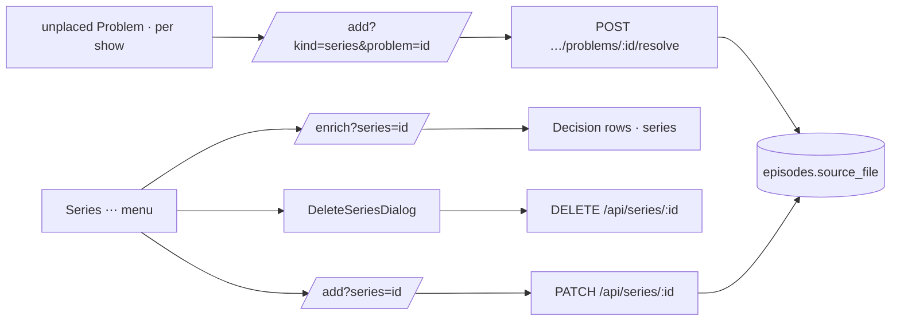

# 38 — Title editing

> **Initiative:** `title-editing` (replaces `episode-links`, `edit-series` and
> `delete-series`)
> **PRD:** `docs/PRDs/38-title-editing.md` (to be written)
> **Plan:** `docs/PRDs/38-title-editing-plan.md` (to be written)

This log is the `grill-me` session that settled step 21 of the build order.
Log 32 had planned it as three steps, 21–23. It was held before the PRD was
written, against the code as it stood on 2026-10-11 after step 20's refactor
(`0516276`), and it is an immutable snapshot of that moment. The session ran
alone, and the maintainer approved every recommendation in advance. Their
brief: _episode-links, edit-a-series, delete-a-series. … i want to combine
all these features to one. everything we do for series is also for movies.
for example edit a movie would be if tmdb doesnt find a match, the user gets
the oppertunity to maybe change the movies title for a better match. (during
testing some movies dont upload because tmdb didnt find a match).
edit-a-series is also a part of episode-links._

## Background

Log 32 Q1a–Q1g and Q7a–Q7c settled the three steps. Those answers still
stand except where a question below amends them:

- **Episode links (step 21):** the **Episode word** (`Episode 12`, `Ep 12`,
  `E12`, read only where the season is known). One `unplaced` **Problem** per
  show, whose _Resolve_ opens the **Movie form**'s series kind in import
  context, with one **Episode file row** per video under the **Numbering
  guess**. The numbers are an **Episode link**, and the file is never
  renamed. Migration 8's `episodes.source_file` remembers it.
- **Edit a series (step 22):** a ⋯ menu on the series page, the form's series
  edit job at `/add?series=<id>`, and `PATCH /api/series/:id`.
- **Delete a series (step 23):** the ⋯ menu's Danger row, a dialog, and
  `DELETE /api/series/:id`.

What the code does today, read before each answer:

- **A film can be fixed in the app, and a series cannot.** `EditMenu`
  (`features/movie-detail/`) offers _Edit details_, _Fetch from TMDB_ and
  _Delete movie_. `SeriesDetail` has no menu at all.
- **A series TMDB can't match goes nowhere.** `lookUp` turns a film that is
  not Confident into an `ambiguous` or `missing` **Decision**.
  `lookUpSeries` returns `unsettled` with no Decision, and the run only logs
  it (`createEnrichment.ts:692`: _"A series' review would write a film: it
  is left for a later Sync."_). A later Sync searches the same title again
  and fails the same way. `held(id)` (`:867`) looks every Decision up with
  `storage.getMovie`, so `search`, `pick` and `apply` are film-only.
  `writeSeries` plans with `scope: 'missing'` whatever the run's scope, so a
  series never raises a **Field conflict**.
- **A pick never fixes the title.** The `missing` face's **Title search**
  queries TMDB with what was typed. `pick` then writes the ten **Enrich
  fields**, and the title is not one of them. A film imported as
  `Heat 1995 1080p BluRay` keeps that title after the match.
- **A wrong match sticks.** `lookUp` searches only while `tmdb_id` is null.
  Once a film is matched (wrongly or not), fixing its title in the form and
  pressing _Fetch from TMDB_ fetches the same TMDB id again. Nothing on screen
  can unlink it.
- **A film folder with two videos has nothing to choose from.** `matchRows`
  files it as `no-video` (`matchRows.ts:121`), and `filesOf` leaves the
  **Found files**' video out whenever there are two (`createImporter.ts:246`).
  So the Resolve form opens with an empty video slot, and the browser picker
  cannot reach the run's root.
- **The `single` scope is film-only.** `StartEnrichment` and `EnrichmentRun`
  carry `movieId`, and `titlesFor` reads only `getMovie` (`:784`).
- `episodes` is `UNIQUE (series_id, season_number, episode_number)`
  (migration 4). Migrations run to 7.

## Problem

Combine log 32's last three steps into one initiative, and make it hold both
ways: **anything that can be done to a film can be done to a series, and the
reverse.** The maintainer's example is the film half: a title TMDB can't
match should be fixable in the app, so the next search finds it.

## Questions and Answers

### Shape

**Q1. One step or three?**
✅ One initiative, `title-editing`: one log, one PRD, and one step in the build
order, **21 — Title editing**. Steps 22 and 23 leave the chain, so the third
chain ends at 21. The PRD's issues are still thin vertical slices (§
Implementation Plan). A _title_ here is the enrichment code's word for a film
or a series (`type Title`, `createEnrichment.ts:60`), which is why it names
the initiative. ❌ Three PRDs: Edit a series reuses the Episode link's rows,
and Delete hangs off the same ⋯ menu, so three PRDs would each re-explain the
other two.

**Q2. What does "everything for series is also for movies" mean, exactly?**
✅ The **Title parity** rule, applied to three surfaces:

| Surface                 | Film today                            | Series today                   | After                                        |
| ----------------------- | ------------------------------------- | ------------------------------ | -------------------------------------------- |
| ⋯ menu                  | Edit details, Fetch from TMDB, Delete | none                           | the same three on the series page            |
| Sync review (Decisions) | `ambiguous`, `missing`, `conflict`    | a log line only                | the same three for a series                  |
| Import Resolve          | every hard kind but `unplaced`        | none (`unplaced` is Skip-only) | `unplaced` resolves; a film's videos offered |

Where the two kinds really differ, they stay different: a film has no
episodes, and a series has no single video. Parity means the same actions,
not the same fields.

### The film half: a title TMDB can't match

**Q3. How does the maintainer give a film "a better title for a match"?**
✅ Two ways, and both already have a surface:

1. **In the review.** The `missing` row's Title search is where a better
   title gets typed. What is new is the **Title fix**: a pick from a
   `missing` or `ambiguous` row writes the picked **Candidate**'s title as
   the title, plus its year when ours is blank. That row exists only because
   our title did not match, and the card the maintainer pressed showed
   TMDB's title. A Confident match never touches the title, and neither does
   a `conflict` row: the title is not an Enrich field, and it raises no Field
   conflict.
2. **Afterwards.** ⋯ → _Edit details_ to fix the title, then ⋯ → _Fetch from
   TMDB_. Q4 is what makes this second press search again.

❌ Making `title` an eleventh Enrich field: every _Everything_ Sync would then
raise a conflict for each title the household spelled its own way (a Dutch
title, `The` left off). ❌ An _Edit details_ link on the Decision row: it
leaves the review mid-list, and the search box already is the edit.

**Q4. Does an edit unlink a wrong match?**
✅ Yes. A form save that changes the **title or the year** clears `tmdb_id`,
for a film (`PATCH /api/movies/:id`) and a series (`PATCH /api/series/:id`)
alike. The match was made by that title and year, and now they have changed.
The next _Fetch from TMDB_ searches again. The fields the wrong match filled
stay: they are now the household's, and an _Everything_ Sync shows them as
conflicts. ❌ An _Unlink TMDB_ menu item: it is a control for something the
household can't see, and fixing the title is what they actually do.

**Q5. "Some movies don't upload": is anything lost?**
✅ No, and the review's copy should say so. A film TMDB can't match is already
in the library, with whatever the sheet or the folder gave it. It is missing
its art and synopsis, not its place in the library. The `missing` reason stays
_No result on TMDB_. The Title search's caption names the fix: _Try another
title — the one you pick becomes its title._ The wording is settled in the
`feat.EnrichmentFlow` revision.

### The series half of the review

**Q6. Does a series get Decisions?**
✅ Yes, the same three kinds as a film:

- `lookUpSeries` returns its Decision the way `lookUp` does, with
  `decisionFace` over TV results. It gets a TV variant that reads `name` and
  `first_air_date`, the way `fetchedTvFields` already reads TV results.
- `writeSeries` plans under the run's own scope. Under _Everything_, a series
  raises Field conflicts the way a film does, and _Apply choices_ writes them.
- `decided` maps a Decision id to a **title reference**,
  `{ kind: 'movie' | 'series'; id }`, instead of a movie id. `held`, `search`,
  `pick` and `apply` branch on that kind: `searchTv` and `writeSeries` for a
  series. The Title fix (Q3) applies to a series too.

The `Decision` on the wire is unchanged: nothing the row draws depends on the
kind. ❌ Adding `kind` to the wire `Decision`: no surface reads it.

**Q7. Can a single series be synced?**
✅ Yes. It was out of scope in log 32, and parity brings it in. Log 33's rule,
read for a series:

- `StartEnrichment` and `EnrichmentRun` gain `seriesId?: string`, beside
  `movieId`. A `single` run carries exactly one of the two.
- `enrichPath({ series })` → `/enrich?series=<id>`. The flow re-attaches
  only to a `single` run for that series. The **Waiting run**, the **Let-go
  line** and the **Busy notice** work as they do for a film.
- The scope card reads _Just this series_.
- _Back_ and _Done_ land on the series page.
- `400` for a series the library does not hold, the film's `no-movie` read as
  `no-title`.

### The series ⋯ menu

**Q8. Where does it live, and what does it hold?**
✅ `features/series/SeriesEditMenu/`, mirroring `EditMenu`: _✎ Edit details_
(→ `movieFormPath({ series })`), _⟳ Fetch from TMDB_
(→ `enrichPath({ series })`), and the Danger row _🗑 Delete series_, which
opens `DeleteSeriesDialog`. It sits in the series hero's corner, where the
movie page's sits, and only on the series page: the season page is a child of
it, not a title. ❌ Promoting `EditMenu` to `components/`: it navigates and
opens a feature's dialog, which is business logic. The two menus share
`CornerMenu`'s furniture. If the refactor finds them identical, it extracts
them then.

### Edit a series

**Q9. The job's URL and landing?**
✅ `/add?series=<id>`, the **Series edit job**, the fifth job on the Movie
form's one URL. `movieFormPath` learns `{ series }`. Its **Landing** is the
series page. Like a film edit, it has no Kind tabs. `?series=` beside
`?problem=` is the Series Resolve's join case (Q14), and `?problem=` wins, as
it already does over `?movie=`.

**Q10. What does it show?**
✅ The shared fields prefilled from the series, its poster, and one Episode
file row per held episode in season then episode order. Each row shows the
episode's numbers and title, its subtitles and its ✕. The mono line shows its
**Source file** when it has one, else the stored video's name. That is the
Episode link, drawn again for editing. _＋ Add episode files_ appends picked
rows. A held file is a `stored` **File slot**, and only a freshly picked one
travels as bytes (the movie edit's rule).

**Q11. The wire?**
✅ `PATCH /api/series/:id`, multipart and atomic, like `POST /api/series`.
`seriesFormBody` reads the same parts. Each `episode` field gains an optional
`id`:

- **With an id:** a held episode, renumbered or retitled. Its video and
  subtitles are stored paths, or a picked replacement.
- **Without an id:** a new episode.
- **A held id the body leaves out:** the episode is removed.

`404` for a series not held. `400` for an `id` the series does not hold, one
sent twice, or anything the add refuses. The **Save gate** is the series gate.
Every refusal rolls back the whole edit, and that includes the files stored
from bytes on the way (the add's rollback).

**Q12. Renumbering two episodes into each other's numbers?**
✅ One transaction, in two passes: first every held episode being renumbered
moves to a negative placeholder (`-1`, `-2`, …), then each takes its new
number. `UNIQUE (series_id, season_number, episode_number)` never sees a
duplicate in between. The numbers stay a gate rule: the form refuses a pair
twice before anything is sent, and the route refuses it too.

**Q13. What does an edit keep?**
✅ An episode keeps its id. So a renumbered or retitled episode keeps its
watch state, resume position and stills, because it is the same episode.
Replacing its video keeps the watch state too, the movie edit's rule.
A removed episode's row (and its `episode_subtitles`) goes in the
transaction, and its files are removed best-effort after the commit (the
Delete's cleanup precedent). Q4's title rule applies. ❌ Resetting the watch
state on a renumber: the household watched that file, whatever its number.

### Episode links, resolved

**Q14. The per-show `unplaced` Problem's shape?**
✅ Log 32 Q1e, with the file list in the right place. The `ImportProblem`
row gains nothing: its title is the show's and its reason the count
(_24 episodes need numbers_). The list goes on the **Problem detail**, as
`files.videos: string[]`, every Unplaced video as an absolute path in name
order. That is also the film half of parity (Q16). `ProblemRow` gives
`unplaced` a _Resolve_ (`/add?kind=series&problem=<id>`). Opened on a show
already held, the form also carries `?series=<id>`. Its fields come from the
held series, its rows are only the Unplaced videos, and the gate also refuses
a number the series already holds.

**Q15. The resolve wire?**
✅ The one route, `POST /api/import/current/problems/:id/resolve`. It reads
the body with `seriesFormBody` when the Problem is `unplaced` and with
`movieFormBody` otherwise. `found` paths copy from under the run's root only
(the film Resolve's rule). A save creates the series or joins the held one,
records each **Source file**, and takes the Problem off the list.

**Q16. A film folder holding two videos: the film's parity case?**
✅ The same `files.videos` list. `filesOf` lists every video, and still sets
`video` only when there is exactly one. The film form's video slot draws the
**Found-file choice** when `videos` has more than one: the names as options,
the first preselected, the picker kept beside them. The `no-video` reason for
two videos becomes _Two videos — pick the film._ A folder with no video stays
as it is. The browser picker can't reach the run's root, so the slot is the
only way.

**Q17. The Source file's reach?**
✅ Log 32 Q1d, made exact. `episodes.source_file` (migration 8, `TEXT`,
nullable) holds the video's path relative to its series' **Source folder**,
with forward slashes. It is written by every path that knows one: a sheet
import, a Folder scan and a Series Resolve. It is not written by the form's
add or a freshly picked file in an edit, because a browser gives no path, so
it is `null` there. An edit keeps it for every held file left in place. A
scan of a held series treats a video as **Already in library** when its
Source file is held, before it checks the Episode tag. Films need no column:
`movies.source_folder` already makes a held film's folder Already in library.

### Delete a series

**Q18. The dialog and the wire?**
✅ Log 32 Q7c. `DeleteSeriesDialog` on `Modal`, worded the movie dialog's way:
_Delete “F'ck That's Delicious”?_ / _This can't be undone._ / _The series and
its 24 episodes leave your library, and the videos, posters and subtitles
FamilyFlix copied are deleted. Its watch history goes with it. The original
files are not touched._, then _Delete series_ (_Deleting…_ in flight) and
_Cancel_. `useDeleteSeries` goes back through `useGoBack` with the Series tab
as its Landing. `DELETE /api/series/:id` → `204` or `404`, and the cascade
already takes episodes, genres and subtitles. Then
`createMedia.removeSeriesFolder(storedPath)` cleans up best-effort, one
directory above an episode's season folder (`storeInSeriesFolder`'s
reading). It takes no `409` guard, the movie delete's precedent.

### Prototype and order

**Q19. Which prototype revisions come first?**
✅ Before any build:

- `page.SeriesPage`: the ⋯ menu and the Delete dialog.
- `feat.MovieForm`: the series edit job, the Series Resolve, and the film's
  Found-file choice.
- `feat.ImportFlow`: the `unplaced` row with _Resolve_.
- `feat.EnrichmentFlow`: _Just this series_ and the Title search's caption.

**Q20. The build order inside the step?**
✅ Smallest and most self-contained first. Each slice works end to end:

1. **Delete a series:** the series ⋯ menu with its one Danger row, the
   dialog and `DELETE`.
2. **Fetch a series:** the `single` scope for a series, and the menu's
   second item.
3. **Series in the review:** series Decisions, the title reference, series
   conflicts under _Everything_, and the Title fix for both kinds.
4. **Edit a series:** `PATCH /api/series/:id`, the form's series edit job,
   the menu's first item, and the title-or-year unlink for both kinds.
5. **Source file:** migration 8, written by every import path, read by the
   scan.
6. **Episode word:** `episodeTag` and the `readEpisodeTag` mirror under the
   drift guard.
7. **Series Resolve:** the per-show `unplaced` Problem, `files.videos`, the
   resolve route's series body, and the film's Found-file choice.

## Design

### Chosen and rejected

- ✅ One initiative, step 21. ❌ Three steps: they share their rows and their
  menu.
- ✅ The Title fix on a review pick. ❌ The title as an Enrich field.
- ✅ A title-or-year edit clears `tmdb_id`. ❌ An _Unlink TMDB_ item.
- ✅ Series Decisions behind a server-side title reference. ❌ `kind` on the
  wire Decision.
- ✅ `SeriesEditMenu` in `features/series/`. ❌ `EditMenu` promoted to
  `components/`.
- ✅ Two-pass renumbering in one transaction. ❌ Dropping the UNIQUE index.
- ✅ `files.videos` on the Problem detail, for both kinds. ❌ `videos` on the
  `ImportProblem` row.

### Types

```ts
// src/types/enrichment.ts
interface StartEnrichment {
  /* … */ movieId?: string;
  seriesId?: string;
}
interface EnrichmentRun {
  /* … */ movieId?: string;
  seriesId?: string;
}
// src/types/import.ts
interface ImportProblemDetail {
  /* … */ files: { /* … */ videos: string[] }; // every video, name order
}
// src/types/series.ts
interface Episode {
  /* … */ sourceFile: string | null;
}
// server: createEnrichment
type TitleRef = { kind: 'movie' | 'series'; id: string };
const decided = new Map<string, TitleRef>();
// server: the series edit body's episode field
interface EpisodeEdit {
  id?: string;
  season: number;
  number: number;
  title: string | null;
}
```



### Where things live

| Slice | Backend                                                                                                           | Frontend                                                                                                    |
| ----- | ----------------------------------------------------------------------------------------------------------------- | ----------------------------------------------------------------------------------------------------------- |
| 1     | `library/series/write` `deleteSeries`, `createMedia.removeSeriesFolder`, the route                                | `features/series/SeriesEditMenu/`, `DeleteSeriesDialog/`, `useDeleteSeries/`, `api/deleteSeries`            |
| 2     | `createEnrichment` `titlesFor`/`start`, `enrichmentBody`                                                          | `enrichPath({ series })`, `useEnrichmentRun`, `ScopeCard` copy                                              |
| 3     | `createEnrichment` `lookUpSeries`, `held`/`search`/`pick`/`apply`, `decisionFace` TV variant, `writeSeries` scope | `TitleSearch` caption                                                                                       |
| 4     | `library/series/write` `updateSeries`, `seriesFormBody` ids, the `PATCH` route, both edits' unlink                | `useMovieForm` series edit job, `useEpisodeList` held rows, `movieFormPath({ series })`, `api/updateSeries` |
| 5     | migration 8, `library/series/write`, `createImporter`'s held-episode check                                        | `Episode.sourceFile`                                                                                        |
| 6     | `media/episodeTag`, `groupShows`                                                                                  | `readEpisodeTag`                                                                                            |
| 7     | `createImporter` per-show filing, `filesOf`, the resolve route                                                    | `ProblemRow`, `useMovieForm` series import context, `MovieFormFiles` Found-file choice                      |

## Implementation Plan

1. Delete a series: the menu with its Danger row, the dialog, `DELETE`, the
   cleanup.
2. Fetch a series: `seriesId` on start and run, the re-attach rule, the menu
   item.
3. Series in the review: the title reference, series Decisions and
   conflicts, the Title fix.
4. Edit a series: the edit job, `PATCH`, two-pass renumbering, the unlink on
   a title or year change.
5. Source file: migration 8, recorded on import, Already in library by it.
6. Episode word: the reader and its client mirror.
7. Series Resolve: one Problem per show, `files.videos`, the series body on
   the resolve route, the film's Found-file choice.

## Trade-offs

- **Easier:**
  - Every title can be fixed, re-fetched or removed in the app, whatever its
    kind.
  - A wrong or missing TMDB match is one search away, and its title comes out
    clean.
  - A show with any file naming can be numbered without touching the disk.
- **Harder:**
  - `createEnrichment` branches on kind in four more places.
  - `useMovieForm` grows to five jobs (add, edit, resolve, series edit,
    series resolve). It was already flagged for its refactor (log 32), and
    this step's refactor is when that happens.
  - Renumbering needs the two-pass write.
  - An episode is now recognised two ways on a scan.
- **Out of scope:**
  - Renaming source files.
  - Editing numbers from the Season page.
  - Moving an episode to another series.
  - A series-level Source file chooser for a show split over two folders.
  - TMDB's title overwriting the household's on a Confident match.
