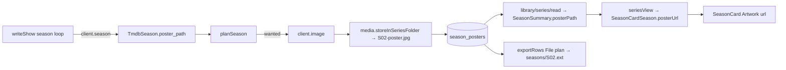

# 39 — Season posters

> **Initiative:** `season-posters`
> **PRD:** `docs/PRDs/39-season-posters.md`
> **Plan:** `docs/PRDs/39-season-posters-plan.md` (to be written)

This log is the `grill-me` session for the first item after the third chain:
the build order's 🔜 **Season posters**, not yet numbered into a chain. It was
held before the PRD was written, against the code as it stood on 2026-10-12
(`4d6679b`), and it is an immutable snapshot of that moment. The session ran
alone, and the maintainer approved every recommendation in advance. Their
brief: _season-poster. do this one alone, i approve all your recommendations.
keep in mind, we want to keep the codebase consistent with our naming and code
conventions/patterns/architecture._

## Background

Log 22 (`22-series.md`, _Ruled out_) left season posters out because
"offline has no source". Enrichment is that source now, so this reopens that
one ruling and nothing else in log 22. Here is what the code does today:

- `writeShow` (`server/src/enrichment/createEnrichment/createEnrichment.ts`)
  asks `client.season(apiKey, tmdbId, n, signal)` for every season on disk
  except season 0. `TmdbSeason` (`tmdbClient.ts`) reads only `season_number`
  and `episodes`, so TMDB's `poster_path` on that answer is dropped. **No new
  request is needed.**
- A season is a number (log 22 Q3). There is no `seasons` table. Migration 4
  made `series`, `episodes`, `series_genres` and `episode_subtitles`, and the
  latest is migration 9.
- A **Still** is the precedent for art a Sync adds below the show. It is
  planned by the pure `planEpisode`, wanted only under the Poster chip and only
  when none is held, and never replaced, whatever the scope. It is stored with
  `media.storeNamed` beside the episode as `<stem>.still.jpg`, and logged
  `↓ name  →  stored`. A still that cannot be stored leaves the gradient drawn.
- The series' own poster and backdrop go through `storeSeriesImage` →
  `media.storeInSeriesFolder(video, 'poster.jpg', …)`, into the **Series
  folder** above the season folders.
- A series renumber (log 38, the **Two-pass renumber** in
  `library/series/write/`) moves no file. So an episode numbered S02 can sit
  in `season-01/`, and "beside the season's first episode" does not name the
  season's folder.
- `SeasonCard` (`components/SeasonCard/`, `mol.SeasonCard` 1:1) draws
  `<Artwork g1 g2 />`, the plain gradient, with the `S02` numeral over it in
  white with a text shadow. The Season card is named in `Artwork`'s comment as
  one of the frames that is **not** a **Poster surface**.
- `SeasonSummary` is `{ number, episodes, next }`, and `SeasonCardSeason` is
  `{ number, label?, episodeCount, watchedCount, g1, g2 }`. `EpisodeRowEpisode`
  carries `stillUrl?: string | null`, mapped through `imageUrl`.
- The **Write targets** write posters for films only. `writePoster` is called
  on the movie path alone, and a series' poster is never written back.
- An **Export** with _Images_ on carries each series' poster and backdrop, and
  each still under `stills/<Episode tag>` in the title's folder. The Titles
  sheet has sixteen columns and the Episodes sheet nine.
- `db/resetDatabase`'s guard refuses a table that is in neither
  `ERASED_TABLES` nor `KEPT_TABLES`.
- `fullDetails` reads the title's own columns only. Stills do not count
  toward **Full details**.

## Problem

Every Season card is the same gradient with a different numeral. TMDB has a
poster per season, a Sync already asks for it, and the app throws it away.
Where does a season's poster live with no `seasons` table, how does a Sync
fill it, and what does the card draw?

## Questions and Answers

**Q1. Where is a season poster recorded? Do we add a real `seasons` table,
add a `season_posters` table, or put a column on `episodes`?**
A ✅ A `season_posters` table in **migration 10**:
`(series_id TEXT NOT NULL REFERENCES series(id) ON DELETE CASCADE,
season_number INTEGER NOT NULL, poster_path TEXT NOT NULL,
PRIMARY KEY (series_id, season_number))`. It keeps log 22 Q3, where a season
is a number, and it is additive. A row exists only for a season that has a
poster, so nothing has to be backfilled. The name follows `series_genres` and
`episode_subtitles`: owner, then what it holds.
❌ A `seasons` table. It overturns log 22 Q3 for one nullable column, and
every insert, renumber and delete of an episode would have to keep a season
row in step.
❌ `episodes.season_poster_path`. It repeats the poster on every episode, and
it has no home for a season whose episodes are renumbered away.

**Q2. Where does the file go?**
A ✅ In the **Series folder**, named `S02-poster.jpg`: the server's
`spellEpisodeTag(season)` followed by `-poster.jpg`. It is stored with the
existing `media.storeInSeriesFolder(video, name, source)`. Because the
renumber moves no file (Background), the series' own folder is the only place
that is stable for a season. The name is unique per season, is never
`poster.jpg` (the series' own), and follows the Collection folder's
`<video stem>-poster.jpg` shape. It goes when a series **Delete** removes the
Series folder, and when **Factory reset** empties the root. No new `Media`
member is needed.
❌ `season-NN/poster.jpg` through `storeNamed` beside the season's first
episode. After a renumber that episode can sit in another season's folder, and
the two seasons would overwrite each other's `poster.jpg`.

**Q3. When does a Sync fetch a season poster?**
A ✅ It follows the **Still** rule exactly. A new pure unit,
`server/src/enrichment/planSeason/`, the sibling of `planEpisode`:
`planSeason(held: string | null, theirs: TmdbSeason, fields) → { poster:
string | null }`. A poster is wanted only under the Poster chip, only when
none is held for that season, and only when TMDB has one. It is never
replaced, whatever the scope, never a **Decision**, and never a **Field
conflict**. `TmdbSeason` gains `poster_path: string | null`. In `writeShow`'s
season loop, before `writeEpisodes`: plan, then `client.image`, then
`storeInSeriesFolder`, then `storage.setSeasonPoster(seriesId, n, stored)`,
then the usual `↓ S02-poster.jpg  →  <stored>` log line. A failure to fetch or
store leaves the gradient, the way a failed still does. Season 0 is never
asked, as today. Every way into `writeShow` gets it at no extra cost: the
library Sync, _Fetch from TMDB_ on the series page, and a series' `pick` and
_Apply choices_.

**Q4. Where does the storage live, and what does the read carry?**
A ✅ In `library/series/`, one unit per concern:

- `enrich` gains `setSeasonPoster(seriesId, season, posterPath)` (an upsert)
  and `seasonPosterOf(seriesId, season): string | null`. `writeShow` uses the
  second to give `planSeason` its `held`.
- `read` joins `season_posters` into the series page's read.
  `SeasonSummary` gains `posterPath: string | null`, a **Stored path**.

The `fakeTmdb` season builder gains `poster_path`, `null` by default, so
today's suites do not change.

**Q5. What does the Season card draw?**
A ✅ The season's poster through `Artwork`'s `url`, over the series' gradient,
with the `S02` numeral kept over the art. The numeral's text shadow was drawn
for exactly that. With no poster it draws the gradient alone, as today.
`SeasonCardSeason` gains `posterUrl?: string | null`, the twin of
`EpisodeRowEpisode.stillUrl`, which `seriesView` maps through `imageUrl`. The
card stays a non-**Poster surface**, so it never draws the **Default poster**.
Its numeral already says what the tile is, and a Wordmark under `S02` would
be noise.
❌ Falling back to the series' poster. Every season would then look the same
with a different numeral, which is the problem this solves. And the Still has
no such fallback either.
❌ Hiding the numeral when there is art. TMDB's season art rarely spells the
season, and the card's job is to say which one it is.

**Q6. Is the prototype amended?**
A ✅ Yes, first, by the rule in "The prototype is the spec".
`mol.SeasonCard.dc.html`'s `season` tsType gains `posterUrl?: string | null`,
its tile draws the image over the gradient when the url is given, and the
numeral is unchanged. `page.SeriesPage`'s sample data gives one season an
image so the state is drawn. This is the PRD's first slice, before any code
draws it.

**Q7. Does the Season page show it too?**
A ❌ No. The Season page's header is the `PageHeader` with the series as
eyebrow, and it has no art frame. Adding one would redesign a screen to give
the poster a second home. The card is where seasons are chosen.

**Q8. Is a season poster a Write target?**
A ❌ No. The series' own poster is not one either: `writePoster` runs for
films alone. Season posters follow the series, not the film.

**Q9. Does it travel in an Export?**
A ✅ Yes, under _Images_, which is "posters, backdrops and stills", and a
season poster is a poster. It lands in the title's folder as
`seasons/S02.<ext>`, beside `stills/`, through the same **File plan** and
`Media.readStored`. An unreadable file is skipped. **No column is added.** The
sixteen Export columns and the nine Episodes columns are fixed (log 31). There
is no Seasons sheet, and the importer reads no art cell for a season, so the
round trip is unchanged. `exportRows` takes the season posters beside the
series it is given.
❌ A `Season posters` column. It would change a fixed column list and the
round trip for a file nothing reads back.

**Q10. Housekeeping: reset, delete, renumber, Full details?**
A ✅

- **Factory reset**: `season_posters` joins `ERASED_TABLES`. The guard
  demands it.
- **Series delete**: `ON DELETE CASCADE` removes the rows, and
  `removeSeriesFolder` removes the files.
- **Series edit**: a renumber or removal leaves the rows alone. A poster
  belongs to season N of the show, not to whichever files are numbered N. A
  row for a season with no episodes is never read, because the read joins by
  the seasons that exist.
- **Full details**: unchanged. Season posters, like stills, are not a field
  and do not count toward it. `ENRICH_FIELDS` is unchanged too. The Poster
  chip governs them.

## Design



```ts
// server/src/enrichment/tmdbClient/tmdbClient.ts
export interface TmdbSeason {
  season_number: number;
  poster_path: string | null;
  episodes: TmdbSeasonEpisode[];
}

// server/src/enrichment/planSeason/planSeason.ts — pure
export interface SeasonPlan {
  poster: string | null;
}
export function planSeason(
  held: string | null,
  theirs: TmdbSeason,
  fields: readonly EnrichField[]
): SeasonPlan;

// src/types/series.ts
export interface SeasonSummary {
  number: number;
  episodes: Episode[];
  next: Episode | null;
  /** The **Season poster**'s Stored path; `null` for none. */
  posterPath: string | null;
}

// src/types/viewModels.ts
export interface SeasonCardSeason {
  // …
  /** The **Season poster**, drawn over the Gradient fallback; absent or `null` for none. */
  posterUrl?: string | null;
}
```

- ✅ Migration 10: `season_posters`, with `ERASED_TABLES` updated.
- ✅ `library/series/enrich`: `setSeasonPoster`, `seasonPosterOf`.
- ✅ `library/series/read`: `posterPath` on each `SeasonSummary`.
- ✅ `enrichment/planSeason/` (pure, with its suite), and `writeShow`'s loop.
- ✅ `components/SeasonCard`: `Artwork url={season.posterUrl}`, numeral kept.
- ✅ `features/series/seriesView`: `posterUrl` through `imageUrl`.
- ✅ `import-export/exportRows`: `seasons/<S02>` in the File plan under
  _Images_, with no column.
- ❌ A `seasons` table, an `episodes` column, `season-NN/poster.jpg`, a
  series-poster fallback, Season page art, a Write target, an Export column.

## Implementation Plan

1. **Prototype.** Amend `mol.SeasonCard.dc.html` (the `posterUrl` prop, the
   image over the gradient, the numeral kept) and `page.SeriesPage`'s sample.
2. **Thinnest end to end.** Migration 10 and `ERASED_TABLES`,
   `setSeasonPoster` and the read's `posterPath`, then `seriesView`'s
   `posterUrl` and `SeasonCard`'s art. Proven with a row written directly in
   the storage suite and drawn by the card.
3. **The Sync fills it.** `TmdbSeason.poster_path`, the `fakeTmdb` builder,
   `planSeason`, `seasonPosterOf`, and `writeShow`'s loop with its log line.
   Proven over `createEnrichment.series.test.ts`: fetched once, never
   replaced, skipped without the Poster chip, the gradient kept on a failed
   image.
4. **Export.** `exportRows`' File plan carries `seasons/S02.<ext>` under
   _Images_, and `writeExport` copies them. The round-trip suites are
   unchanged.

## Trade-offs

- **Easier:** no new request, no new `Media` member, no new chip, no new
  Decision kind. The Still's rule is reused whole, so a reader who knows
  stills knows season posters.
- **Harder:** a third place art hangs off a series: the series row, episode
  rows, and now a side table. A poster row can outlive every episode of its
  season. That is harmless and deliberate (Q10).
- **Out of scope:** a Season page art frame (Q7); a season poster picked or
  uploaded by hand in the **Movie form** (the form edits no seasons); specials
  (season 0 stays unasked, as log 22 left it); writing season posters back
  into a **Library folder**; reading a `season01-poster.jpg` from disk during
  import. Each would be its own session.
