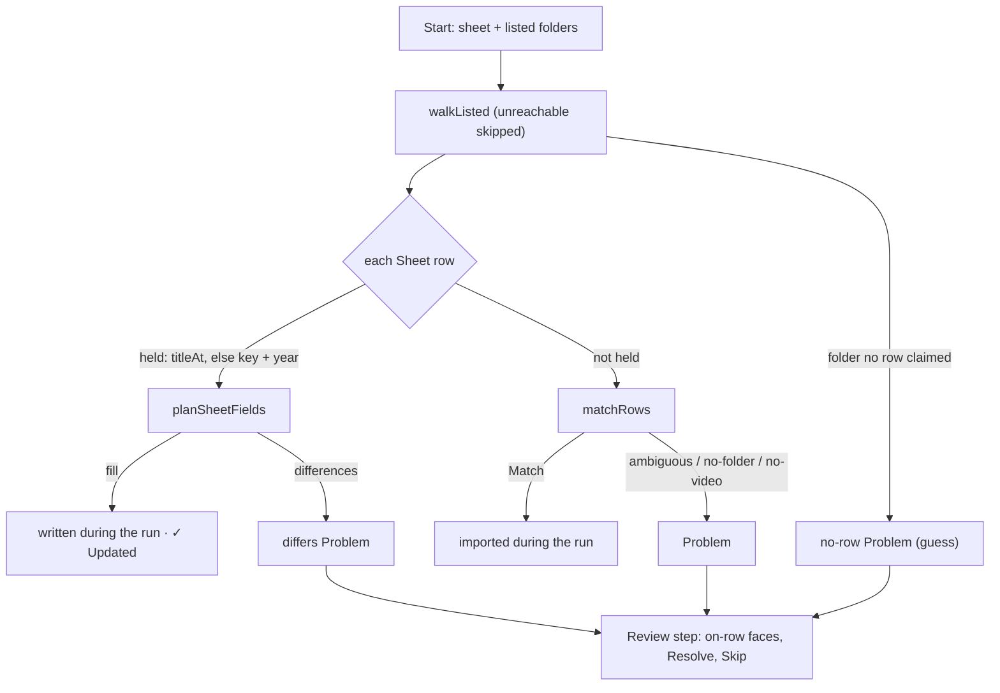

# 40 — Import review

> **Initiative:** `import-review`
> **Issue:** [#328](https://github.com/carlos-rezai/FamilyFlix/issues/328)
> **PRD:** `docs/PRDs/40-import-review.md` (issue 329)
> **Plan:** `docs/PRDs/40-import-review-plan.md` (to be written)

This log is the `grill-me` session for step 23 of the build order, **Import
review**, held before the PRD was written. It ran against the code as it stood
on 2026-10-13 (`19cab5c`), the day #327 shipped. It is an immutable snapshot of
that moment. The session ran alone, and the maintainer approved every
recommendation in advance. Their brief, from the session that filed the step:
_settings › Import from spreadsheet opens up the Scan library folders. We
wanted our folder import and a spreadsheet as CSV or Excel, then a scan showing
if there are any adjustments which need to be made, similar to the TMDB sync._
And for this session: _keep the codebase consistent with our naming and code
conventions/patterns/architecture._

## Background

The first half of the brief was a bug, and #327 fixed it (`e8cdf62`,
`d515ad7`): _Finish_ never let the **Current run** go, so `/import` kept
re-attaching to a finished **Folder scan** in review. This log is the second
half: the import's shape.

What exists:

- **Two starts, one run** (log 30 Q12). `Importer.start(sheet, root, enrich)`
  is a sheet run over **one typed root**, which joins the **Library folders**
  list on Start (log 30 Q19), and is refused when it _holds_ a listed folder.
  `Importer.scan(folders, enrich)` is a **Folder scan** over every listed
  folder, sheetless, each title named off its folder (`guessedRow`). Both end
  in the same **Import phase** (`importPlaced`) and the same **Review step**.
  `ImportRun.source` (`'sheet' | 'folders'`) chooses `/import`'s heading.
- **The two walks are written twice.** `execute` walks the one root;
  `executeScan` walks each listed folder, skips an unreachable one with a
  warning line, and applies log 30 Q14's **Already in library** rule — the
  Source folder on record first (`storage.titleAt`), then the title key and
  year. The sheet run applies only the second.
- **A held title ignores the sheet.** In a sheet run, a row whose title key and
  year the library already holds is skipped with `· Already in library …` and
  its Source folder recorded — nothing else. A row edited in the sheet changes
  nothing in a library that holds the title. The export round trip's _"one
  with a row edited imports the edit"_ (`routes.export.test.ts`) is proven only
  **onto a fresh library**.
- **The Review step** lists **Problems** (`ProblemRow`): seven kinds
  (`no-folder`, `ambiguous`, `no-video`, `no-row`, `failed`, `unplaced` hard;
  `missing-meta` soft), each with **Resolve** (the **Movie form** in **Import
  context**) and **Skip** (**Dismiss**). Nothing is settled on the row itself.
- **The Sync's review** (log 23 Q25, Q42) settles each **Decision** on its
  row: `CandidatePicker` (pick one), `TitleSearch`, and `FieldDiff` — a
  _Yours | TMDB_ row per **Field conflict**, TMDB chosen by default, _Apply
  choices_ / _Keep all mine_. During its run it **fills empty fields at once**
  and raises a conflict only for a filled field that differs.
- **Writes that exist.** `updateMovie(id, patch)` is the general film write
  (rating and genres among its columns); `markWatched`; `enrichSeries(id,
fields)` writes a series' named columns, never its rating; a series' rating
  is written only by the whole-record `updateSeries` of log 38.
- `SheetRow`: `title`, `year`, `endYear`, `genres`, `director`, `cast`,
  `synopsis`, `rating`, `watched`. An absent column reads as `null` / `[]` /
  `false`.

## Problem

Make _Import from spreadsheet_ one import over **the Library folders and a
Sheet** together, whose run ends in a review of the **adjustments** to make,
settled on the row the way a **Sync**'s review settles a Decision. What is an
adjustment, when is anything written, and how much of the import's existing
review changes?

## Questions and Answers

### Scope

1. **Its own initiative?** ✅ **Yes**: `40-import-review.md`, initiative
   `import-review`, one PRD, its issues, build and refactor. It is step 23,
   issue #328.

2. **What is not built?** ❌ A _Browse…_ for the sheet (a file dialog is a new
   preload channel; log 30 Q3's ruling stands — the field stays typed);
   reviewing confident new matches before they import (log 13 Q16 stands,
   Q6); adjustments for episodes (Q9); TMDB in the import (log 13 Q18 stands —
   the _Also fetch_ box still hands _Finish_ to a Sync); a Folder scan reading
   a sheet found inside a Library folder (log 30 Q3 stands).

### Setup

3. **What does the sheet run read?** ✅ **The listed Library folders — every
   one, in the order added — and the Sheet.** The _Movies root folder_ field
   is gone. Import setup draws, in its place, the group **Library folders**:
   each listed folder's path in mono with its title count (or _Can't be
   reached right now_ in `danger`), and _Manage folders_ (`ghost`, `sm`),
   pushing `/settings/folders`. With none listed it draws _No library folders
   yet._ and _Add library folders_ (`secondary`), pushing the same route, and
   _Start import_ stays `disabled`. Read with the existing
   `fetchLibraryFolders`, `null` until it lands (the hub's rule).
   ❌ **Keeping the typed root beside the list**: two ways to name a folder,
   and the second is the one log 30 Q19 had to reconcile with the first.
   ❌ **Drawing `FolderRow`**: its ✕ removes a folder, and setup is not where
   the list is edited.

4. **What happens to log 30 Q19 (the root joins the list) and its `contains`
   refusal?** ✅ **Retired with the field.** `POST /api/import` becomes
   `{ sheetPath, enrich }`. `IMPORT_FIELDS` becomes `['sheet', 'folders']`:
   `400 { field: 'folders', error: 'Add a library folder first.' }` when none
   is listed (setup gates it, the route still says so), drawn as the 13px
   `danger` line under the folders group. `sheetFolderOf` and the `root`
   refusals go. An unreachable folder is skipped with the scan's warning line
   (log 30 Q17), not refused.

5. **One run or two?** ✅ **One importer, two starts, one walk.**
   `start(sheetPath, enrich)` and `scan(enrich)` both walk the listed folders
   through one closure, `walkListed`, extracted from `executeScan` (the
   unreachable skip, the `Scanning   E:\Movies` lines, each scan tagged with
   its Library folder). They differ only in what names a folder: a **Sheet
   row** through `matchRows`, or the folder itself through `guessedRow`. Both
   apply log 30 Q14's two-rule **Already in library**. `ImportRun.source`
   stays, still choosing the heading alone. ❌ **Merging the two entries into
   one screen**: _Scan folders_ is the folders page's own one-press loop
   (log 30 Q29), and a sheet is a different job.

### What is written, and when

6. **When is anything written?** ✅ **Log 13 Q16, unchanged, plus the Sync's
   rule for held titles.** A confident **Match** for a title the library does
   not hold imports during the run, as today. A row for a title it **does**
   hold is no longer skipped: its empty fields are **filled during the run**
   (a **Sheet fill**), and a field filled on both sides that differs waits in
   the review as a **Sheet difference**. Nothing filled in by the household
   is overwritten without a press — the Sync's bargain (log 23 Q24), with the
   sheet in TMDB's place. ❌ **Writing every difference silently**: the
   library is edited in the app too, and a month-old export would undo it.
   ❌ **Holding new imports for review** (log 13 Q16's argument).

7. **Which held titles does a row reach?** ✅ **Any, folder or not.** A row is
   matched against the library before the folders: the held title at the
   row's matched **Source folder** (`titleAt`), else the held title with the
   row's key and year — so a title added through the form, or whose folder
   was not found, still takes its fills and differences. A row matching no
   held title goes on to `matchRows` exactly as today. `· Already in library
…` is still logged; a row with fills logs `✓ Updated    Heat (1995) —
genres, director` (`success`) in its place.

8. **Which fields?** ✅

   | Field (sheet column)   | Fills an empty one | Can differ | Compared                                |
   | ---------------------- | ------------------ | ---------- | --------------------------------------- |
   | Synopsis               | ✅                 | ✅         | trimmed, case-blind                     |
   | Year (a series' range) | ✅                 | ✅         | the spelled **Year range** for a series |
   | Genres                 | ✅                 | ✅         | as a set, after the **Genre pool**      |
   | Director (Created by)  | ✅                 | ✅         | trimmed, case-blind                     |
   | Cast                   | ✅                 | ✅         | as a set                                |
   | Rating                 | ✅                 | ✅         | the number                              |
   | Watched                | ✅ (films only)    | ❌         | —                                       |
   | Title                  | ❌                 | ❌         | —                                       |
   - **Title** is how the row found the title (its key), so a difference can
     only be case or punctuation; the library's spelling stands.
   - **Year** cannot differ for a film (a match requires the years to agree
     when both are known); it can for a series' end year.
   - **Rating** is the household's own, on both sides, so unlike the Sync it is
     in play — filled when empty, a difference when not.
   - **Watched** only ever marks: a row reading _Watched_ marks an unwatched
     film watched (`markWatched`); it never unmarks one and never touches one
     in progress. A sheet with no Status column reads every row unwatched, and
     that must not be a difference on every watched film. A series has no
     watched flag; episodes are not in the sheet.
   - Unknown genres are dropped and logged once, as today, before comparing.

9. **Episodes?** ❌ **No adjustments.** The Episodes sheet is the Export's,
   not the importer's (log 31), and episode numbers are the **Episode link**'s
   (log 38). A held show still gains its new episodes (log 22 Q20).

10. **Who decides fill and difference?** ✅ **A pure unit,
    `server/src/import-export/planSheetFields/`**: `planSheetFields(current,
row, kind) → { fill: Partial<SheetFields>, differences:
SheetDifference[] }`, `planFields`' sibling on the import's side.
    `current` is the held title's values in the same shape; the row's genres
    arrive already read onto the **Genre pool**. It spells its own comparison (trimmed,
    case-blind, sets) rather than importing `enrichment/`'s: the dependency
    runs from `enrichment/` to `import-export/` (`titleKey`), never back. If
    the refactor finds the two comparisons identical, extracting them is its
    call.

11. **What is written, through what?** ✅ **The writes that exist.** A film:
    `updateMovie(id, patch)` with the chosen columns (rating included), and
    `markWatched` for the watched fill. A series: `enrichSeries` for synopsis,
    year range, genres, creator and cast, and a new `setSeriesRating(id,
units)` in `library/series/curation/`, beside the series heart — the one
    write this step adds, because `updateSeries` is a whole-record edit with
    episodes, and `enrichSeries` never touches a rating by design.

### The review

12. **What is an adjustment called?** ✅ **A Problem of a new soft kind,
    `differs`**, carrying its **Sheet differences**. The import's review rows
    stay **Problems** and the Sync's stay **Decisions** (log 23 Q25): two
    reviews, two nouns, as today. Its reason: _The spreadsheet has different
    values for fields you already filled in._ — the Sync's sentence with the
    sheet in TMDB's place. Its dot is `accent`, the Sync's `conflict` dot.
    ❌ **`conflict`**: the glossary lists it as an alias to avoid for both
    **Problem** and **Already in library**, and it is the Sync's Decision
    kind. ❌ **"Adjustment"** as a type: it is the brief's word for the whole
    review, every Problem included, and is kept for the step's name in prose.

13. **What does a Sheet difference carry?** ✅
    `{ field: SheetField; label: string; mine: string; sheet: string }`, both
    sides spelled for display (lists joined with `, `, a rating as stars'
    number, a range through `spellYearSpan`), `FieldConflict`'s shape with
    `sheet` in `tmdb`'s place. `SheetField` is `'synopsis' | 'year' |
'genres' | 'director' | 'cast' | 'rating'`, an `as const` list
    (`SHEET_FIELDS`) on `ENRICH_FIELDS`' precedent. The label for `director`
    is _Created by_ on a series.

14. **How is a `differs` row settled?** ✅ **On the row, as a Sync's conflict
    is.** The _Yours | Spreadsheet_ face, the sheet chosen by default (the
    sheet is what the maintainer just brought in, as TMDB is what they asked
    for), _Apply choices_ → `POST /api/import/current/problems/:id/apply
{ choices }` → `204`, writing the sheet's side of every field chosen so
    and taking the row off; _Keep all mine_ is **Dismiss**, `DELETE …/:id`.
    The row carries `movieId` or `seriesId`, as `missing-meta` and `unplaced`
    already do. No _Resolve_ on it: the form edits a record, not a
    comparison. A difference is never filled again by the run it came from;
    the next run over the same sheet raises it again — the sheet still says
    so (the Sync's own behaviour).

15. **Which other kinds settle on the row?** ✅ **Two, by the same rule — a
    press that needs no form:**
    - **`ambiguous`** draws a **Folder picker**: one card per **Candidate
      folder** (the folder's name, its path in mono, its video count), and
      pressing one imports the row from it →
      `POST …/problems/:id/pick { folder }` → `204`. The folder must be one
      of the Problem's candidates. A candidate holding no video or several is
      still pickable, and the row becomes that folder's `no-video` Problem
      (`200 ImportProblem`, the row redrawn — the Sync's `search` answer),
      whose _Resolve_ is the **Found-file choice**. _Resolve_ stays beside it
      for a pick that wants editing first.
    - **`no-row`** draws _Import as “Ironwood (2018)”_ (`secondary`, `sm`),
      importing the folder under its own name exactly as a Folder scan would
      → `POST …/problems/:id/import` → `204`. _Resolve_ stays beside it.

    `no-folder`, `no-video`, `unplaced`, `failed` and `missing-meta` are
    unchanged: _Resolve_ and _Skip_. ❌ **A search on `no-folder`**: there is
    no folder to search for — the walk already read every listed folder.

16. **What does the snapshot carry for the faces?** ✅ **Optional fields on
    `ImportProblem`, each documented by the kind it is set on** — the
    `movieId?` / `seriesId?` precedent: `differences?: SheetDifference[]`
    (`differs`), `candidates?: CandidateFolder[]` (`ambiguous`; `{ path,
name, videos }`), `guess?: string` (`no-row`; the title and year a
    Folder scan would give it). ❌ **Turning `ImportProblem` into a union**
    like `Decision`: every reader of the seven kinds would move for three
    faces. `ImportProblemDetail.candidates` stays for the form.

17. **The tiles?** ✅ **Unchanged**: _matched confidently and imported_
    counts new imports, _need your attention_ every Problem, `differs`
    included. Fills are in the log, not a tile — the Sync's `enriched` tile
    is the prototype's, and the import's prototype draws two.

18. **The face components?** ✅
    - **`FieldDiff` graduates to `components/FieldDiff/`** on its second
      caller (the `CreditsRow` / `CornerMenu` precedent), generic and
      presentational: rows of `{ key, label, mine, theirs }`, a
      `theirsLabel` (_TMDB_ / _Spreadsheet_), the theirs side chosen by
      default, and `onApply(choices: Record<K, 'mine' | 'theirs'>)`. Each
      feature maps its own wire type onto it — `FieldConflict` and
      `SheetDifference` are untouched, and `enrichment/` maps `'theirs'` back
      to `'tmdb'`.
    - **`FolderPicker/`** in `features/import-export/`, `CandidatePicker`'s
      shape but its own pixels (no poster, no _% match_): a folder is not a
      TMDB candidate, and a shared molecule would carry a mode prop for
      no one (log 23 Q40's argument).
    - **`ProblemRow`** gains the face slot under its head, `DecisionRow`'s
      layout; the faces are chosen by `kind` in the row.

19. **The hook and the api?** ✅ `useImportRun` gains `apply(id, choices)`,
    `pick(id, folder)` and `importAsGuessed(id)` beside `skip`, each taking
    the row off (or redrawing it from a `200`) once the route answers —
    `skip`'s rule; the run is not polled in review. `features/import-export/
api/` gains `applySheetChoices`, `pickCandidateFolder` and
    `importGuessed`, one caller each.

### Names, prototype, and docs

20. **The new terms?** ✅ **Sheet fill**, **Sheet difference**, **Candidate
    folder**, **Folder picker**, and the `differs` kind. **Already in
    library**, **Bulk import**, **Problem**, **Review step** and **Field
    conflict** are amended; **Import review** is the step's name.

21. **Prototype first?** ✅ **Yes**, per _The prototype is the spec_, as the
    PRD's first slice: `feat.ImportFlow.dc.html` — setup's folders group in
    place of the root field (listed, unreachable, none); the review's three
    faces (a `differs` row with three fields, an `ambiguous` row's Folder
    picker, a `no-row` row's _Import as_); `FamilyFlix.dc.html`'s
    `seedProblems` gains a `differs` row. `mol.FieldDiff.dc.html` (new)
    carries the graduated molecule's `data-props`, and `feat.EnrichmentFlow`
    draws it unchanged. `COMPONENT-SPEC.md` gets the molecule and the two
    feature units.

22. **Which documents change?** ✅ README's and CLAUDE.md's _Bulk Import_
    section (the root becomes the Library folders; held titles take fills and
    differences), the Settings Hub's `/api/import` lines, and step 23's entry,
    which now points here. The glossary per Q20.

## Design

### Chosen and rejected

- ✅ The sheet run over every listed Library folder; the typed root retired (Q3, Q4)
- ❌ A typed root beside the list; `FolderRow` with its ✕ on setup
- ✅ One walk, `walkListed`, for both starts; log 30 Q14's two rules for both (Q5)
- ✅ New matches import during the run; held titles filled during it; differences reviewed (Q6)
- ❌ Writing differences silently; holding new imports for review
- ✅ A held title reached with or without a folder (Q7)
- ✅ Rating in play; watched fill-only; title never (Q8)
- ✅ `differs`, a soft Problem kind, with **Sheet differences** (Q12, Q13)
- ❌ `conflict`; a Decision in the import; "Adjustment" as a type
- ✅ On-row faces for `differs`, `ambiguous`, `no-row`; the rest keep Resolve (Q14, Q15)
- ✅ `FieldDiff` graduated to `components/`, generic; `FolderPicker` feature-local (Q18)
- ❌ A shared candidate picker; `ImportProblem` as a union; a sheet _Browse…_

### Shapes

```ts
// src/types/import.ts
export const IMPORT_FIELDS = ['sheet', 'folders'] as const;

export type ProblemKind =
  | 'no-folder'
  | 'ambiguous'
  | 'no-video'
  | 'no-row'
  | 'failed'
  | 'unplaced'
  | 'missing-meta'
  | 'differs';

export const SHEET_FIELDS = [
  'synopsis',
  'year',
  'genres',
  'director',
  'cast',
  'rating',
] as const;
export type SheetField = (typeof SHEET_FIELDS)[number];

/** One field a held title and its **Sheet row** both fill, differently. */
export interface SheetDifference {
  field: SheetField;
  label: string;
  mine: string;
  sheet: string;
}
export type SheetChoices = Partial<Record<SheetField, 'mine' | 'sheet'>>;

/** One folder an `ambiguous` row weighed. */
export interface CandidateFolder {
  path: string;
  name: string;
  videos: number;
}

export interface ImportProblem {
  // …as today, plus:
  /** Set on `differs`. */
  differences?: SheetDifference[];
  /** Set on `ambiguous`. */
  candidates?: CandidateFolder[];
  /** Set on `no-row`: the title and year a Folder scan would give it. */
  guess?: string;
}

// server/src/import-export/createImporter/createImporter.ts
start(sheetPath: string, enrich?: boolean): Promise<ImportRun>; // was (sheet, root, enrich)
scan(enrich?: boolean): Promise<ImportRun>; // reads the list itself
apply(id: string, choices: SheetChoices): boolean;
pick(id: string, folder: string): Promise<ImportProblem | null | false>; // null: imported; false: not found
importGuessed(id: string): Promise<boolean>;

// server/src/import-export/planSheetFields/planSheetFields.ts — pure
export function planSheetFields(
  current: SheetFields,
  row: SheetRow,
  kind: 'movie' | 'series'
): { fill: Partial<SheetFields>; differences: SheetDifference[] };
```

### Routes

| Route                                                     | Answer                                                          |
| --------------------------------------------------------- | --------------------------------------------------------------- |
| `POST /api/import { sheetPath, enrich }`                  | `201 ImportRun` · `400 { field: 'sheet' \| 'folders' }` · `409` |
| `POST /api/import/current/problems/:id/apply { choices }` | `204` · `400` · `404`                                           |
| `POST /api/import/current/problems/:id/pick { folder }`   | `204` imported · `200 ImportProblem` redrawn · `400` · `404`    |
| `POST /api/import/current/problems/:id/import`            | `204` · `404`                                                   |

The rest of `/api/import` is unchanged. The bodies are read by
`routes/importBody/` (`enrichmentBody`'s precedent), each `400` a sentence.

### The units

| Unit                   | Where                                                | What changes                                                                             |
| ---------------------- | ---------------------------------------------------- | ---------------------------------------------------------------------------------------- |
| `createImporter`       | `server/src/import-export/createImporter/`           | `walkListed`; `start` over the list; held rows planned; `apply`, `pick`, `importGuessed` |
| `planSheetFields`      | `server/src/import-export/planSheetFields/` (new)    | pure: fill and differences                                                               |
| `setSeriesRating`      | `server/src/library/series/curation/`                | the series' rating write                                                                 |
| routes, `importBody`   | `server/src/routes/`                                 | the start's new body; the three Problem writes                                           |
| types                  | `src/types/import.ts`                                | Q16's shapes                                                                             |
| `FieldDiff`            | `features/enrichment/` → `src/components/FieldDiff/` | graduated, generic, `theirsLabel`                                                        |
| `ImportSetup`          | `src/features/import-export/ImportSetup/`            | the folders group in place of the root field                                             |
| `ProblemRow`           | `src/features/import-export/ProblemRow/`             | the face slot; three faces by kind                                                       |
| `FolderPicker`         | `src/features/import-export/FolderPicker/` (new)     | the Candidate folder cards                                                               |
| `useImportRun`, `api/` | `src/features/import-export/`                        | `apply`, `pick`, `importAsGuessed`; their three calls                                    |
| `ImportFlow`           | `src/features/import-export/ImportFlow/`             | the root's state and refusal gone; the folders read                                      |

### The run



## Implementation Plan

1. **Prototype.** Amend `feat.ImportFlow.dc.html` and `FamilyFlix.dc.html`,
   add `mol.FieldDiff.dc.html`, update `COMPONENT-SPEC.md` (Q21).
2. **The sheet over the folders.** `walkListed` extracted from
   `executeScan`; `start(sheetPath, enrich)` over the list with both
   Already-in-library rules; `IMPORT_FIELDS` and the `folders` refusal;
   `ImportSetup`'s folders group; the root field, `sheetFolderOf` and the
   `contains` refusal gone. A sheet run over two listed folders imports both
   folders' films.
3. **Fills and differences.** `planSheetFields`, `setSeriesRating`, the held
   row planned with and without a folder, `✓ Updated`, the `differs` Problem
   and its `differences`; `FieldDiff` graduated; `ProblemRow`'s face slot and
   the `differs` face; the `apply` route and hook. An edited export row,
   imported onto the library it came from, lands as a difference; _Apply
   choices_ writes it.
4. **The other two faces.** `CandidateFolder` on the snapshot, `FolderPicker`
   and the `pick` route (with the `no-video` redraw); `guess`, _Import as_
   and the `import` route.
5. **Docs.** README, CLAUDE.md and the glossary per Q22 — ticked ✅ only
   after the refactor.

## Trade-offs

- **Easier:** one list of folders feeds both imports, so the sheet and the
  folders page can never disagree about where the library lives. The sheet
  becomes a way to **edit** the library, not just to seed it — the export
  round trip finally holds on a library that already has the titles. The
  review settles most rows with one press, the way the Sync's does.
- **Harder:** the importer gains a planning step for held titles and three
  more Problem writes; `ImportProblem` grows three optional fields read by
  kind. A held title is now written by an import, so a stale sheet can
  propose undoing in-app edits — every one of them a difference the
  maintainer must press, never a silent write.
- **Accepted:** _Keep all mine_ does not stick — the next run over the same
  sheet asks again, until the sheet or the library changes (an Export
  settles it). An `ambiguous` pick into a several-video folder costs a second
  step on the form.
- **Ruled out:** a sheet _Browse…_; reviewing new imports before they
  import; episode adjustments; TMDB in the import; a candidate search on
  `no-folder`; unmarking watched films from a sheet.
