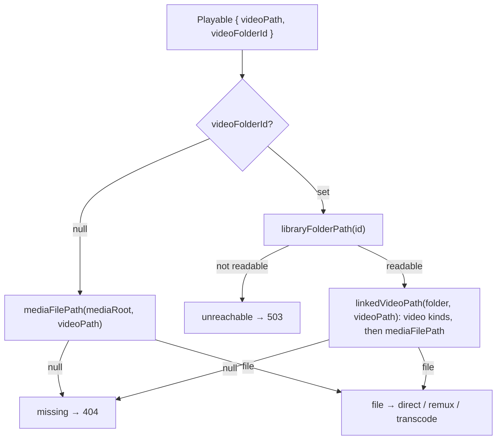

# 41 — Link or copy

> **Initiative:** `link-or-copy`
> **Issue:** to be filed (step 24)
> **PRD:** `docs/PRDs/41-link-or-copy.md` (to be written)
> **Plan:** `docs/PRDs/41-link-or-copy-plan.md` (to be written)

This log is the `grill-me` session for step 24 of the build order, **Link or
copy**, held before the PRD was written. It ran against the code as it stood
on 2026-10-14 (`e0886cd`). It is an immutable snapshot of that moment. The
session ran alone, and the maintainer approved every recommendation in
advance, asking that the codebase stay consistent with its naming, code
conventions, patterns and architecture. Its input was step 24's roadmap entry
(`e0886cd`), whose points were "the input to grill-me, not decisions".

## Background

Importing five real series (3–8 seasons, 8–20 episodes each) was slow and
doubled the disk: every import is a **Managed copy**. Log 11 chose copying
because a browser file picker yields bytes and never a path, and log 13 kept
it for **Bulk import** because the source folders were going away. Neither is
true of a **Library folder** (log 30): it is listed, rescanned, and stays.

What exists:

- **Every file the app delivers is a Stored path** — relative to the
  **Managed media directory**, resolved by `playback/mediaFilePath/`, the one
  check between a string in the database and an open file (realpath
  containment, absolute refused, one `null` for every failure).
  `Playback.videoFile(storedPath)` and `subtitleFile(storedPath)` both go
  through it; `/api/images/<path>` serves art under the same root.
- **A title's managed folder is found through its video.** `Media.storeNamed`
  (a Sync's poster, backdrop and stills), `storeInSeriesFolder`,
  `openFolder`, `openSeriesFolder`, `removeMovieFolder` and
  `removeSeriesFolder` all read the **Movie folder** or **Series folder** off
  the video's Stored path — its directory, or two directories up for an
  episode. The importer finds a held show's Series folder the same way.
- **What a link needs is half there.** Both titles carry
  `library_folder_id` (`ON DELETE SET NULL`) and `source_folder`; films and
  episodes carry `source_file`. They say where a title _came from_, and
  removing a Library folder forgets it. They are read by the **Write targets**
  and by **Already in library**.
- **Two starts, one run** (log 40 Q5): `start(sheetPath, enrich)` and
  `scan(enrich)`, both through `walkListed` and `importPlaced`. `ImportRun`
  carries `enrich` so a re-attached screen still knows it. Every import of a
  file is `Media.copyIn`.
- **The Movie form** saves multipart; Resolve fills it from a **Problem**, with
  **Found files** travelling as paths and copied in by the importer.
- The **Reset dialog** already lists _Your library folders and every file in
  them_ under _What stays_; the **Delete dialog** already says _The original
  files are not touched._
- `PlayerNotice` draws `missing-file`, `cannot-play` and `could-not-start`,
  the client choosing among them by the playback read's answer.

## Problem

Let an import **link** a title's video where it lies in a Library folder
instead of copying it, as the default, without loosening the boundary that
makes a stored string safe to open. What is linked, how is it stored and
resolved, where is the choice made, and what happens when the folder is gone?

## Questions and Answers

### Scope

1. **Its own initiative?** ✅ **Yes**: `41-link-or-copy.md`, initiative
   `link-or-copy`, one PRD, its issues, build and refactor. It is step 24.
   Step 25, **Review at scale + Season art**, is not touched.

2. **What is not built?** ❌ _Convert to linked and free space_ for titles
   already copied (the roadmap's own _later_); a **Relocate** of a Library
   folder whose drive letter changed (Q17); Link in the **Movie form** (Q12);
   any change to the **Write targets** or the **Export**.

### What is linked

3. **Which files does Link link?** ✅ **The video alone.** A title's poster,
   backdrop and subtitles found in its **Source folder** are copied into its
   managed folder exactly as today, and everything the app writes itself —
   TMDB art, **Stills**, **Season posters** — stays managed. The video is
   all but every byte of a title; the rest is kilobytes. So every path but a
   video's stays a **Stored path**, and `/api/images/`, `subtitleFile`, the
   Export's `readStored` and every art write are untouched.
   ❌ **Linking every found file**: a second root on seven path columns and
   two subtitle tables, for no saving anyone would notice.

4. **What is the mode a property of?** ✅ **Each video: a film's, and each
   episode's.** A library copied before this keeps working, mixed; a series
   can hold linked episodes beside ones added later by the form (copied). A
   title's mode is never shown as a setting — it is how its video is
   addressed (Q5).
   ❌ **One household switch**: libraries copied before this would change
   meaning under it.

5. **How is a linked video stored?** ✅ **A Library folder id beside the
   path.** Migration 12 adds `video_folder_id TEXT REFERENCES
library_folders(id)` to `movies` and `episodes`. `NULL` — every row today
   — means `video_path` is a **Stored path**; set, it means `video_path` is
   relative **to that Library folder**, forward slashes — a **Linked video**.
   Never absolute, on either side. `Movie` and `Episode` carry it as
   `videoFolderId: string | null`, so a **Playable** is addressed by
   `{ videoPath, videoFolderId }` — `StoredVideo` in code.
   ❌ **A prefix spelled into `video_path`** (`@<id>/…`): a union hidden in a
   string, which every reader of the column would have to remember.
   ❌ **Reusing `library_folder_id` + `source_folder` + `source_file`**: they
   say where a title came from, are `SET NULL` when its folder goes, and
   `source_file` is `null` for a film in a folder of its own. Where a video
   _plays from_ is a second fact.

6. **Where does a linked title's art live, if its video is not in its folder?**
   ✅ **In the managed folder it reserves anyway, now recorded.** Every
   import still reserves the **Movie folder** or **Series folder** — a linked
   one holds the copied poster, backdrop, subtitles and whatever a Sync writes,
   and no video. Migration 11 adds `media_folder TEXT` to `movies` and
   `series`: the folder's path relative to the Managed media directory,
   **backfilled** — a film's from its video's directory, a series' from any
   episode's path two directories up (the `__seed__/series/…` prefix
   included). Every member of `Media` that found a folder through a video now
   takes the recorded folder, so there is **one reading for every title**,
   copied or linked:

   | Today (off a video's Stored path)          | After (off `media_folder`)                          |
   | ------------------------------------------ | --------------------------------------------------- |
   | `storeNamed(storedPath, …)`                | `storeNamed(folder, name, source)` — a season's too |
   | `storeInSeriesFolder(episode, …)`          | gone: `storeNamed(seriesFolder, …)`                 |
   | `openFolder` / `openSeriesFolder`          | `openFolder(folder)`                                |
   | `removeMovieFolder` / `removeSeriesFolder` | `removeTitleFolder(folder)`                         |

   Each still checks containment through `containedFolder`, `mediaFilePath`'s
   rule; an episode's **Still** goes into `seasonFolder(mediaFolder, n)`.
   It is read server-side through `storage.mediaFolderOf(kind, id)`
   (`titleSource`'s precedent) and is not on the wire.
   ❌ **A mirror folder derived from the linked path**: two films of one
   **Collection folder** would share it, and their `poster.jpg` with it.
   ❌ **Recording it for linked titles alone**: two readings of one fact,
   which is where they drift.

### The boundary

7. **What opens a linked video?** ✅ **A new pure-ish unit,
   `server/src/playback/linkedVideoPath/`**: `linkedVideoPath(folderPath,
videoPath) → string | null` — absolute refused, then the **video** kinds of
   `media/fileKinds/` only (a Library folder is not the app's, so the row may
   name nothing but a video), then `mediaFilePath(folderPath, videoPath)` for
   the realpath containment and the file — the rule reused, never spelled a
   second time (`createMedia`'s precedent). A link out of the folder, a `..`
   that leaves it, a missing file: one `null`.

8. **Who resolves which root?** ✅ **The playback domain, given a reader.**
   `createPlayback(mediaPath, slot, libraryFolderPath)`, where
   `libraryFolderPath: (id: string) => string | null` is composed in
   `main.ts` over `storage`, the way `slot` is. `videoFile(video:
StoredVideo)` answers a value, never a throw:

   ```ts
   type VideoFile =
     | { kind: 'file'; file: string }
     | { kind: 'missing' }
     | { kind: 'unreachable' };
   ```

   `unreachable` when the video is linked and `readableFolder` does not read
   its Library folder as `readable`; `missing` for everything `null` meant
   before. `derivedRuntime` and every route that reads bytes take the
   `StoredVideo`. No route learns there are two roots.

9. **Do the rules change?** ✅ **Two sentences, amended, not dropped.**
   _All file paths are stored as relative paths under the managed media
   directory_ becomes _… relative to the managed media directory, or — a
   **Linked video** — to its **Library folder**, by id; never absolute_. A
   **Library folder** is no longer _never served from_: its videos are
   streamed, read-only, by `playback/`. Nothing in the app writes into one
   that did not before — the **Write targets** and an **Export** stay the
   only writers. _Only `media/` touches managed storage_ stands as it is:
   a linked video is not managed storage.

### Where the choice is made

10. **What is the choice called?** ✅ **The Import mode**, `'link' | 'copy'`:
    `IMPORT_MODES = ['link', 'copy'] as const` and `ImportMode` in
    `src/types/import.ts`, `SHEET_FIELDS`' precedent. **Link** is the
    default. **Link** (the mode) and **Episode link** (log 38's typed
    numbers) are different things; the glossary flags it, and an Episode
    link is always called that in full.

11. **Where is it drawn?** ✅ **On both import starts, by one molecule** —
    `EnrichCheckCard`'s precedent: `features/import-export/ImportModeChoice/`,
    a caption, _Files_, over two cards in a `radiogroup`:
    - **Link** — _Play videos where they are. Nothing is copied._
    - **Copy** — _Keep FamilyFlix’s own copy, playable with the drive
      unplugged._

    Drawn by **Import setup** above the _Also fetch_ box, and by the **Library
    folders page** above **Scan folders**. **Link** is chosen on every visit,
    never remembered (`useExport`'s defaults-on-every-open). The cards are
    `FormatCard`, which a second caller makes misnamed: it is renamed
    **`ChoiceCard`** in the same feature, the Export dialog drawing it
    unchanged. ❌ **A household preference in Settings**: the choice belongs
    to the moment of the import (_copy this run, I'm about to unplug it_).

12. **And the Movie form?** ❌ **Not this step — the form copies.** A file that
    lies in a Library folder is added by **Scan folders**, which links it;
    the form is for a file from anywhere else — a stick, Downloads — which is
    exactly a file to copy. Linking from the form would need the shell's
    `webUtils.getPathForFile` over a new preload member, a server-side
    _inside a listed folder?_ check before the bytes are sent, and a choice
    drawn only sometimes — three mechanisms for the case Scan folders already
    covers. On an **edit**, a held linked video travels back as its path and
    **stays linked**; a freshly picked one replaces it as a copy (the linked
    file is never removed, Q15). The **Series edit job** the same, per
    episode: added episodes are copied.

13. **What carries the mode through a run?** ✅ **The run.** `POST /api/import
{ sheetPath, enrich, mode }` and `POST /api/library-folders/scan { enrich,
mode }`, `mode` required and read by `routes/importBody/` (a `400`
    sentence otherwise). `start(sheetPath, enrich, mode)` and `scan(enrich,
mode)`; `ImportRun.mode`, `enrich`'s precedent. Every import of a found
    video in that run follows it — `importMatch`, `importShow`, and the
    review's presses: the **Folder picker**, _Import as_, and a film or
    **Series Resolve**'s Found files. A freshly picked file in a Resolve is
    copied (Q12).

14. **What does Link change in the run?** ✅ **One call.** Where a run in
    Link mode would `copyIn` a video, it records
    `{ videoFolderId: libraryFolder.id, videoPath: relative(libraryFolder.path,
video) }` (posix) instead; the folder is still reserved, the art and
    subtitles still copied, the runtime still derived, the Source folder and
    **Source file** still recorded. **Already in library** is untouched, and
    a held title never changes mode on a re-run. The Activity log's lines
    are unchanged — the run already said which mode it was started in.

### What never touches a linked file

15. **Delete, reset, a replaced video?** ✅ **Only the managed folder goes.**
    A **Delete** removes the row, then `removeTitleFolder(media_folder)` —
    the linked video lies elsewhere and nothing is asked to remove it.
    `Media.removeFile` is never handed a linked path (a caller checks
    `videoFolderId`; the PRD holds it with a test that a same-named managed
    path is not touched). **Factory reset** empties the Managed media
    directory and erases the rows. Neither dialog's copy changes: the Delete
    dialog's _The original files are not touched._ and the Reset dialog's
    _Your library folders and every file in them_ already say it.

16. **Removing a Library folder that linked videos play from?** ✅ **Refused
    in a sentence.** `DELETE /api/library-folders/:id` → `409 { error }`,
    _12 titles play from this folder. Delete them before removing it._ (_1
    title plays …_ in the singular), counting films and series with a linked
    video there. `useLibraryFolders` keeps the route's sentence, as its add
    does, drawn as the 13px `danger` **Refusal** under that **Folder row**.
    The column's foreign key has no `ON DELETE`, so the database refuses too.
    ❌ **Deleting the titles with it**: one ✕, no dialog, and the household's
    watch history gone. ❌ **Keeping the titles unplayable**: an id pointing
    at nothing, with no way back.

17. **A drive letter that changed?** ❌ **Not this step.** Linking by folder
    id rather than by path is what makes a later **Relocate** — re-pointing a
    listed folder's path — a one-row write. Until then the folder reads
    _Can’t be reached right now_ and its linked titles answer `unreachable`.

### An unreachable folder

18. **What does the player say?** ✅ **A fourth notice, `unreachable`.** The
    playback read and the stream answer `503 { error }` for an `unreachable`
    `VideoFile` — `404` stays _the file is gone_ — and the client maps the
    status onto `PlayerNotice`'s new kind, a peer of the three in
    `UNAVAILABLE`:
    - **Can’t reach this film’s folder**
    - _It plays from one of your library folders, which can’t be reached
      right now — most likely a drive that isn’t plugged in._

    No path in the body, so `PlayerNotice` takes no new prop. The detail
    pages draw nothing new: Play opens the player, which says so.
    ❌ **Greying Play on the detail page**: a reachability read on every
    detail page for a state that is rare and transient.

### Names, prototype, and docs

19. **The new terms?** ✅ **Link**, **Copy**, **Import mode**, **Linked
    video**, **StoredVideo**, and the `unreachable` notice; **Movie folder**,
    **Series folder**, **Stored path**, **Library folder**, **Managed copy**,
    **Copy-in** and **Episode link** are amended.

20. **Prototype first?** ✅ **Yes**, per _The prototype is the spec_, as the
    PRD's first slice: `feat.ImportFlow.dc.html` (the **Import mode** choice
    on setup), `page.LibraryFoldersPage.dc.html` (the choice above **Scan
    folders**, and a **Folder row**'s removal refusal),
    `FamilyFlix.dc.html`'s `noticeCopy` (the `unreachable` notice), and
    `COMPONENT-SPEC.md` (`ImportModeChoice`, `ChoiceCard` for `FormatCard`).

21. **Which documents change?** ✅ CLAUDE.md's _Code Rules_ (the paths
    sentence, Q9), _Desktop Build_'s _Media storage_, _Bulk Import_'s copy
    bullet, the folder-structure lines for `createMedia`, `playback/` and
    `db/`'s migrations, the Settings Hub's two start bodies and the folder
    removal's `409`; README the same; step 24's entry, which now points here.
    Ticked ✅ only after the refactor.

## Design

### Chosen and rejected

- ✅ Link the video alone; art and subtitles copied, app-written files managed (Q3)
- ❌ Linking every found file
- ✅ The mode per video, a Library folder id beside `video_path` (Q4, Q5)
- ❌ A prefix in the path; reusing the source columns; one household switch
- ✅ `media_folder` recorded for every title, one reading for `Media` (Q6)
- ❌ A mirror folder; a column for linked titles alone
- ✅ `linkedVideoPath` reusing `mediaFilePath`, video kinds only (Q7)
- ✅ `Playback.videoFile(StoredVideo) → VideoFile`, the root read through an injected reader (Q8)
- ✅ The **Import mode** on both starts by one molecule, Link each visit (Q10, Q11)
- ❌ A Settings preference; Link in the Movie form (Q12)
- ✅ Removing a folder linked videos play from refused (Q16)
- ❌ Deleting the titles with it; dangling them
- ✅ An `unreachable` notice off a `503` (Q18)

### Shapes

```ts
// src/types/import.ts
export const IMPORT_MODES = ['link', 'copy'] as const;
export type ImportMode = (typeof IMPORT_MODES)[number];

export interface ImportRun {
  // …as today, plus:
  /** How this run adds a found video: linked where it lies, or copied in. */
  mode: ImportMode;
}

// src/types (Movie, Episode) — a Playable is addressed by both
export interface StoredVideo {
  /** A Stored path, or — when `videoFolderId` is set — relative to that Library folder. */
  videoPath: string;
  /** The Library folder a **Linked video** plays from; `null` for a managed one. */
  videoFolderId: string | null;
}

// server/src/playback/linkedVideoPath/linkedVideoPath.ts
export function linkedVideoPath(folderPath: string, videoPath: string): string | null;

// server/src/playback/createPlayback/createPlayback.ts
export function createPlayback(
  mediaPath: string,
  slot: ComponentSlot,
  libraryFolderPath: (id: string) => string | null
): Playback;
videoFile(video: StoredVideo): VideoFile; // was (storedPath) => string | null

// server/src/import-export/createImporter/createImporter.ts
start(sheetPath: string, enrich: boolean, mode: ImportMode): Promise<ImportRun>;
scan(enrich: boolean, mode: ImportMode): Promise<ImportRun>;
```

### Migrations

| #   | Change                                                                                                             |
| --- | ------------------------------------------------------------------------------------------------------------------ |
| 11  | `media_folder TEXT` on `movies` and `series`, backfilled off the video's directory / an episode's path two up      |
| 12  | `video_folder_id TEXT REFERENCES library_folders(id)` on `movies` and `episodes`; `NULL` for every row that exists |

### Routes

| Route                                             | Answer                                                               |
| ------------------------------------------------- | -------------------------------------------------------------------- |
| `POST /api/import { sheetPath, enrich, mode }`    | as today; `400` for a missing or unknown `mode`                      |
| `POST /api/library-folders/scan { enrich, mode }` | as today; `400` the same                                             |
| `DELETE /api/library-folders/:id`                 | `204` · `404` · **`409` while a linked video plays from it**         |
| the playback read and the stream, both kinds      | as today; **`503` for a Linked video whose folder can’t be reached** |

### The units

| Unit                                                                                  | Where                                        | What changes                                                      |
| ------------------------------------------------------------------------------------- | -------------------------------------------- | ----------------------------------------------------------------- |
| migrations 11, 12                                                                     | `server/src/db/migrations.ts`                | `media_folder`; `video_folder_id`                                 |
| `createMedia`                                                                         | `server/src/media/createMedia/`              | folder members off `media_folder`; `removeTitleFolder`            |
| `linkedVideoPath`                                                                     | `server/src/playback/linkedVideoPath/` (new) | the linked boundary                                               |
| `createPlayback`                                                                      | `server/src/playback/createPlayback/`        | `StoredVideo`, `VideoFile`, the folder reader                     |
| `derivedRuntime`                                                                      | `server/src/playback/derivedRuntime/`        | takes a `StoredVideo`                                             |
| `createImporter`                                                                      | `server/src/import-export/createImporter/`   | `mode` on both starts and the run; the video recorded, not copied |
| `createEnrichment`                                                                    | `server/src/enrichment/createEnrichment/`    | art written into `media_folder`                                   |
| routes, `importBody`                                                                  | `server/src/routes/`                         | `mode`; the `409`; the `503`                                      |
| `main.ts`                                                                             | `server/src/`                                | the folder reader composed into `createPlayback`                  |
| `ImportModeChoice` (new), `ChoiceCard` (was `FormatCard`)                             | `src/features/import-export/`                | the choice; the rename                                            |
| `ImportSetup`, `LibraryFolders`, `useImportRun`, `useFolderScan`, `useLibraryFolders` | `src/features/import-export/`                | the choice posted; the removal refusal                            |
| `PlayerNotice`, `Player`, `useOpeningReads`                                           | `src/features/player/`                       | `unreachable`                                                     |

### Where a video plays from



## Implementation Plan

1. **Prototype.** Amend `feat.ImportFlow.dc.html`,
   `page.LibraryFoldersPage.dc.html`, `FamilyFlix.dc.html`'s `noticeCopy`
   and `COMPONENT-SPEC.md` (Q20).
2. **The recorded folder.** Migration 11 and its backfill; every `Media`
   member that found a folder through a video takes `media_folder`;
   `storeInSeriesFolder` and the two removals folded; the importer, the
   routes and `createEnrichment` moved onto it. No behaviour changes: every
   existing suite passes over the recorded folder.
3. **A linked film plays.** Migration 12, `StoredVideo`, `linkedVideoPath`,
   `videoFile → VideoFile`, the folder reader in `main.ts`; `mode` on the
   Folder scan's body and run; `ImportModeChoice` and `ChoiceCard` on the
   Library folders page. A Folder scan in Link mode over a film adds it with
   no copy of its video, and it streams.
4. **Everywhere a run imports.** `importShow`, the sheet start and Import
   setup's choice; the **Folder picker**, _Import as_ and both Resolves
   following `ImportRun.mode`; the form's edit keeping a held linked video
   linked.
5. **When the folder is gone.** The `503` and the `unreachable` notice; the
   removal's `409` and its refusal under the Folder row.
6. **Docs.** CLAUDE.md, README and the glossary per Q21 — ticked ✅ only after
   the refactor.

## Trade-offs

- **Easier:** importing a Library folder costs the time to read it, not to
  copy it, and no second copy of the videos on disk. The managed folder is
  now found the same way for every title, so the media domain loses two
  members and a derivation that only worked while every video was managed.
  Linking by folder id makes a later **Relocate** one row.
- **Harder:** a title can be unplayable for a reason outside the app — the
  drive is unplugged — and the player has a fourth face for it. A Library
  folder that linked videos play from cannot be removed until its titles are
  gone. The stream route now opens files in a folder the app does not own,
  guarded by video kinds and realpath containment.
- **Accepted:** a linked title moved or renamed outside the app is
  `missing-file`, as a deleted managed video is today; nothing re-finds it
  but a **Folder scan**'s **Already in library** rule on its Source folder.
  Choosing Link and Copy per run means a library can be mixed, and that is
  the point.
- **Ruled out:** Link in the Movie form; linking art or subtitles; a household
  Import mode; converting copied titles to linked; a Relocate; any change to
  the Write targets or the Export.
