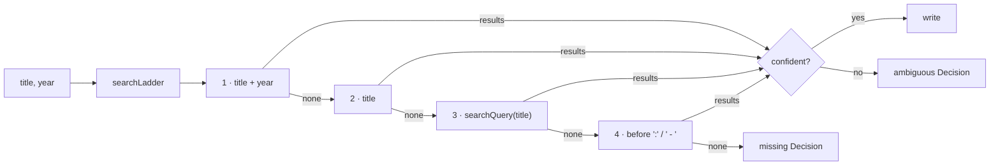

# 42 — Review at scale + Season art

> **Initiative:** `review-at-scale`
> **Issue:** to be filed by `write-a-prd` (step 25)
> **PRD:** `docs/PRDs/42-review-at-scale.md` (to be written)
> **Plan:** `docs/PRDs/42-review-at-scale-plan.md` (to be written)

This log is the `grill-me` session for step 25 of the build order, **Review at
scale + Season art**, held before the PRD was written. It ran against the code
as it stood on 2026-10-14 (`43e3de9`). It is an immutable snapshot of that
moment. The session ran alone, and the maintainer approved every
recommendation in advance, asking that the codebase stay consistent with its
naming, code conventions, patterns and architecture. Its inputs were step 25's
roadmap entry (`e0886cd`) and the maintainer's brief:

> sometimes TMDB doesn't sync properly. When manually using the movie/series
> search TMDB gives 0 hits (even though there are hits). So we need a way to
> get more reliable TMDB hits (feels like if TMDB doesn't find it once, then it
> continuously skips even trying again in the future), and also when the review
> list is long, a way to display it better, maybe with our accordion component.

## Background

What exists, read off the code:

- **Every TMDB search is one request.** `tmdbClient.searchMovie(key, title,
year)` sends `query` and, when the title has one, `year`;
  `searchTv` sends `first_air_date_year`. `createEnrichment.lookUp` searches
  once with the title exactly as stored and the year; zero results is a
  `missing` **Decision** (`no result on TMDB`). The review's search box
  (`createEnrichment.search`) sends the typed query once, with no year, and
  does not trim it.
- **TMDB's search is literal.** It tokenises the query and matches words; it
  does not fold punctuation the way our **Title key** does. A held title
  `F'ck That's Delicious` is TMDB's `F*ck, That's Delicious`; the key of both is
  `fck thats delicious`, so `confident` would accept it — but the query `F'ck`
  is a word TMDB does not hold. A strict `year` one off TMDB's release year
  (a sheet's festival year, a regional release) answers nothing at all. A title
  a **Folder scan** named off its folder carries whatever `titleGuess` did not
  strip: only a trailing year and a quality tag go, so `BluRay`, `x264`,
  `WEB-DL`, `REMUX` and a release group stay in the query.
- **Nothing is remembered about a failed search** — Decisions live in memory —
  but the **Enrichment scope** `missing` is **Full details**, `synopsis` and
  `poster_path` filled (`library/enrich/fullDetails`). So:
  - a film whose poster the scanner found and whose synopsis the sheet gave is
    never searched again, though `tmdb_id` is still `null`;
  - a series with a synopsis and a poster is never synced again, so a season
    added later never gets its episodes' titles, air dates, **Stills** or its
    **Season poster**.
    That is the "skips trying again": not a flag, the scope rule.
- **A season's poster is asked in `en-US`.** `season()` sends
  `language=en-US`, under which TMDB answers the `poster_path` of an English
  (or untagged) image only. The installed library's `F'ck That's Delicious`
  holds four seasons and one Season poster; log 39 chose "no Decision, no
  choice", so a season TMDB answers `null` for stays on the gradient for good.
- **The review has no grouping.** `ImportReview` and `EnrichmentReview` each
  draw one flat list. There is **no accordion component** in the codebase —
  `CodecManager`'s suite asserts there is none, and "codec accordion" is an
  alias the glossary avoids for the **Codecs row**. `PillTabs` is the one
  segmented control (`components/PillTabs/`).
- **One filing site is per episode.** In `createImporter`, a show's episode
  copy that throws files one `failed` **Problem** per episode
  (`Couldn't copy the video file: …`), titled with the episode's label. Every
  other kind is at most one per **Source folder**, **Sheet row** or **Show
  folder** (`unplaced` was folded to one per show by log 38). A copy that runs
  out of disk fails every episode after it — the "doubled the disk" import
  that preceded the 1,400-row review.

## Problem

1. A title TMDB holds is reported as having no result, both by the run and by
   the review's search box.
2. A title once unmatched — or a series once complete — is never synced again
   under _Only what's missing_.
3. A review of hundreds of rows is one flat list with no way to see it by
   title or by kind, nor to settle many rows with one press.
4. A season TMDB's default leaves bare can never be given art.

## Questions and Answers

### Scope

1. **One initiative or two?** ✅ **One**, `review-at-scale`, as the roadmap
   framed it: the search fix, the scope fix, the review's shape and Season art
   all meet in the two reviews. ❌ Splitting search off as a `fix:` — it changes
   a glossary rule (**Confident** is unchanged, but what is searched is new)
   and the scope's meaning, so it is designed, not patched.

2. **What is not built?** ❌ **Converting a title's kind** (a film that is
   really a series, or the reverse): a search that finds nothing because it
   asked the wrong kind is a real cause, but the fix is a Movie → Series move,
   its own feature. ❌ **A Rematch** (re-searching a title that holds a wrong
   `tmdb_id`): the brief is about zero hits, not wrong hits. ❌ Persisting
   Decisions across restarts. ❌ An automatic series-poster fallback on the
   Season card (Q19). ❌ Grouping the Enrichment review (Q14).

### Reliable search

3. **Why does TMDB answer nothing?** ✅ **Because we ask once, literally.**
   Three causes, all in the query and none in the key or the network: a strict
   year that is one off; punctuation and curly quotes TMDB does not fold;
   release noise a folder name kept. (A `429` or a `5xx` is `unreachable`
   today, never "no result", so it is not this.)

4. **The fix?** ✅ **A Search ladder**: an ordered list of queries, asked one
   after another until one answers a result, at most four requests. A pure
   unit, `server/src/enrichment/searchLadder/`:

   ```ts
   /** One rung: what to send TMDB. */
   export interface SearchRung {
     query: string;
     year: number | null;
   }
   /** Pure: a title and its year → the rungs to try, distinct, in order. */
   export function searchLadder(
     title: string,
     year: number | null
   ): SearchRung[];
   ```

   The rungs, each dropped when it equals one already listed:
   1. the title as held, with its year;
   2. the title as held, **without** the year;
   3. the **Search query** — `searchQuery(title)`: `titleGuess`'s tail strip,
      then release noise dropped, curly quotes and dashes folded to ASCII,
      `&` read as `and`, every other non-letter-or-digit a space — without
      the year;
   4. the part before a `:` or a `-` subtitle (`Star Wars: The Force
Awakens` → `Star Wars`; `The Force Awakens` already stands), when it
      has two words or more — without the year.

   ❌ Fuzzy matching on our side over a broad TMDB query: TMDB already ranks;
   our side scores with **Match score**. ❌ `search/multi`: it answers people
   too, and the kind is Q2's.

5. **Where does the noise list live?** ✅ **Beside `titleKey`**, as
   `RELEASE_NOISE` in `import-export/titleKey/titleKey.ts`, with `searchQuery`
   exported from the same file: the Title key is "the heuristic that will be
   tuned against the real folder names", and a query is the same heuristic
   read for TMDB. `titleGuess` strips the noise too, so a Folder scan names
   `Heat.1995.1080p.BluRay.x264-GRP` "Heat" rather than keeping the tags —
   the noise is whole words (`bluray`, `brrip`, `webrip`, `web dl`, `webdl`,
   `hdtv`, `dvdrip`, `remux`, `x264`, `x265`, `h264`, `h265`, `hevc`, `10bit`,
   `hdr`, `dts`, `aac`, `proper`, `repack`, `extended`, `unrated`), and
   anything after the first of them is dropped with it. Each spelling a real
   shelf turns up is one more row in the test table.

6. **Who walks the ladder?** ✅ **`createEnrichment`, through one function
   both searches use**: `searchTitled(apiKey, kind, rungs, signal)` →
   `TmdbOutcome<{ rung: SearchRung; results }>`, stopping at the first rung
   with results; `unreachable` or `refused` on any rung stops the climb and
   is the outcome. The client stays one request per call — the seam is not
   widened. `lookUp` and the series' look-up climb `searchLadder(title,
year)`; the review box climbs `searchLadder(query.trim(), null)`.

7. **Does Confident change?** ✅ **No.** `confident(ours, results)` is read
   over whichever rung answered: one result, an equal Title key, and an equal
   year when ours has one. A rung-2 answer of one result whose year is ours
   is Confident; a rung-4 answer (`Star Wars` for `Star Wars: The Force
Awakens`) will rarely be — it lands as `ambiguous` with **Candidates**,
   which is the point: a picker beats "no result".

8. **What does a `missing` Decision say now?** ✅ That the ladder was climbed:
   `NO_MATCH_REASON` becomes _Nothing on TMDB matched this title, with or
   without its year._, and `noMatchFor(query)` stays as it is. The run's log
   line gains the rung that answered when it was not the first: `↳ found as
“Star Wars”`, an `info` **Log line**.

### Trying again

9. **What does _Only what's missing_ cover?** ✅ **A Sync gap**, not Full
   details. A title is in the `missing` scope when it has a **Sync gap**:

   - it is not **Full details** (as today), or
   - it is **Unmatched** — `tmdb_id IS NULL`, or
   - (a series) an **Episode** has no title, no air date or no Still, or a
     **Season** on disk has no **Season poster**.

   Spelled once as SQL, `syncGap(alias)` in `library/enrich/`, the
   `fullDetails` precedent; `moviesInScope` and `seriesInScope` read it.
   **Full details** keeps its meaning and its count — the Settings line
   "N of M titles have full details" is unchanged. ❌ Widening Full details
   itself: the line would then count episodes, which it does not say.

10. **Does a gap TMDB cannot fill make every Sync slower?** ✅ **A little, and
    that is accepted.** A matched series with a still TMDB lacks is re-read by
    its `tmdb_id` — one detail and one season request per season, no search
    and never a Decision. An Unmatched title is searched again on every
    _Only what's missing_ — which is the brief. ❌ Remembering "tried and
    failed": it is exactly the skip the maintainer is complaining of.

### The review's shape

11. **What is filed per episode, and what instead?** ✅ **`failed`, folded to
    one per show**, `unplaced`'s precedent: one `failed` **Problem** titled
    with the show, its reason the count and the first error (`3 episodes
couldn't be copied: no space left on device.`), its detail listing the
    episodes. A film's `failed` is unchanged. Its _Resolve_ is the **Series
    Resolve** when the series is held, else the existing form; _Skip_ is
    **Dismiss** as ever. A guard in `createImporter`'s suite holds the rule:
    **at most one Problem per kind per Source folder, Sheet row or Show
    folder**, over a generated tree of five shows × eight seasons × twenty
    episodes with every copy failing.

12. **What draws a long list?** ✅ **An `Accordion` molecule**,
    `components/Accordion/` (`mol.Accordion.dc.html`), the maintainer's word:
    a header button — chevron, label, a count pill, optional trailing actions
    — over its children, `aria-expanded` and `aria-controls`, the body
    unmounted while closed. Controlled, `PillTabs`' and `Toggle`'s rule:

    ```ts
    interface AccordionProps {
      label: string;
      count: number;
      expanded: boolean;
      onToggle: () => void;
      /** The header's right end: a group's bulk buttons. */
      actions?: ReactNode;
      children: ReactNode;
    }
    ```

    A **Control** by the **Interaction contract** (`controlStates`), not a
    **Card**. Domain-free: it knows no Problem. ❌ `<details>`: the open
    state must answer the kind filter and the bulk press (Q15). ❌ Naming it
    `ReviewGroup`: a molecule knows no domain.

13. **How is the Import review grouped?** ✅ **By title — a Review group.**
    Problems are grouped by their `title`; a group of one is drawn as the bare
    **Problem row**, exactly as today, so a short review looks unchanged. A
    group of two or more is one `Accordion`: the title, the count, each kind's
    dot in the label line, closed by default. Hard kinds' groups come first in
    the run's order; groups made only of soft kinds (`missing-meta`,
    `differs`) after them. Grouping is the client's (`importView`'s
    `reviewGroups(problems, filter)`, pure); the snapshot is unchanged.

14. **And the Enrichment review?** ✅ **Filtered, not grouped**: a Sync raises
    at most one Decision per title, so a group would always be one. It gains
    the kind filter (Q15) and nothing else in its list.

15. **Filter by kind?** ✅ **`PillTabs` above the list**, in both reviews:
    _All N_, then one pill per kind present with its count, in the glossary's
    order (import: `no-folder`, `ambiguous`, `no-video`, `no-row`, `failed`,
    `unplaced`, `missing-meta`, `differs`; Sync: `ambiguous`, `missing`,
    `conflict`). Drawn only when the list holds two kinds or more. The filter
    is screen state, **not** in the URL — the review is not a place one links
    to. A pill whose kind empties goes, and the filter falls back to _All_.

16. **Bulk actions?** ✅ **Three, each one press, no confirm** — Skip has none
    today, and every one is undone by running the import again:
    - _Skip all_ — on every group's header, and beside the filter when a kind
      is chosen: **Dismiss** for every row it covers;
    - _Import all as guessed_ — beside the filter when `no-row` is chosen:
      _Import as_ for each row, under the run's **Import mode**;
    - _Keep all mine_ — beside the filter when `differs` is chosen: Dismiss,
      worded as the row's own.

    The Sync's review gains _Skip all_ beside its filter, nothing more.

17. **On the wire?** ✅ **Two import routes and one Sync route**, each
    answering the whole snapshot so the screen redraws from the echo, the
    Codec report's precedent:
    - `POST /api/import/current/problems/dismiss { ids }` → `200 ImportRun`;
    - `POST /api/import/current/problems/import-guessed { ids }` →
      `200 ImportRun`, each row through `importFromReview` in order — a row
      that redraws stays, redrawn;
    - `POST /api/enrichment/current/decisions/dismiss { ids }` →
      `200 EnrichmentRun`.

    `400` for an `ids` that is not a non-empty string array; an id not held is
    passed over, not refused (a row settled meanwhile). `404` with no run.
    Bodies read in `importBody` / `enrichmentBody`. `useImportRun` gains
    `skipMany(ids)` and `importManyAsGuessed(ids)`, `useEnrichmentRun`
    `skipMany(ids)`; each api call in `features/…/api/`, one caller each.

### Season art

18. **Where are a season's choices?** ✅ **A Seasons section in a
    single-series Sync's review**, above the Decision rows and drawn on _All
    done_ too: one **Season choice** per Season on disk — `S02`, the held
    Season poster (or the gradient) and up to ten TMDB posters beside it in a
    horizontal row, `CandidatePicker`'s face with no score. A press stores
    that image as the Season poster, **replacing** a held one — a press is a
    human's, so log 39's "never replaced" is a rule for the run, not for this.
    Only a `single` run over a series draws it; a library Sync stays one
    review of titles.

19. **Where do the choices come from?** ✅ **`/3/tv/{id}/season/{n}/images`**,
    asked with `include_image_language=en,null` and then, when that answers
    none, with no language filter — the `en-US` default is why a season TMDB
    holds art for comes back bare. A new client call, `seasonImages(key, id,
n, signal)` → `TmdbOutcome<{ file_path; vote_average }[]>`, ordered by
    vote. The series' own posters (`/3/tv/{id}/images`) follow a season's own,
    marked _Series poster_ — log 39's "no series-poster fallback" is reopened
    **as a choice, never automatic**. The run's own `planSeason` gains the same
    no-language retry when `season()` answers `poster_path: null`.

20. **On the wire?** ✅ `EnrichmentRun` gains `seasons?: SeasonChoice[]`
    (`types/enrichment.ts`, both build targets):

    ```ts
    export interface SeasonChoice {
      season: number;
      /** The held Season poster, through `imageUrl`; `null` for none. */
      posterUrl: string | null;
      choices: { path: string; url: string; source: 'season' | 'series' }[];
    }
    ```

    `POST /api/enrichment/current/seasons/:season/poster { path }` →
    `200 SeasonChoice`: the image streamed through `Media.storeNamed` as
    `S02-poster.jpg` (overwriting), `setSeasonPoster`'s upsert. `400` for a
    path not among that season's choices — the client never names an
    arbitrary TMDB path; `404` without a single-series run or that season;
    `503` when TMDB is not reached. `useEnrichmentRun` gains
    `chooseSeasonPoster(season, path)`.

21. **And offline?** ✅ **The Series edit job takes a season poster from a
    file.** `SeriesFormFiles` gains a _Season posters_ list under the series
    poster: one poster slot per Season the episode rows hold, held ones
    travelling as their paths, a picked one as bytes, ✕ to take one away. On
    the wire, `PATCH /api/series/:id` gains a `seasonPoster` field (`{ season,
path? }`) followed, for a picked file, by a `seasonPosterFile` part —
    `seriesFormBody`'s pairing by order, the episode precedent. The add
    (`POST /api/series`) takes the same fields. `fileKinds`' image rule is the
    boundary. ❌ A season poster on the Season page: log 39 ruled art there
    out, unchanged.

### Names, prototype, and docs

22. **The new terms?** ✅ **Search ladder**, **Search query**, **Sync gap**,
    **Unmatched**, **Review group**, **Accordion**, **Season choice**, **Bulk
    action** — each in the glossary with its aliases to avoid. **Enrichment
    scope**'s `missing`, **Decision**'s `missing` reason, **Problem**
    (`failed` per show) and **Season poster** (replaced by a press, set from a
    file) are updated.

23. **Prototype first?** ✅ **Yes**, per _The prototype is the spec_:
    `mol.Accordion.dc.html` new; `feat.ImportFlow.dc.html` (the filter, the
    groups, the bulk buttons), `feat.EnrichmentFlow.dc.html` (the filter,
    _Skip all_, the Seasons section) and `feat.MovieForm.dc.html` (_Season
    posters_) amended, and `FamilyFlix.dc.html` with them, before any of it
    is built.

24. **Which documents change?** ✅ README's and CLAUDE.md's step 25 and
    feature entries, CLAUDE.md's folder tree (`searchLadder/`,
    `components/Accordion/`, the new routes under _Settings Hub_), and the
    glossary — ticked ✅ only after the refactor.

## Design

### Chosen and rejected

- ✅ A pure **Search ladder** of up to four rungs, climbed by
  `createEnrichment`; ❌ one literal search; ❌ fuzzy matching of our own.
- ✅ The noise list and `searchQuery` beside `titleKey`; `titleGuess` strips
  noise too.
- ✅ `missing` scope = **Sync gap** (`syncGap` SQL); ❌ widening Full details;
  ❌ a "tried and failed" flag.
- ✅ `failed` one per show, guarded by a per-source rule.
- ✅ `components/Accordion/`, controlled; ❌ `<details>`; ❌ a domain-named
  molecule.
- ✅ Review groups by title in the Import review only; ✅ `PillTabs` kind
  filter in both; ✅ three bulk actions, echo-redrawn.
- ✅ Season choices in a single-series Sync, season images then series posters,
  a press replaces; ❌ automatic series-poster fallback.
- ✅ Season posters from a file in the series edit and add.

### The search



### The units

| Unit                           | Where                                    | What                                 |
| ------------------------------ | ---------------------------------------- | ------------------------------------ |
| `searchLadder`                 | `server/src/enrichment/searchLadder/`    | pure: title, year → `SearchRung[]`   |
| `searchQuery`, `RELEASE_NOISE` | `server/src/import-export/titleKey/`     | pure: a title → TMDB's query         |
| `syncGap`                      | `server/src/library/enrich/`             | SQL: the `missing` scope             |
| `seasonImages`, `seriesImages` | `server/src/enrichment/tmdbClient/`      | `/images` calls, values never throws |
| `Accordion`                    | `src/components/Accordion/`              | the molecule                         |
| `reviewGroups`                 | `src/features/import-export/importView/` | pure: problems × filter → groups     |
| `SeasonChoices`                | `src/features/enrichment/SeasonChoices/` | the Seasons section                  |

### Routes

| Route                                                          | Answer                                     |
| -------------------------------------------------------------- | ------------------------------------------ |
| `POST /api/import/current/problems/dismiss { ids }`            | `200 ImportRun` · `400` · `404`            |
| `POST /api/import/current/problems/import-guessed { ids }`     | `200 ImportRun` · `400` · `404`            |
| `POST /api/enrichment/current/decisions/dismiss { ids }`       | `200 EnrichmentRun` · `400` · `404`        |
| `POST /api/enrichment/current/seasons/:season/poster { path }` | `200 SeasonChoice` · `400` · `404` · `503` |
| `PATCH /api/series/:id`, `POST /api/series`                    | gain `seasonPoster` / `seasonPosterFile`   |

## Implementation Plan

1. **Prototype.** `mol.Accordion.dc.html`; amend `feat.ImportFlow`,
   `feat.EnrichmentFlow`, `feat.MovieForm` and `FamilyFlix.dc.html`.
2. **The Search ladder.** `searchQuery`, `RELEASE_NOISE`, `searchLadder`,
   `searchTitled`; `lookUp`, the series' look-up and the review box climb it;
   the new reason and log line. Thinnest end-to-end: a title one year off
   TMDB's is now Confident.
3. **The Sync gap.** `syncGap`, both `InScope` reads; an Unmatched film with
   Full details and a complete series with a new season are synced again.
4. **`failed` per show** and the per-source guard.
5. **The Accordion and the review.** `components/Accordion/`, `reviewGroups`,
   the kind filter in both reviews.
6. **Bulk actions.** The three routes, the hooks' calls, the buttons.
7. **Season choices.** `seasonImages`, `seriesImages`, the `planSeason`
   retry, `SeasonChoice` on the run, the route, the Seasons section.
8. **Season posters from a file.** `seriesFormBody`'s pairing, the
   `SeriesFormFiles` list.
9. **Docs.** README, CLAUDE.md and the glossary per Q24.

## Trade-offs

- **Easier:** a title TMDB holds is found far more often, with no new network
  seam; a gap is retried until it is filled; a thousand-row review reads as a
  few dozen groups and settles in a handful of presses; every season can have
  art, online or off.
- **Harder:** a Sync makes up to four searches for a title TMDB truly lacks,
  and re-reads matched series with a gap TMDB cannot fill; the noise list is a
  heuristic that will need rows; two reviews now carry screen state (the
  filter, the open groups) that is lost on a reload, as their scroll is.
- **Out of scope:** converting a title's kind, a Rematch, persisted Decisions,
  an automatic series-poster fallback, Season page art, grouping the Sync's
  review.
