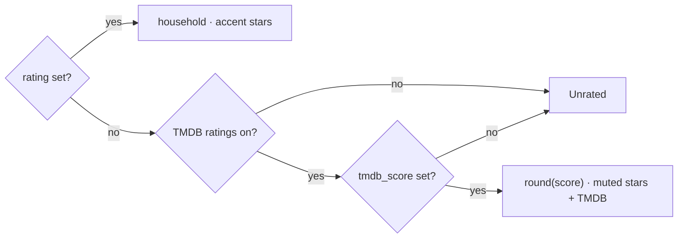

# 43 — TMDB ratings

> **Initiative:** `tmdb-ratings`
> **Issue:** to be filed by `write-a-prd` (step 26)
> **PRD:** `docs/PRDs/43-tmdb-ratings.md` (to be written)
> **Plan:** `docs/PRDs/43-tmdb-ratings-plan.md` (to be written)

This log is the `grill-me` session for step 26 of the build order, **TMDB
ratings**, held before the prototype revision and the PRD. It ran against the
code as it stood on 2026-10-15 (`bbc3dee`). It is an immutable snapshot of
that moment. The session ran alone, and the maintainer approved every
recommendation in advance, asking that the codebase stay consistent with its
naming, code conventions, patterns and architecture. Its input was step 26's
roadmap entry (`bbc3dee`): a synced library still draws every title
**Unrated**, because the **TMDB score** is stored and not drawn (log 23 Q12).

## Background

What exists, read off the code:

- **Two columns, one scale.** `rating` (log 01 Q6) is the household's,
  `INTEGER` 0–10 half-star units, 10 = five stars, `NULL` **Unrated**, a
  stored `0` only from a sheet. `tmdb_score` (migration 5) is TMDB's
  `vote_average`, `REAL` 0–10 to one decimal (`fetchedFields`' `score`),
  written by every Sync that fetches the field and never touching `rating`
  (log 23 Q12, Q24). Both ride every `Movie` and `Series` the client reads
  (`types/movie.ts`, `types/series.ts`), so a browse payload already carries
  both. Because both scales are 0–10 with ten meaning five stars, TMDB's score
  _is_ a rating in units once rounded to the integer: `7.4` → `7` → 3½ ★.
- **A score of 0 means no votes.** TMDB votes are 1–10, so any vote makes the
  average at least 1; a title nobody voted on answers `vote_average: 0`, which
  `score()` stores as `0`. Log 01 Q7 asked for a `vote_count` guard; log 23
  never built it, and `vote_count` is not fetched.
- **Stars are drawn on three surfaces, through four mappers.** The **Poster
  card** (`StarRating` at 13px with its value) — the Movies tab, the Series
  tab, the Genre page and search — fed by `features/library/view/` and
  `features/library/series/seriesCardView/`; the movie page's **Meta line**
  (`RatingPicker` at 20px, `x / 5` or `Not rated`), fed by
  `movie-detail/detailView/`; and the series page's `SeriesMetaLine`
  (read-only `StarRating` at 20px — a series is rated by the sheet and the
  form, not from its page), fed by `series/seriesView/`. Each maps with
  `toRatingPercent(record.rating)`. The **Movie form**'s `RatingPicker` is
  _Your rating_, the stored value being edited. The **Continue card** draws no
  stars.
- **Sort and filter are SQL.** `highest-rated` is
  `m.rating IS NULL, m.rating DESC, title` in `library/browse/` and its
  `s.` twin in `library/series/browse/`; the **Minimum rating** is
  `m.rating >= ?`. Every **Home section** is a `listMovies` over the same
  `ORDER_BY`. The route reads the **Library query** and never a preference.
- **One display preference exists.** **Ultrawide margins**: the
  `ultrawide-margins` key (`'1'`/`'0'`) in `library/settings/`,
  `Settings.ultrawideMargins` with `DEFAULT_ULTRAWIDE_MARGINS`,
  `POST /api/settings/ultrawide-margins`, held app-wide by
  `DisplayPreferenceProvider` (`App/`) — **Blank until it lands**, `null`
  read as off — and drawn as the Display group's one row
  (`settings/DisplaySection/`).
- **The Export writes `Rating`, the household's** (log 31); `TMDB score` was
  ruled out as a column because it was "drawn on neither page".

## Problem

1. A synced library draws every title the family has not rated as five empty
   stars, though TMDB has said how good it is.
2. A TMDB score drawn as stars must never pass for the family's own Rating,
   nor ever overwrite it.
3. What the stars say, the _Highest rated_ order and the rating filter must
   agree.

## Questions and Answers

### Scope

1. **One initiative?** ✅ **One**, `tmdb-ratings`, step 26. ❌ Not built:
   the TMDB score as a number of its own beside the stars, the original title
   drawn, a `vote_count` threshold (Q5), an Export column (Q17), a rating
   picker on the series page (unchanged, Q14).

### Names

2. **What are the new things called?** ✅ Three terms:
   - **TMDB rating** — the **TMDB score** read as a **Rating**: `round(score)`
     units, so `7.4` is 3½ ★. Never stored; derived where it is drawn and
     where it is sorted.
   - **Shown rating** — what a surface draws for a title: its **Rating** when
     the family set one, else its **TMDB rating** while **TMDB ratings** is
     on, else **Unrated**. Carries its **Rating source**, `household` or
     `tmdb`.
   - **TMDB ratings** — the household preference, the Display group's
     _Fill in ratings from TMDB_ row. Key `tmdb-ratings`, field
     `Settings.tmdbRatings`, default `DEFAULT_TMDB_RATINGS = true`.

   ❌ "effective rating", "display rating", "fallback rating" — the glossary's
   aliases to avoid. **Rating** keeps meaning the household's column alone.

### The arithmetic

3. **How is a score drawn?** ✅ `Math.round(tmdbScore)` units — the nearest
   half star, `x.5` up — then `toRatingPercent` as any Rating. SQLite's
   `ROUND` rounds a positive half the same way, so the order and the stars
   agree on `6.5`. One pure client unit:

   ```ts
   // src/utils/shownRating/shownRating.ts
   import type { RatingSource } from '@/types'; // 'household' | 'tmdb'

   export interface ShownRating {
     /** 0–10 half-star units, the Rating's own scale. */
     units: number;
     source: RatingSource;
   }
   /** Pure: the household Rating, else the TMDB rating while `tmdbRatings`, else `null`. */
   export function shownRating(
     rating: number | null,
     tmdbScore: number | null,
     tmdbRatings: boolean
   ): ShownRating | null;
   ```

   It lives in `utils/` because four mappers in three features read it.
   `RatingSource` is exported from `src/types/viewModels.ts`, beside the view
   models that carry it.

4. **Does the household Rating always win?** ✅ **Yes, any stored value,
   `0` included** — a stored `0` is a rating the sheet gave (log 01 Q6).
   Only `NULL` lets TMDB's through.

5. **A score of 0?** ✅ **It is no score.** `fetchedFields`' `score` answers
   `null` for a `vote_average` of `0`, so a title nobody voted on is never
   drawn as a TMDB 0.0; **migration 13** sets `tmdb_score = NULL WHERE
tmdb_score = 0` on `movies` and `series`, since a stored `0` can only have
   come from no votes. ❌ A `vote_count` threshold (log 01 Q7): `vote_count` is
   not fetched, the stored scores could not be judged by it, and any number
   would be a guess.

### Where it is decided

6. **Server or client?** ✅ **The client draws; the server sorts.** Every
   record already carries `rating` and `tmdbScore`, so the mappers derive the
   **Shown rating** per render — a flip on the Settings page redraws every
   loaded screen at once, as the **Content frame** does. ❌ A merged rating
   on the record: a flip would not redraw what is loaded, and the movie page
   needs the two apart (Q10).

7. **Who holds the preference on the client?** ✅ **`DisplayPreferenceProvider`**,
   whose name already says it holds display preferences: one `fetchSettings`
   on mount as now, now landing both values; `useDisplayPreference()` →
   `{ ultrawideMargins, setUltrawideMargins, tmdbRatings, setTmdbRatings }`;
   `setTmdbRatings` is `setUltrawideMargins`' bargain — shown at once, posted,
   the echo kept, put back on refusal, never rejecting — over a new
   `App/saveTmdbRatings/`, `saveUltrawideMargins`' twin. **`null` reads as
   off** (Blank until it lands; a suite without the provider reads off), so a
   cold start draws the household Ratings alone for the one read it takes. ❌
   Reading `null` as the default: it would draw TMDB stars on a refused read
   the maintainer had switched off.

8. **Where is it mapped?** ✅ **In the four mappers**, each gaining a
   `tmdbRatings: boolean` parameter and calling `shownRating`: `view()` and
   `seriesCardView()` give `PosterCardMovie` `rating` (percent) and
   `ratingSource`; `detailView()` gives the movie page `ratingPercent` (the
   household's, for the picker) and `tmdbPercent` (the **TMDB rating** while
   on, else `null`); `seriesView()` gives `ratingPercent` and
   `ratingSource`. Their callers read `useDisplayPreference().tmdbRatings`
   and pass `=== true`. `formValues` is untouched: the form edits the stored
   Rating.

### Telling them apart

9. **How does a TMDB rating look?** ✅ **Muted stars and a `TMDB` tag.** The
   filled stars in a neutral ink rather than the accent, and the value
   followed by a small uppercase `TMDB` in the faint ink — `★★★½☆ 3.5 TMDB`.
   The colour makes a shelf scannable; the word is what a parent and a screen
   reader read, since colour alone says nothing. The exact inks are the
   prototype revision's (Q18). The primitive stays domain-free:
   `StarRating` gains `muted?: boolean` and `tag?: string`; the **Poster
   card** and `SeriesMetaLine` map `ratingSource === 'tmdb'` onto
   `muted` and `tag="TMDB"`. ❌ Colour alone; ❌ a tooltip (no hover on a
   parent's remote-like use, and not read by default).

10. **The movie page's picker?** ✅ **TMDB's rating as the picker's
    placeholder**, as an input's placeholder is shown while it is empty:
    `RatingPicker` gains `placeholder?: number | null` (a percent) and
    `placeholderTag?: string`. While `value` is `null` and a placeholder is
    given, the stars are drawn muted at the placeholder and the label reads
    `3.5 / 5 TMDB` in place of `Not rated`. A hover's **Rating preview** is
    drawn in the accent as now. A click on any segment sets the household
    Rating — the segment equal to the placeholder _adopts_ TMDB's as the
    family's, it does not clear; **Clear rating** is still named only on the
    segment holding `value`. The Movie form passes no placeholder: _Your
    rating_ edits what is stored.

11. **How is a Rating cleared back to TMDB's?** ✅ **The existing grammar**:
    click the segment holding the Rating, it is cleared to `NULL`, and the
    **Shown rating** falls through to TMDB's — the placeholder reappears. No
    new control, no _Use TMDB's_ button. A series' Rating is cleared in the
    Movie form's series edit, as today.

12. **Every surface?** ✅ The **Poster card** (Movies tab, Series tab, Genre
    page, search — all through the two card mappers), the movie page's
    **Meta line**, and the series page's meta line. Nothing else draws stars.

### Sort and filter

13. **Do _Highest rated_ and the Minimum rating read the Shown rating?** ✅
    **Yes**: a card drawing 4 ★ that `4+ stars` hides, or that sorts under
    the unrated, reads as a bug. One SQL spelling, `fullDetails`' precedent:

    ```ts
    // server/src/library/browse/browse.ts
    /** SQL: the Shown rating's units over `alias` — `rating`, else TMDB's while on. */
    export function shownRatingSql(alias: string, tmdbRatings: boolean): string;
    // → `COALESCE(m.rating, CAST(ROUND(m.tmdb_score) AS INTEGER))`, or `m.rating`
    ```

    `ORDER_BY['highest-rated']` and the `minRating` term are built from it in
    both `library/browse/` and `library/series/browse/` (which imports it). The
    wire is unchanged: `rating` stays a 0–10 floor, `sort` its slug.

14. **Who tells browse the preference?** ✅ **The library, not the route.**
    `createBrowse` and the series browse are composed in `library/index.ts`
    with a reader, `() => settings.settings().tmdbRatings`, asked per query —
    so `listMovies`, every **Home section**, `/series` and the Genre page all
    agree, and no route learns there is a preference. ❌ A `tmdbRatings` field
    on `LibraryQuery`: it is the URL's vocabulary, and a preference is not a
    query.

### Series

15. **Series alike?** ✅ **Yes** — the series card, the series page's
    read-only stars, the Series tab's sort and filter. A series is still rated
    by the sheet and the form; its page gains no picker.

### The setting

16. **The row?** ✅ The Display group's second row, under _Ultrawide
    margins_, the same `Row` furniture and `Toggle`:
    _Fill in ratings from TMDB_ — _When the family hasn't rated a title, show
    TMDB's score as its stars, marked TMDB. Your own ratings always come
    first._ On by default. `POST /api/settings/tmdb-ratings { value }` →
    `{ value }`, a **Single-signal write**, `400` for anything but a boolean;
    `GET /api/settings` answers `{ subtitleLanguage, ultrawideMargins,
tmdbRatings }`; `library/settings/` gains `setTmdbRatings(on)` over
    `valueOf`. Drawn whether or not a key is stored: with no scores, nothing
    changes. A **Factory reset** erases it back to the default.

### What does not change

17. **Export, import, Sync?** ✅ **Untouched.** An **Export** writes the
    household `Rating` alone — the **Titles sheet** is the family's, and a
    `TMDB score` column would not round-trip (the reader has no field for
    it). Bulk import's Rating cell still writes the household Rating. No Sync
    touches `rating` (log 23's rule kept); a Sync refreshing the score
    redraws its stars.

### Prototype and docs

18. **Prototype first?** ✅ **Yes**, per _The prototype is the spec_:
    `prim.StarRating` (`muted`, `tag`), `mol.RatingPicker` (`placeholder`,
    `placeholderTag`), `mol.PosterCard` (a TMDB-rated face),
    `page.SettingsPage` (the second Display row), `page.MoviePage` and
    `page.SeriesPage` (a TMDB-rated meta line), and `FamilyFlix.dc.html`,
    before any of it is built. The inks are settled there.

19. **Which documents change?** ✅ README's and CLAUDE.md's step 26 and
    feature entries, CLAUDE.md's folder tree (`utils/shownRating/`,
    `App/saveTmdbRatings/`, migration 13, the Settings Hub's new route), and
    the glossary — ticked ✅ only after the refactor.

## Design

### Chosen and rejected

- ✅ **Shown rating** = Rating, else TMDB rating while on, else Unrated;
  ❌ storing TMDB's into `rating` (log 01 Q7's seed) — it is how a family's
  rating gets overwritten.
- ✅ `round(score)` units; a score of 0 is no score (migration 13).
- ✅ The client draws per render off the provider; ❌ a merged field on the
  record.
- ✅ Muted stars + a `TMDB` tag; ❌ colour alone; ❌ a tooltip.
- ✅ The picker's placeholder; clearing falls back to TMDB's; ❌ a _Use
  TMDB's_ control.
- ✅ Sort and filter on the Shown rating, `shownRatingSql`, the preference
  read inside `library/`; ❌ on `LibraryQuery`.
- ✅ Export, import and Sync unchanged.

### Shown rating



### The units

| Unit                            | Where                          | What                                    |
| ------------------------------- | ------------------------------ | --------------------------------------- |
| `shownRating`                   | `src/utils/shownRating/`       | pure: rating, score, pref → ShownRating |
| `RatingSource`                  | `src/types/viewModels.ts`      | `'household' \| 'tmdb'`                 |
| `shownRatingSql`                | `server/src/library/browse/`   | SQL: the Shown rating's units           |
| `setTmdbRatings`, `tmdbRatings` | `server/src/library/settings/` | the key `tmdb-ratings`                  |
| `saveTmdbRatings`               | `src/App/saveTmdbRatings/`     | the one write                           |
| `StarRating` `muted`, `tag`     | `src/primitives/StarRating/`   | the TMDB face                           |
| `RatingPicker` `placeholder`    | `src/components/RatingPicker/` | TMDB's while unrated                    |
| migration 13                    | `server/src/db/migrations.ts`  | `tmdb_score = 0` → `NULL`               |

### Routes

| Route                                          | Answer                              |
| ---------------------------------------------- | ----------------------------------- |
| `GET /api/settings`                            | gains `tmdbRatings`                 |
| `POST /api/settings/tmdb-ratings { value }`    | `200 { value }` · `400` non-boolean |
| `GET /api/home`, `/api/series`, the genre page | sort and filter on the Shown rating |

## Implementation Plan

1. **Prototype.** The six files of Q18 and `FamilyFlix.dc.html`.
2. **The preference.** Key, `Settings.tmdbRatings`, the route, the provider,
   `saveTmdbRatings`, the Display row. Thinnest end-to-end: the Toggle flips
   and survives a reload.
3. **Shown on the cards.** `shownRating`, `StarRating`'s `muted` and `tag`,
   `view()` and `seriesCardView()`; an unrated synced title draws TMDB's
   stars on the shelf.
4. **Shown on the pages.** `RatingPicker`'s placeholder, `detailView`,
   `seriesView`, `SeriesMetaLine`.
5. **Sort and filter.** `shownRatingSql`, both browses, the reader composed
   in `library/index.ts`.
6. **No votes.** `score()` reads `0` as `null`; migration 13.
7. **Docs.** README, CLAUDE.md and the glossary per Q19.

## Trade-offs

- **Easier:** a synced library reads as rated at once, with nothing written
  over the family's own; a parent can tell TMDB's stars from the family's on
  every surface; the order, the filter and the stars agree.
- **Harder:** a rating now has two sources every star-drawing mapper must
  know about; the browse SQL reads a preference, so a test of `highest-rated`
  must say which; a cold start draws household Ratings only until the
  settings read lands.
- **Out of scope:** the score as its own number, a `vote_count` threshold,
  an Export column, a picker on the series page, original titles drawn.
