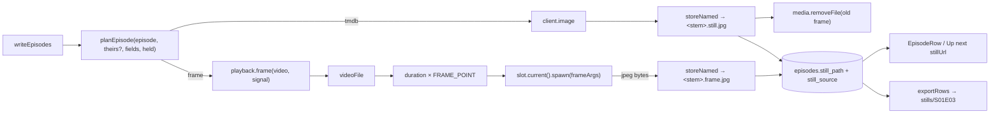

# 44 — Episode stills

> **Initiative:** `episode-stills`
> **Issue:** #380 (build order step 27)
> **PRD:** `docs/PRDs/44-episode-stills.md` (#381)

This log is the `grill-me` session for build order step 27, 🔜 **Episode
stills**. It was held before the PRD was written, against the code as it stood
on 2026-10-16 (`aac3999`), and it is an immutable snapshot of that moment. The
session ran alone, and the maintainer approved every recommendation in
advance. Their brief: _episode-stills. in short, we want a still from tmdb, if
there is none, fallback is taking a still from the episode file 1/3rd in. we
save/export them the same way as the tmdb stills. do this one alone, i approve
all your recommendations. keep in mind, we want to keep the codebase
consistent with our naming and code conventions/patterns/architecture._

## Background

Here is what the code does today:

- A **Still** comes from one place in a **Sync**. `writeEpisodes`
  (`server/src/enrichment/createEnrichment/createEnrichment.ts`) walks one
  season's episodes on disk, finds TMDB's episode with the same number, and
  asks the pure `planEpisode(episode, theirs, fields) → { enrichment, still }`.
  A Still is wanted only under the Poster chip and only when none is held, and
  it is never replaced. It is fetched with `client.image` (TMDB's `original`
  size), stored with `media.storeNamed(seriesFolder, '<stem>.still.jpg',
bytes, season)` in the Series folder's `season-NN/`, written through
  `enrichEpisode({ stillPath })`, and logged `↓ name  →  stored`. An episode
  TMDB does not list is passed over with `continue`. A still that cannot be
  stored leaves the gradient.
- Since issue #379, the series form takes a Still from a file on add and on
  edit. It is stored as `S01E03-still.jpg` (`stillName` in
  `routes/seriesFormBody/`). A held still travels back as `stillPath`, and the
  series edit's cleanup deletes a replaced or removed still.
- `episodes.still_path` came in migration 5. The latest migration is 13. No
  column records where a still came from.
- The **Sync gap** (`syncGap`, `library/enrich/enrich.ts`) counts an episode
  with no Still. So a show TMDB holds no stills for stays in _Only what's
  missing_ on every Sync, for ever.
- **Playback** (`playback/createPlayback/`) already knows everything a frame
  grab needs. `videoFile(StoredVideo) → VideoFile` resolves a managed or a
  **Linked video** behind both containment checks. `duration(file)` reads the
  probe first, then the MP4's `mvhd`. The live **Playback component** is read
  per call off the **Component slot** (`slot.current()`), and its `spawn(argv)
→ { stdout, kill }` is the one seam every ffmpeg run goes through.
- `createImporter({ storage, media, playback })` is the precedent for one
  domain taking `Playback` as a dependency. `derivedRuntime(playback, video)`
  is the precedent for a best-effort reading off a video that never throws.
- An **Export** with _Images_ on carries each held still under
  `stills/<Episode tag>` in the title's folder, and the Episodes sheet's
  `Still` cell names it. Stills are never written back into a **Library
  folder**.
- `EpisodeRow` draws `stillUrl` over the **Gradient fallback**. The Up next
  card draws the next episode's still too (#377).

## Problem

TMDB holds a Still for every episode of some shows and for none of others, so
a season page can be half gradients. Every episode's own file has a picture in
it. When should a Sync take one, where does it go, how is it told apart from
TMDB's so TMDB's can still win later, and what happens with no FFmpeg?

## Questions and Answers

**Q1. When is a frame taken: as a Sync's fallback, during import, or as an
action of its own?**
A ✅ **As a Sync's fallback, and only there.** In `writeEpisodes`, once TMDB
has answered for the season, an episode that is still left without a Still
gets a **Frame still**. That is the brief read literally ("a still from TMDB;
if there is none, fallback"). It needs no new screen, no new run, and no new
progress UI.
❌ During import. Import is the large-file operation that is already slow at
a thousand episodes, and a spawn per episode would add minutes to it. It would
also take a frame before TMDB had a chance to supply the real Still.
❌ An action of its own (a menu item, a Settings row). That would need a
prototype revision and a run with its own progress, for a fallback.

**Q2. Which episodes take a Frame still?**
A ✅ Only under the **Poster chip** (an episode's Poster is its Still, log
23), only when the episode holds no Still, and only when TMDB offers none for
it. "Offers none" covers both TMDB's episode with no `still_path` and an
episode TMDB does not list at all, which today is a `continue`. A TMDB Still
that TMDB offers but that fails to download or store does **not** fall back
to a frame. That failure is transient, and the episode keeps its **Sync gap**
so the next Sync tries TMDB again.
❌ A frame whenever the TMDB image fails. A network blip would fix a frame in
place where TMDB has a real Still.
❌ A chip of its own, or a Settings switch. The brief makes it automatic, and
the Poster chip already means "art for this title".

**Q3. Where in the file?**
A ✅ At the **Frame point**: **a third of the video's own duration**, from
`playback.duration(file)`, which is the probe and then the `mvhd`. If the
duration is unknown, no frame is taken and the gradient stays. The stored
`runtime_minutes` is not used, because it may be TMDB's runtime and not this
file's.
❌ A third of `runtime_minutes`. It is a different number for a cut or an
extended file.
❌ ffmpeg's `thumbnail` filter, or black or credits detection. It decodes many
frames per episode, and a third of the way in is almost never black. A frame
the family dislikes is replaced by picking a Still in the series form.

**Q4. Is a Still's source recorded?**
A ✅ Yes. **Migration 14** adds `episodes.still_source TEXT`, which is one of
`'tmdb' | 'frame' | 'picked'` and is `NULL` exactly when `still_path` is
`NULL`. It is the **Still source**. The backfill sets `'picked'` for a held
`still_path` whose name is form-shaped (`%-still.%`) and `'tmdb'` for any
other held one. No frames exist before this migration. Every writer of
`still_path` writes the source beside it: the Sync's TMDB still `'tmdb'`, its
fallback `'frame'`, the form's picked still `'picked'`, a held still sent back
by the edit unchanged, a removed one `NULL`.
❌ Telling a frame by its filename. The data would live in a name, and a
rename would change behaviour.
❌ A boolean `still_is_frame`. It answers today's one question but cannot say
"picked", and the README already named the three.

**Q5. Does the client learn the source?**
A ✅ No. It is server side only, on the `mediaFolderOf` precedent. The
assembled `Episode` never carries it. A Frame still is drawn exactly like a
TMDB Still, with no mark, because a picture is not an opinion the way a
**TMDB rating** is. The storage gains one read, `stillSourcesOf(seriesId) →
ReadonlyMap<episodeId, StillSource>`, which `writeShow` reads once per show,
as it reads the Media folder once.
❌ `stillSource` on `Episode` (`src/types/series.ts`). Nothing in `src/` would
read it.

**Q6. Can TMDB later replace a Frame still?**
A ✅ Yes. That is the reason Q4 exists. `planEpisode` treats a held Frame still
as "no TMDB still held". When TMDB offers one, it is fetched and stored as
`<stem>.still.jpg` with source `'tmdb'`, and the frame file is then removed
through `media.removeFile`. A TMDB Still and a picked Still are never
replaced, so the existing rule stands for both.
❌ Treating a frame as final. Shows that TMDB fills in later would keep worse
art for ever.

**Q7. Does a Frame still close the Sync gap?**
A ✅ Yes. `syncGap` is unchanged: it counts `still_path IS NULL` only. A show
whose episodes all hold a TMDB or Frame still leaves _Only what's missing_, so
the count settles at zero instead of re-asking TMDB on every Sync. A Frame
still is upgraded by Q6 whenever its show is synced, which _Everything_ always
does and _Only what's missing_ does when the show has some other gap.
❌ Counting a frame as a gap. TMDB would be asked again on every Sync for a
show it has no stills for, and the setup's count would never reach zero.

**Q8. Where does the grab live, and what is its signature?**
A ✅ In `playback/`, the domain that owns the component. It gets a new pure
unit and one new `Playback` member.

- `server/src/playback/frameArgs/` (pure, with its suite):
  `FRAME_POINT = 1 / 3` and `frameArgs(file, atSeconds) → string[]`, which is
  `-hide_banner -loglevel error -ss <t> -i <file> -frames:v 1 -an -sn -f
image2pipe -c:v mjpeg -q:v 3 pipe:1`. Input seeking (`-ss` before `-i`)
  keeps it fast on a 12 GB file. Native resolution is kept, like TMDB's
  `original`.
- `Playback.frame(video: StoredVideo, signal: AbortSignal) →
Promise<Readable | null>`: `videoFile`, then `duration`, then
  `slot.current()?.spawn(frameArgs(file, duration * FRAME_POINT))`. The
  stdout is collected into a buffer and answered as a stream. It is `null` for
  every way of not having a picture: no component, a missing or
  `unreachable` video, an unknown duration, a process that wrote nothing, the
  **Frame budget** (20 s) spent, or the signal aborted. Each of those kills
  the process. It never rejects (`derivedRuntime`'s rule). It goes through
  the existing `spawn` seam, so the `PlaybackComponent` interface does not
  change, and the route tests' fake component can script a frame.
- `createEnrichment({ storage, client, media, playback })` is wired in
  `main.ts`, as `createImporter` is.

❌ A `frame()` member on `PlaybackComponent`. `spawn` already is the seam, and
a second spawning member would be a second place to forget `windowsHide`.
❌ A temp file and `-y out.jpg`. That is a write outside `media/`, and a stdout
pipe needs no cleanup.
❌ The grab inside `enrichment/`. That would be a second domain that knows
there is an FFmpeg.

**Q9. Where is a Frame still stored, and under what name?**
A ✅ The same way as a TMDB Still: `media.storeNamed(seriesFolder,
'<stem>.frame.jpg', bytes, season)`, so it lands in the Series folder's
`season-NN/` beside the Sync's and the form's stills. A **Linked video** is
read and never written into, because the frame goes to managed storage, as
every image a Sync writes does. The `.frame.jpg` suffix keeps a TMDB still
that replaces it (`.still.jpg`) from colliding with it before the frame is
removed. The name is for people looking in the folder. The source column
(Q4) is what the code reads.

**Q10. Progress, cancel and logging at a thousand episodes?**
A ✅ No new UI. The Sync's bar counts titles, and frames are part of a show's
pass. Each Frame still logs one line, `▣ <name>  →  <stored>`, kind `scan`,
the sibling of the Still's `↓`. A grab that answers `null` is silent, the
same as a still that cannot be stored. _Stop_ aborts the signal, which kills
the ffmpeg in flight. The ETA is not changed. It is already an estimate per
title.

**Q11. What changes in `planEpisode`?**
A ✅ It takes the held source and the TMDB episode, which may be missing:
`planEpisode(episode, theirs: TmdbSeasonEpisode | undefined, fields, held:
StillSource | null) → { enrichment, still: StillPlan }`, where `StillPlan` is
`{ kind: 'tmdb'; path: string } | { kind: 'frame' } | null`. The pure rule is
this. Under Poster, with nothing held or a frame held: TMDB offers a still →
`tmdb`. Nothing held and TMDB offers none → `frame`. Otherwise → `null`. A
held frame with TMDB offering none → `null`, so no second grab. Title, air
date and runtime are unchanged, and need `theirs`. `writeEpisodes` drops the
`continue` and lets the plan say what an unlisted episode gets.

**Q12. Export, Write targets, Factory reset, the form?**
A ✅ **Export**: unchanged. A Frame still is a Still, carried under
`stills/<Episode tag>` with _Images_ on and named in the `Still` cell. The
sheet stays at sixteen and nine columns, and no source column is added.
**Write targets**: none, as for every still. **Factory reset**: the column
goes with `episodes`, so the `ERASED_TABLES` guard does not change. **The
series form**: a held Frame still is drawn in the Still slot like any held
still. Picking a file replaces it as `'picked'`, and the #379 cleanup deletes
the frame file. No prototype revision: `EpisodeRow` and the Up next card
already draw `stillUrl`.

**Q13. Specials, unmatched shows, no key, no component?**
A ✅ Each one leaves the gradient, and none is an error. Season 0 is never
read by a Sync (log 22), so it gets no frames. An **Unmatched** show has no
episode pass, and gets its frames the Sync that matches it. With no key there
is no Sync. With no component (`ffmpegBinary` absent) `frame` answers `null`.
A Library folder that cannot be reached answers `null`, and the episode keeps
its gap for the next Sync.

## Design



```ts
// src/types/series.ts is unchanged; server only:
// server/src/library/series/enrich/enrich.ts
export type StillSource = 'tmdb' | 'frame' | 'picked';
export interface EpisodeEnrichment {
  title?: string;
  airDate?: string;
  stillPath?: string;
  stillSource?: StillSource; // written with stillPath, never alone
  runtimeMinutes?: number;
}
// SeriesEnrich gains:
stillSourcesOf(seriesId: string): ReadonlyMap<string, StillSource>;

// server/src/playback/frameArgs/frameArgs.ts — pure
export const FRAME_POINT = 1 / 3;
export function frameArgs(file: string, atSeconds: number): string[];

// server/src/playback/createPlayback/createPlayback.ts
export interface Playback {
  // …
  /** A **Frame still** at the **Frame point**, or `null`; never rejects. */
  frame(video: StoredVideo, signal: AbortSignal): Promise<Readable | null>;
}

// server/src/enrichment/planEpisode/planEpisode.ts — pure
export type StillPlan = { kind: 'tmdb'; path: string } | { kind: 'frame' } | null;
export interface EpisodePlan {
  enrichment: EpisodeEnrichment;
  still: StillPlan;
}
export function planEpisode(
  episode: Episode,
  theirs: TmdbSeasonEpisode | undefined,
  fields: readonly EnrichField[],
  held: StillSource | null
): EpisodePlan;
```

- ✅ Migration 14: `episodes.still_source TEXT`, backfilled by Q4's rule.
- ✅ `library/series/enrich`: `stillSource` in `EPISODE_COLUMNS`,
  `stillSourcesOf`.
- ✅ `library/series/write`: the add's and the edit's still writes carry
  `'picked'`, keep the source of a held still, and `NULL` a removed one.
- ✅ `playback/frameArgs/` (pure) and `Playback.frame`, with the **Frame
  budget** of 20 s.
- ✅ `enrichment/planEpisode/`'s `StillPlan`, `writeEpisodes`' fallback and
  frame replacement, and `createEnrichment`'s `playback` dependency.
- ✅ `syncGap`, `exportRows`, `writeExport` and `src/` unchanged.
- ❌ A frame at import, a separate action, a chip or switch, black-frame
  detection, a client-side source or a mark, an Export column, a
  `PlaybackComponent` member, a temp file.

## Implementation Plan

1. **Thinnest end to end.** Migration 14 with its backfill, and `stillSource`
   written beside `stillPath` by every writer (the Sync's TMDB still, the
   form's add and edit). Proven in `db.test.ts` and the routes'
   `editSeries` suite.
2. **The grab.** `playback/frameArgs/` and `Playback.frame` over the slot.
   Proven with a scripted component: a frame's bytes, `null` with no
   component, for a missing or unreachable video, with no duration, for an
   empty stdout, at the budget, and on abort, each one killing the process.
   One suite over `test-support/fixtureVideo/` runs real ffmpeg when it is on
   PATH and skips otherwise.
3. **The Sync falls back.** `planEpisode`'s `StillPlan` and its suite,
   `stillSourcesOf`, `createEnrichment`'s `playback` dependency (`main.ts` and
   the suites' composition), and `writeEpisodes`: a frame for an episode TMDB
   offers no still for or does not list, `▣` logged, no frame without the
   Poster chip or after a failed TMDB image. Proven over
   `createEnrichment.series.test.ts`.
4. **TMDB replaces a frame.** A held frame plus TMDB's still gives `.still.jpg`
   with source `'tmdb'`, and the frame file is removed. A held frame with TMDB
   offering none is not grabbed again. A TMDB or picked still is never
   touched. The Sync gap closes once every episode holds a still.

## Trade-offs

- **Easier:** no new screen, request, chip or run. The Still's rule is
  extended, not forked, and the frame goes through the one spawn seam and the
  one store. Export and the client need no change.
- **Harder:** a Sync over a show TMDB has no stills for now spawns one ffmpeg
  per episode, at up to 20 s each on a slow Library folder. That is bounded
  by the budget and cancelled by _Stop_. `still_path` has a companion column
  that every writer must keep in step.
- **Out of scope:** frames at import or on demand; frames for season 0; a
  choice of frame point or a frame picker; black or credits detection; frames
  for films (a film has a poster and a backdrop, not a Still); writing stills
  back to a Library folder. Each would be its own session.
