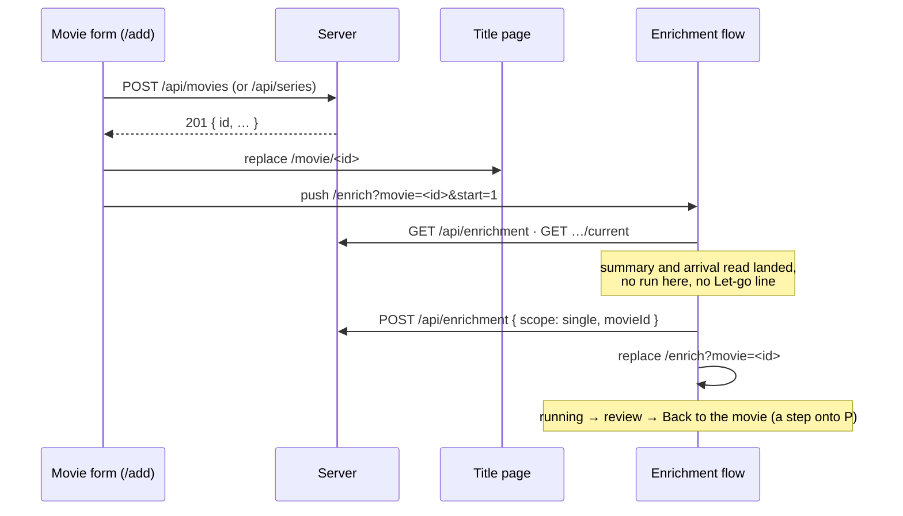

# 45 — Add and sync

> **Initiative:** `add-and-sync`
> **Issue:** to be filed by `write-a-prd` (build order step 28)
> **PRD:** `docs/PRDs/45-add-and-sync.md` (to be written)

This log is the `grill-me` session for build order step 28, 🔜 **Add and
sync**. It was held before the PRD and the prototype revision, against the code
as it stood on 2026-10-17 (`04bdf22`), and it is an immutable snapshot of that
moment. The session ran alone, and the maintainer approved every
recommendation in advance, asking that the codebase stay consistent with its
naming, code conventions, patterns and architecture. Its input was step 28's
roadmap entry (`e8c0580`): adding one title by hand means typing every field
TMDB already knows.

## Background

What exists, read off the code:

- **The plain add.** `/add` (`?kind=series` for a show) is the **Movie
  form**'s `add` job (`formJob`). Its **Save gate** is a title and a video —
  every episode's for a series — and the title fills itself from the first
  video's name (`titleFromFilename`). `useMovieForm`'s `save` sends
  `createMovie(values)` → `Movie` or `createSeries(values, episodes,
seasonPosters)` → `Series`, then pushes the kind's **Fresh home** (`/` or
  `/?tab=series`). Both answers carry the new title's `id`; nothing reads it
  today. A refused save leaves the form standing with everything typed in it.
- **The Single-title Sync.** `/enrich?movie=<id>` or `/enrich?series=<id>`
  (`enrichPath`) opens `EnrichmentFlow` on the `single` scope: setup names the
  title under _Just this movie_ / _Just this series_, Start reads _Fetch
  details_, review's Finish is _Back to the movie_ / _series_, and `useGoBack`
  lands on the title's page. `useEnrichmentRun(single)` re-attaches on arrival
  only to a `single` run for that same title (`belongsHere`); another's run in
  review is the **Waiting run**, named by the **Let-go line**
  (`letGoLine`, only while it has **Decisions**). The flow's `onStart` owns
  every start rule: no summary yet → nothing; no key → push `/settings` and
  _Add your TMDB key here first._; offline → nothing; a `409` over another's
  run → the **Busy notice**. The server's `start` refuses `busy`, `no-key`
  and a title it does not hold, and nothing else.
- **The import's precedent.** Import setup and the Library folders page draw
  `EnrichCheckCard` (`features/import-export/`) — _Also fetch metadata and
  posters from TMDB_, off on every visit, its hint chosen by `useKeyStored()`.
  The run carries `enrich`; _Finish_ **replaces** `/import` with
  `/enrich?scope=all`, setup on _Everything_, **nothing started**.
  `useImportRun` exposes `attaching` while its arrival read is in flight;
  `useEnrichmentRun` exposes no such flag.
- **The ⋯ menu** on both detail pages already offers _⟳ Fetch from TMDB_ over
  a held title (step 16).

## Problem

1. Adding one film or show by hand means typing every field TMDB already
   knows, though a Single-title Sync could fill them once the title exists.
2. The option must not cost a press it does not need, nor ever let go of
   another title's review behind the maintainer's back.
3. A failed or refused Sync must never undo, or block, the add.

## Questions and Answers

### Scope

1. **One initiative?** ✅ **One**, `add-and-sync`, step 28, entirely in
   `src/` — no route, no wire field, no migration (Q16). ❌ Not built: the
   option on an edit or a Resolve (Q14), a Sync in the background (Q7), a
   year prefilled from the video's name, and a TMDB search _before_ the save.

### Names

2. **What are the new things called?** ✅ Two terms:
   - **Add and sync** — the **Movie form**'s plain-add option, the
     `EnrichCheckCard` ticked: the title is saved, then a **Single-title
     Sync** is run over it. In `useMovieForm` it is `enrich` and
     `toggleEnrich`, `ImportFlow`'s names for the same box.
   - **Started on arrival** — the **Enrichment flow** opened with `?start=1`
     pressing its own Start once, as the maintainer would, then dropping the
     parameter. `EnrichQuery.start?: true`.

   ❌ "auto-sync", "quick add", "smart add", "auto-start" — aliases to avoid.

### Where it is drawn

3. **A checkbox or a second button?** ✅ **A checkbox, `EnrichCheckCard`'s
   precedent**: the same card, between the Files card and the actions, on a
   plain add only and on both **Form kinds**. _Add to library_ keeps its
   label; the box changes where the save goes, not what it is. ❌ A second
   button (_Add and sync_): two primaries in one row, and a save label that
   means two different journeys.

4. **Ticked by default?** ✅ **Off on every mount**, the import's precedent
   and the **Import mode**'s (Link on every visit): no preference is stored.
   A switch of **Form kind** keeps it — it is one choice over the record both
   kinds share.

5. **Its words, and where it lives?** ✅ The label is kept — _Also fetch
   metadata and posters from TMDB_ reads true beside _Add to library_. The
   key-less hint is kept (_Needs a TMDB key. Add one under Settings → Network
   first._). The keyed hint is the caller's: the import's _Runs straight
   after the import, over everything it brings in. Needs the internet._, the
   form's _Runs straight after the save, over this title. Needs the
   internet._ So a second feature draws it, and it **graduates**,
   `FieldDiff`'s precedent:

   ```ts
   // src/components/EnrichCheckCard/EnrichCheckCard.tsx
   export interface EnrichCheckCardProps {
     checked: boolean;
     /** Whether a TMDB key is stored — it chooses between the two hints. */
     keySet: boolean;
     /** The hint while a key is stored: when the Sync runs, over what. */
     keyedHint: string;
     onToggle: () => void;
   }
   ```

   `mol.EnrichCheckCard` is drawn for it (Q17). `useKeyStored` moves to
   `src/hooks/useKeyStored/` — a hook two features now call. Neither move
   changes a pixel or a read.

### The Save gate

6. **Does the gate change?** ✅ **No** — a title and a video, every
   episode's for a series. The title fills itself from the video's name, and
   the **Search ladder** is what turns `the.matrix.1999.1080p` into a match;
   a typed year still helps it. The box makes no field required. ❌ Relaxing
   the title: the Sync has nothing to search with, and a title is what the
   library lists.

### Where it lands

7. **The flow, or the title's page with the Sync behind it?** ✅ **The
   flow's single run**, `enrichPath({ movie | series: id, start: true })`.
   An `ambiguous` or `missing` match needs the review's faces, a conflict
   needs _Yours | TMDB_, and progress needs the bar; none of them exists on
   a detail page. ❌ A background Sync: its review would be reachable only
   by knowing to go and look, and the title page would redraw under the
   reader as fields landed.

8. **What does history hold?** ✅ **Settings → the title's page → the
   flow.** The save **replaces** `/add` with the title's page (`moviePath`
   or `seriesPath`), then **pushes** the flow. So _Back to the movie_ and
   Back both step onto the new title — the page that shows what the Sync
   wrote — and its own Back steps to Settings, where _＋ Add a title_ was.
   This leaving is not a **Fresh home**; with the box off the add keeps its
   Fresh home exactly as now. ❌ A plain push: Finish would step back onto
   an emptied form. ❌ Replacing `/add` with the flow alone: Finish, which
   says _Back to the movie_, would step to Settings.

### Who starts the Sync

9. **The form or the flow?** ✅ **The flow — Started on arrival.** Opened
   with `?start=1`, `EnrichmentFlow` calls its own `onStart` once, when the
   **EnrichmentSummary** and the arrival read have both landed, with setup's
   defaults: every field chip, both **Write targets** as setup would offer
   them. Then it **replaces** the URL with the same `enrichPath` minus
   `start`, so a reload or a later Back never starts a second Sync.
   `useEnrichmentRun` gains `attaching: boolean`, `useImportRun`'s name,
   `true` until the arrival read answers. ❌ The form posting
   `startEnrichment`: the wire would move to `src/api/`, and every start rule
   — the key, offline, busy, the Waiting run — would be written twice.

10. **When is it not started?** ✅ **Exactly when the press would not run or
    would need the maintainer to read something first**, each answered by
    Start's existing rule, the title already saved:
    - **No key** — Start's rule: `/settings` pushed, _Add your TMDB key here
      first._
    - **Offline** — Start does nothing; setup draws its offline banner and
      waits for a press.
    - **Another's Sync running** — the `409`, the **Busy notice**; setup
      stays.
    - **A Waiting run with Decisions** — **not pressed**: the **Let-go line**
      is drawn under Start, and letting another title's review go is the
      maintainer's press, never an arrival's. A Waiting run with none has no
      line, and Start would let it go silently, so arrival presses.
    - **The run already belongs here** — it was re-attached; nothing to
      press.

    In every case the parameter is dropped.

11. **An unsettled match?** ✅ **The review, as the ⋯ menu's Sync answers
    it** — the Candidate picker for `ambiguous`, the search box for
    `missing`, _Yours | TMDB_ for a field typed into the form that TMDB
    disagrees with. A blank field is simply filled. Nothing new is drawn.

12. **A save that fails?** ✅ **Unchanged**: the form stands with
    everything in it, nothing is navigated and nothing is synced. A Sync that
    fails, is stopped or is skipped never touches the title the save made.

### What it is not offered on

13. **The series kind?** ✅ **Yes, alike** — `createSeries`' `id`,
    `seriesPath`, `enrichPath({ series })`; the single-series run already
    fetches seasons and episodes and draws the **Seasons** section.

14. **An edit, a Resolve?** ✅ **No.** A held title has the ⋯ menu's _Fetch
    from TMDB_ (step 16); a Resolve is the **Import context**, whose run
    carries its own `enrich`. The box is drawn on the `add` job alone.

15. **Does the form's Back or Cancel change?** ✅ **No** — the box only
    changes where a successful save goes.

### The server

16. **What changes on the server?** ✅ **Nothing.** The add routes answer
    the record with its `id`; `POST /api/enrichment` takes a `movieId` or a
    `seriesId` already; the single run already re-attaches by title.

### Prototype and docs

17. **Prototype first?** ✅ **Yes**, per _The prototype is the spec_:
    `feat.MovieForm.dc.html` (the box on a plain add, both kinds, between the
    Files card and the actions), `mol.EnrichCheckCard.dc.html` (graduated,
    `keyedHint`), and `FamilyFlix.dc.html` (the save onto the title's page and
    the flow, Started on arrival). `feat.EnrichmentFlow` draws nothing new.

18. **Which documents change?** ✅ README's and CLAUDE.md's step 28 and
    feature entries, CLAUDE.md's folder tree (`components/EnrichCheckCard/`,
    `hooks/useKeyStored`, `enrichPath`'s `start`, the flow's arrival), and
    the glossary — ticked ✅ only after the refactor.

## Design

### Chosen and rejected

- ✅ A checkbox, `EnrichCheckCard` graduated with `keyedHint`; ❌ a second
  button.
- ✅ Off on every mount, kept across a kind switch; ❌ a stored preference.
- ✅ The Save gate unchanged.
- ✅ Land on the flow's single run; ❌ a background Sync on the title page.
- ✅ Replace `/add` with the title's page, then push the flow; ❌ a plain
  push; ❌ replacing with the flow alone.
- ✅ The flow starts itself, **Started on arrival**, through its own
  `onStart`; ❌ the form posting the start.
- ✅ Never pressed over a **Let-go line**.
- ✅ The plain add only, both kinds; ❌ an edit, a Resolve.

### The journey



### The units

| Unit                          | Where                                  | What                                         |
| ----------------------------- | -------------------------------------- | -------------------------------------------- |
| `EnrichCheckCard` (graduated) | `src/components/EnrichCheckCard/`      | the box; `keyedHint` the caller's words      |
| `useKeyStored` (moved)        | `src/hooks/useKeyStored/`              | whether a key is stored, three callers' read |
| `enrich`, `toggleEnrich`      | `features/movie-form/useMovieForm/`    | the box's state; the add's leaving           |
| `EnrichQuery.start`           | `src/utils/enrichPath/`                | `?start=1`                                   |
| `attaching`                   | `features/enrichment/useEnrichmentRun` | `true` until the arrival read answers        |
| **Started on arrival**        | `features/enrichment/EnrichmentFlow`   | one `onStart`, then the parameter dropped    |

### Routes

None change.

## Implementation Plan

1. **Prototype.** The three files of Q17.
2. **Started on arrival.** `enrichPath`'s `start`, `useEnrichmentRun`'s
   `attaching`, the flow's one press and the replace, every case of Q10.
   Thinnest end-to-end: `/enrich?movie=<id>&start=1` typed by hand runs the
   Sync and drops the parameter.
3. **The box on a film's add.** `EnrichCheckCard` graduated, `useKeyStored`
   moved, the form's `enrich`, and the save's replace-then-push.
4. **The series kind.** The same leaving over `createSeries`.
5. **Docs.** README, CLAUDE.md and the glossary per Q18.

## Trade-offs

- **Easier:** one title is added by its files and one tick; the Sync's
  review answers an uncertain match with the faces it already has; every
  start rule stays in one place.
- **Harder:** the flow now has an arrival that acts, so its suites must say
  whether `start` is set and what the arrival read answered; the add has two
  leavings, chosen by the box.
- **Out of scope:** the option on an edit or a Resolve, a background Sync, a
  year read off the filename, a TMDB search before the save, a remembered
  tick.
