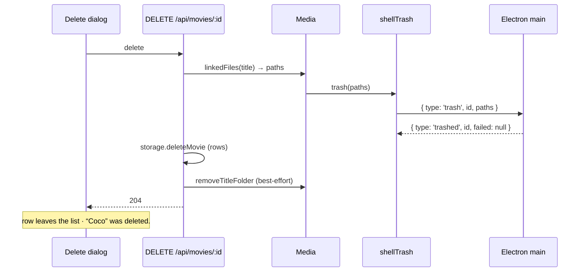

# 47 — Manage library

> **Initiative:** `manage-library`
> **Issue:** #406 (build order step 30)
> **PRD:** `docs/PRDs/47-manage-library.md`

This log is the `grill-me` session for build order step 30, 🔜 **Manage
library**. It was held before the PRD, against the code as it stood on
2026-10-19 (`c734465`), and it is an immutable snapshot of that moment. The
session ran alone, and the maintainer approved every recommendation in
advance, asking that the build keep to FamilyFlix's own components and layouts
and stay consistent with its naming, conventions, patterns and architecture.
Its inputs were step 30's roadmap entry and a Claude Design handoff,
`docs/handoff/handoff-manage-library/` — `page.ManageLibraryPage.dc.html`,
seven screenshots and a README with three open questions.

## Background

What exists, read off the code and the handoff:

- **The handoff draws one half of step 30.** A page at `/settings/library`,
  reached from a new Library-group row, lists every title split by
  Movies / Series, one row per title — a folder tile, title and year, a mono
  path, a _Linked_ / _Imported_ badge, a file count, a status dot (_Synced
  with TMDB_, _Edited by hand_, _No metadata_, _Syncing…_) — with an _Edit ▾_
  menu (_Edit details_, _Sync with TMDB_) and a ⋯ menu (_Clear metadata_,
  _Delete…_), each of the last two behind a dialog listing what is removed
  and what is kept. A linked title's Delete removes its folder from disk,
  bypassing the Recycle Bin. **It draws nothing of _Add a show folder_.** Its
  README's wiring into `FamilyFlix.dc.html` was not made.
- **Delete today.** `DELETE /api/movies/:id` and `DELETE /api/series/:id`:
  `204`; **row first, then bytes, best-effort** — the cascade, then
  `media.removeTitleFolder` over the recorded **Media folder**. A **Linked
  video** is forgotten, never removed: "a linked video stays the Library
  folder's … never deleted by the app" (log 41). No `409` guard. The two
  **Delete dialogs** (`DeleteMovieDialog`, `DeleteSeriesDialog`) are one
  paragraph and **Delete movie** / **Delete series** before **Cancel**; they
  draw no refusal. `deleteMovie` and `deleteSeries` are each one feature's
  wire.
- **What a title records.** `movies`/`series`: `tmdb_id`, `title NOT NULL`,
  the Sync's ten fields, `library_folder_id` + `source_folder` (its **Source
  folder** / **Show folder**, when an import or scan found it), `media_folder`
  (its managed **Movie folder** / **Series folder**, always). A film's or an
  episode's `video_folder_id` makes its video a **Linked video**; a
  **Collection folder** film shares its Source folder with others, told by
  `source_file`. A **Sync never writes a title**; it writes the ten fields,
  `tmdb_id`, Season posters, and each episode's title, air date and Still.
- **The Electron seam.** The **Server process** is a `utilityProcess`; it
  and main speak the **Shell handshake** (`ready` / `fatal` / `shutdown`).
  Only main has Electron's `shell`, and so `shell.trashItem`.
- **Furniture that already exists.** `MaintainerLayout`, `PageHeader`,
  `PillTabs` (counts written into the label by `kindFilter`, _Movies 6_),
  `FolderRow` (the accent tile, the mono path, `folderLine`'s _Can’t be
  reached right now_), `Menu` / `MenuItem` (`glyph`, `trailing`, `danger`),
  `IconButton`, `Modal`, the **Reset dialog**'s **What goes** / **What
  stays** lists and its refusal line, `ActionRow`, `useSnackbar`,
  `enrichPath({ movie | series, start })` — **Started on arrival** (log 45).

## Problem

1. Nothing lists what the library holds in one place, with where each title
   lives and whether TMDB matched it.
2. Nothing takes a title out completely: today's Delete leaves a linked
   video in its Library folder, and the next **Scan folders** brings the
   title back.
3. A wrong TMDB match has no undo — a **Rematch** was ruled out in step 25.
4. The handoff improvises where FamilyFlix already has a word, a component or
   a rule: a count pill on the tabs, an inline syncing row, _Imported_,
   _metadata_, Cancel before the confirm, a permanent delete.

## Questions and Answers

### Scope

1. **Both halves of step 30 in one initiative?** ✅ **No — the overview
   alone.** _Add a show folder_ reopens design log 11 Q6 (manual pickers
   only), and the handoff draws nothing of it; _The prototype is the spec_
   says a feature with no prototype is not built. It becomes **step 31,
   Add a show folder**, with its own grill and its own prototype revision.
   Step 30 keeps its name, **Manage library**. ❌ Settling the show-folder
   half here without a design: a second improvisation in one log.

2. **What is out?** ❌ Search, sort controls, filters and bulk actions on
   the page; size on disk (walking every linked folder on each visit); an
   episode-level delete; _Clear details_ on the detail pages' ⋯ menus; a
   remembered exclusion list (Q11); _Move the media folder_.

### Names

3. **What are the new things called?** ✅
   - **Manage library page** — `/settings/library`, the hub's third nested
     route, heading _Manage library_. `pages/ManageLibraryPage`, organism
     `features/manage-library/ManageLibrary/` — the feature named after its
     initiative, as `movie-form` and `import-export` are. ❌
     `library-admin` (the handoff's suggestion): no other feature is named
     for a role.
   - **Title row** — one title on the page (`TitleRow`). ❌
     `ManagedFolderRow`: the row is a title, and a copied title has no
     folder of the family's.
   - **Library title** — the wire shape of one row (`LibraryTitle`).
   - **Details state** — `synced` / `own` / `none`, the row's dot (Q7).
   - **Clear details** — the ⋯ menu's _Clear details_: a title set back to
     its title, its files and its household signals (Q13). ❌ _Clear
     metadata_: the menu's sibling is _Edit details_, the hub's line is _N of
     M titles have **full details**_, and the flow's Start reads _Fetch
     details_.
   - **Linked files** — what a Delete moves to the Recycle Bin for a title
     with a Linked video (Q10); `LinkedFiles` = `folder` / `videos` /
     `unreachable`.

   ❌ "admin", "manager", "folder list", "wipe", "reset title", "unlink" —
   aliases to avoid.

### The page

4. **Where is it reached from?** ✅ An `ActionRow` after _📁 Library
   folders_: glyph `☰`, **Manage library**, _Edit, clear or delete any title
   in your library._ → `/settings/library`. Its **Landing** is Settings,
   `useGoBack('/settings')`, Library folders' precedent.
   `MaintainerLayout` around the organism; `PageHeader` with Back, the
   heading and the handoff's lede reworded for titles — _Every title in your
   library, and where its files are. Edit its details, clear them, or delete
   it for good._

5. **The tabs?** ✅ `PillTabs` as it is, labels _Movies 6_ and _Series 4_ —
   `kindFilter`'s spelling — `tab` in the URL as a replace, omitted at
   `movies`, `LibraryTabs`' precedent. ❌ A count pill inside each tab:
   `PillTabs` would grow a prop for one caller, and the **Kind filter**
   already counts in words. The summary at the toolbar's right reads _6
   movies · 1 without details_ (_4 series_ on the other tab), the second
   part only when there is one. ❌ _6 folders_.

6. **The list?** ✅ Every title of the tab, **A–Z** by title — the Export's
   order — rows stacked 8px apart. **Blank until it lands**, `null` and
   nothing drawn on a failed read, the Settings rule. An empty tab is the
   handoff's card: _No movies in your library._ / _No series in your
   library._

### The Title row

7. **What does the status dot mean?** ✅ The **Details state**, read off
   the row, never off a history the app does not keep:
   - `synced` — `tmdb_id` is set: _Synced with TMDB_, `success` dot.
   - `none` — no `tmdb_id`, and the Sync's fields (year, synopsis, director,
     cast, original title, poster, backdrop, genres, TMDB score) all empty:
     _No details_, `warning` dot.
   - `own` — anything else: _Your own details_, `info` dot.

   ❌ _Edited by hand_: a sheet import and a scan's folder art are not edits,
   and the app cannot tell them apart. ❌ _Syncing with TMDB…_ (Q15).
   Spelled once on the server, `detailsStateSql`, `fullDetails`' precedent.

8. **What does the row say?** ✅ The handoff's layout on our furniture —
   `FolderRow`'s tile and mono path, extended with:
   - the title, and the year as the series page spells it (`spellYearSpan`
     for a show); no year drawn when there is none. The title is always the
     title: ❌ the handoff's folder name in mono for a bare row — after
     Clear details the title is kept (Q13), so there is nothing to swap in.
   - **the path** — a linked title's Source folder (a Collection folder
     film's video), else its Media folder, both absolute. A linked title
     whose Library folder cannot be read draws `folderLine`'s _Can’t be
     reached right now_ in `danger` under it.
   - **the badge** — _Linked_ or _Copied_, the **Import mode**'s words. ❌
     _Imported_: a title added on the Movie form was never imported. A
     series is _Linked_ when any episode's video is.
   - **the files** — a film: _3 files_, its video and its subtitles; a
     series: _3 seasons · 151 episodes_, `SeriesMetaLine`'s counts.
   - the Details state's dot and words.

9. **The two menus?** ✅ Both on `Menu`, the handoff's split kept:
   - **Edit ▾** — `Button` secondary sm with a trailing chevron, the
     `FilterDropdown` trigger's shape. Items: _Edit details_ (`/add?movie=`
     or `/add?series=`, `movieFormPath`) and _Sync with TMDB_ (Q15).
     `MenuItem` gains an optional `hint` line — _Change the title, year and
     poster by hand_ / _Fetch details and artwork again_ — a prop, not a
     second item component.
   - **⋯** — `IconButton` ghost with `MoreIcon`, _More actions for
     “Coco”_. Items: _Clear details_, disabled while the Details state is
     `none` (`MenuItem` gains `disabled`), a divider, and _Delete…_ as the
     **Danger row**.

### Delete

10. **What does a Delete do to a Linked video?** ✅ **It moves its files to
    the Recycle Bin.** The maintainer asked for a delete that takes a title
    out completely; a forgotten linked video comes back on the next scan
    and keeps its disk. But FamilyFlix has never removed a file of the
    family's, so the first time it does, it is undoable: main's
    `shell.trashItem`, never `fs.rm`. The **Linked files**, one rule spelled
    once (`media/linkedFiles/`, pure), shared by the list read and the
    delete:
    - `folder` — the title's Source folder (Show folder) holds no other
      held title's video and is not a Library folder itself: **the folder
      goes whole**, extras and all.
    - `videos` — it is shared (a **Collection folder**, or a show whose
      episodes sit at a Library folder's root): **its linked videos alone
      go**, nothing else in the folder.
    - `unreachable` — its Library folder cannot be read: nothing is
      trashed, the rows still go, the dialog says the files stay.

    A copied title has no Linked files (`null`). ❌ The handoff's permanent
    delete: one wrong press loses a film nobody can re-rip. ❌ Forget only,
    today's rule: the delete would not do what the step asks.

11. **Does a later Scan folders bring a deleted title back?** ✅ **Only if
    its files are still there.** A linked title's are in the Recycle Bin,
    so no. A copied title imported from a Library folder still has its
    original there — FamilyFlix copied it, the original is the family's,
    and it is never trashed — so the dialog says so (Q12). ❌ An exclusion
    list: state with no screen to undo it.

12. **The Delete dialog?** ✅ The handoff's dialog on `Modal`, with the
    **Reset dialog**'s **What goes** / **What stays** lists (two columns,
    the handoff's ✕ and ✓), the path in the mono well, and our order and
    words: **Delete movie** / **Delete series** (`danger`, _Deleting…_ in
    flight) **before Cancel**; focus on the card. ❌ _Delete folder_, Cancel
    first.
    - Title _Delete “Coco”?_; subtitle _This takes the movie out of
      FamilyFlix. It can’t be undone from here._
    - What goes: _Its details, poster and artwork_; _Its watch history,
      rating and heart_; then by its files — copied: _FamilyFlix’s copy of
      its video and subtitles_; `folder`: _Its folder, to the Recycle Bin_;
      `videos`: _Its video file(s), to the Recycle Bin_.
    - What stays: copied with a Source folder: _Your original in its library
      folder — Scan folders would bring it back_; `unreachable`: _Its files
      on <path> — they can’t be reached right now_; otherwise _Nothing_.
    - The callout, for `folder` and `videos` only: _This is a linked title.
      Its files go from your library folder to the Recycle Bin, not just
      out of FamilyFlix._
    - A refusal (Q14) in `danger` above the buttons, the Reset dialog's
      line, until the next press is answered.
    - Done: the row leaves the list, and `success`: _“Coco” was deleted._ ❌
      A `danger` snackbar for a delete that worked.

13. **What does Clear details clear?** ✅ **Everything a Sync can write but
    the runtime**, so a cleared title is **Unmatched** and the next _Only
    what's missing_ Sync searches it afresh — the undo of a wrong match:
    `tmdb_id`, year (a show's end year too), synopsis, director, cast,
    original title, TMDB score, genres, poster, backdrop; a show's Season
    posters, and each episode's title, air date and Still of any **Still
    source**. The art files go from managed storage, row first then bytes,
    best-effort. **Kept**: the title (a Sync never wrote it), every file,
    the runtime (the bytes said it), watch history, the household
    **Rating** and the heart. ❌ The handoff's _ratings_ removed: the Rating
    is the family's, and no Sync writes it. ❌ Watch history cleared — the
    handoff's open question 1.

    The **Clear dialog**: the accent tile, _Clear details?_, _The movie
    stays in your library under its title, with no details, until you edit
    it or sync it with TMDB._, the path well, What goes (_Year, synopsis,
    credits and genres_; _Poster, backdrop and artwork_; _Its TMDB match
    and score_), What stays (_Its title and files_; _Watch history, rating
    and heart_), then **Clear details** (`primary`, _Clearing…_) before
    Cancel. Done: the row is redrawn from the echo, and `success`: _Details
    cleared for “Coco”._

14. **When is a Delete refused?** ✅ Trash first, rows after, so a refusal
    changes nothing but what already went to the bin:
    - `409` _Only the desktop app can move a linked title’s files to the
      Recycle Bin._ — no shell (a browser on `npm run dev`).
    - `409` _Couldn’t move <path> to the Recycle Bin. Close anything playing
      it and try again._ — a file the shell could not trash. What was
      trashed stays trashed; a retry counts a path already gone as gone.

    Then the rows, then the Media folder, best-effort, as today. No guard
    while a run runs, the delete's precedent.

15. **Sync with TMDB — inline, or the flow?** ✅ **The flow, Started on
    arrival.** The overview **pushes the title's page, then**
    `enrichPath({ movie | series: id, start: true })` — log 45's leaving
    with a push where the add replaces — so _Back to the movie_ steps onto
    the movie, and its Back onto the overview. Every start rule (no key,
    offline, busy, a Let-go line) is the flow's. ❌ The handoff's _Syncing
    with TMDB…_ row and its snackbar: log 45 Q7 rejected a background Sync —
    an ambiguous match needs the review's faces.

16. **Is there one Delete or two?** ✅ **One.** The overview calls the
    existing `DELETE /api/movies/:id` and `/api/series/:id`, which learn
    Linked files and the two refusals; `deleteMovie` and `deleteSeries`, now
    two features' wire each, move to `src/api/`. The detail pages' **Delete
    dialogs** keep their paragraph and gain, for a linked title, _Its video
    goes to the Recycle Bin._ (_Its files go…_ for a series), and the
    refusal line — the prototype draws neither, so both are drawn first
    (Q20). ❌ A second route for the overview: one delete with two meanings.

17. **An unreachable title?** ✅ Drawn with the danger line (Q8); **Delete
    stays offered** — a dead drive's titles are exactly what the maintainer
    needs to clear out — and its dialog says the files stay (Q12). Edit and
    Clear are unchanged. ❌ Delete disabled (the handoff's open question 3).

### The server

18. **Which routes?** ✅ - `GET /api/library-titles` → `{ movies: LibraryTitle[]; series:
LibraryTitle[] }`, A–Z, reachability read afresh — one read for both
    tabs, since both labels count; `/library-folders`' spelling. ❌
    `?kind=`: the other tab's count would need a second read. - `POST /api/movies/:id/clear-details` and `POST
/api/series/:id/clear-details` → `200 LibraryTitle`, the echo the row
    redraws from; `404` for an id not held. The per-title sub-route
    precedent (`/favorite`, `/rating`). - `DELETE /api/movies/:id`, `/api/series/:id` — as today, plus Q10 and
    Q14.

19. **Where does each piece live?** ✅ - `server/src/library/titles/` — `libraryTitles()`, the list's one
    query; `detailsStateSql`; `clearMovieDetails` / `clearSeriesDetails`,
    each one transaction answering the Stored paths it let go. - `server/src/media/linkedFiles/` — pure: a title's linked videos, its
    Source folder and every other held title's → `LinkedFiles` and the
    paths to trash. A Linked video is not managed storage, but deciding
    which of a Library folder's files are a title's is folder knowledge,
    and `media/` is where folder knowledge lives. - `createMedia` gains `trashLinked(paths)` over an injected `Trash` — so
    no route learns there is a shell, the way none learns there is an
    FFmpeg. - `server/src/shell/shellTrash/` — `createShellTrash(parentPort)` → a
    `Trash`: `trash(paths) → { kind: 'trashed' } | { kind: 'failed'; path
} | { kind: 'unavailable' }`, inert with no parent port,
    `shellHandshake`'s precedent. - The **Shell handshake** grows one exchange: `ServerMessage` `{ type:
'trash'; id: number; paths: string[] }`, `ShellCommand` `{ type:
'trashed'; id: number; failed: string | null }`.
    `electron/trashItems/` answers it — each path through
    `shell.trashItem`, a missing path counted as gone, stopping at the
    first failure — wired by `main.ts` and `serverHandle`. - No migration.

### Prototype and docs

20. **Prototype first?** ✅ **Yes — the handoff promoted and amended.**
    `page.ManageLibraryPage.dc.html` moves into `docs/handoff/` amended to
    this log (the labels with counts, _Copied_, the Details state's words,
    _Clear details_, no syncing row, the dialogs' lists, words, order and
    refusal, `success` notices); `page.SettingsPage.dc.html` gains the row;
    `FamilyFlix.dc.html` gains the screen; `page.MoviePage` and
    `page.SeriesPage` draw the Delete dialogs' linked sentence and refusal.
    `handoff-manage-library/` stays as received. Built on our components
    only — the maintainer's ask — so the amended prototype names each one.

21. **Which documents change?** ✅ README's and CLAUDE.md's step 30 (the
    overview alone) and a new step 31 (_Add a show folder_, 🔜), the
    feature entries, CLAUDE.md's folder tree and _Settings Hub_ routes, the
    **Linked video** and **Library folder** rules ("never removed by the
    app" becomes "only ever to the Recycle Bin, by a Delete"), and the
    glossary — ticked ✅ only after the refactor.

## Design

### Chosen and rejected

- ✅ The overview alone; _Add a show folder_ is step 31. ❌ Both halves.
- ✅ `PillTabs` with counts in the labels; ❌ a count pill.
- ✅ The Details state off the row; ❌ _Edited by hand_.
- ✅ _Linked_ / _Copied_; ❌ _Imported_.
- ✅ Clear details keeps the title, files, runtime and household signals;
  ❌ clearing the Rating or watch history.
- ✅ A Delete moves Linked files to the Recycle Bin through main; ❌
  `fs.rm`; ❌ forget only.
- ✅ A shared Source folder loses only the title's videos; ❌ the folder.
- ✅ One Delete for every surface; ❌ an overview-only route.
- ✅ Sync through the flow, Started on arrival; ❌ an inline syncing row.
- ✅ Confirm before Cancel, `success` notices; ❌ the handoff's order and
  danger snackbar.

### The wire

```ts
// src/types/libraryTitles.ts
export const DETAILS_STATES = ['synced', 'own', 'none'] as const;
export type DetailsState = (typeof DETAILS_STATES)[number];

/** What a Delete moves to the Recycle Bin; `null` for a copied title. */
export type LinkedFiles = 'folder' | 'videos' | 'unreachable';

interface LibraryTitleBase {
  id: string;
  title: string;
  year: number | null;
  /** The linked Source folder (or a Collection film's video), else the Media folder — absolute. */
  path: string;
  linkedFiles: LinkedFiles | null;
  /** A copied title's Source folder, absolute — the original a Delete leaves. */
  originalPath: string | null;
  details: DetailsState;
}

export type LibraryTitle =
  | (LibraryTitleBase & { kind: 'movie'; files: number })
  | (LibraryTitleBase & {
      kind: 'series';
      endYear: number | null;
      seasons: number;
      episodes: number;
    });

export interface LibraryTitles {
  movies: LibraryTitle[];
  series: LibraryTitle[];
}
```

### The delete



### The units

| Unit                               | Where                                       | What                                                            |
| ---------------------------------- | ------------------------------------------- | --------------------------------------------------------------- |
| `ManageLibraryPage`                | `src/pages/ManageLibraryPage/`              | `MaintainerLayout` around the organism                          |
| `ManageLibrary`                    | `features/manage-library/ManageLibrary/`    | header, tabs, summary, list, the open dialog                    |
| `TitleRow`                         | `features/manage-library/TitleRow/`         | one title, its two menus                                        |
| `DeleteTitleDialog`, `ClearDialog` | `features/manage-library/`                  | the two dialogs                                                 |
| `useLibraryTitles`                 | `features/manage-library/useLibraryTitles/` | read on mount, `deleteTitle`, `clearDetails`                    |
| `titleRowView`                     | `features/manage-library/titleRowView/`     | pure: a LibraryTitle → the row's and dialogs' words             |
| `api/`                             | `features/manage-library/api/`              | `fetchLibraryTitles`, `clearMovieDetails`, `clearSeriesDetails` |
| `deleteMovie`, `deleteSeries`      | `src/api/` (moved)                          | two features' wire each                                         |
| `MenuItem` `hint`, `disabled`      | `src/components/Menu/`                      | the Edit menu's second line; Clear's disabled state             |
| `libraryTitles`, `clear…Details`   | `server/src/library/titles/`                | the list read; the two clears                                   |
| `linkedFiles`                      | `server/src/media/linkedFiles/`             | pure: what a Delete trashes                                     |
| `trashLinked`                      | `server/src/media/createMedia/`             | over the injected `Trash`                                       |
| `createShellTrash`                 | `server/src/shell/shellTrash/`              | the server's half of the trash exchange                         |
| `trashItems`                       | `electron/trashItems/`                      | main's half: `shell.trashItem`                                  |

## Implementation Plan

1. **Prototype.** Q20's files.
2. **The list, read-only.** `GET /api/library-titles`, `detailsStateSql`,
   `linkedFiles`, the page, the row, the entry row. Thinnest end-to-end: the
   Library group's row opens a page listing every title with its path,
   badge and dot.
3. **Edit and Sync.** The Edit ▾ menu, `MenuItem`'s `hint`, the form's edit
   and the push-push into the flow.
4. **Clear details.** The two routes, the dialog, the echo.
5. **Delete, copied titles.** `deleteMovie` / `deleteSeries` moved to
   `src/api/`, the ⋯ menu, the dialog over today's route.
6. **Delete, linked titles.** The handshake's trash exchange, `shellTrash`,
   `trashItems`, `trashLinked`, the two refusals, the detail dialogs'
   sentence and refusal.
7. **Docs.** Q21.

## Trade-offs

- **Easier:** the maintainer sees the whole library's state in one list; a
  wrong match is undone by Clear then a Sync; a dead drive's titles can be
  cleared out; a linked delete is recoverable from the Recycle Bin.
- **Harder:** FamilyFlix now removes files from a Library folder — the first
  write that takes something out of one — so the Linked files rule carries
  a folder-sharing guard and the shell carries a request/answer exchange
  beside its shutdown; a browser build can no longer delete a linked title;
  three Delete dialogs say the same truth in two shapes.
- **Out of scope:** _Add a show folder_ (step 31), search and bulk actions
  on the page, size on disk, an exclusion list, an episode delete, Clear on
  the detail pages, a permanent delete.
