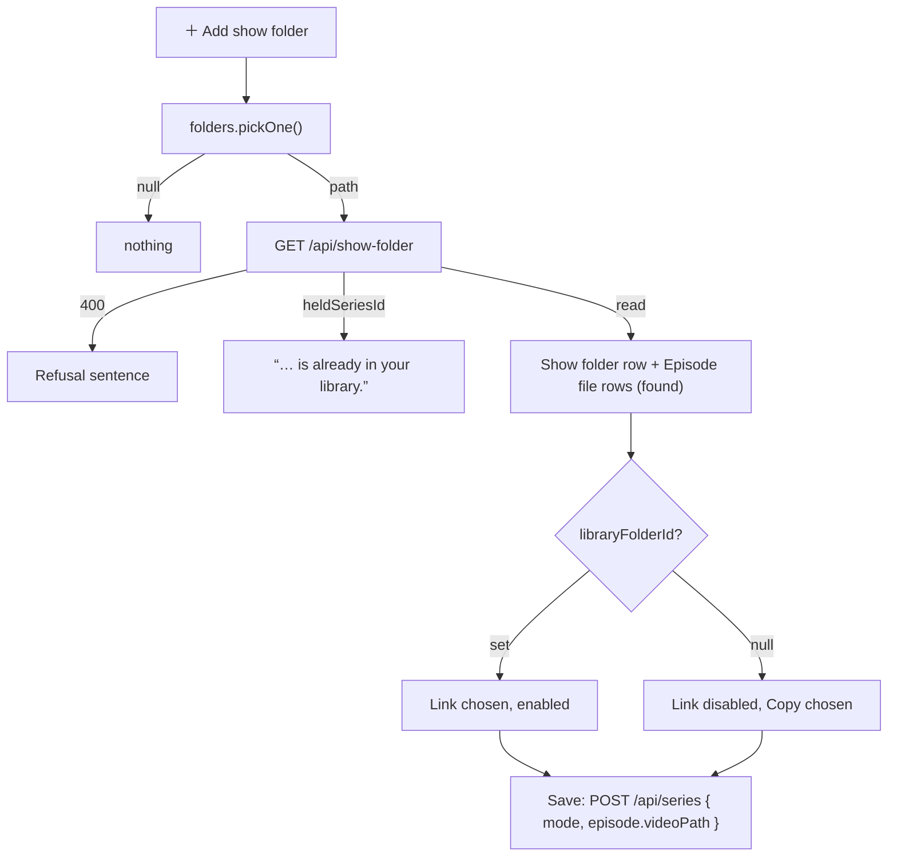

# 48 — Add a show folder

> **Initiative:** `add-a-show-folder`
> **PRD:** `docs/PRDs/48-add-a-show-folder.md` (to be written)
> **Plan:** `docs/PRDs/48-add-a-show-folder-plan.md` (to be written)

This log is the `grill-me` session for step 31 of the build order, **Add a
show folder**, held before the PRD was written. It ran against the code as it
stood on 2026-10-21 (`a5fff20`). It is an immutable snapshot of that moment.
The session ran alone, and the maintainer approved every recommendation in
advance, asking that the codebase stay consistent with its naming, code
conventions, patterns and architecture. Their brief: _add-a-show-folder. atm
when we add a show, we have to link a episode. the idea was to link a series
folder which contains the season folders and their respective episodes. for
both add a movie/series we need the option to link or import with link set as
default._

## Background

- **The series kind of the Movie form** (log 29) takes episodes one pick at a
  time: _＋ Add episode files_ is a browser file input, each video becomes an
  **Episode file row** numbered by the client's `readEpisodeTag`, and the save
  streams every byte through `POST /api/series` into a **Series folder**. A
  five-season show is five dialogs and a full copy.
- **Log 41 Q12 kept the form a Copy.** Linking from it would need "the shell's
  `webUtils.getPathForFile` over a new preload member, a server-side _inside a
  listed folder?_ check before the bytes are sent, and a choice drawn only
  sometimes". This brief asks for exactly that, so this log reverses Q12 for
  the add, deliberately.
- **Most of the machinery exists.**
  - `walkLibraryFolder` (media) and `groupShows` (import-export) read a
    **Show folder** into numbered `ShowEpisode`s, each with its stem-matched
    subtitles, plus its **Unplaced** videos and stray subtitles.
  - The **Series Resolve** already fills the form with **Found files**:
    `MovieFormFile`'s `found` kind, an absolute path that travels as
    `videoPath` in the `episode` JSON, numbered by `seriesResolveRows`' Numbering
    guess (`readSeasonFolder` + `readEpisodeTag`).
  - The importer's private `linkedVideo` + `listedFolderOf` turn a found path
    into a **Linked video** (`StoredVideo` relative to its listed **Library
    folder**) in a Link run; a Copy run `copyIn`s it.
  - The **Folder bridge** has `pickOne()`, one native folder or `null`.
  - `ImportModeChoice` over two `ChoiceCard`s lives in
    `features/import-export/`, drawn by Import setup and the Library folders
    page; Link on every visit.
- **What the form never records:** a form-added title has no
  `library_folder_id` / `source_folder`, so a later **Folder scan** over the
  same files would not read it as **Already in library**.

## Problem

Let the series add take a whole **Show folder** — its Season folders and their
episodes — in one pick, numbered as a Folder scan would number it, and let
both kinds of add **Link** a video where it lies instead of copying it, Link
by default, without loosening the boundary that makes a stored path safe.

## Questions and Answers

### Scope

1. **Its own initiative?** ✅ **Yes**: `48-add-a-show-folder.md`, initiative
   `add-a-show-folder`, step 31. It carries the Import mode on the form for
   both kinds, because the folder pick is what makes a link possible and the
   movie's link is the same rule over one file.

2. **What is not built?** ❌ A film's folder picked whole (autofill of poster
   and subtitles from a movie folder stays **Bulk import**'s); the show's
   poster or backdrop read from the folder (the importer reads none either —
   _Add and sync_ fills them); Link on the **Edit job**, the **Series edit
   job** or a **Resolve** (log 41 Q12 stands there: a held linked video stays
   linked, a fresh pick is copied, a Resolve follows its run); linking art or
   subtitles (log 41 Q3); an upload progress bar (log 29's shared debt).

### Picking the folder

3. **How is the folder picked?** ✅ **The Folder bridge's `pickOne()`**, behind
   a second button in the Episodes section, _＋ Add show folder_, before
   _＋ Add episode files_. It is drawn only when `folderBridge()` is not
   `null` — in a browser there is no path to read, and a control whose
   mechanism doesn't exist isn't drawn. ❌ **`<input webkitdirectory>`**:
   it reads every file into a `FileList` and still yields no path.

4. **Who reads it?** ✅ **The server, by the Folder scan's own rules.** A new
   unit, `server/src/import-export/readShowFolder/`, walks the one folder with
   `walkLibraryFolder` and reads it with `groupShows`, so the form numbers a
   show exactly as a scan would. A folder `groupShows` reads as a film (no
   Season folders, no tags) answers its videos as **Unplaced**: the maintainer
   said it is a show. The importer exposes it as `importer.readShowFolder(path)`,
   and `GET /api/show-folder?path=` answers it — the route never learns there
   is a walk. ❌ **Reading on the client**: `src/` never touches the
   filesystem. ❌ **A second numbering rule**: two readings of one folder
   drift.

5. **What does the read answer?** ✅ A `ShowFolderRead` (Design), or a `400`
   sentence: _That folder can’t be read._ / _There are no videos in that
   folder._ It carries the folder's **Title guess** (the importer's own rule
   on its name), the listed **Library folder** it lies under or `null`, the
   held series whose **Show folder** it already is or `null`, every numbered
   episode with its subtitles and their languages, the Unplaced videos, and
   the count of stray subtitles.

6. **What does a pick put on the form?** ✅ **One Episode file row per video,
   as Found files.** A numbered episode lands with its season, number, tag
   title and its stem-matched subtitles as found **Subtitle rows** in their
   detected languages. The Unplaced videos are numbered by the **Numbering
   guess** the Series Resolve already uses — `seriesResolveRows`' numbering,
   extracted as `numberFoundRows` in `formValues` with both callers — so every
   row is numbered and any clash is the gate's existing refusal. Rows land in
   season then episode order; a stray subtitle is not attached, and the
   section says so in one line: _2 subtitle files matched no episode._

7. **A second pick?** ✅ **Replaces the first folder's rows; picked-file rows
   stay.** A series has one Show folder (`source_folder` is one value). Rows
   added by _＋ Add episode files_ are kept, and save as copies.

8. **What shows which folder was picked?** ✅ **A Show folder row** above the
   episode rows: the `FileField` filled-row furniture labelled _Show folder_,
   the path in mono, a ✕ that takes the folder's rows off the form. No new
   molecule.

9. **The title?** ✅ **The read's Title guess fills an empty title**, log 29
   Q19's rule: a typed title is never overwritten. The client's
   `titleFromFilename` is not run on a folder name; the server already has the
   importer's rule.

10. **A folder already held?** ✅ **Refused before any row lands.** When the
    folder is the **Show folder** of a held series, the read answers its id and
    the form draws a **Refusal** under the buttons: _Harbor and Vine is already
    in your library._ No rows are added. Bulk import never makes a second copy
    of a held title, and neither does the form.

### Link or copy on the form

11. **Where is the choice drawn?** ✅ **`ImportModeChoice`, under the Files
    card, before the `EnrichCheckCard`**, on a plain add of either kind, only
    with the Folder bridge. **Link** on every visit, never remembered (log 41
    Q11). It and `ChoiceCard` graduate to `src/components/` — a second
    feature now draws them, `EnrichCheckCard`'s precedent — and the Export
    dialog and the import pages import them from there.

12. **How does the movie's picked video get a path?** ✅ **A new Folder bridge
    member, `pathOf(file)`**, over Electron's `webUtils.getPathForFile` in the
    preload: the absolute path, `''` for a file with none. The video picker
    stays the `FilePicker` it is. ❌ **A native file dialog for the video**:
    a second picker for the same slot, and the edit job's picker would differ.

13. **When can a video link?** ✅ **Only when it lies under a listed Library
    folder** — a **Linked video** is relative to one, by id. The movie asks
    `GET /api/library-folders/containing?path=` → `{ libraryFolderId }` when a
    video is picked; the show-folder read carries the same answer. Under none,
    the **Link** card is drawn disabled with the line _Only for files inside
    one of your library folders._ and **Copy** is chosen. `ChoiceCard` gains
    `disabled`. ❌ **Listing the folder as a Library folder on the fly**: a
    later scan would sweep in its siblings. ❌ **Refusing at Save**: the gate
    is a disabled button, never a message.

14. **What travels on Save?** ✅

    | Kind / file                 | Link                                    | Copy                                              |
    | --------------------------- | --------------------------------------- | ------------------------------------------------- |
    | Movie video, picked         | its path, `videoPath`                   | its bytes, as today                               |
    | Episode video, folder row   | its path, `episode.videoPath`           | its path; the server `copyIn`s it into the season |
    | Episode video, picked row   | its bytes — a picked row is always Copy | its bytes                                         |
    | Found subtitle (folder row) | its path; the server copies it          | the same                                          |
    | Poster, still, season art   | bytes, as today                         | the same                                          |

    A `mode` field (`'link' | 'copy'`) travels first on `POST /api/movies` and
    `POST /api/series`, required, refused in a sentence by the field readers
    when missing or unknown (`importBody`'s precedent). A browser sends
    `copy`. Art and subtitles are always copied (log 41 Q3).

15. **Who turns a found path into a stored video?** ✅ **The import-export
    domain, one rule.** The importer's private `linkedVideo` + `listedFolderOf`
    are extracted to `server/src/import-export/placeFoundVideo/`:
    `placeFoundVideo(folders, path, mode) → StoredVideo | null` (a link) — the
    importer and the two add routes call it; a `null` in Copy is a
    `Media.copyIn` into the reserved folder. A found path the form sends must be
    absolute and of the video (or subtitle) kinds of `fileKinds`, else
    `400`; a Link path under no listed folder is `400` _Link needs a file inside
    one of your library folders._ — unreachable from the form.

16. **Is the Source folder recorded?** ✅ **Yes, for every found video under a
    listed Library folder, in both modes**: the series its Show folder, the
    film its folder (and **Source file** in a shared one), through the
    importer's `setSourceFolder` rule. A later **Folder scan** reads the title
    as **Already in library** instead of importing it twice. A picked
    (bytes-only) file records nothing, as today.

17. **Rollback?** ✅ **The add's own.** A refused or failed save removes the
    reserved managed folder; a linked file is never touched (log 41 Q15).

### Names, prototype and docs

18. **The new terms?** ✅ **Show folder pick** (_＋ Add show folder_ and what it
    adds), **Show folder read** (`ShowFolderRead`), **Show folder row**, and
    `pathOf` on the **Folder bridge**. **Import mode**, **Movie form**,
    **Found file** and **Folder bridge** are amended.

19. **Prototype first?** ✅ **Yes**, as the PRD's first slice:
    `feat.MovieForm.dc.html` (_＋ Add show folder_, the Show folder row, the
    stray line, the held refusal, the Files choice on both kinds, the disabled
    Link card), `COMPONENT-SPEC.md` (`ImportModeChoice` and `ChoiceCard` as
    molecules, `ChoiceCard`'s `disabled`).

20. **Which documents change?** ✅ CLAUDE.md's _Movie form_ bullet (the form
    links by default, in the shell); README's step 31; the glossary. Ticked ✅
    only after the refactor.

## Design

### Chosen and rejected

- ✅ _＋ Add show folder_ over the Folder bridge's `pickOne()`, shell only (Q3)
- ❌ `webkitdirectory`
- ✅ The server reads the folder with `walkLibraryFolder` + `groupShows` (Q4)
- ❌ A client reading or a second numbering rule
- ✅ Found-file rows, Unplaced numbered by the shared Numbering guess (Q6)
- ✅ One Show folder per form; a held folder refused before any row (Q7, Q10)
- ✅ `ImportModeChoice` on both adds, Link each visit, graduated to `components/` (Q11)
- ✅ `pathOf` over `webUtils.getPathForFile` for the movie's video (Q12)
- ❌ A second, native video picker
- ✅ Link only under a listed Library folder, the card disabled otherwise (Q13)
- ❌ Listing a folder on the fly; refusing at Save
- ✅ `placeFoundVideo` extracted, one rule for importer and form (Q15)
- ✅ Source folder recorded for every found video under a listed folder (Q16)

### Shapes

```ts
// src/types/form.ts
export interface ShowFolderRead {
  /** The Show folder, absolute. */
  path: string;
  /** The importer's Title guess on its name. */
  titleGuess: string;
  /** The listed Library folder it lies under — Link is possible — or `null`. */
  libraryFolderId: string | null;
  /** The held series whose Show folder this is, or `null`. */
  heldSeriesId: string | null;
  episodes: {
    season: number;
    number: number;
    title: string | null;
    video: string;
    subtitles: { path: string; language: string }[];
  }[];
  /** Videos no rule numbered, absolute, in scan order. */
  unplaced: string[];
  /** Subtitles that matched no episode's stem. */
  straySubtitles: number;
}

// src/types/libraryFolders.ts — FolderBridge gains
/** The absolute path of a picked file, `''` for none — `webUtils.getPathForFile`. */
pathOf(file: File): string;

// server/src/import-export/placeFoundVideo/placeFoundVideo.ts
export function placeFoundVideo(
  folders: readonly StoredLibraryFolder[],
  path: string,
  mode: ImportMode
): StoredVideo | null;
```

### Routes

| Route                                       | Answer                                                       |
| ------------------------------------------- | ------------------------------------------------------------ |
| `GET /api/show-folder?path=`                | `200 ShowFolderRead` · `400` a sentence                      |
| `GET /api/library-folders/containing?path=` | `200 { libraryFolderId: string \| null }`                    |
| `POST /api/movies`                          | as today, plus `mode`; a `videoPath` found path in Link      |
| `POST /api/series`                          | as today, plus `mode`; `episode.videoPath` / found subtitles |

### The units

| Unit                              | Where                                             | What changes                                                    |
| --------------------------------- | ------------------------------------------------- | --------------------------------------------------------------- |
| `readShowFolder`                  | `server/src/import-export/readShowFolder/` (new)  | walk + `groupShows` over one folder; a film shape → Unplaced    |
| `placeFoundVideo`                 | `server/src/import-export/placeFoundVideo/` (new) | extracted from `createImporter`'s `linkedVideo`                 |
| `createImporter`                  | `server/src/import-export/createImporter/`        | `readShowFolder` member; calls `placeFoundVideo`                |
| `movieFormBody`, `seriesFormBody` | `server/src/routes/`                              | `mode`; found video and subtitle paths                          |
| routes                            | `server/src/routes/index.ts`                      | the two reads; the adds link, copy in, record the Source        |
| `preload.ts`, `FolderBridge`      | `electron/`, `src/types/libraryFolders.ts`        | `pathOf`                                                        |
| `ImportModeChoice`, `ChoiceCard`  | `src/components/` (moved)                         | `ChoiceCard.disabled`; Link's disabled line                     |
| `SeriesFormFiles`                 | `src/features/movie-form/`                        | _＋ Add show folder_, Show folder row, stray line, refusal      |
| `useMovieForm`, `useEpisodeList`  | `src/features/movie-form/`                        | the mode, the folder pick, its rows, Link availability          |
| `formValues`                      | `src/features/movie-form/formValues/`             | `numberFoundRows` extracted; `mode` and found paths on the wire |
| `api`                             | `src/features/movie-form/api/`                    | `readShowFolder`, `containingFolder`                            |

### The pick



## Implementation Plan

1. **Prototype.** Amend `feat.MovieForm.dc.html` and `COMPONENT-SPEC.md` (Q19).
2. **A show folder, linked.** `readShowFolder`, `GET /api/show-folder`, the
   _＋ Add show folder_ button and Show folder row, found rows with their
   subtitles, the title prefill; `placeFoundVideo` extracted; `mode` on
   `POST /api/series`; `ImportModeChoice` and `ChoiceCard` moved and drawn on
   the series add; the Source folder recorded. A maintainer picks a show under
   a Library folder, saves, and it plays with nothing copied.
3. **A show folder, copied.** Copy in the series add `copyIn`s found rows;
   Link disabled with its line for a folder under no Library folder.
4. **A movie, linked.** `pathOf` in the preload and bridge,
   `GET /api/library-folders/containing`, the choice on the movie add, `mode`
   and the found `videoPath` on `POST /api/movies`, its Source folder.
5. **The edges.** Unplaced numbered by `numberFoundRows`, the stray line, the
   held refusal, a second pick replacing the first.
6. **Docs.** CLAUDE.md, README and the glossary per Q20 — ticked ✅ only after
   the refactor.

## Trade-offs

- **Easier:** a whole show is one pick and no copy; the form, a Folder scan
  and a Resolve number a show by one rule; a form-added title is now **Already
  in library** to a scan, so the two doors no longer double a title.
- **Harder:** the form has three ways a file reaches the server (bytes, a held
  path, a found path) and a mode beside them; the Folder bridge reaches into
  the renderer's `File`s; `ImportModeChoice` grows a disabled state.
- **Accepted:** Link is only possible under a listed Library folder; a show on
  a stick is copied, or its folder listed first. A Copy of a show folder shows
  only _Adding…_ while the server copies — log 29's progress debt, now larger.
  Rows from _＋ Add episode files_ are always copies, beside linked ones.
- **Ruled out:** a film's folder picked whole, folder art, Link on the edit
  jobs or a Resolve, listing a folder on the fly, a client-side folder read.
