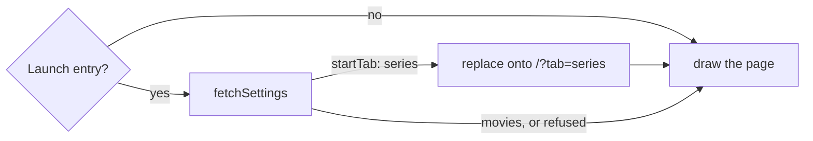

# 49: Start on Series

> **Initiative:** `start-on-series`
> **PRD:** `docs/PRDs/49-start-on-series.md` (to be written)
> **Plan:** `docs/PRDs/49-start-on-series-plan.md` (to be written)

This log is the `grill-me` session for step 32 of the build order, **Start on
Series**, held before the prototype revision and the PRD. It ran against the
code as it stood on 2026-10-22 (`831b227`). It is an immutable snapshot of that
moment. The session ran alone, and the maintainer approved every
recommendation in advance, asking that the codebase stay consistent with its
naming, code conventions, patterns and architecture. Their brief:
_start-on-series. an option, in our settings to decide if movies or series are
the first thing the user sees when starting up FF._ The checklist's row:
_Start on Series: open FamilyFlix on the Series tab_.

## Background

What exists, read off the code:

- **The tab is the URL.** The **Library tabs** (`features/library/LibraryTabs/`)
  write `?tab=series` on `/` through `useQueryParamWriter`, a `replace`,
  omitted at `movies` (log 22 Q24). `LibraryBody` picks `SeriesHome` or
  `HomeRows` off the same param. `seriesTabPath()` (`src/utils/`) spells
  `/?tab=series` for the three screens that name it: the series page's
  **Landing**, a series delete's, and the series add's **Fresh home**.
- **Bare `/` means the Movies tab everywhere.** The logo (`MainLayout`), the
  movie page's _Back to library_ and `useGoBack`'s default all push `/`, and
  log 20 Q10 settled that they all mean the library, Movies first.
- **Launch is the window loading `/`.** `rendererUrl` gives the shell
  `http://127.0.0.1:<port>/` (Vite's `/` in dev). The router's first entry has
  `location.key === 'default'`, the same test `useGoBack` reads as "no history
  behind". A **Factory reset**'s `location.assign('/')` and `reloadOnce` land
  there too.
- **Settings are keys in the `settings` table**, behind
  `library/settings/settings.ts`: `valueOf`, `flagOf`, `setFlag`, one setter
  per key, `GET /api/settings` answering every preference with its default
  applied, one **Single-signal write** per key. A **Factory reset** empties the
  table.
- **The Display group** (`features/settings/DisplaySection/`) holds two
  `Toggle` rows, _Ultrawide margins_ and _Fill in ratings from TMDB_, both read
  and written through `useDisplayPreference()`, held app-wide by
  `DisplayPreferenceProvider` over one `fetchSettings` (**Blank until it
  lands**). Its setters share one bargain, `useHeldFlag`: shown at once, posted,
  the echo kept, put back on refusal, never rejecting. `useSettings`'
  `useHeldLanguage` is the same bargain over strings.
- **`fetchSettings` has three callers already**: the provider, `useSettings`
  (the Playback group's languages) and the player's `useOpeningReads`, which
  reads the languages on its own when a title opens.

## Problem

A household that mostly watches series opens FamilyFlix on the Movies tab
every time and switches by hand. Let the household choose, in Settings, which
tab FamilyFlix opens on, without changing what any link or Back already lands
on, and without a flash of the wrong tab while the choice is read.

## Questions and Answers

### Scope

1. **Its own initiative?** ✅ **Yes**: `49-start-on-series.md`, initiative
   `start-on-series`, step 32, the checklist's planned row.

2. **When does the choice apply?** ✅ **At launch only**: the first screen
   FamilyFlix draws when it opens, the brief's _first thing the user sees when
   starting up_. Every link, Landing and Fresh home keeps its own destination:
   the logo and _Back to library_ still push `/`, the Movies tab. ❌ **Making
   bare `/` mean the chosen tab**: `/` would mean two things, the movie page's
   Landing would drop a parent on the Series tab after a film, and log 20 Q10
   would be reversed for a reason the brief never gave.

3. **What is not built?** ❌ The logo following the choice (Q2); a third
   choice such as a genre or Continue Watching (the two tabs are what exists);
   remembering the last tab used (a choice the household makes once is not a
   history; a remembered tab is a device's, and Settings are never
   `localStorage`); a per-person choice (FamilyFlix has no profiles).

### Names

4. **What is the preference called?** ✅ **Start tab**: the **Library tab**
   FamilyFlix opens on. Key `start-tab`, field `Settings.startTab`, default
   `DEFAULT_START_TAB = 'movies'`. The row reads _Start on_. ❌ "default tab",
   "home tab", "landing tab": **Landing** already means a screen's no-history
   destination, and "home" is the **Browse home** itself.

5. **What is "launch" in code?** ✅ **The Launch entry**: the router's first
   entry on bare `/` with no query, `location.key === 'default'`. A window
   load, a reload of `/` and a Factory reset's reload all arrive on it; a deep
   link anywhere else, or a `/` carrying any parameter, is not one. ❌ Asking
   the shell: the browser and the shell would differ, and the main process
   would need a preference it cannot read (Q9).

### The value

6. **A flag or a choice?** ✅ **A choice of two**, `LibraryTab = 'movies' |
'series'`, spelled once as `LIBRARY_TABS` in `src/types/browse.ts` beside
   `MOVIE_SORTS`, the union derived from the list (that file's precedent). The
   **Library tabs** take their values from it, and the route validates against
   it. ❌ **A `startOnSeries` boolean**: _off_ says nothing a parent can read,
   and it would be the checklist's wording frozen into the wire.

7. **Stored how?** ✅ `'movies'` or `'series'` under `start-tab`. A stored
   value outside `LIBRARY_TABS` reads as the default, so a hand-edited database
   never yields a tab that does not exist. `library/settings/` gains
   `setStartTab(tab: LibraryTab)` over `upsertValue`, and `settings()` answers
   `startTab`.

8. **The wire?** ✅ `GET /api/settings` gains `startTab`.
   `POST /api/settings/start-tab { value }` → `200 { value }`, a **Single-signal
   write**, `400` unless `value` is one of `LIBRARY_TABS`. A **Factory reset**
   erases it with the table, back to Movies.

### The launch

9. **Who decides at launch?** ✅ **The library, on the client.** A new
   organism, `features/library/StartTabGate/`, over a hook in the same feature,
   `features/library/useStartTab/`. On the **Launch entry** the hook reads
   `fetchSettings()` once; on `'series'` it replaces onto `seriesTabPath()`,
   then lets the page draw. Anywhere else it lets the page draw at once. The
   gate renders its children only once the hook says so. ❌ **The shell loading
   `/?tab=series`**: the main process never touches SQLite, the handshake
   would carry a client route, and the browser would ignore the choice. ❌
   **The server redirecting `/`**: it serves the built `index.html` and knows
   no client route.

10. **Replace or push?** ✅ **Replace**, so the Launch entry becomes
    `/?tab=series` and there is nothing behind it: a later switch to Movies
    is the tabs' own `replace`, and Back from a series still steps onto the
    Series tab, as log 22 Q24 promised.

11. **No flash of Movies?** ✅ **The gate draws nothing until the read
    settles**, the header included, so neither the Movies pill nor the Movies
    rows draw first and are swapped. One read of a local SQLite key, while the
    shell's window is still waiting for `ready-to-show`. ❌ Drawing Movies and
    switching when the read lands: the rows' own read is wasted, and a parent
    sees the wrong shelf jump. ❌ A skeleton: there is nothing yet to shape it
    after.

12. **A refused read?** ✅ **Movies**, and the page draws. The tabs and the
    rows then make their own reads and show their own failures, the
    `RetryableFailure` a refused home already draws. ❌ Waiting for ever on a
    read that never lands.

13. **Why its own read, not the provider's?** ✅ **The player's
    precedent**: `useOpeningReads` reads `fetchSettings` itself for the
    languages `useSettings` writes, because it needs the answer once, at one
    moment, and must tell a refusal from a value still on its way. The
    provider's `null` cannot tell those apart, and teaching it to would add a
    status every other caller ignores. Two reads of one local route at launch
    cost nothing a parent can see. ❌ A `refused` field on
    `useDisplayPreference()`.

14. **An empty Series tab?** ✅ **Drawn as it is**: a household that chose
    Series and has none sees _All series_ over `0 series · 0 episodes`, the
    tab's own empty face. ❌ Falling back to Movies: one rule, honest, and the
    choice is one press away in Settings.

### The setting

15. **Which group?** ✅ **Display**, the third row under _Fill in ratings
    from TMDB_: what FamilyFlix shows is a display preference, and the group's
    rows already read and write through `useDisplayPreference()`. ❌ The
    Library group: its rows are **Action rows** that do something to the
    library; this changes how it is shown.

16. **The control?** ✅ **The Pill tabs**, `Movies` and `Series`, labelled
    _Start on_: the same switch a parent presses at the top of the library,
    so the choice reads as the thing it chooses. Drawn on the right of the row
    where the other two rows draw their `Toggle`. ❌ A `Toggle` _Start on
    Series_ (Q6). ❌ `FilterDropdown`, the language rows' pill: two options
    are clearer drawn than hidden in a menu.

17. **The copy?** ✅ _Start on_, and under it: _Which shelf FamilyFlix opens
    on. You can still switch between Movies and Series at the top of the
    library._ No snackbar: the prototype draws none for a Display row, and the
    pressed pill is the confirmation. The row is drawn whether or not the
    library holds a series.

18. **Who holds it on the Settings page?** ✅ **`DisplayPreferenceProvider`**,
    beside the two flags, so the Display group stays one source:
    `useDisplayPreference()` gains `startTab: LibraryTab | null` and
    `setStartTab(tab)`, on the same bargain. The pills are not drawn while
    `startTab` is `null` (**Blank until it lands**). `useHeldFlag` becomes
    `useHeldValue<T>`, the one bargain over any value, and the three
    preferences each use it. A new `App/saveStartTab/`, `saveTmdbRatings`'
    twin, posts the value through `postValue` with an `isLibraryTab` echo
    guard. ❌ **`useSettings`**: the Display group would read the route a
    second time beside the Playback group's read, and two hooks would hold
    one card.

### Prototype and docs

19. **Prototype first?** ✅ **Yes**, per _The prototype is the spec_:
    `page.SettingsPage.dc.html` gains the third Display row with
    `mol.PillTabs`, and `FamilyFlix.dc.html` gains the same row and opens on
    the Series tab when it is chosen. COMPONENT-SPEC's settings page lists the
    row. The prototype revision lands before any of it is built.

20. **Which documents change?** ✅ The checklist's step 32 entry, the
    glossary (**Start tab**, **Launch entry**, and the **Library tabs**,
    **Display group** and **Settings** rows), and CLAUDE.md only if its folder
    tree names a new unit, ticked ✅ only after the refactor.

## Design

### Chosen and rejected

- ✅ Launch only; every link and Landing unchanged · ❌ bare `/` follows the
  choice (Q2)
- ✅ **Start tab**, a `LibraryTab` choice · ❌ a `startOnSeries` flag (Q6)
- ✅ The library decides on the client, replacing the **Launch entry** · ❌ the
  shell's URL, ❌ a server redirect (Q9)
- ✅ Nothing drawn until the read settles; Movies on a refusal (Q11, Q12)
- ✅ The gate's own `fetchSettings` · ❌ a status on the provider (Q13)
- ✅ The Display group's third row, **Pill tabs** · ❌ a `Toggle`, ❌ a dropdown
  (Q15, Q16)
- ✅ Held by `DisplayPreferenceProvider` over `useHeldValue<T>` · ❌
  `useSettings` (Q18)

### Types

```ts
// src/types/browse.ts
/** The two **Library tabs**, in the switch's order. */
export const LIBRARY_TABS = ['movies', 'series'] as const;
/** One of {@link LIBRARY_TABS}. */
export type LibraryTab = (typeof LIBRARY_TABS)[number];

// src/types/settings.ts
/** The **Start tab** until the household chooses: Movies. */
export const DEFAULT_START_TAB: LibraryTab = 'movies';
export interface Settings {
  // ...the four existing fields
  /** The **Library tab** FamilyFlix opens on. */
  startTab: LibraryTab;
}
```

### The launch



```ts
// src/features/library/useStartTab/useStartTab.ts
/**
 * `true` once the browse home may draw: at once off the **Launch entry**; on it,
 * once the **Start tab** is read and, for Series, replaced onto.
 */
export function useStartTab(): boolean;

// src/features/library/StartTabGate/StartTabGate.tsx
/** Its children, once `useStartTab()` says the browse home may draw; nothing before. */
export function StartTabGate({ children }: { children: ReactNode }): ReactNode;
```

`pages/LibraryPage` composes `<StartTabGate>` around its `MainLayout`.

### The units

| Unit                            | Where                                   | What                                     |
| ------------------------------- | --------------------------------------- | ---------------------------------------- |
| `LIBRARY_TABS`, `LibraryTab`    | `src/types/browse.ts`                   | the two tabs, the union derived          |
| `DEFAULT_START_TAB`, `startTab` | `src/types/settings.ts`                 | the default and the field                |
| `setStartTab`, `startTab`       | `server/src/library/settings/`          | the key `start-tab`, guarded on read     |
| `POST /settings/start-tab`      | `server/src/routes/index.ts`            | the Single-signal write                  |
| `saveStartTab`                  | `src/App/saveStartTab/`                 | the one write, `isLibraryTab` echo guard |
| `useHeldValue<T>`               | `src/App/DisplayPreferenceProvider/`    | `useHeldFlag` made generic               |
| `startTab`, `setStartTab`       | `src/App/useDisplayPreference/`         | the provider's API grows                 |
| the _Start on_ row              | `src/features/settings/DisplaySection/` | the third Display row, `PillTabs`        |
| `useStartTab`                   | `src/features/library/useStartTab/`     | the Launch entry's read and replace      |
| `StartTabGate`                  | `src/features/library/StartTabGate/`    | draws nothing until the hook allows      |

### Routes

| Route                                    | Answer                                       |
| ---------------------------------------- | -------------------------------------------- |
| `GET /api/settings`                      | gains `startTab`                             |
| `POST /api/settings/start-tab { value }` | `200 { value }` · `400` unless a Library tab |

## Implementation Plan

1. **Prototype.** The _Start on_ row in `page.SettingsPage.dc.html` and
   `FamilyFlix.dc.html`, the prototype opening on the chosen tab, and
   COMPONENT-SPEC's settings entry.
2. **The preference.** `LIBRARY_TABS`, `Settings.startTab`, the key and its
   guard, the route, `saveStartTab`, `useHeldValue<T>`, the provider's
   `startTab`, and the Display row. Thinnest end to end: a press on _Series_
   survives a reload of the Settings page.
3. **The launch.** `useStartTab`, `StartTabGate`, `LibraryPage` composing it;
   FamilyFlix opened with Series chosen draws the Series tab first, with no
   Movies drawn before it.

## Trade-offs

- **Easier:** the choice touches one entry of one session; every Landing,
  Fresh home and Back keeps the rule logs 20 and 22 gave it, and `/` keeps
  one meaning. The value is a union, so a third tab, if one is ever built,
  is a list entry and a pill.
- **Harder:** the browse home now waits for one settings read on launch
  before it draws anything; tests that mount `LibraryPage` at bare `/` meet
  the gate and must answer, or refuse, `/api/settings`. Launch reads the
  settings route twice (the provider's and the gate's).
- **Out of scope:** the logo following the choice, a remembered last tab,
  per-person choices (Q3).
