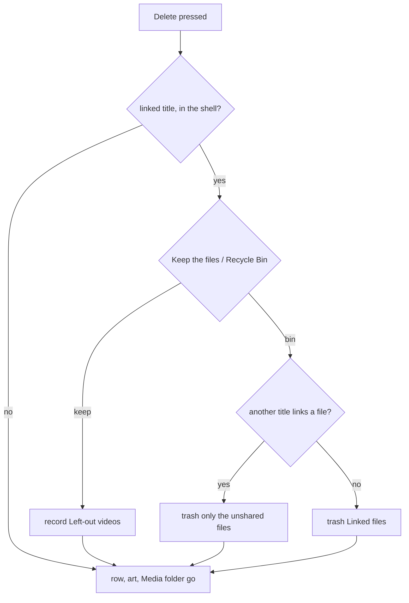

# 51: Library audit

> **Initiative:** `library-audit`
> **PRD:** `docs/PRDs/51-library-audit.md` (to be written)
> **Plan:** `docs/PRDs/51-library-audit-plan.md` (to be written)

This log is the `grill-me` session for step 34 of the build order, **Library
audit**, held before the prototype revision and the PRD. It ran against the
code as it stood on 2026-10-24 (`65655de`). It is an immutable snapshot of that
moment. The session ran alone, and the maintainer approved every
recommendation in advance, asking that the codebase stay consistent with its
naming, code conventions, patterns and architecture. Their brief:
_library-audit. after testing 0.10.0 live, a lot of issues appeared. some are
listed in our feature-checklist but there could be many more. we need to use
the devtools mcp and test every edge case we can to make sure the user has a
intuitive, easy way to add movie/series, edit, remove only specific
movie/series/episodes files or metadata, update, link or import and so on._

## Background

### How the audit ran

Nothing touched the household's library or the installed app's data.

- **The real layout, read only.** The installed app's database was copied and
  read; `D:\Movies` was listed. One **Library folder**; films in **Collection
  folders** (`Star Wars/Solo (2018).mp4`) and their own folders; shows as
  `Tacoma FD/Season 1/Episode 1 - On the Hot Seat.mp4`, one as
  `Mr. Robot/Season 1/eps1.0_hellofriend.mov.mp4`; an Export folder inside the
  Library folder (art and sheets, no video, so never a **Source folder**).
- **A sandbox library** in the session's scratchpad, of the shapes a real
  household has: the real ones above, plus `Seizoen 1` (the checklist's own
  example), `Season 1 (2008)`, `Release.Show.S01.1080p.WEB-DL`, a `Specials`
  folder, `S01E01` names, a film with two subtitle files and a film named
  `Amelie.2001.1080p.BluRay.mkv`.
- **A sandbox server** (`tsx server/src/main.ts` with its own
  `FAMILYFLIX_DB_PATH`, `FAMILYFLIX_MEDIA_PATH` and component path) driven
  over HTTP: add the folder, scan in Link mode, rescan, then edit rows in the
  sandbox database to stand in for older libraries (no folder on record, a
  title a Sync renamed) and rescan.
- **The UI live**, Vite over that server in Chrome, with a stub
  `window.familyflix` whose `pickOne()` answered a chosen sandbox folder, so
  the **Show folder pick** ran against real reads. What only the shell can do
  (the **Shell trash**) was read in the code, not run.

### What the checklist already listed

Step 34's five known issues (a rescan doubles series; deleting the double
breaks the original; a deleted title can't come back; a show folder's import
is mislabelled; a show folder with season folders isn't read). All five were
reproduced or confirmed; the findings below say how.

## Problem

The Library flows were built one step at a time and never walked end to end.
Walked, they lose titles (a film with no genre is not drawn at all), make
second copies, throw away files nobody asked to throw away, and misread the
folder shapes real shows come in. The household needs one predictable way to
add, edit, take out and bring back a film, a series or one episode, its files
or its details.

## Findings

Numbered once here and referred to by number below.

| #   | Finding                                                                                                                                                                                                                                                                                                                                                                                              | How it was confirmed                                                                                                                                       |
| --- | ---------------------------------------------------------------------------------------------------------------------------------------------------------------------------------------------------------------------------------------------------------------------------------------------------------------------------------------------------------------------------------------------------- | ---------------------------------------------------------------------------------------------------------------------------------------------------------- |
| F1  | **A rescan doubles a title.** **Already in library** has two rules: the folder on record, then **Title key** and year. A title with no folder on record (added before log 48) whose title no longer keys like its folder (a Sync's _Rogue One: A Star Wars Story_ for `Rogue One  (2016).mp4`) matches neither, and a scan links its files a second time.                                            | Reproduced: _Pixar Coco_ and _Tacoma Fire Department_ with no folder on record; a rescan added a second _Coco_ and a second _Tacoma FD_ on the same files. |
| F2  | **Deleting the double trashes the original's files.** `linkedFiles` answers `videos` with the title's own paths even when another held title links the same files; `others` only stops the whole-folder answer.                                                                                                                                                                                      | Code (`media/linkedFiles/linkedFiles.ts`); the dialog for _Pixar Coco_ promised _Its video file(s), to the Recycle Bin_.                                   |
| F3  | **A delete always throws the files away.** A linked title's Delete moves its **Linked files** to the Recycle Bin; there is no way to take a title out of FamilyFlix and keep its files, so it can't be added back.                                                                                                                                                                                   | The **Delete dialog**: _What stays: Nothing_; `trashedFirst` in `routes/index.ts`.                                                                         |
| F4  | **A Show folder pick is mislabelled.** Each **Episode file row** names its video by basename only, so `Seizoen 1/Aflevering 1.mp4` and `Seizoen 2/Aflevering 1.mp4` read the same; an **Unplaced** video from season 2 is numbered S1 E3 by the **Numbering guess**; the **Show folder row** shows the start of the path (`C:\Users\…`), not the folder; a second pick keeps the first pick's title. | Live, picking `Seizoen Show`, then `Year Show (2008)`, `Release Show`.                                                                                     |
| F5  | **Season folders are read in three spellings only.** `Season 1`, `Season 01`, `S01`. `Seizoen 1` and `Season 1 (2008)` are films, so their episodes became films named _Aflevering 1_ and _Season 1_; `Release.Show.S01.1080p.WEB-DL` made each season its own series (_Release Show S01_, _Release Show S02_); a `Specials` folder became a film _Specials_.                                        | Live scan of the sandbox.                                                                                                                                  |
| F6  | **A film with no genre is not drawn.** The Movies home is genre rows; a film with no genre (every scanned film before a Sync) earns none, and the home says _Your library is empty_ with 11 films held. A search narrows the same rows, so it never finds them either.                                                                                                                               | Live: `/api/home` answered no rows; `/api/library-titles` 11 films. Known since log 13 Q15, made severe by Folder scans.                                   |
| F7  | **A title taken out comes back on the next scan.** Once F3 keeps the files, a scan finds them again; it already does for a removed episode (its file stays, by design, and the series no longer holds its Source file or number) and for a deleted copied title (its Source folder is still in the Library folder).                                                                                  | Code (`showMatch`, `heldFilm` in `createImporter.ts`; `pathsOf` in `series/write`).                                                                        |
| F8  | **Picking a Season folder names the show after it.** Picking `Tacoma FD/Season 1` reads its episodes right but guesses the title _Season 1_ and misses that _Tacoma FD_ is held.                                                                                                                                                                                                                     | Live `GET /api/show-folder`.                                                                                                                               |
| F9  | **A scan's tally counts films only.** _Found 15 movies across 22 folders_ counts shows as movies; _Scan complete: 10 imported_ left out the five new series.                                                                                                                                                                                                                                         | Live scan log.                                                                                                                                             |
| F10 | **The form says FILES twice and names a page that isn't there.** The Files card and the **Import mode** choice are both headed _FILES_; the subtitle sends the maintainer to _Import library_, which no screen is called.                                                                                                                                                                            | Live, both kinds of the form.                                                                                                                              |
| F11 | **The Episode word is English only.** `Aflevering 1` gives no number and no title, so every Dutch episode is Unplaced.                                                                                                                                                                                                                                                                               | Live scan and pick.                                                                                                                                        |

Walked and found sound: a rescan of titles with their folder on record (every
title _Already in library_); the **Numbering guess** on `eps1.0_…` names (an
Unplaced Problem, log 38's design); a held Show folder's **Refusal** on the
form; removing a linked episode in the series edit keeps its file (`pathsOf`
skips a Linked video); _Clear details_ and the **Title row**'s furniture.

## Questions and Answers

### Scope

1. **One initiative or several?** ✅ **One**, `library-audit`, step 34, log 51:
   F1 to F11. They share the files that change (the importer's match, the
   **Season folder** rule, the Delete) and each is small once those rules are
   right. ❌ Not built here: **Loading states** and **Scan new folders**
   (their own planned steps); a cleanup of doubles an older library may
   already hold (the household's own database holds none today); the
   **Details state** reading a year parsed from a folder name as _Your own
   details_ (noted, deferred: it misleads but loses nothing).

2. **Prototype first?** ✅ **Yes**, per _The prototype is the spec_, for what
   is drawn: the Delete dialog's two cards (Q6), the **Other row** (Q14), the
   Library folders row's left-out line (Q10), the Episode file row's relative
   path and the Show folder row's ellipsis (Q12), the form's _Link or copy_
   heading (Q16). Files: `page.ManageLibraryPage.dc.html`,
   `page.MoviePage.dc.html`, `page.SeriesPage.dc.html`, `page.LibraryPage.dc.html`,
   `feat.GenreRow.dc.html`, `page.LibraryFoldersPage.dc.html`,
   `mol.EpisodeFileRow.dc.html`, `feat.MovieForm.dc.html`.

### Recognising a held title (F1)

3. **What third rule stops the double?** ✅ **The Held video rule, checked
   second**: after the folder on record and before the Title key, a found
   video that is already a held title's **Linked video** (same Library folder,
   same relative path) or a held episode's **Source file** makes its title
   held. For a **Show folder**, any one held episode video makes the whole
   folder that series; for a film, its one video. When it matches, the folder
   is recorded on the title (`setSourceFolder`, as the key rule already does),
   so the next scan takes the first rule. ❌ Matching on the TMDB title or
   original title: still a guess, and a title the family typed has neither.
   ❌ A unique index on `video_path`: a held double would fail a migration on
   an older library.

4. **Where does it live?** ✅ In the library domain's storage as one read,
   `storage.titleHolding(folderId, videoPath): { kind, id } | null`, over
   `movies` and `episodes` by `video_folder_id` and `video_path`; the
   importer's `heldFilm` and `heldShow` ask it, and so do `readShowFolder`
   (its `heldSeriesId`) and the **Movie form**'s add: a movie add whose
   linked video is held is refused, _Coco already plays this file._, as a
   held Show folder already is (log 48 Q10).

### Taking a title out (F2, F3, F7)

5. **What does a Delete do to a linked title's files?** ✅ **Nothing, unless
   asked**: the default Delete takes the title out of FamilyFlix (its row, its
   art, subtitles and everything in its **Media folder**, as today) and
   leaves its **Linked files** where they lie. Moving them to the Recycle Bin
   is a second, deliberate choice in the same dialog. A copied title is
   unchanged: its copy is FamilyFlix's own and goes with it. ❌ Always
   trashing (today's rule, log 47 Q14): the brief's "remove only specific
   files or metadata" and the checklist's "two separate choices". ❌ Two menu
   items (_Remove_ / _Delete with files_): two danger rows a parent reads as
   the same.

6. **How is the choice drawn?** ✅ **Two `ChoiceCard`s** in the Delete dialog,
   between **What goes / What stays** and the buttons, drawn only for a
   linked title in the shell: **Keep the files** (_They stay in your library
   folder. A scan won't add it again._), chosen on every open, and **Move
   them to the Recycle Bin** (_From your library folder, so it can be
   restored from there._). _What goes_ and _What stays_ follow the choice;
   the callout shows only with the second. The confirm stays _Delete movie_ /
   _Delete series_. ❌ A checkbox: no Checkbox primitive exists, and
   `ChoiceCard` is the molecule the Import mode already uses for the same
   kind of question.

7. **What does the wire carry?** ✅ `DELETE /api/movies/:id?files=trash` (and
   `/series/:id`); no query keeps the files. `trashedFirst` runs only with
   `files=trash`. A browser never sends it (the cards are not drawn), so its
   `409` _Only the desktop app can…_ goes away for a plain Delete.

8. **Can a Delete trash another title's file?** ✅ **Never** (F2):
   `linkedFiles` drops from `videos` every path another held title links,
   and answers `shared` with no paths when none is left; a whole folder
   another title lies in was already refused. The dialog then draws no
   Recycle Bin card and says under _What stays_: _Its video file(s), which
   another title plays_.

9. **How does a title taken out stay out?** ✅ **Left-out videos.** A Delete
   that keeps the files, and an episode removed in the **Series edit job**,
   record each video the title came from (a Linked video, or a copied
   title's Source folder and **Source file**) in a new table,
   `left_out_videos (library_folder_id, video_path)`, relative with forward
   slashes, the Linked video's own spelling (migration 17). A Folder scan and
   a sheet import skip a left-out video before any match, and log one `info`
   line per run: _· Left out 3 videos you deleted earlier_. A **Show folder**
   whose every video is left out is skipped whole; one with new videos takes
   only those. Trashed files need no entry (they are gone). Removing a
   Library folder drops its entries (`ON DELETE CASCADE`); a **Factory reset**
   empties the table.

10. **How does one come back?** ✅ **Two ways.** An explicit add (the Movie
    form picking the file, or a **Show folder pick** of the folder) clears
    the entries it adds, since a hand pick says what it wants. And the
    Library folders page draws, on a **Folder row** with any, a second line
    _3 videos left out_ with a _Bring back_ text button: it forgets that
    folder's entries (`DELETE /api/library-folders/:id/left-out`), and the
    next scan adds them. ❌ A list of left-out files to pick from: a page for
    a rare act; the folder is where they lie.

### Season folders and episodes (F5, F11)

11. **Which names are Season folders?** ✅ `seasonOf` (server) and
    `readSeasonFolder` (client mirror, held together by the drift guard)
    read, either case:
    - `Season 1`, `Season 01`, `Seizoen 1` and `S01`, alone or followed by a
      separator and anything (`Season 1 (2008)`, `Season 1 - 1080p`);
    - a name holding a standalone `S01` token not followed by `E\d`
      (`Release.Show.S01.1080p.WEB-DL`), whose parent is then the Show
      folder;
    - `Specials` (and `Season 0`) as **season 0**, which the form and the
      wire already accept (`season >= 0`).

    The **Episode word** gains `Aflevering 12` and `Afl. 12`, the household's
    language beside English. ❌ Every language's word for season: guesses we
    can't test; the two the household uses are read. ❌ Reading a Season
    folder's number from anywhere in its name (`2008` in `Season 1 (2008)`):
    the number must follow the word.

### The Show folder pick (F4, F8)

12. **What does each row show?** ✅ **The video's path relative to the Show
    folder** (`Seizoen 2/Aflevering 1.mp4`) on every **Episode file row** a
    pick lands, so two seasons' `Aflevering 1` read apart; a picked file
    keeps its name. The **Show folder row** truncates from the start, so the
    folder's own name always shows (`…\scratchpad\lib\Seizoen Show`), the
    full path its `title`. With F5 fixed the season-2 video is numbered from
    its folder and never lands as S1 E3; the Numbering guess also starts
    each season's free numbers from that season.

13. **A second pick, or a Season folder picked?** ✅ A second pick replaces
    the title the first pick filled (the form remembers whether the title
    came from a pick); a typed title is still never overwritten (log 29 Q19).
    A picked **Season folder** is read for its own episodes but titled and
    checked as held by its Show folder (`showFolderOf`), so _Tacoma FD/Season
    1_ is _Tacoma FD_ and is refused while held.

### Films with no genre (F6)

14. **Where does a film with no genre appear?** ✅ **The Other row**: one more
    row on the Movies home, last, titled _Other movies_, holding every film
    with no **Genre**, capped at 15 like a **Genre row**, with _View all_
    opening the **Genre page** in its `other` mode at `/genre-less` (its own
    route, so no genre name can collide with it): every film with no genre,
    uncapped, headed _Other movies_. A search, the rating filter and the
    sort narrow it like any row; a genre filter leaves it out. ❌ A fake
    genre named _Other_ written to the films: a Sync would keep it, and it
    would show in the form's genre chips. ❌ `/genre/other`: a genre the
    family names _Other_ would land on the wrong page. ❌ A plain grid of
    every film: the home's shape is rows.

### Copy and tallies (F9, F10)

15. **What does a scan count?** ✅ Titles: _Found 15 titles across 22
    folders_; _Scan complete: 15 imported_ counting a new series as one, as
    a film is. A held series that took episodes is not an import (today's
    rule, kept).

16. **The form's wording?** ✅ The **Import mode** choice is headed _Link or
    copy_ wherever `ImportModeChoice` is drawn (form, Library folders, Import
    setup), so it never repeats the Files card's _FILES_. The form's subtitle
    names _Library folders_, the page that scans many at once.

### Documents

17. **Which documents change?** ✅ The checklist's step 34 entry (its known
    list becomes the findings) and row, README's Library paragraph, CLAUDE.md
    _Product Rules_ (**Media**: "removed only by a Delete, only to the
    Recycle Bin" becomes "kept by a Delete unless the household asks, then
    only to the Recycle Bin"), the glossary, and the docblocks of
    `linkedFiles`, `trashedFirst`, `seasonOf`, `readSeasonFolder`,
    `episodeTag`, `walkLibraryFolder`'s callers and `HomeRows`.

## Design

### Chosen and rejected

- ✅ The **Held video** rule second in **Already in library**; ❌ TMDB-title
  matching; ❌ a unique index.
- ✅ Delete keeps linked files by default, **Move them to the Recycle Bin**
  on request; ❌ always trash; ❌ two menu items.
- ✅ Never trash a file another title links.
- ✅ **Left-out videos** skipped by scans, cleared by a hand add or _Bring
  back_; ❌ a left-out file browser.
- ✅ Season folders: trailing text, `Seizoen`, release `S01`, `Specials` as
  0; ❌ every language.
- ✅ Relative paths on picked rows; the title follows the pick until typed.
- ✅ The **Other row**; ❌ a fake genre.

### Types and wire

```ts
// server/src/library (storage)
titleHolding(folderId: string, videoPath: string):
  { kind: 'movie' | 'series'; id: string } | null;
leaveOut(entries: readonly { folderId: string; videoPath: string }[]): void;
leftOut(folderId: string): ReadonlySet<string>;   // relative video paths
bringBack(folderId: string): number;              // entries forgotten
clearLeftOut(entries: readonly { folderId: string; videoPath: string }[]): void;

// src/types
export type LinkedFiles = 'folder' | 'videos' | 'shared' | 'unreachable';
export interface LibraryFolderView { /* … */ leftOut: number }  // Folder row
export interface HomePayload { /* … */ other: HomeRow | null }  // the Other row
```

| Route                                       | Change                                        |
| ------------------------------------------- | --------------------------------------------- |
| `DELETE /api/movies/:id`, `/api/series/:id` | `?files=trash` to trash; default keeps        |
| `DELETE /api/library-folders/:id/left-out`  | new: _Bring back_, `204`                      |
| `GET /api/library-folders`                  | each folder's `leftOut` count                 |
| `GET /api/home`                             | `other`, the **Other row**, after `rows`      |
| `GET /api/genre-less`                       | every film with no genre, the page's `other`  |
| `GET /api/show-folder`                      | Season folder climbs for title and held check |

### A Delete, decided



### The units

| Unit                                  | Where                                            | What                                                                         |
| ------------------------------------- | ------------------------------------------------ | ---------------------------------------------------------------------------- |
| `seasonOf` / `readSeasonFolder` (ch.) | `import-export/groupShows/`, `movie-form/…`      | the wider Season folder rule, season 0                                       |
| `episodeTag` / `readEpisodeTag` (ch.) | `media/episodeTag/`, `movie-form/readEpisodeTag` | `Aflevering`, `Afl.`                                                         |
| `titleHolding` (new)                  | `server/src/library/`                            | the **Held video** read                                                      |
| `createImporter` (ch.)                | `import-export/createImporter/`                  | Held video rule, left-out skip, title tallies                                |
| `left_out_videos` (new)               | `server/src/db/` migration 17                    | the table, cascade on Library folder                                         |
| `linkedFiles` (ch.)                   | `media/linkedFiles/`                             | drops shared paths, `shared`                                                 |
| delete routes (ch.)                   | `routes/index.ts`                                | `?files=trash`, left-out on keep                                             |
| `readShowFolder` (ch.)                | `import-export/readShowFolder/`                  | Season folder climb; relative paths                                          |
| `DeleteTitleDialog` (ch.)             | `features/manage-library/`                       | the two `ChoiceCard`s; `DeleteMovieDialog`, `DeleteSeriesDialog` draw it too |
| `useShowFolderPick` (ch.)             | `features/movie-form/`                           | the picked title follows the pick                                            |
| `FolderRow` (ch.)                     | `features/import-export/`                        | _N videos left out_ · _Bring back_                                           |
| `HomeRows` (ch.), home read (ch.)     | `features/library/home/`, `library/home/`        | the **Other row**                                                            |
| `ImportModeChoice` (ch.)              | `components/`                                    | heading _Link or copy_                                                       |

## Implementation Plan

1. **Prototype.** The files of Q2.
2. **Season folders.** The wider `seasonOf` and its client mirror, the
   Episode word, season 0: a scan of `Seizoen Show`, `Year Show (2008)`,
   `Release Show` and `Specials Show` makes four series.
3. **The Held video rule.** `titleHolding`, the importer's second rule, the
   form's refusal: a rescan of a renamed title with no folder on record adds
   nothing and records the folder.
4. **Delete keeps the files.** `?files=trash`, `linkedFiles`' `shared`, the
   dialog's two cards on all three Delete dialogs.
5. **Left-out videos.** Migration 17, the skip and its log line, an episode
   removed in the edit, a hand add clearing, _Bring back_ on the Folder row.
6. **The Show folder pick.** Relative paths, the start-truncated path, the
   title following the pick, the Season folder climb.
7. **The Other row.** The home's `other`, the Genre page's `other` mode.
8. **Copy and tallies.** _Found N titles_, series counted, _Link or copy_,
   the form's subtitle.
9. **Walk it again.** The sandbox shapes and the real layout, live in the
   shell, before the docs; then the documents of Q17.

## Trade-offs

- **Easier:** a Delete is safe to press: files go only when asked, never a
  file another title plays; a taken-out title stays out, and comes back with
  one press or one pick; the shapes real shows come in are read as shows;
  every film is on the home from the moment it is scanned.
- **Harder:** a new table that every scan reads, and a second state for a
  file in a Library folder (held, left out, or new); the Season folder rule
  is wider, so a film folder named `S01 Something` would now read as a
  season (accepted: no film the household holds is named so); the home gains
  a row with no genre behind it, so the Genre page grows a mode.
- **Out of scope:** Loading states, Scan new folders, cleaning up doubles an
  older library already holds, every language's season word, the Details
  state's reading of a parsed year.
