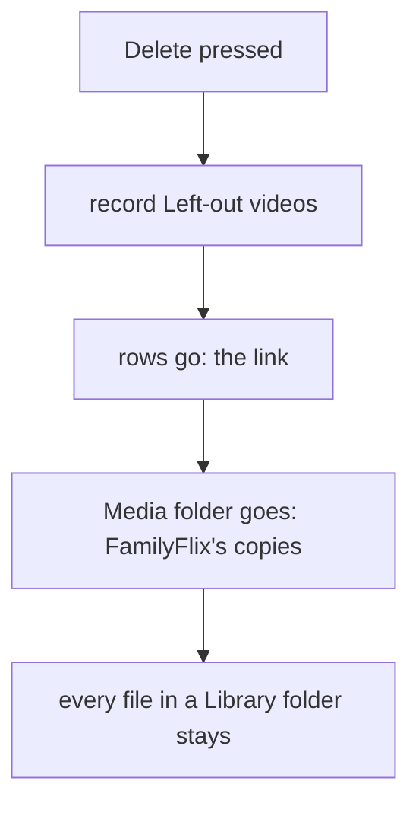

# 52: Keep originals

> **Initiative:** `keep-originals`
> **PRD:** `docs/PRDs/52-keep-originals.md` (to be written)
> **Plan:** `docs/PRDs/52-keep-originals-plan.md` (to be written)

This log is the `grill-me` session for step 35 of the build order, **Keep
originals**, held before the prototype revision and the PRD. It ran against
the code as it stood on 2026-10-26 (`39b7fd7`). It is an immutable snapshot of
that moment. The session ran alone, and the maintainer approved every
recommendation in advance, asking that the codebase stay consistent with its
naming, code conventions, patterns and architecture. Their brief:
_keep-og. we NEVER want to delete the original files. if we link a file, we
only delete the link. if we import a file, we only delete the imported file.
FF can never delete the original files._

## Background

- **v0.10.0** (log 47 Q14): a Delete of a linked title moved its **Linked
  files** to the Recycle Bin through the **Shell trash**. Deleting a linked
  series sent over a thousand episodes there; Windows silently purges what
  goes over the bin's size limit, and the household's originals were lost.
- **v0.11.0** (log 51 Q5 to Q8): keeping became the default, and the
  **Recycle choice** (_Keep the files_ / _Move them to the Recycle Bin_) was
  drawn for a linked title in the shell, sent as `?files=trash`.
- **An earlier, aborted session** (2026-10-26) settled Q1 below before this
  one began.

What removes a file today, read in the code:

| Removal                                   | Reaches                                                                              | An original?                                   |
| ----------------------------------------- | ------------------------------------------------------------------------------------ | ---------------------------------------------- |
| `media.trashLinked` (`?files=trash`)      | a linked title's **Linked files**, via main                                          | **yes**, the one way                           |
| `media.removeTitleFolder` (Delete)        | the title's **Media folder**, contained                                              | no                                             |
| `media.removeFile` (edits, Clear details) | one **Stored path**, contained; `pathsOf` and the movie edit skip a **Linked video** | no                                             |
| `media.removeFolder` (rollbacks)          | a folder `reserveFolder` made, contained                                             | no                                             |
| `media.emptyRoot` (Factory reset)         | every entry in the **Managed media directory**                                       | no, unless a **Library folder** lies inside it |
| `writeBack`'s `unlink`                    | the poster it just created (`wx`)                                                    | no                                             |

So the Recycle choice is the only door, and one more lies ajar: nothing stops
a Library folder from being, lying inside or holding the Managed media
directory.

## Problem

Make "FamilyFlix never deletes an original" true by construction, not by a
default: remove the one mechanism that can, close the overlap that could, and
pin the rest with tests, without changing what the household sees beyond the
cards that go.

## Questions and Answers

### Settled before this session

1. **Does any Delete still reach a linked title's files?** ✅ **No, never.**
   A linked Delete removes only its rows (the link); a copied Delete removes
   only FamilyFlix's **Managed copy**. The **Recycle choice**, `?files=trash`,
   `media.trashLinked` and the whole **Shell trash** channel
   (`electron/trashItems/`, `server/src/shell/shellTrash/`) go.

### Scope

2. **One initiative?** ✅ **One**, `keep-originals`, step 35, log 52, above
   **Loading states** in the checklist. ❌ Not built here: Loading states and
   **Scan new folders** (their own steps); a boot-time check of Library
   folders already listed (Q10).

3. **Prototype first?** ✅ **Yes**, per _The prototype is the spec_: the
   Delete dialog without its cards and callout in `page.ManageLibraryPage.dc.html`,
   `page.MoviePage.dc.html`, `page.SeriesPage.dc.html` and `FamilyFlix.dc.html`;
   the Library folders add's new refusal (Q10) in `page.LibraryFoldersPage.dc.html`;
   the three Delete dialogs' rows in `COMPONENT-SPEC.md` (`ChoiceCard ×2`
   drops). `handoff-manage-library/` is step 30's frozen handoff and is left
   as it is.

### The Delete dialog

4. **What does it draw?** ✅ **Today's _Keep the files_ state, with the cards
   and the callout gone; every word unchanged.** The heading, the subtitle,
   **What goes / What stays** as `deleteView` words them for `keep`
   (_Its folder, in your library folder_; _Its video file(s), which another
   title plays_; _Your original in its library folder, Scan folders would
   bring it back_; _Its files on … they can't be reached right now_), then
   _Delete movie_ / _Delete series_ and _Cancel_. ❌ New copy promising the
   files are safe: What stays already says it, title by title.

5. **Does the shell draw it differently from a browser?** ✅ **No.** The cards
   were the only difference, so `DeleteTitleBody` stops reading
   `folderBridge()`; the dialog is one dialog everywhere.

### The wire

6. **What does a Delete route do?** ✅ `DELETE /api/movies/:id` and
   `/api/series/:id` take no query. Each always records the title's **Left-out
   videos** (`storage.leaveOut(titleVideos(...))`, inlined in both routes),
   then the rows, then the Media folder, **row first, then bytes,
   best-effort**, as today. `recycleChoiceFirst` and `trashedFirst` go. A
   stray `?files=trash` is ignored, as every route ignores a query it does
   not read. ❌ A `400` for it: no client sends it any more.

7. **Is there still a refusal?** ✅ **No.** Every delete `409` was the trash's
   (_Only the desktop app can…_, _Couldn't move …_). So `DeleteOutcome`, the
   hooks' `refusal`, `useLibraryTitles`' `refusalFor` and the dialog's
   `Refusal` line go; `deleteTitleAt` returns to **factoryReset's shape**,
   `Promise<void>`: any `2xx` or a `404` (**gone is gone**) resolves, anything
   else rejects. `DeleteFiles` and every `files` parameter
   (`deleteTitleAt`, `deleteMovie`, `deleteSeries`, `useDeleteMovie`,
   `useDeleteSeries`, `useLibraryTitles.deleteTitle`, `onConfirm`) go.
   `refusalSentence` stays: the folder and form wires use it.

### What stays of Linked files

8. **Does `LinkedFiles` survive?** ✅ **Yes, as a kind only.** _What stays_
   still reads it (`folder` / `videos` / `shared` / `unreachable`, `null` for
   a copied title), so it is redefined as _what a Delete leaves where it
   lies_. `LinkedFilesAnswer.paths` (the paths to trash) and
   `libraryTitleList`'s `linkedFilesOf` go: `linkedFiles` answers
   `LinkedFiles | null`. `offersRecycleChoice`, `LINKED_CALLOUT`,
   `DeleteView.callout` and `filesGoing`'s trash branch go; `deleteView(title)`
   loses its second parameter.

9. **What happens to the shell's half?** ✅ **It goes whole.** `ServerMessage`
   is back to `ready | fatal` and `ShellCommand` to `shutdown`;
   `createShellTrash`, `electron/trashItems/`, main's `trashWorld`,
   `serverHandle`'s `trash` dependency and `answerTrash` go; `createMedia`
   loses its second parameter, and `Trash`, `TrashOutcome` and `NO_TRASH` go
   with `trashLinked`. Their tests go with them: `routes.shellTrash.test.ts`,
   `shellTrash.test.ts`, `trashItems.test.ts` and the four
   `*.recycle.test.tsx`.

### By construction

10. **Can anything else reach an original?** ✅ **Only through an overlap,
    and the add refuses it.** Every `Media` removal is contained in the
    Managed media directory, but a Library folder inside it would put
    originals in reach of **Factory reset**'s `emptyRoot`. `admitFolder`
    gains a fourth rule after the overlap check: a path that is, lies inside
    or holds the Managed media directory is refused, `folderOverlap(path,
[mediaPath])`, as a new `FolderRefusal`, `'media'`, `409` with _That
    folder overlaps where FamilyFlix keeps its own copies. Choose another
    one._ `admitFolder(storage, path, mediaPath)`. Holding it is refused too:
    a scan would walk FamilyFlix's copies as new videos. ❌ A boot-time check
    of folders already listed: the installed media root lies under the app's
    own `serverCwd`, and the household's one Library folder is `D:\Movies`
    (log 51's audit).

11. **How is the guarantee pinned?** ✅ **One route test of every removal**,
    `server/src/routes/routes.keepsOriginals.test.ts`, over a temporary
    Library folder: delete a linked movie, a linked series (the shape that
    lost a thousand episodes) and a copied movie; replace a linked film's
    video on an edit; remove a linked episode in the **Series edit job**;
    Clear details; Factory reset. After each, every original is on disk and
    byte-identical; a copied title's Managed copy is gone. The trash cases
    leave `routes.deleteKeepsFiles.test.ts` and `routes.linkedDelete.test.ts`.

12. **Does a copied Delete change?** ✅ **No.** Its Media folder (video, art,
    subtitles, all FamilyFlix's copies) goes; its original stays in its
    Library folder as a Left-out video. A poster a **Write target** wrote
    beside a linked video stays too: nothing deletes in a Library folder.

### Documents

13. **Which documents change?** ✅ The checklist's row and a step 35 entry
    (steps 30 and 34 stay as the history of what shipped); README's Library
    paragraph (_unless you ask for the Recycle Bin_ goes); CLAUDE.md _Product
    Rules_ **Media** ("kept by a Delete unless the household asks, then only
    to the Recycle Bin" becomes "never deleted: FamilyFlix deletes nothing
    outside the **Managed media directory**"); the release checklist's Shell
    trash smoke becomes a Keep originals smoke; the glossary (**Recycle
    choice** and **Shell trash** retired; **Linked files**, **Linked video**,
    **Library folder**, **Delete** and the Delete relationship updated); the
    docblocks of every unit Q6 to Q10 touch. The `keep-originals-pending-grill`
    memory is obsolete once this log is written.

## Design

### Chosen and rejected

- ✅ No Delete ever touches an original; ❌ the Recycle choice as an opt-in
  (the bin is not a safe place: Windows purged what overflowed it).
- ✅ The dialog keeps its _Keep the files_ words, cards and callout gone; ❌
  new reassurance copy.
- ✅ The delete wire back to factoryReset's shape; ❌ keeping the refusal
  plumbing for a `409` nothing sends.
- ✅ `LinkedFiles` kept as a kind for _What stays_; ❌ dropping it (the dialog
  would lose _which another title plays_ and _can't be reached_).
- ✅ The Library folder add refuses the Managed media directory; ❌ a check
  on boot.

### Types and wire

```ts
// src/types/libraryTitles.ts
export type LinkedFiles = 'folder' | 'videos' | 'shared' | 'unreachable'; // unchanged
// DeleteFiles: removed

// src/types/shell.ts
export type ServerMessage =
  | { type: 'ready'; port: number }
  | { type: 'fatal'; message: string };
export type ShellCommand = { type: 'shutdown' };

// src/api/deleteTitleAt/deleteTitleAt.ts
export function deleteTitleAt(route: string): Promise<void>;

// server/src/media/createMedia/createMedia.ts
export function createMedia(mediaPath: string): Media; // trashLinked, Trash, TrashOutcome, NO_TRASH: removed

// server/src/import-export/admitFolder/admitFolder.ts
export type FolderRefusal = 'empty' | 'relative' | 'missing' | 'media';
export function admitFolder(
  storage: LibraryStorage,
  path: string,
  mediaPath: string
): Promise<FolderAdmission>;
```

| Route                                       | Change                                                   |
| ------------------------------------------- | -------------------------------------------------------- |
| `DELETE /api/movies/:id`, `/api/series/:id` | no query; always Left-out videos; no `409`               |
| `POST /api/library-folders`                 | `409` for a path overlapping the Managed media directory |

### A Delete, decided



### The units

| Unit                                                          | Where                                       | What                                                       |
| ------------------------------------------------------------- | ------------------------------------------- | ---------------------------------------------------------- |
| `DeleteTitleBody` (ch.)                                       | `features/manage-library/`                  | no cards, callout, refusal or `folderBridge`               |
| `deleteView` (ch.)                                            | `features/manage-library/libraryTitleView/` | one parameter; no callout, no trash branch                 |
| `useLibraryTitles`, `useDeleteMovie`, `useDeleteSeries` (ch.) | their features                              | no `files`, no refusal                                     |
| `deleteTitleAt`, `deleteMovie`, `deleteSeries` (ch.)          | `src/api/`                                  | `Promise<void>`, no `files`                                |
| delete routes (ch.)                                           | `routes/index.ts`                           | Left-out always; `recycleChoiceFirst`, `trashedFirst` gone |
| `linkedFiles`, `libraryTitleList` (ch.)                       | `media/`                                    | the kind only; `linkedFilesOf` gone                        |
| `createMedia` (ch.)                                           | `media/createMedia/`                        | no Trash                                                   |
| `shellTrash`, `trashItems` (gone)                             | `server/src/shell/`, `electron/`            | the Shell trash                                            |
| `serverHandle`, `main.ts` (ch.)                               | `electron/`, `server/src/`                  | no trash wiring                                            |
| `admitFolder` (ch.)                                           | `import-export/admitFolder/`                | the `media` refusal                                        |
| `routes.keepsOriginals.test.ts` (new)                         | `server/src/routes/`                        | every removal leaves every original                        |

## Implementation Plan

1. **Prototype.** The files of Q3.
2. **A Delete keeps originals.** The routes always leave out and never trash;
   the dialog drops its cards, callout and refusal; the wire drops `files`
   and `DeleteOutcome`; `routes.keepsOriginals.test.ts` for both Deletes.
3. **The Shell trash goes.** `trashLinked`, `Trash`, `createShellTrash`,
   `trashItems`, the handshake's `trash` / `trashed`, `linkedFiles`' paths.
4. **The media directory is no Library folder.** `admitFolder`'s `media`
   refusal, and the rest of `routes.keepsOriginals.test.ts` (edit, episode,
   Clear details, Factory reset).
5. **Walk it live.** In the shell over a sandbox Library folder: delete a
   linked film, a linked series and a copied film; every original is still
   there. Then the documents of Q13.

## Trade-offs

- **Easier:** a Delete is safe to press in every case, with nothing to choose
  and nothing to read; one fewer message on the Shell handshake, one fewer
  injected dependency in `media/`, one fewer feature-to-shell bridge read in
  the dialog; the guarantee is a test, not a default.
- **Harder:** freeing disk space from a linked title is the household's job in
  Explorer, not FamilyFlix's (accepted: that is the point); a Library folder
  that overlaps the Managed media directory can no longer be added, even
  deliberately.
- **Out of scope:** Loading states, Scan new folders, a boot-time check of
  folders already listed.
