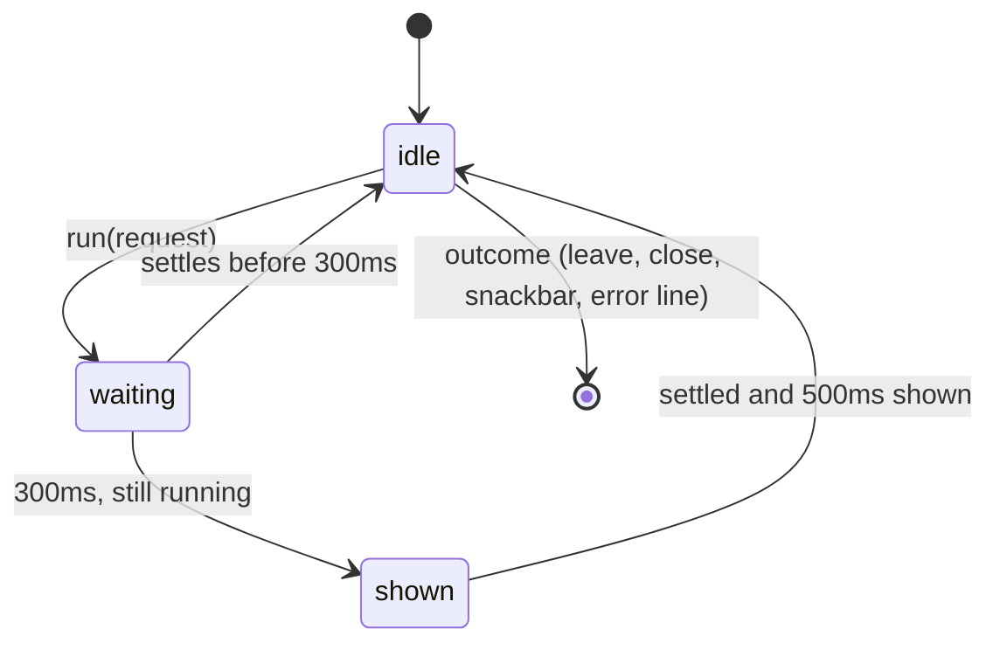

# 53: Loading states

> **Initiative:** `loading-states`
> **PRD:** `docs/PRDs/53-loading-states.md` (to be written)
> **Plan:** `docs/PRDs/53-loading-states-plan.md` (to be written)

This log is the `grill-me` session for step 36 of the build order, **Loading
states**, held against the handoff `docs/handoff/handoff-loading-states/` and
the code as it stood on 2026-10-28 (`cd7f580`). It is an immutable snapshot of
that moment. The session ran alone, and the maintainer approved every
recommendation in advance, asking that the codebase stay consistent with its
naming, code conventions, patterns and architecture.

## Background

The handoff brings `prim.LogoLoader`, the FF mark as a loader (the two Fs take
turns rising, or fill left to right when the work can be counted), a text
shimmer for a busy button, a timing rule (show after 300ms, hold for 500ms),
and a table of eight places to use them. Page and detail loads keep their
**Skeletons**.

What the code does today, read before the session:

| Action                            | Today                                                                         |
| --------------------------------- | ----------------------------------------------------------------------------- |
| Movie form save (every job, kind) | `saving` boolean; label _Adding…_ / _Saving…_ at once, disabled (grey face)   |
| Clear dialog                      | `clearing`; _Clearing…_, disabled; dismissal live                             |
| Delete dialog (three owners)      | `deleting`; _Deleting…_, disabled; dismissal live; a failure changes nothing  |
| Reset dialog                      | `resetting`; _Erasing…_, disabled; a refusal sentence above the buttons       |
| TMDB _Test connection_            | `testing`; _Testing…_                                                         |
| Library folders _Add_             | `adding`; disabled, no label change                                           |
| Export                            | `exporting`; _Exporting…_, disabled                                           |
| Manage library _Sync with TMDB_   | not in the row: pushes the title's page, then the **Enrichment flow** over it |
| App start-up                      | the window opens only after the server's `ready`, shown on `ready-to-show`    |

Three facts shape most answers. The handoff's copy predates the app's words
(_Save movie_, _Clear metadata_, _Delete folder_). The shell loads the renderer
from the server it has already waited for, so a splash in the renderer would
never be seen. And `GlobalStyle` collapses every animation under
`prefers-reduced-motion`, which would freeze a loader at its dimmest frame.

## Problem

Give every action the household or the maintainer starts, and the app's own
start-up, a calm, honest sign of work in the FF mark, translated from the
handoff onto the app as it is: its words, its units, its Modal, its shell.

## Questions and Answers

### Scope

1. **One initiative?** ✅ **One**, `loading-states`, step 36, log 53. ❌ Not
   built here: server-reported progress for any action (nothing reports a
   count today), upload progress in the Movie form, **Scan new folders** (its
   own step).

2. **Is the handoff amended?** ✅ **No, it is committed as received**, frozen
   like `handoff-manage-library/`; this log records where the build departs
   from it. Phase 1 lifts `prim.LogoLoader.dc.html` to `docs/handoff/` and adds
   `COMPONENT-SPEC.md` rows for `prim.LogoLoader`, `Button`'s busy props,
   `Modal`'s `locked` and `mol.DialogLoader`.

3. **Whose words?** ✅ **The app's.** The handoff's copy maps onto the labels
   that ship: _Save changes → Saving…_, _Add to library → Adding…_, _Clear
   details → Clearing…_, _Delete movie / Delete series → Deleting…_, _Erase
   everything → Erasing…_, _Test connection → Testing…_, _Add → Adding…_,
   _Export as CSV → Exporting…_. ❌ _Save movie_, _Clear metadata_, _Delete
   folder_: names the app no longer uses.

### The mark

4. **What is `LogoLoader`?** ✅ **An atom**, `src/primitives/LogoLoader/`
   (`LogoLoader.tsx`, `.styles.ts`, `.test.tsx`), exported from the
   `primitives` barrel, **the full `prim.LogoLoader` surface**: `size`,
   `progress`, `tone`, `tile`, `label`, `detail`, `inline`, as `Button` was
   built to its spec rather than its first caller. The clip path's id comes
   from `useId`, stripped of characters a `url(#…)` reference can't carry.
   ❌ The handoff's per-unit `index.ts`: only category barrels exist.

5. **Reduced motion?** ✅ **The loader opts out of the global collapse.** Its
   beat and the button shimmer carry their own reduced-motion keyframes (fade
   only, no movement), with the specificity to beat `GlobalStyle`'s `*` rule;
   the mount pop-in collapses as everything else does. ❌ Letting the global
   rule freeze it: a loader stopped at .28 opacity says nothing is happening.

### Timing

6. **Where does the 300 / 500 rule live?** ✅ **`useDelayedBusy`**, in
   `src/hooks/useDelayedBusy/` (five features use it). It answers a
   **Busy phase** and a `run`:

   ```ts
   // src/types/busy.ts
   export type BusyPhase = 'idle' | 'waiting' | 'shown';

   // src/hooks/useDelayedBusy/useDelayedBusy.ts
   export const SHOW_AFTER_MS = 300;
   export const MIN_SHOWN_MS = 500;
   export interface DelayedBusy {
     phase: BusyPhase;
     run<T>(work: () => Promise<T>): Promise<T>;
   }
   export function useDelayedBusy(): DelayedBusy;
   ```

   `run` sets `waiting` at once, `shown` at 300ms if still running, and
   settles (resolve or reject) no sooner than 500ms after `shown`, then back to
   `idle`. ❌ The timing inside `Button`: the hold must delay the outcome
   (a dialog closing, a leaving), which only the caller owns.

7. **What does `run` wrap?** ✅ **The request only.** A leaving, a close or a
   snackbar follows `run`'s promise, so it happens after the hold.

8. **What do the feature hooks answer?** ✅ **The same names, typed
   `BusyPhase`**: `saving`, `clearing`, `deleting`, `resetting`, `testing`,
   `adding`, `exporting`. Each `useState(false)` behind them becomes a
   `useDelayedBusy()`.

### The busy button

9. **`Button`'s props?** ✅ `busy?: BusyPhase` and `busyLabel?: string`
   (default `label`), on the button form only (`busy?: never` on the link).
   `waiting`: disabled, `aria-busy`, the idle label, **the variant's face kept**
   (the grey disabled face is for a control that can't be used, not one at
   work), `cursor: progress`. `shown`: `busyLabel` in a span with
   `aria-live="polite"` and the shimmer. A busy button's `onClick` never fires.

10. **How is the shimmer drawn?** ✅ **As a moving `mask-image`** over the
    label in its own ink, so one rule serves every variant. ❌ The handoff's
    `background-clip: text` gradient in `#1a1109`: it assumes a dark ink on
    `danger`, and our `danger` is bordered with danger-coloured text.

11. **Keeping the width?** ✅ **The idle width, measured** when `busy` leaves
    `idle`, held as `min-width` until it returns. ❌ Stacking both labels in a
    grid: it widens the idle button (_Add_ sized for _Adding…_).

12. **_Saved ✓_?** ✅ **Not built.** No caller stays on screen after a save:
    the form leaves, Settings saves on change, a folder's row is its own
    answer.

### Where it's used

13. **Which buttons take `busy`?** ✅ Every control whose label swaps today:
    the **Movie form**'s save (all jobs and both kinds, the series edit
    included), the **Clear dialog**'s confirm, _Test connection_, Library
    folders' _Add_ (with _Browse…_ disabled beside it) and the **Export
    dialog**'s confirm. ❌ _Check for updates_: its _Checking…_ is the
    **Update status** from main, not a request.

14. **The Sync row (handoff #5)?** ✅ **Dropped.** _Sync with TMDB_ leaves
    for the **Enrichment flow**, which has its own live log, and the handoff
    itself rules out a second indicator there.

15. **Which dialogs turn into the loader?** ✅ **The Delete dialog** (Manage
    library, the movie page, the series page) **and the Reset dialog.** Once
    shown, the card goes **Bare** with a `DialogLoader`: a 64px `LogoLoader`,
    _Deleting “Coco”_ / _Erasing everything_, **no detail**. ❌ The step
    detail (open question 1): a Delete is one request, rows before bytes, and
    _Removing files from disk_ is false for a linked title (log 52). ❌ The
    determinate mode (open question 2): a Factory reset reports no count.

16. **Can it be dismissed?** ✅ **No, from the confirm press on.** `Modal`
    gains `locked?: boolean`: Escape and the scrim ask nothing and the ✕ is
    not drawn. Locked in `waiting` too, with _Cancel_ disabled, so the 300ms
    before the loader is no escape hatch. The **Export** and **Clear**
    dialogs stay live, as today.

17. **When it fails?** ✅ **The dialog returns to its idle face, live, with
    one line above the buttons** in the **Reset dialog**'s refusal style:
    _Couldn’t delete “Coco”. Try again._ The Reset dialog keeps its own
    refusal sentence. The hooks own the flag (`deleteFailed` on
    `useLibraryTitles`, `failed` on `useDeleteMovie` and `useDeleteSeries`),
    cleared by the next confirm. ❌ A new error face with _Close_: the idle
    face already closes, and keeps a retry.

18. **When it lands?** ✅ **Unchanged**: each surface's shipped outcome (the
    snackbar it already pushes, the leaving, the reload). ❌ The handoff's
    _danger_ / _info_ snackbars: no such **Snackbar variant**, and no surface
    gains a snackbar it doesn't push.

### Start-up

19. **Where does the splash draw?** ✅ **In the shell, before the server is
    up.** `main.ts` opens the window at `whenReady` over a splash page and
    shows it; when the server's `ready` lands, `loadRenderer` loads the app
    over it. ❌ A renderer splash: the renderer is served by the server the
    shell has already waited for, so the first answer is a request away and
    the 300ms rule would never let it show.

20. **What is the splash?** ✅ **A pure unit**, `electron/splashPage/`
    (`splashPage.ts` + test): a `data:` URL of static HTML on `bg`, the 88px
    tile and mark, the beat and its reduced-motion fade, _Opening your
    library_. The F paths are copied from `docs/handoff/brand/familyflix-mark.svg`
    (the shell imports only types from `src/`); the accent is the token's,
    since no setting changes it.

21. **The 10s _Can't reach the FamilyFlix server_ and _Try again_?** ✅ **Not
    built.** The shell's 15s `READY_TIMEOUT_MS` and **startupFailed** dialog
    (_Quit_ / _Show data folder_) already answer a server that never comes.
    No 200ms cross-fade (a page load can't fade into another) and no timing
    rule: the splash is the window's first paint. A browser (`npm run dev`)
    draws no splash.

### Documents

22. **Which documents change?** ✅ The checklist's row (_Loading states: the FF
    mark while an action runs_); `COMPONENT-SPEC.md` (Q2); the glossary (a
    **Loading states** section; **Delete dialog**, **Modal**, **Reset dialog**
    updated); the docblocks of every unit Q8 to Q17 touch.

## Design

### Chosen and rejected

- ✅ The full `prim.LogoLoader` surface as an atom; ❌ only what has a caller.
- ✅ `useDelayedBusy` owning the 300 / 500 rule and holding the outcome; ❌ the
  timing in `Button`.
- ✅ A mask shimmer in the button's own ink; ❌ a gradient in one fixed ink.
- ✅ Delete and Reset dialogs locked and turned into the loader; ❌ the step
  detail nothing reports.
- ✅ The splash in the shell, before the server; ❌ in the renderer, after it.
- ✅ The app's words and outcomes; ❌ the handoff's stale labels, _Saved ✓_,
  new snackbars, the Sync row.

### Types and props

```ts
// src/primitives/LogoLoader/LogoLoader.tsx
export interface LogoLoaderProps {
  size?: number; // 48
  progress?: number; // 0 to 1: determinate
  tone?: 'brand' | 'current';
  tile?: boolean;
  label?: string;
  detail?: string; // "NN%" when progress is set
  inline?: boolean;
}

// src/primitives/Button/Button.tsx (button form only)
busy?: BusyPhase; // 'idle'
busyLabel?: string; // label

// src/components/Modal/Modal.tsx
locked?: boolean; // Escape and scrim ask nothing; no ✕

// src/components/DialogLoader/DialogLoader.tsx
export interface DialogLoaderProps {
  label: string;
}
```

### An action, timed



### The units

| Unit                                                                                                                  | Where                      | What                                            |
| --------------------------------------------------------------------------------------------------------------------- | -------------------------- | ----------------------------------------------- |
| `LogoLoader` (new)                                                                                                    | `primitives/LogoLoader/`   | the mark, both modes, a11y status               |
| `BusyPhase` (new)                                                                                                     | `types/busy.ts`            | `idle \| waiting \| shown`                      |
| `useDelayedBusy` (new)                                                                                                | `hooks/useDelayedBusy/`    | the 300 / 500 rule, holding the outcome         |
| `Button` (ch.)                                                                                                        | `primitives/Button/`       | `busy`, `busyLabel`, shimmer, width lock        |
| `Modal` (ch.)                                                                                                         | `components/Modal/`        | `locked`                                        |
| `DialogLoader` (new)                                                                                                  | `components/DialogLoader/` | the 64px loader face of a Bare modal            |
| `useMovieForm`, `useTmdbKey`, `useLibraryFolders`, `useExport` (ch.)                                                  | their features             | in-flight state as `BusyPhase`                  |
| `useLibraryTitles`, `useDeleteMovie`, `useDeleteSeries`, `useFactoryReset` (ch.)                                      | their features             | `BusyPhase`; the delete hooks' failed flag      |
| `DeleteTitleDialog`, `DeleteMovieDialog`, `DeleteSeriesDialog`, `DeleteTitleBody`, `ResetDialog`, `ClearDialog` (ch.) | their features             | locked, loader face, failure line, busy buttons |
| `splashPage` (new)                                                                                                    | `electron/splashPage/`     | the start-up splash as a `data:` URL            |
| `main.ts` (ch.)                                                                                                       | `electron/`                | window at `whenReady`, renderer on `ready`      |

## Implementation Plan

1. **Prototype.** Lift `prim.LogoLoader.dc.html`; the `COMPONENT-SPEC.md` rows
   of Q2.
2. **A save that waits.** `LogoLoader`, `BusyPhase`, `useDelayedBusy`,
   `Button`'s `busy`; the Movie form's save on it end to end.
3. **Every busy button.** Clear, _Test connection_, _Add_, Export.
4. **Destructive dialogs.** `Modal`'s `locked`, `DialogLoader`; the three
   Delete dialogs and the Reset dialog; the failure line.
5. **The splash.** `splashPage`, and `main.ts` opening the window first.
6. **Walk it live.** In the shell: a slow series delete, a reset, a large
   copy-add, a cold start; then the documents of Q22.

## Trade-offs

- **Easier:** one timing rule in one hook; one busy face for every button,
  whatever its ink; a destructive action can no longer be half-dismissed; a
  cold start shows the family something at once instead of nothing.
- **Harder:** every action's outcome waits up to 500ms more when it ran past
  300ms (accepted: the rule is the point); the splash's mark is a second copy
  of the brand paths, in the shell; a deletion that fails no longer leaves
  the dialog silent, so its hooks carry one more flag.
- **Out of scope:** server-reported progress (the determinate mode ships with
  no caller), upload progress in the Movie form, a renderer splash for a
  browser, _Saved ✓_, the Sync row.
