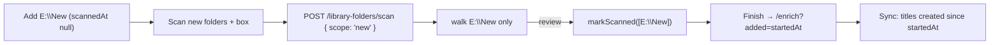

# 54: Scan new folders

> **Initiative:** `scan-new-folders`
> **PRD:** `docs/PRDs/54-scan-new-folders.md` (to be written)
> **Plan:** `docs/PRDs/54-scan-new-folders-plan.md` (to be written)

This log is the `grill-me` session for step 37 of the build order, **Scan new
folders** (the checklist's _Scan new folders, and sync only what a run
added_), held against the prototype and the code as they stood on
2026-10-28 (`7dbabab`), the day the Loading states refactor closed. It is an
immutable snapshot of that moment. The session ran alone, and the maintainer
approved every recommendation in advance. Their brief: _when adding
(link/import) folders, movies or series, we don't want to have to scan the
already existing but just the new ones added. Keep the codebase consistent
with our naming and code conventions/patterns/architecture._

## Background

What exists:

- **A Folder scan walks every listed folder** (log 30 Q16: _All, one press_;
  a per-folder Scan was rejected because "a rescan of held folders costs a
  walk and copies nothing"). `POST /api/library-folders/scan { enrich, mode }`
  hands `storage.libraryFolders()` whole to `Importer.scan(folders, enrich,
mode)`; `walkListed` logs one `Scanning   <path>` line per folder, skips an
  **Unreachable** one with a **Warning line**, and walks the rest. The sheet
  run (`start(sheetPath, enrich, mode)`) takes the same walk (log 40 Q5).
- **Nothing records that a folder was ever walked.** `library_folders` holds
  `id`, `path`, `added_at` (migration 6). A folder added a minute ago and one
  scanned a hundred times look the same to the page and to the route.
- **The walk is not free.** On a collection of a few hundred titles over a
  USB or network drive, each rescan reads every directory, runs the four
  **Already in library** rules per Source folder, and fills the Activity log
  with one `· Already in library` line per held title, burying the few lines
  the maintainer pressed Scan to see.
- **The Library folders page** draws the group **Scan**: `FolderShapes`, the
  **Import mode** (`ImportModeChoice`, Link on every mount), the
  `EnrichCheckCard` (_Runs straight after the scan, over everything it brings
  in._) and **Scan folders** (`primary`, `lg`, disabled with no folder).
- **The Sync after an import is not what the hint says.** _Finish_ on a run
  carrying `enrich` replaces `/import` with `/enrich?scope=all`: setup with
  _Everything_ selected. So adding one folder of three films and ticking the
  box offers a Sync over all 250 titles. The checklist names the fix with
  this step: _and sync only what a run added_.
- `movies.created_at`, `series.created_at` and `episodes.created_at` are ISO
  stamps written on insert; `ImportRun.startedAt` is the run's own.

## Problem

Let the maintainer add a folder (or several) and scan **only those**, leaving
folders already scanned unwalked; and let the Sync the scan hands on to cover
**only what the run brought in**, not the whole library. What marks a folder
as scanned, what still reaches the old ones, and what bounds "what was
added"?

## Questions and Answers

### Scope

1. **One initiative?** ✅ **One**, `scan-new-folders`, step 37, log 54: both
   halves of the checklist row. They share the press (a scan with the box
   ticked is the case where both bite) and each is small. ❌ Not built here:
   watching folders or scanning on launch (log 30 Q3 stands: a scan is always
   the maintainer's press); a per-row Scan (Q6); detecting new titles inside
   an already-scanned folder without walking it (a walk is the only way to
   know; Q5 keeps that walk one press away).

2. **Prototype first?** ✅ **Yes**, per _The prototype is the spec_: the Folder
   row's line (Q8), the group Scan's two buttons (Q6), and the Sync setup's
   third card (Q13) are amended in `docs/handoff/` in Phase 1, before code.
   The handoff for the session is `docs/handoff/handoff-scan-new-folders/`.

### What is a new folder

3. **What makes a folder new?** ✅ **No run has walked it to review.** A
   **New folder** is a listed **Library folder** with `scanned_at` null:
   added since any run's walk read it. `scanned_at` is set (to the moment the
   run reached review) on every folder the walk **read**, by **either start**,
   a Folder scan or a sheet run, since both take `walkListed` and both leave
   that folder's titles in the library or in review. ❌ **Marking at the end of
   the walk**: a run cancelled during the Import phase would leave a folder
   marked scanned with nothing imported. ❌ **Marking on _Finish_**: a run
   left in review and let go by the next start would never mark.

4. **Which folders does a run mark?** ✅ **Only those it read.** An
   Unreachable folder (skipped with its Warning line) and one that stopped
   being readable mid-walk (`walkListed`'s `catch`) stay new, so the next
   _Scan new folders_ tries them again. A cancelled run marks none.
   `walkListed` answers the folders it read as it already answers the
   `WalkedFolder[]`; the run marks them when it sets `phase = 'review'`.

5. **The folders already listed, on upgrade?** ✅ **Migration 16 marks every
   folder that holds a title**, `scanned_at = added_at`; a folder holding none
   stays new. A folder with titles was walked by some run (titles get a
   `library_folder_id` only from a run, the form's **Path bridge** add, or a
   **Show folder pick**); one with none was added and never scanned, or
   scanned and empty, and walking it again costs nothing.

   ```sql
   ALTER TABLE library_folders ADD COLUMN scanned_at TEXT;
   UPDATE library_folders SET scanned_at = added_at
     WHERE EXISTS (SELECT 1 FROM movies WHERE library_folder_id = library_folders.id)
        OR EXISTS (SELECT 1 FROM series WHERE library_folder_id = library_folders.id);
   ```

### The press

6. **One press or two?** ✅ **Two, side by side, in the group Scan.** **Scan
   new folders** (`primary`, `lg`), disabled with no New folder; and **Scan
   all folders** (`secondary`, `lg`), disabled with no folder listed: today's
   _Scan folders_, renamed, which is still how a new season dropped into a
   held folder arrives (log 30 Q14). Both send the **Import mode** and the
   box, both push `/import`, and both are held while either is in flight
   (`useFolderScan`'s `scanning`). ❌ **A Scan on each Folder row** (log 30
   Q16 stands: the case is "the folders I just added", which may be several,
   and one press covers it). ❌ **Scanning on add**: the add has no Import
   mode or TMDB box, and log 30 Q3 keeps a scan the maintainer's press.
   ❌ **One button that changes meaning** (_Scan folders_ walking new folders
   when there are some, all otherwise): the same label doing two things is the
   surprise this step removes.

7. **The wire?** ✅ **A `scope` on the scan's body**, required:
   `POST /api/library-folders/scan { enrich, mode, scope }`, `scope` one of
   `SCAN_SCOPES = ['new', 'all'] as const` (`ScanScope`, in
   `src/types/import.ts`, `IMPORT_MODES`' precedent), read by a new
   `folderScanBody` in `routes/importBody/` beside `importStartBody`
   (_Scope must be new or all._ otherwise). `scope: 'new'` with no New folder
   is `400` _No new folders to scan._ (the page gates it; the route still
   says so, Import setup's precedent, log 40 Q4). Which folders a scope takes
   is a pure unit, `server/src/import-export/foldersToScan/` →
   `foldersToScan(listed, scope)`, so the route only parses, calls and
   responds. `Importer.scan(folders, enrich, mode)` is **unchanged**: it
   already walks the folders it is handed. ❌ **`folderIds: string[]`**: the
   page would choose what a "new" folder is, and the route would have to
   check each id.

8. **How does the page show a New folder?** ✅ **On the Folder row's line**,
   through `folderLine`: a reachable New folder reads _Not scanned yet_ with
   no titles, _214 titles · not scanned yet_ with some; a scanned one keeps
   _N titles_; an Unreachable one keeps _Can't be reached right now_ in
   `danger`, whatever its mark. Import setup's listed folders draw the same
   line, as they already share `folderLine`. ❌ **A badge or a tint on the
   row**: one more element for a fact the line already has room for.

9. **What does the wire carry?** ✅ **`scannedAt: string | null`** on
   `LibraryFolder` (`src/types/libraryFolders.ts`) and on
   `StoredLibraryFolder`, an ISO stamp as every date is. The page derives
   _new_ (`scannedAt === null`) where it draws; no `isNew` boolean on the
   wire. The folders slice gains `markScanned(ids: string[], at: string)`.

10. **And the run's screen?** ✅ **Unchanged.** `/import` already reads
    _Scan library folders_ / _Finding new movies and series in your library
    folders._ for any Folder scan, and the Activity log's `Scanning   <path>`
    lines name exactly the folders walked. `ImportRun` gains nothing.

11. **What else reaches an old folder?** ✅ **What reaches it today**, with
    the button's new name in its copy: **Bring back** forgets the folder's
    **Left-out videos** and leaves its mark alone, so they return with _Scan
    all folders_; the Manage library line for a title whose original lies in
    a Library folder names _Scan all folders_. ❌ **Bring back clearing
    `scanned_at`**: the folder's 214 titles would read _not scanned yet_,
    which is false.

12. **Removing and adding a folder back?** ✅ **It is new**: a removed
    folder's row is deleted (log 30 Q9), and an add inserts a fresh one with
    `scanned_at` null. Its titles are recognised by the Already in library
    rules as before.

### The Sync after the run

13. **What does "only what a run added" mean?** ✅ **Every title created
    since the run started**, by its `created_at`, plus every held series
    with an episode created since then. That is what the run imported, what
    its Review step's Resolves and _Import as_ presses added, and the new
    episodes a held show took. A **Found again** film (a held title whose
    video was replaced) is not added. ❌ **A list of ids on the run**: Finish
    lets the run go (#327), the ids would have to ride the URL or router
    state, and every Review press would have to append to it.
    ❌ **Holding an upper bound**: the window closes when the Sync starts, and
    a hand add made between the two is something the maintainer would want
    synced too.

14. **How is it asked for?** ✅ **A fourth Enrichment scope, `added`**:
    `ENRICH_SCOPES = ['missing', 'all', 'added', 'single']`, with
    `StartEnrichment.since?: string`, an ISO stamp, required for `added` and
    refused on any other scope (`startEnrichmentBody`, the `movieId` rule's
    shape: _An added Sync names its since_, _Only an added Sync names a
    since_). `storage.moviesInScope` / `seriesInScope` take `(scope, since?)`.
    An `added` Sync plans fields as _Everything_ does (`planFields`' `scope
!== 'missing'` rule), so a title named off its folder still raises its
    **Field conflicts**: it is _Everything_, narrowed.

15. **What does Finish push?** ✅ **`/enrich?added=<run.startedAt>`**, in
    place of `?scope=all`, for both starts' runs carrying `enrich`. Setup
    draws the library's two cards and a third, **Just what was added**, chosen,
    its line _N titles this run brought in_; the count is
    `EnrichmentSummary.added`, which `GET /api/enrichment?since=<ISO>`
    answers and which is absent without `since`. The third card is drawn only
    with `?added=` (a control whose mechanism doesn't exist isn't drawn).
    Review's _Done_ still pushes the **Fresh home**. `?scope=all` had Finish
    as its only setter and is retired. ❌ **The `added` card alone**, as
    `single` draws its card alone: the maintainer may still want the whole
    library from here, as today.

16. **And the box's hint?** ✅ **Unchanged**: _Runs straight after the scan,
    over everything it brings in._ is now true.

### Names and documents

17. **The new terms?** ✅ **New folder**, **Scan new folders**, **Scan all
    folders**, **Scan scope** (`ScanScope`), and the Enrichment scope
    **Added** (_Just what was added_). **Folder scan**, **Library folder**,
    **Library folders page**, **Bring back**, **Enrichment scope** and
    **Fresh home** are updated. _Scan folders_ is retired as a label.

18. **Which documents change?** ✅ The glossary (Q17); the checklist row;
    `COMPONENT-SPEC.md`'s `mol.FolderRow` and `feat.EnrichmentFlow` rows;
    the prototype (Q2); the docblocks of `LibraryFolders`, `useFolderScan`,
    `folderLine`, `walkListed`, `ImportFlow` and `EnrichmentFlow`.

## Design

### Chosen and rejected

- ✅ `scanned_at` on the folder, set on reaching review for each folder read,
  by either start; ❌ set at the end of the walk, or on Finish.
- ✅ Migration 16 marks folders that hold a title; ❌ marking all, or none.
- ✅ _Scan new folders_ and _Scan all folders_; ❌ a per-row Scan, scan on add,
  one button that changes meaning.
- ✅ `scope: 'new' | 'all'` on the body and `foldersToScan`; ❌ a list of ids.
- ✅ The Folder row's line; ❌ a badge.
- ✅ Enrichment scope `added` bounded by `since = run.startedAt`, planning as
  _Everything_; ❌ ids on the run, an upper bound.
- ✅ Finish to `/enrich?added=`, three cards with _Just what was added_ chosen;
  ❌ the card alone.

### Types

```ts
// src/types/import.ts
/** The **Scan scopes**: the New folders, or every listed folder. */
export const SCAN_SCOPES = ['new', 'all'] as const;
export type ScanScope = (typeof SCAN_SCOPES)[number];

// src/types/libraryFolders.ts
export interface LibraryFolder {
  id: string;
  path: string;
  titleCount: number;
  reachable: boolean;
  /** When a run last walked it to review; `null` for a **New folder**. */
  scannedAt: string | null;
}

// src/types/enrichment.ts
export const ENRICH_SCOPES = ['missing', 'all', 'added', 'single'] as const;
export interface StartEnrichment {
  scope: EnrichScope;
  movieId?: string;
  seriesId?: string;
  /** An `added` Sync's lower bound, ISO: titles created since. */
  since?: string;
  fields: EnrichField[];
  writeSheet: boolean;
  writePosters: boolean;
}
export interface EnrichmentSummary {
  // ...as today
  /** Titles created since `?since=`; absent when the read names none. */
  added?: number;
}
```

### The units

| Unit                       | Where                                        | Change                                                                 |
| -------------------------- | -------------------------------------------- | ---------------------------------------------------------------------- |
| migration 16               | `server/src/db/migrations.ts`                | `scanned_at`, backfilled for folders holding a title                   |
| folders slice              | `server/src/library/folders/`                | `scannedAt` on the select; `markScanned(ids, at)`                      |
| `foldersToScan`            | `server/src/import-export/foldersToScan/`    | new, pure: `(listed, scope) => StoredLibraryFolder[]`                  |
| `createImporter`           | `server/src/import-export/createImporter/`   | `walkListed` answers the folders read; both starts mark them on review |
| `folderScanBody`           | `server/src/routes/importBody/`              | new: `{ enrich, mode, scope }`                                         |
| scan route                 | `server/src/routes/index.ts`                 | reads `scope`, `400` with no New folder                                |
| enrich slice               | `server/src/library/enrich/`                 | `moviesInScope` / `seriesInScope` take `since`; an `added` count       |
| `createEnrichment`         | `server/src/enrichment/createEnrichment/`    | `titlesFor` passes `since`; `summary(since?)`                          |
| `startEnrichmentBody`      | `server/src/routes/enrichmentBody/`          | `since` for `added` and only `added`                                   |
| `folderLine`               | `src/features/import-export/folderLine/`     | _Not scanned yet_ / _N titles · not scanned yet_                       |
| `useFolderScan`, `api`     | `src/features/import-export/`                | `startFolderScan(enrich, mode, scope)`; `scan(enrich, mode, scope)`    |
| `LibraryFolders`           | `src/features/import-export/LibraryFolders/` | the two buttons                                                        |
| `ImportFlow`               | `src/features/import-export/ImportFlow/`     | Finish pushes `/enrich?added=<startedAt>`                              |
| `EnrichmentFlow` / `Setup` | `src/features/enrichment/`                   | `?added=` read; the third card; `since` posted                         |
| `libraryTitleView`         | `src/features/manage-library/`               | the line names _Scan all folders_                                      |

### The loop



## Implementation Plan

1. **The prototype.** `mol.FolderRow`'s line, the group Scan's two buttons,
   `feat.EnrichmentFlow`'s third card, the model in `FamilyFlix.dc.html`
   (`scannedAt` on the mock folders, `scanFolders(scope)`, Finish to the
   added scope), `COMPONENT-SPEC.md`. No code.
2. **The mark.** Migration 16, `scannedAt` on both folder types, the folders
   slice's `markScanned`, both starts marking the folders read on review,
   `folderLine`'s new line. Demo: add a folder, see _Not scanned yet_; scan
   all; the line becomes _N titles_.
3. **Scan new folders.** `SCAN_SCOPES`, `folderScanBody`, `foldersToScan`, the
   route's `400`, `startFolderScan`'s `scope`, the two buttons. Demo: two
   scanned folders and one new; _Scan new folders_ logs one `Scanning` line
   and imports only the new folder's titles.
4. **Sync what was added.** The `added` scope, `since` through the body, the
   slice and the summary, Finish's push, the third card. Demo: a scan of one
   new folder of three films with the box ticked; _Continue to TMDB sync_
   offers _Just what was added_, _3 titles this run brought in_, chosen.
5. **The documents** (Q18).

## Trade-offs

- **Easier:** adding a folder and scanning it costs a walk of that folder
  alone, and its Activity log is only its own titles; the Sync after it
  touches only what arrived, as its hint always said.
- **Harder:** two buttons where there was one; a new title dropped into a
  scanned folder needs _Scan all folders_, which the maintainer must know to
  press (the disabled _Scan new folders_ points there); the `added` window
  is a timestamp, so a hand add made between the run's start and the Sync is
  included, which is accepted as wanted.
- **Out of scope:** watching folders, scanning on launch, a per-row Scan,
  telling a changed folder from an unchanged one without walking it.
