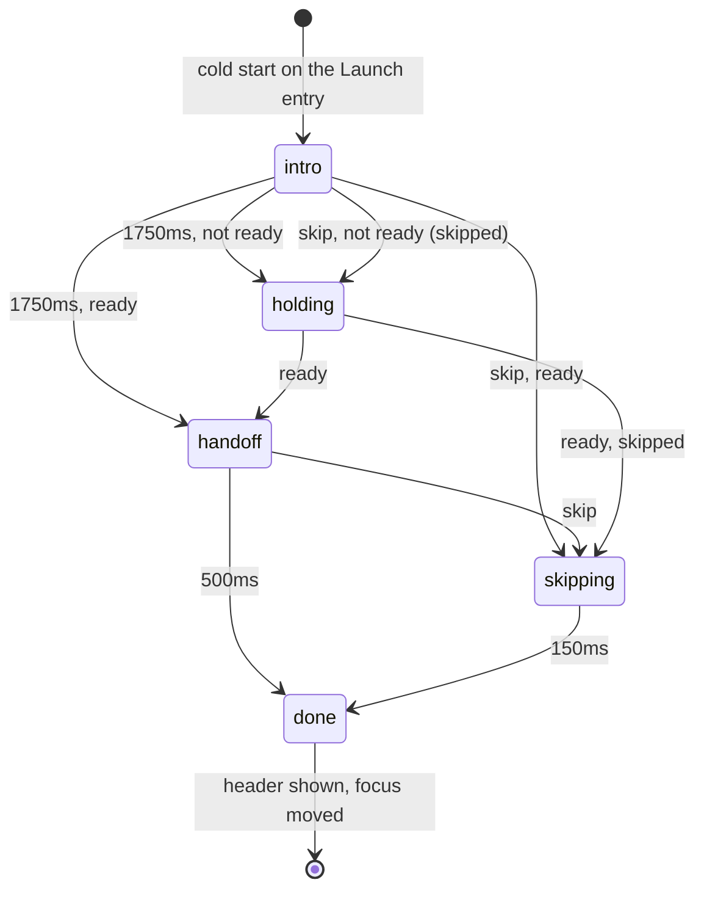

# 55: Intro animation

> **Initiative:** `intro-animation`
> **PRD:** `docs/PRDs/55-intro-animation.md` (to be written)
> **Plan:** `docs/PRDs/55-intro-animation-plan.md` (to be written)

This log is the `grill-me` session for step 38 of the build order, **Intro
animation**, held against the handoff `docs/handoff/handoff-welcome-splash/`
(option 2a, _Bounce, sweep, handoff_) and the code as it stood on 2026-10-29
(`e9c9d09`). It is an immutable snapshot of that moment. The session ran
alone, and the maintainer approved every recommendation in advance, asking
that the codebase stay consistent with its naming, code conventions, patterns
and architecture.

## Background

The handoff draws a welcome of about 2.25s: the two Fs drop in with a bounce,
the ten letters of _FamilyFlix_ rise one by one, a light sweeps across both in
the inverse colour, and the wordmark glides into the home header while the
splash fades out and the home fades in under it. It plays on a cold start
only, is skipped by any click or key, holds on a loader if the app isn't
ready, and has its own reduced-motion timeline. Its README gives every
element's start, duration, curve and keyframes; the prototype is the source
of the keyframes.

What the code does today, read before the session:

| Fact                     | Today                                                                                                                                   |
| ------------------------ | --------------------------------------------------------------------------------------------------------------------------------------- |
| The window's first paint | the shell's **Start-up splash** (`electron/splashPage/`, log 53 Q19): the 88px tile, the beat, _Opening your library_                   |
| The app's first paint    | the renderer, loaded over the splash on the server's `ready`, the history cleared after (#501)                                          |
| The home's first frame   | `StartTabGate` draws nothing on the **Launch entry** until the **Start tab** is read; the rows draw their **Skeletons** while they read |
| The header wordmark      | `MainLayout`'s `LogoMark`: the `Wordmark` primitive at 25px, 0.3px tracking, 2px between the words, inside the logo button              |
| The F paths              | private constants in `LogoLoader.tsx`, copied once more into `splashPage.ts` (the shell imports only types)                             |
| Reduced motion           | `GlobalStyle` collapses every animation to 0.01ms with `!important`; `LogoLoader` alone out-ranks it                                    |
| Curves                   | `interactionStates.test.tsx` refuses a `cubic-bezier(` spelled anywhere but `src/tokens/motion.ts`                                      |

Three facts shape most answers. The welcome needs the home under it and the
home's own header wordmark as its landing place, so it can only live in the
renderer. The prototype's header is a 16px wordmark at (16, 16) on a 480×270
stage; ours is a real 25px one wherever the header lays it out. And the
prototype's "ready" is a simulation; ours has to be a fact the home already
knows.

## Problem

Translate option 2a 1:1 onto the app as it is: its shell, its home, its
header, its tokens and its reduced-motion rule, so the family's cold start
ends with the wordmark sitting exactly where the header draws it.

## Questions and Answers

### Scope

1. **One initiative?** ✅ **One**, `intro-animation`, step 38, log 55, option
   **2a** alone. ❌ Options 1a to 1f: explored alternatives, reference only.
   ❌ Sound: the handoff has none.

2. **Is the handoff amended?** ✅ **No, it is committed as received**
   (`e9c9d09`), frozen like `handoff-loading-states/`; this log records where
   the build departs from it. Phase 1 adds a `COMPONENT-SPEC.md` section for
   the **Welcome splash** (`Welcome Splash.dc.html`, option 2a, target
   `src/App/WelcomeSplash/`) and the motion tokens of Q14.

3. **What is it called?** ✅ The **Welcome splash**, after the handoff's own
   name; its three stretches are the **Welcome intro** (0 to 1750ms), the
   **Welcome hold** (waiting on the home, loader beating) and the **Wordmark
   handoff** (the last 500ms). ❌ _Splash_ alone: the shell's **Start-up
   splash** already answers to it. ❌ _Intro animation_: the initiative's and
   the checklist row's name, not the thing on screen.

### Where and when it plays

4. **Renderer or shell?** ✅ **The renderer.** The handoff draws the home
   underneath and lands the wordmark on the header, neither of which the
   shell has. ❌ Folding it into the **Start-up splash**: a `data:` page can't
   cross-fade into another load (log 53 Q21). The **Start-up splash** is
   **unchanged** and still covers the server's start; the welcome begins
   with the renderer's first paint, on the same `bg`.

5. **What is a cold start?** ✅ **The first Launch entry of the window's
   session**: the renderer's first entry is a **Launch entry** (bare `/`, no
   query, key `default`) and the session has not yet been welcomed, a flag in
   `sessionStorage` (`familyflix.welcomed`), set when the welcome starts.
   So a crashed renderer's reload, a **Factory reset**'s reload and a reload
   of `/` don't replay it (the session survives a reload; it ends with the
   window), and a deep link never plays it. A browser tab plays it once. Every
   storage access is in a `try`; a refused read plays it, a refused write is
   ignored. ❌ A preload flag from main: a bridge and a channel for one bit
   the renderer's own session already keeps.

6. **Where does the Launch entry test live?** ✅ **Lifted into a util**,
   `src/utils/isLaunchEntry/` (`isLaunchEntry.ts` + test,
   `isLaunchEntry(location: Pick<Location, 'pathname' | 'search' | 'key'>): boolean`),
   now that two units ask it: `useStartTabSettled` and the welcome.

### The units

7. **Where does it live?** ✅ **In `src/App/`**, beside the Snackbar stack:
   it wraps the route table, which only `App` has. Three units:
   - `src/App/WelcomeProvider/` (`.tsx`, `.styles.ts`, `.test.tsx`): decides
     whether the welcome plays (Q5), owns the phase (Q10) and its timers,
     wraps the routes in the **home layer** it fades in (Q12), listens for a
     skip (Q16), moves focus at the end (Q18), and draws `WelcomeSplash`
     over it all. Mounted in `App` inside `SnackbarProvider`, around
     `<Routes>`.
   - `src/App/WelcomeSplash/` (`.tsx`, `.styles.ts`, `.test.tsx`): the drawn
     layers of the handoff (background, mark, sweep, letters), given its
     `phase`, its geometry and whether motion is reduced. Logic-free.
   - `src/App/useWelcome/` (`useWelcome.ts` + test): the context, owned by
     the hook file as `useSnackbar` owns its own, answering
     `{ wordmarkRef, wordmarkHidden }`.

   ❌ A `features/welcome/`: there is no domain and no wire; it is app
   furniture, like the Snackbar stack and the **Content frame**.

8. **How does the header take part?** ✅ **`MainLayout` reads `useWelcome()`**:
   its `LogoMark` takes `wordmarkRef` (the **Welcome splash**'s landing
   place, and its readiness, Q11) and is `visibility: hidden` while
   `wordmarkHidden`. Outside a `WelcomeProvider` (every test that mounts a
   layout alone) the context's default is a no-op ref and `false`, so
   nothing else changes. ❌ The splash finding the header by a DOM query and
   hiding it with a global rule: a hidden coupling the type system can't see.

9. **Where do the F paths come from?** ✅ **One renderer copy**, lifted from
   `LogoLoader.tsx` to `src/tokens/brand.ts` (`MARK_F1`, `MARK_F2`,
   `MARK_VIEWBOX = '160 300 704 424'`), exported from the `tokens` barrel and
   read by `LogoLoader` and `WelcomeSplash`. `splashPage.ts` keeps its own
   copy (the shell imports only types) and its docblock now names
   `src/tokens/brand.ts` as the source.

### The phases

10. **What drives the timeline?** ✅ **A pure step**, `src/App/welcomeStep/`
    (`welcomeStep.ts` + test), over a **Welcome phase**:

    ```ts
    // src/App/welcomeStep/welcomeStep.ts
    export type WelcomePhase =
      | 'intro'
      | 'holding'
      | 'handoff'
      | 'skipping'
      | 'done';
    export interface WelcomeState {
      phase: WelcomePhase;
      ready: boolean; // the header wordmark is mounted
      skipped: boolean; // a skip came while the home wasn't ready
    }
    export type WelcomeEvent =
      | 'introEnded'
      | 'ready'
      | 'skip'
      | 'handoffEnded'
      | 'skipEnded';
    export function welcomeStep(
      state: WelcomeState,
      event: WelcomeEvent
    ): WelcomeState;
    ```

    `intro` → `handoff` at `introEnded` when ready, else `holding`;
    `holding` → `handoff` at `ready` (or `skipping` if `skipped`); a `skip` in
    `intro`, `holding` or `handoff` → `skipping` when ready, else `holding`
    with `skipped`; `handoff` → `done`, `skipping` → `done`. The provider's
    timers send the time events (1750ms intro, 500ms handoff, 150ms skip;
    900 / 400 under reduced motion, Q15); a ready that comes early is only
    recorded, so **the sequence is never cut** for an app that's ready
    early. ❌ `animationend` as the clock: it fires per element, is collapsed
    by `GlobalStyle` and can't be driven by fake timers.

11. **What is "ready"?** ✅ **The header wordmark is mounted**: `wordmarkRef`
    receives its element, which happens once `StartTabGate` has settled (a
    Series start already replaced, a refused read on Movies). The rows'
    **Skeletons** under it are the home's own loading, not the welcome's
    business. ❌ Waiting for the rows: the handoff's "app" is the home's
    frame, and a slow library would hold the family on a splash with the
    home's own loading ready to draw.

12. **The home under it?** ✅ **Mounted from the start, in the home layer**,
    at opacity 0 through `intro` and `holding`, so it lays out and the
    header can be measured; its fade (0→1, 400ms, ease-out) starts 100ms
    into the **Wordmark handoff**, as the README's 1850ms. At `done` the
    layer is a plain wrapper again, with no style left on it.

### The drawing

13. **What size is it?** ✅ **The stage, scaled to the window, as the README
    says**: `scale = min(innerWidth / 480, innerHeight / 270)`, read once
    when the welcome starts (a resize during 2s is ignored). Mark
    `132·scale × 80·scale`, its centre `26·scale` above the window's centre;
    wordmark at `30·scale` px, its centre `42·scale` below. On a maximised
    1080p window that is a 528px mark and a 120px wordmark. ❌ Sizing the
    splash from the header (25 × 30/16): it keeps the prototype's 30→16
    handoff ratio but draws a 47px wordmark on a TV-sized screen, against the
    README's rule.

14. **The curves?** ✅ **Motion tokens**, so the structural guard holds:
    `easeDrop: 'cubic-bezier(0.3, 0.6, 0.4, 1)'`, `easeSweep:
'cubic-bezier(0.4, 0, 0.2, 1)'`, `easeGlide: 'cubic-bezier(0.3, 0.7, 0.2,
1)'` in `src/tokens/motion.ts`; the letters' curve is the existing
    `easeOut`. The durations and delays are the handoff's own, as the
    welcome's constants (not motion tokens: none of them is 120, 180 or
    280ms). The keyframes are the prototype's, verbatim: `ffDrop`,
    `ffLetter`, `ffSweep`, `ffTextSweep`, `ffMarkOut`, `ffIn`, `ffOut`, as
    `styled-components` `keyframes` in `WelcomeSplash.styles.ts`; the glide
    is `ffToHeader` with its end computed (Q17).

15. **Reduced motion?** ✅ **The handoff's own timeline, opted out of the
    collapse** as `LogoLoader` is: under `prefers-reduced-motion` (read once
    with `matchMedia` at start) no drop, blur, sweep or glide; mark and
    wordmark fade in over 300ms, the intro ends at 900ms, the splash fades
    out over 300ms while the home fades in from 100ms (the README's 1000ms),
    the **Wordmark handoff** being 400ms; total 1300ms. The header wordmark
    is shown with the handoff's start and fades in with the home. Its rules
    carry the specificity and `!important` to beat `GlobalStyle`'s `*`, the
    third such rule. ❌ Letting the collapse stand: the home would snap in
    and the splash would vanish in one frame.

16. **The sweep?** ✅ **As the prototype draws it**: over the mark, a
    220-unit band in a gradient `rect` (`translateX −260 → +760` viewBox
    units), clipped to each F by an SVG `clipPath`, warm orange
    `rgb(255,150,90)` at 0.95 over F1 and white at 0.7 over F2, ids from
    `useId` stripped as `LogoLoader`'s are; over the letters, a copy of each
    glyph on top, `color: transparent`, `background-clip: text`, a 100°
    band (orange at 1 over _Family_, white at 0.9 over _Flix_), 300% wide,
    `background-position 160% → −60%`, linear, 380ms from `1150 + i·45`.

### The handoff

17. **Where does the wordmark land?** ✅ **On the header's own `LogoMark`,
    measured** at the handoff's start: `getBoundingClientRect()` and its
    computed `font-size`. The glide moves the splash wordmark's box from its
    centred place to that rect's top-left, `transform-origin: 0 0`, scaling
    by `headerSize / (30·scale)`, over 500ms `easeGlide`. To make the swap at
    `done` invisible the splash wordmark is **the header's typography at
    splash size**: the theme's serif 700, the header's tracking (0.3px) and
    word gap (2px) scaled by the same ratio, `line-height: normal` as the
    header has. ❌ The prototype's −0.01em tracking and 1.25 line height:
    they are the prototype's 16px header, not ours, and would jump at the
    swap. ❌ `Wordmark` itself: its two words can't rise letter by letter.

18. **At the end?** ✅ **In the same frame**: the header wordmark is shown,
    `WelcomeSplash` unmounts and the home layer loses its style; then focus
    moves to the home layer's first focusable element (the header's logo
    button), as the README asks. ❌ An `inert` home during the welcome: the
    README says not to trap focus, and every key skips anyway.

19. **The Welcome hold?** ✅ **The intro's last frame, held**: background on,
    wordmark centred, and in the mark's place a `LogoLoader` at the mark's
    own width (`132·scale`), beating, no label, wrapped `aria-hidden` (the
    splash is already the status, Q21). On `ready` the handoff runs from
    there with the static mark fading out instead of the loader. ❌ A
    separate size token for "large": our `LogoLoader` takes pixels, and the
    mark's width is what puts the beat in its place.

### Skipping

20. **What skips it?** ✅ **Any `pointerdown` or `keydown` on `window`, in
    the capture phase, while the welcome is up**, swallowed
    (`preventDefault`, `stopPropagation`) so it doesn't also press what's
    beneath. A ready home: the splash is gone at once and the home layer
    fades in over 150ms (`ffIn`), the header wordmark shown, then `done` and
    the focus move. Not ready: the **Welcome hold**, which ends the same way
    when `ready` comes. ❌ A skip that also acts: a click meant for the
    splash would open whatever card lay under it.

### Accessibility

21. **Its semantics?** ✅ As the README: the splash's root is
    `role="status"` with `aria-label="Opening FamilyFlix"`; every drawn layer
    is `aria-hidden`. The home layer is not hidden from assistive tech.

### Documents

22. **Which documents change?** ✅ `COMPONENT-SPEC.md` (Q2); the glossary (an
    **Intro animation** section: **Welcome splash**, **Welcome intro**,
    **Welcome hold**, **Wordmark handoff**, **Welcome phase**, **Cold
    start**, **Home layer**; **Start-up splash**, **Launch entry** and
    **Wordmark** updated); the docblocks of `MainLayout`, `LogoLoader`,
    `useStartTabSettled`, `splashPage` and `App`. The checklist row stays
    🔜 until the refactor (the **Done** rule).

## Design

### Chosen and rejected

- ✅ In the renderer, after the unchanged **Start-up splash**; ❌ in the shell.
- ✅ Once per window session, on the **Launch entry**; ❌ every reload, a
  preload flag.
- ✅ A pure `welcomeStep` driven by timers; ❌ `animationend`.
- ✅ Ready = the header wordmark mounted; ❌ ready = the rows loaded.
- ✅ The stage scaled to the window, landing on the measured header; ❌ the
  prototype's fixed (16, 16) at 16px.
- ✅ The header's typography at splash size; ❌ the prototype's tracking.
- ✅ The handoff's curves as motion tokens; ❌ literals past the guard.
- ✅ The reduced timeline opted out of the collapse; ❌ an instant cut.

### The phases



### The timeline (full motion)

| Element           | Phase   | Start (ms)  | Duration | Curve       | Keyframes     |
| ----------------- | ------- | ----------- | -------- | ----------- | ------------- |
| F1, F2            | intro   | 0, 150      | 520      | `easeDrop`  | `ffDrop`      |
| Letter i (0 to 9) | intro   | 520 + i·40  | 420      | `easeOut`   | `ffLetter`    |
| Mark sweep        | intro   | 1000        | 700      | `easeSweep` | `ffSweep`     |
| Letter sweep i    | intro   | 1150 + i·45 | 380      | linear      | `ffTextSweep` |
| Mark              | handoff | 0           | 300      | ease-out    | `ffMarkOut`   |
| Wordmark          | handoff | 0           | 500      | `easeGlide` | `ffToHeader`  |
| Background        | handoff | 50          | 400      | ease-out    | `ffOut`       |
| Home layer        | handoff | 100         | 400      | ease-out    | `ffIn`        |

### The units

| Unit                       | Where                    | What                                                        |
| -------------------------- | ------------------------ | ----------------------------------------------------------- |
| `WelcomeProvider` (new)    | `App/WelcomeProvider/`   | plays or not, the phase and timers, home layer, skip, focus |
| `WelcomeSplash` (new)      | `App/WelcomeSplash/`     | the handoff's layers, logic-free                            |
| `useWelcome` (new)         | `App/useWelcome/`        | the context: `wordmarkRef`, `wordmarkHidden`                |
| `welcomeStep` (new)        | `App/welcomeStep/`       | the pure phase step                                         |
| `isLaunchEntry` (new)      | `utils/isLaunchEntry/`   | the **Launch entry** test, lifted                           |
| `brand.ts` (new)           | `tokens/`                | the F paths and the mark's viewBox                          |
| `motion.ts` (ch.)          | `tokens/`                | `easeDrop`, `easeSweep`, `easeGlide`                        |
| `MainLayout` (ch.)         | `layouts/MainLayout/`    | `LogoMark` takes the ref and hides while asked              |
| `LogoLoader` (ch.)         | `primitives/LogoLoader/` | reads the paths from `tokens`                               |
| `useStartTabSettled` (ch.) | `features/library/`      | reads `isLaunchEntry`                                       |
| `App` (ch.)                | `App/`                   | `WelcomeProvider` around `<Routes>`                         |

## Implementation Plan

1. **Prototype and tokens.** The `COMPONENT-SPEC.md` section; `brand.ts` with
   `LogoLoader` on it; the three curves.
2. **A welcome that lands.** `isLaunchEntry`, `welcomeStep`, `useWelcome`,
   `WelcomeProvider` and `WelcomeSplash` with the background, the static
   mark and wordmark, and the **Wordmark handoff** onto the measured header:
   a cold start ends with the wordmark in the header and focus on the logo.
3. **The intro.** The drop, the letters and both sweeps, to the README's
   timeline.
4. **Hold and skip.** The **Welcome hold** with its loader; a skip in every
   phase, swallowed.
5. **Reduced motion.** The fade timeline, opted out of the collapse.
6. **Walk it live.** In the shell: a cold start on Movies and on Series, a
   skip by click and by key, a slow settings read held on the loader, a
   reload (no replay), reduced motion on; then the documents of Q22.

## Trade-offs

- **Easier:** one pure step owns every ordering question, so the hold, the
  skip and the never-cut rule are unit tests; the header is the landing place
  by measurement, so a header that changes keeps the welcome honest; the F
  paths have one renderer home.
- **Harder:** a cold start shows two brand moments back to back (the shell's
  beating tile, then the welcome's drop), accepted since the shell's covers a
  wait the renderer can't; `MainLayout` now reads an App-level context, as
  `ContentFrame` reads the display preference; the welcome adds about 2.25s
  before the family can act, shortened by any key.
- **Out of scope:** replaying it from Settings, a welcome off the **Launch
  entry**, sound, merging the **Start-up splash** into it, and every option
  but 2a.
