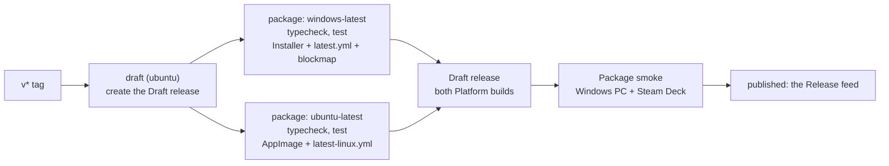

# 56: Linux build

> **Initiative:** `linux-build`
> **PRD:** `docs/PRDs/56-linux-build.md` (to be written)
> **Plan:** `docs/PRDs/56-linux-build-plan.md` (to be written)

This log is the `grill-me` session for step 39 of the build order, **Linux
build**, held against the plan in `docs/feature-checklist.md` and the code as
it stood on 2026-11-04 (`c427b68`, v0.13.0). It is an immutable snapshot of
that moment. The session ran alone, and the maintainer approved every
recommendation in advance, asking that the codebase stay consistent with its
naming, code conventions, patterns and architecture.

## Background

The maintainer wants FamilyFlix on a Steam Deck (SteamOS 3) as well as on the
family's Windows PC, and from now on every **Release** should carry an install
file for each. SteamOS is Arch-based with a read-only root filesystem: a
package install doesn't survive an OS update, and only the home folder is
reliably writable.

What the code does today, read before the session:

| Fact               | Today                                                                                                                                  |
| ------------------ | -------------------------------------------------------------------------------------------------------------------------------------- |
| The release        | `.github/workflows/release.yml`: one `windows-latest` job on a `v*` tag; makes the **Draft release** first (issue #284), then packages |
| Packaging          | `packageApp.mjs`: `Platform.WINDOWS.createTarget(nsis or dir, x64)` over `builderConfig.json`, which has only `win` and `nsis` blocks  |
| What to build      | `packageOptions(args)`: `target: 'nsis' \| 'dir'`, `publish: 'never' \| 'always'`                                                      |
| The SQLite binding | `fetchNative.mjs` already asks `prebuild-install` for `process.platform` and `process.arch`                                            |
| The **FFmpeg pin** | one `{ version, url, sha256 }`: gyan.dev's Windows essentials zip, 9.0.2; `fetchFfmpeg.mjs` reads it by hand with `zipEntries`         |
| **Shell paths**    | `ffmpeg: resources/ffmpeg/ffmpeg.exe` and `icon: electron/assets/icon.ico`, whatever the platform                                      |
| The **App mark**   | `buildIcon.mjs` renders `icon.ico`, the favicon and preview PNGs; no PNG in `electron/assets/`                                         |
| The server         | already by platform: `EXE` and `pairIn` in `ffmpegBinary`, `chmod 0o755` in `componentSlot`, `folderOverlap`'s posix/win32 choice      |
| Hardware encoders  | `ffmpegComponent` trial-runs `h264_nvenc`, `h264_qsv`, `h264_amf`, `h264_videotoolbox`, `h264_vaapi`, else `libx264 veryfast`          |
| HEVC               | not in `NATIVE_VIDEO_CODECS`: a **Transcode** on every platform already                                                                |
| Visible copy       | platform-neutral: the drop zone says `ffmpeg`, Storage says _Open folder_; "Explorer" appears only in docblocks                        |

Three facts shape most answers. The app code is already written for more than
one platform; what is Windows-only is packaging, `shellPaths` and the
workflow. electron-builder can't build an AppImage on Windows, and the
binding and FFmpeg have to be Linux ones, so the Linux build is made on Linux.
And nothing on screen changes, so there is no prototype to translate.

## Problem

Ship FamilyFlix for SteamOS beside Windows on every **Release**: one file the
maintainer puts on the Deck that runs, plays and updates itself the way the
**Installer** does, built by the same tag, smoked before it is published, and
written in the codebase's own patterns.

## Questions and Answers

### Scope

1. **One initiative?** ✅ **One**, `linux-build`, step 39, log 56: an x86_64
   Linux build for SteamOS, released beside the Windows one from the next
   minor (v0.14.0) on. The Windows **Installer** is unchanged. ❌ arm64, other
   distros as targets (an AppImage runs on most, but only the Deck is
   smoked), macOS.

2. **Is the prototype amended?** ✅ **No.** Nothing on screen changes: every
   visible string is already platform-neutral, the About card's **Software
   update** row draws the same four faces, and the drop zone already names
   `ffmpeg` without an extension. No handoff, no `COMPONENT-SPEC.md` section.
   Docblocks that say "Explorer" for the file manager are corrected to "the
   file manager" where they describe behaviour, as the code is touched.

3. **What is it called?** ✅ The Linux file is the **AppImage**; the
   **Installer** stays the Windows file's name. Each is one **Platform
   build**, and a **Release** carries exactly two. ❌ "Linux installer": an
   AppImage installs nothing. ❌ "Release files" / "install files": vague;
   **Platform build** says what varies.

### The format

4. **AppImage, Flatpak or a package?** ✅ **AppImage.** One file in the home
   folder, untouched by SteamOS updates, and `electron-updater` updates it in
   place, so **Software update** works as on Windows. ❌ Flatpak: needs a
   repository or Flathub, `electron-updater` can't update it, and its sandbox
   would put every **Library folder** behind portals. ❌ `.deb`, `.rpm`,
   pacman: the read-only root rules them out.

5. **What is the file called?** ✅ **`FamilyFlix-x86_64.AppImage`, with no
   version.** `electron-updater`'s AppImage updater overwrites the running
   file in place when its name carries no version, and renames it to the new
   version otherwise, which would break the Steam shortcut pointing at the
   old path. ❌ `FamilyFlix-<version>.AppImage`: the Installer's pattern,
   wrong here for that reason. The Installer keeps its versioned name.

6. **Where does it live on the Deck?** ✅ **`~/Applications/`**, made
   executable once (Dolphin → Properties → Permissions, or `chmod +x`), and
   added to Steam with _Add a Non-Steam Game_. The README gains _Installing on
   SteamOS_ beside _Installing on a new machine_. ❌ AppImageLauncher or Gear
   Lever: an extra tool for the family's maintainer to keep; nothing needs it.

7. **Where is the data?** ✅ **Electron's own `userData`**,
   `~/.config/FamilyFlix/`: the database, the **Managed media directory**, the
   **Component slot** and the logs, as `%APPDATA%\FamilyFlix\` is on Windows.
   Replacing or deleting the AppImage never touches it. ❌ Overriding it to
   `~/.local/share/`: a Linux-only branch in **Shell paths** for no gain the
   family sees.

8. **The desktop entry?** ✅ `builderConfig.json` gains a `linux` block:
   `target` AppImage, `category` `AudioVideo`, `icon`
   `electron/assets/icon.png`, `executableName` `familyflix`, a `synopsis`,
   and an `appImage` block naming the artifact (Q5). The desktop entry inside
   the AppImage is what Steam and the Desktop Mode menu read the name and the
   mark from.

### SteamOS's two modes

9. **Desktop Mode, Game Mode, or both?** ✅ **Desktop Mode is the target and
   blocks a release; Game Mode is best effort.** In Game Mode FamilyFlix runs
   as a Non-Steam game under gamescope, driven by the trackpad as a mouse and
   the touchscreen (Steam Input's desktop template); it is smoked but a
   failure there is filed, not blocking. ❌ Controller navigation (a focus
   model the D-pad can walk, every screen): a feature with its own prototype,
   a later step if the family wants it.

10. **The Chromium sandbox?** ✅ **Unchanged**: `sandbox: true`, the fuses as
    they are, no `--no-sandbox` anywhere. Inside an AppImage the SUID helper
    can't work, and Chromium uses unprivileged user namespaces instead, which
    SteamOS's kernel allows. If the smoke shows otherwise it is a fix issue,
    never a switch turned off.

### The shell

11. **How does `shellPaths` learn the platform?** ✅ **A third argument,
    `platform: NodeJS.Platform = process.platform`**, `folderOverlap`'s
    precedent, so a test asks about Linux on Windows. It answers
    `resources/ffmpeg/ffmpeg` and `electron/assets/icon.png` off Windows,
    `ffmpeg.exe` and `icon.ico` on it. ❌ Importing `EXE` from
    `server/src/playback/`: the shell imports only types from outside
    `electron/`. ❌ A `platform` field on `ShellLocations`: it is not a
    location.

12. **The App mark on Linux?** ✅ `buildIcon.mjs` also renders
    `electron/assets/icon.png` at 512, committed beside `icon.ico`, and
    `builderConfig.json`'s `files` carries it: the window's icon off Windows
    and the AppImage's. ❌ Letting electron-builder derive one from the `.ico`
    at package time: the mark would be rendered twice by two tools.

13. **Anything else in main?** ✅ **No.** `setAppUserModelId` is a no-op off
    Windows; the single-instance lock, the folder dialogs, `shell.openPath`
    for _Open folder_ and the **Path bridge** all work as they are.

14. **Software update?** ✅ **Unchanged code.** `electron-updater` picks its
    AppImage updater on Linux and reads `latest-linux.yml` from the same
    **Release feed**; `createUpdates` and the About card's row are as they
    are, enabled only in the `installed` **Shell mode**. An **Install**
    replaces the file in `~/Applications/` and relaunches. The first Linux
    release can't prove it; the round-trip is smoked from the second (Q24).

### The server

15. **Does the server change?** ✅ **No change is planned.** It already names
    executables and compares paths by platform, and **Library folders** on
    the Deck's SD card (`/run/media/deck/<label>/...`) are ordinary absolute
    paths. The proof is the suite running on Linux in the workflow (Q20); a
    test that goes red there is a Linux bug, fixed in this initiative.

16. **An uploaded component on the Deck?** ✅ **As it is.** The maintainer
    drops the two extensionless binaries; `componentBinary` names them, the
    slot stages them under `ffmpeg` and `ffprobe` and sets `0o755`, and
    `verifyComponent` runs them. A Windows build dropped on the Deck fails
    verification with the one sentence it has today.

### FFmpeg

17. **Which FFmpeg is the Linux Default component?** ✅ **A static GPL
    `linux64` build with `libx264`, of the Windows pin's version line
    (9.0)**, from BtbN's FFmpeg-Builds, pinned to a dated `autobuild-*`
    release asset and its SHA-256. ❌ The distro's FFmpeg: not on SteamOS,
    and the root is read-only. ❌ Johnvansickle's builds: their URL moves when
    a version is superseded. A pinned URL that disappears blocks the release
    at the fetch, loudly; re-pinning is a `chore:` commit.

18. **The pin's shape and the fetch?** ✅ `ffmpegPin.json` becomes **keyed by
    platform**: `{ "win32": { version, url, sha256 }, "linux": { ... } }`, and
    `fetchFfmpeg.mjs` takes `process.platform`'s entry, refusing any other
    platform in a sentence. A new pure unit, `ffmpegTarget(platform)` in
    `electron/scripts/ffmpegTarget/`, answers what differs: the archive kind,
    the wanted entries and their shipped names, and the README's build line.
    A `.zip` is read by `zipEntries` as today; a `.tar.xz` by the system
    `tar` (spawned with no shell, on Linux only, since Node has no xz). The
    binaries are written `0o755`; the README keeps the digest as its
    "already matches" mark.

    ```ts
    export interface FfmpegTarget {
      archive: 'zip' | 'tar.xz';
      /** Entry under the archive's one top folder → the name shipped. */
      wanted: ReadonlyArray<readonly [inner: string, shipped: string]>;
      /** The README's `Build:` line. */
      build: string;
    }
    export function ffmpegTarget(platform: NodeJS.Platform): FfmpegTarget;
    ```

19. **Hardware encoding on the Deck?** ✅ **Software for now.** The detector
    already trial-runs `h264_vaapi`, but a bare `-c:v h264_vaapi` needs a
    device and an upload filter, so its trial fails and the Deck converts
    with `libx264 veryfast`, as an AMD machine with a build lacking AMF does
    today. The smoke measures a 1080p HEVC film; VAAPI wiring is filed as a
    follow-up only if it stutters. ❌ Wiring VAAPI now: a second argv shape in
    the format policy for a problem not yet seen.

### The release workflow

20. **One job or several?** ✅ **Two jobs**: `draft`, on `ubuntu-latest`,
    makes the **Draft release** (issue #284's rule, kept), then `package`,
    `needs: draft`, a matrix over `windows-latest` and `ubuntu-latest` with
    `fail-fast: false`, each leg running Install, Typecheck, Test and
    `packageApp.mjs --publish` with `fetch-depth: 0` (issue #510). Each leg
    uploads its **Platform build** and its `latest*.yml` to the one draft.
    Tests run on both legs: the first time the suite runs on Linux.
    ❌ Two hand-written jobs: the same steps twice. ❌ Tests on Windows only:
    the Linux leg would ship code no test ran on Linux.

21. **A leg fails?** ✅ The draft is **not published** until it carries both
    Platform builds: the Installer, `latest.yml` and its blockmap, the
    AppImage and `latest-linux.yml`. The checklist's first tick says so.
    Re-running the failed leg finds the draft already there.

22. **What does `packageApp` build?** ✅ **`packageOptions(args, platform)`**,
    the platform passed in as Q11's is: `target: 'nsis' | 'AppImage' | 'dir'`
    by platform, `publish` as today, and `platform: 'windows' | 'linux'`,
    mapped to electron-builder's `Platform` in the script. `--dir` writes
    `release/linux-unpacked/` on Linux. Any other platform is refused in a
    sentence. On the maintainer's Windows machine `npm run electron:package`
    builds the Installer, as today; the AppImage is built on Linux.

23. **The SQLite binding?** ✅ **Unchanged**: `fetchNative.mjs` already asks
    for `process.platform` and `process.arch`, so the Linux leg fetches the
    Linux Electron-ABI prebuild.

### The proof

24. **How is the AppImage proven?** ✅ **The Package smoke gains a Linux
    half, run on the Steam Deck**, from the draft's AppImage. Blocking, in
    Desktop Mode: it launches maximized on _Your library is empty_; the
    **App mark** in the taskbar and the menu; the importer's fixture imported
    from the SD card; `smoke.mp4` direct-plays, `smoke.mkv` remuxes; an HEVC
    film transcodes, its smoothness noted (Q19); _Open folder_ opens
    `~/.config/FamilyFlix/media`; Codecs reads **Default**; About reads the
    version; and, from the second Linux release, an **Install** from the
    previous AppImage keeps the library and the Steam shortcut. Not blocking,
    in Game Mode: it launches from Steam and plays with the trackpad.

25. **Which release is first?** ✅ **v0.14.0**, the first minor after the
    build. Its Linux half skips the update round-trip; v0.14.1 or v0.15.0
    is the first to run it.

### The documents

26. **What changes besides code?** ✅ The README (platforms, _Installing on
    SteamOS_, _The installer_ section naming both Platform builds),
    `docs/release-checklist.md` (both halves, Q21's first tick), the
    feature-checklist row, and `docs/ubiquitous-language.md`. `CLAUDE.md`'s
    stack line gains "Windows and Linux (AppImage)".

## Design

### Chosen and rejected

- ✅ An AppImage, unversioned name; ❌ Flatpak, a package, a versioned name.
- ✅ Desktop Mode blocks, Game Mode best effort; ❌ controller navigation.
- ✅ The sandbox and fuses unchanged; ❌ `--no-sandbox`.
- ✅ The platform as an argument to pure units; ❌ reaching for
  `process.platform` inside them, importing the server's `EXE`.
- ✅ One pin file keyed by platform; ❌ a second pin file.
- ✅ Software encoding on the Deck for now; ❌ VAAPI wiring up front.
- ✅ One draft, a two-leg matrix, tests on both; ❌ tests on Windows only.

### The release



### The two Platform builds

|                   | Windows                              | Linux                                 |
| ----------------- | ------------------------------------ | ------------------------------------- |
| File              | `FamilyFlix-Setup-<version>.exe`     | `FamilyFlix-x86_64.AppImage`          |
| Update metadata   | `latest.yml` + blockmap              | `latest-linux.yml`                    |
| Built on          | `windows-latest`, or the maintainer  | `ubuntu-latest`, or any Linux machine |
| Lives in          | `%LOCALAPPDATA%\Programs\FamilyFlix` | `~/Applications/`                     |
| Data              | `%APPDATA%\FamilyFlix\`              | `~/.config/FamilyFlix/`               |
| Default component | gyan.dev essentials, 9.0.2, zip      | BtbN linux64 GPL, 9.0, tar.xz         |
| Icon              | `electron/assets/icon.ico`           | `electron/assets/icon.png`            |
| Smoked on         | the maintainer's PC, the parents' PC | the Steam Deck, Desktop Mode          |

### The units

| Unit                       | Where                              | What                                                       |
| -------------------------- | ---------------------------------- | ---------------------------------------------------------- |
| `shellPaths` (ch.)         | `electron/shellPaths/`             | a `platform` argument: the ffmpeg and icon names           |
| `packageOptions` (ch.)     | `electron/scripts/packageOptions/` | a `platform` argument: `nsis`, `AppImage` or `dir`         |
| `ffmpegTarget` (new)       | `electron/scripts/ffmpegTarget/`   | per platform: archive kind, wanted entries, build line     |
| `fetchFfmpeg.mjs` (ch.)    | `electron/scripts/`                | the platform's pin; `tar` for a `.tar.xz`; `0o755`         |
| `packageApp.mjs` (ch.)     | `electron/scripts/`                | the platform's target                                      |
| `buildIcon.mjs` (ch.)      | `electron/scripts/`                | also `electron/assets/icon.png` at 512                     |
| `ffmpegPin.json` (ch.)     | `electron/packaging/`              | keyed by `win32` and `linux`                               |
| `builderConfig.json` (ch.) | `electron/packaging/`              | the `linux` and `appImage` blocks; `icon.png` in `files`   |
| `packagingConfig.test.ts`  | `electron/packaging/`              | guards the Linux blocks against `shellPaths` and Q5's name |
| `release.yml` (ch.)        | `.github/workflows/`               | `draft`, then the two-leg `package` matrix                 |

## Implementation Plan

1. **The units, proven on Windows.** `shellPaths` and `packageOptions` take a
   platform; `ffmpegTarget`; the pin keyed by platform with the Linux entry;
   `fetchFfmpeg.mjs` over both; `icon.png`; the `linux` blocks and their
   guard. `npm run electron:package` still writes the same Installer.
2. **Both Platform builds on one draft.** The workflow's `draft` job and the
   two-leg matrix; the suite green on Linux, any red test fixed here. Proven
   by the v0.14.0 tag's draft carrying all five files.
3. **The Deck smoke and the documents.** The release checklist's Linux half,
   run on the Deck against the v0.14.0 draft; the README, CLAUDE.md and the
   feature checklist; then the draft is published.

## Trade-offs

- **Easier:** every Release reaches both machines from one tag; the platform
  is an argument, so each Linux answer is a unit test on Windows; the shell
  and the server change only in `shellPaths`.
- **Harder:** the AppImage can't be built on the maintainer's machine, so a
  Linux packaging change is first seen on CI; two FFmpeg pins to keep in
  step, one from a source that prunes old builds; a release now waits on two
  smokes, one on the Deck.
- **Out of scope:** controller navigation and a Game Mode that needs no
  trackpad, VAAPI hardware encoding, Flatpak and Flathub, arm64, code signing
  on either platform, and any distro beyond SteamOS as a smoked target.
