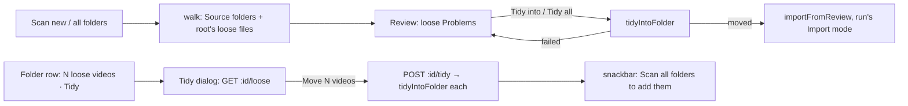

# 57: Tidy into folders

> **Initiative:** `tidy-into-folders`
> **PRD:** `docs/PRDs/57-tidy-into-folders.md` (to be written)
> **Plan:** `docs/PRDs/57-tidy-into-folders-plan.md` (to be written)

This log is the `grill-me` session for step 40 of the build order, **Tidy into
folders** (the checklist's _Tidy into folders: each loose video its own
folder_), held against the code as it stood on 2026-11-06 (`602a1b0`). It is
an immutable snapshot of that moment. The session ran alone, and the
maintainer approved every recommendation in advance. Their brief: _if the root
folder only has loose movies, we need to create a dedicated folder for them
with this option. This feature can also appear and be part of the process
during the link/import scan._ The handoff `docs/handoff/handoff-tidy-loose-videos/`
was drawn against an older FamilyFlix and is **not** built 1:1: the build
uses the units FamilyFlix has, and where the two disagree this log rules.

## Background

What exists:

- **The walk never reads a Library folder's top level as a film.**
  `media/walkLibraryFolder/` descends the root always and stops at the first
  folder holding a video (log 30 Q15). A drive of about a hundred
  `Title (Year).mp4` files lying side by side, `E:\Movies\Movies (2026)`,
  scans to 0 titles, and the run says nothing about why.
- **One level down is already handled.** A folder holding several films'
  videos is a **Collection folder** (`import-export/splitCollections/`, log
  41): each video a film, its subtitles by the video's stem, its poster the
  image named `<stem>-poster`. A folder of loose tagged videos is a **Show
  folder** (`groupShows`). So only the root itself is a problem.
- **A loose video can already be added by hand**: the **Movie form**'s add in
  the shell reads its path through the **Path bridge** and links it where it
  lies. Such a video is then a **Held video**; so is any title a run linked.
- **The Review step can import a folder from a Problem**: _Import as_ on a
  `no-row` Problem (`importer.importGuessed`, through `importFromReview`)
  imports a folder named off its folder, under the run's **Import mode**,
  with a bulk _Import all as guessed_ on the **Kind filter** row
  (`POST /api/import/current/problems/import-guessed`).
- **The Folder row** draws a second line for **Left-out videos**: _N videos
  left out_ with the _Bring back_ text button (`LibraryFolderView.leftOut`).
- **Nothing in FamilyFlix moves a file in a Library folder.** Its only writers
  are **Write targets** and an **Export**, each only ever adding (CLAUDE.md).
- The handoff draws a dedicated page with six states, an `ImportLog`, a
  checkbox look FamilyFlix has no primitive for, an inline rename of the video
  and its companions, a show editor, and a Settings → Library `ActionRow` with
  a badge.

## Problem

Give every video lying loose at a Library folder's top level the folder the
walk expects, so a scan finds it as a film, moving nothing until the
maintainer asks; and offer it both on its own and inside the scan that walks
past those videos. What is loose, what moves with it, what is the new folder
called, what stops a move, where is it offered, and what does a failed move
leave behind?

## Questions and Answers

### Scope

1. **One initiative?** ✅ **One**, `tidy-into-folders`, step 40, log 57. ❌ Not
   built here: renaming a video or its companions; tidying below the top
   level (Q4); a show named by hand (Q8); watching folders or tidying on
   launch (log 30 Q3: the disk changes only on the maintainer's press).

2. **The handoff as spec?** ❌ **Not 1:1.** It predates the Review step's
   groups, the **Busy label**, `Modal` and the Folder row's second line, and
   its dedicated page duplicates what the Review step already does (a list of
   rows, a press per row, a bulk press, the Activity log, the Import mode, the
   Sync after). ✅ It is committed beside this log as the reference for copy
   and intent; the build draws from `mol.ProblemRow` (the _Import as_ slot),
   `mol.FolderRow` (the left-out line) and `Modal`. A note at the head of its
   README, committed with this log, names this log; Phase 1 amends
   `COMPONENT-SPEC.md`.

### What is loose

3. **What is a Loose video?** ✅ **A video file lying directly in a Library
   folder's root** (`isVideoFilename`), that is none of:
   - an **extra**: its name carries `splitCollections`' extras words
     (`sample`, `trailer`, `featurette`, `behind the scenes`, ...); it stays
     put, as a sample beside a film does today;
   - a **Held video**: a held title's **Linked video** at that relative path
     (`storage.titleHolding`), as a Path bridge add leaves one; it already
     plays where it is;
   - a **Left-out video** of that folder: the household deleted it and kept
     the file.

   So nothing on record ever points at a file a tidy moves (Q16).

4. **Only the top level?** ✅ **Yes.** A folder one level down holding
   several films is a **Collection folder** and already imports film by film
   (log 41); a folder holding one video is a **Source folder**. ❌ Tidying
   Collection folders too: they work, and moving them buys nothing the scan
   needs.

5. **What moves with it?** ✅ **Its Companion files**: every non-video file in
   the root whose name, case folded, starts with the video's stem followed by
   `.` or `-`: `Apex (2026).en.srt`, `Apex (2026)-poster.jpg`,
   `Apex (2026).nfo`. The stem rule `groupShows` and `splitCollections` read
   subtitles and `-poster` by. Never another video. A file two stems claim
   (`Apex.Redux.en.srt`, beside `Apex.mkv` and `Apex.Redux.mkv`) goes with
   the longest stem that matches.

6. **What is the new folder called?** ✅ **The Tidy folder name**: the name a
   Folder scan would give the film, `titleWithYear(titleGuess(stem),
yearInName(stem))`, the `no-row` Problem's `guess` spelling, through
   `safeFilename`: `Apex.2026.1080p.BluRay.mkv` goes into `Apex (2026)\`. The
   files keep their own names; only the folder is new. ❌ **Renaming the video
   and its companions** (handoff): it changes what every other player on the
   family's machines sees, and the walk names a film off its folder anyway.
   ❌ **The stem as is**: release noise in a folder the family opens by hand.

7. **A name already there?** ✅ **Not tidied.** When the root already holds an
   entry of that name, file or folder, case folded, the video stays loose; its
   reason says _A folder called “Apex (2026)” is already here._, and only
   _Resolve_ and _Skip_ (or, in the Tidy dialog, the _Left where they are_
   list) remain. ❌ **Move into it** (handoff): a folder holding no video may
   be a shelf (`Drama\`); a video moved into it makes it a Source folder and
   hides every film under it from the walk. Two loose videos with one Tidy
   folder name (`Northwind.mkv`, `Northwind.mp4`) are both offered; the second
   press finds the folder there and is refused with the same reason.
   ❌ **The handoff's sibling-year hint and rename editor**: one more editor
   for a rare case, which _Resolve_ already covers.

8. **Loose episodes?** ✅ **Never tidied as films.** A Loose video carrying an
   **Episode tag** belongs to the show its name gives before the tag
   (`Breaking.Bad.S01E01.mkv` → `Breaking Bad`, by **Title key**); all of a
   show's loose episodes tidy together, as **one** tidy into one **Show
   folder** of that name (`titleGuess` of the text, `safeFilename`d), the
   files kept flat: `groupShows` already reads a folder of loose tagged videos
   as a Show folder, so no Season folder is made. Episodes whose name gives
   nothing before the tag stay loose, with one Warning line per folder
   (_⚠ 3 loose episodes at the top of E:\Series don't name their show, left
   where they are_). ❌ **The handoff's show editor**: rare, and the
   maintainer can make that folder by hand.

### Where it is offered

9. **Inside a scan?** ✅ **A `loose` Problem kind in the Review step**, filed
   by a **Folder scan** (either **Scan scope**) for each tidy its walk finds:
   one per Loose video, one per loose show. A Loose video is not in the
   library, so the kind is **hard**, filed in walk order after the folder's
   other Problems.
   - Title: the Tidy folder name. Reason: _Lies loose at the top of
     E:\Movies, with no folder of its own._ (a show: _12 episodes lie loose
     at the top of E:\Series, with no folder of their own._), or Q7's.
   - The face (the _Import as_ slot): the destination, mono,
     `→ Apex (2026)\Apex.2026.1080p.BluRay.mkv`; _Moves with it:_ and the
     companions joined by `·` when there are any; and **Tidy into
     “Apex (2026)”** (`Button secondary sm`), absent on a Q7 row. _Resolve_
     and _Skip_ as on every row.
   - **Kind filter** pill _Loose_; bulk **Tidy all** in _Import all as
     guessed_'s place, beside _Skip all_.
   - The walk logs one info line per folder with any:
     `· 9 loose videos at the top of E:\Movies, listed in review to tidy`.
   - A sheet run files none: its rows match Source folders, and a row whose
     film lies loose stays `no-folder`. ❌ **A snackbar after the scan**
     (handoff): the Review step is where an unsettled video belongs, by the
     Bulk import rule.

10. **What does a press do?** ✅ **Move, then import, as _Import as_ does.**
    `importer.tidy(id)` moves the tidy (Q14), then imports the new folder
    through `importFromReview`, named off its folder under the run's Import
    mode (a show through `importShow`); the Problem comes off, `imported`. A
    move that fails redraws the same `loose` Problem in its place, reason
    _Couldn't move it: <why>. Nothing was moved._, Tidy kept: `redrawn`. Log
    lines: `✓ Tidied Apex.2026.1080p.BluRay.mkv into Apex (2026)\ (+2 with
it)` (`success`), then the import's own lines. Wire, the
    `import-guessed` precedent: `POST /api/import/current/problems/:id/tidy`
    → `ReviewOutcome`, and `POST /api/import/current/problems/tidy { ids }`
    → the snapshot; the bulk goes in order and stops at the first failure
    that says the folder can't be reached (Q15). The row's press is its
    **Busy button**. ❌ **A confirm dialog**: the row has drawn every file and
    its destination; the press is the confirm, as _Import as_'s is. The Sync
    after the run covers what a tidy imported, since its window is the run's
    `startedAt` (log 54 Q13).

11. **_Resolve_ on a `loose` row?** ✅ **The Movie form, untidied**: its
    **Problem detail** answers the root as the folder, its **Found files** the
    video and its companions (`splitCollections`' film-of-one-video shape), so
    the add links the video where it lies, as a Path bridge add does. A show's
    _Resolve_ is the **Series Resolve** over its episodes, as `unplaced`'s.

12. **On its own?** ✅ **From the Folder row.** `LibraryFolderView` gains
    `loose: number` (the tidies a reachable folder holds: Loose videos and
    loose shows, Q7's included; `0` for an Unreachable one). The row draws a
    line under the left-out one: _9 loose videos_ and the text button **Tidy**
    (_Bring back_'s look), which opens the **Tidy dialog** (`Modal`, title
    _Tidy into folders_, subtitle the folder's path):
    - the plan, read on open (`GET /api/library-folders/:id/loose` →
      `TidyPlan`), drawing nothing until it lands; each tidy one row: the
      file in mono, `→ Apex (2026)\`, _Moves with it:_;
    - _Left where they are_, only when there are any: each with its reason
      (Q7, Q8);
    - footer: **Move 9 videos** (`primary`, its Busy button) and _Cancel_;
      _Move 1 video_; with nothing to move, only _Close_.

    The press posts `POST /api/library-folders/:id/tidy { ids }`, the ids of
    the tidies drawn, so a file dropped in since is not moved, and answers
    `TidyResult`. All moved: the dialog closes on the snackbar _Moved 9
    videos into folders of their own. Scan all folders to add them._ Some
    failed: the dialog stays, listing each failure with its reason under the
    count moved. Refused `409` _A scan is running._ while a run is scanning or
    importing. ❌ **A Settings → Library row with a badge** (handoff): the
    loose count is per folder, and the Folder row is where a folder's facts
    are; the Settings hub would have to read every folder's disk on mount.
    ❌ **A dedicated page**: the plan is a list and two buttons.

13. **And after a tidy on its own?** ✅ **_Scan all folders_**, which the
    snackbar names: the folder has been walked, so it is no **New folder**.
    ❌ **Clearing `scanned_at`**: _214 titles · not scanned yet_ would be
    false (log 54 Q11's reason). ❌ **A per-folder scan** (log 30 Q16, log 54
    Q6).

### The move

14. **One move, all or nothing?** ✅ **Yes, per tidy.**
    `media/tidyIntoFolder/` makes the folder exclusively (`mkdir`, failing on
    one already there: Q7 at the moment of the move), renames the video(s) in,
    then each companion; on any failure it renames back what it moved, in
    reverse, and removes the folder it made, then answers the reason.
    Renames only, never a copy: the folder is in the same root, so on the
    same volume, and a rename is instant; no progress bar is drawn because no
    large file is written. Reasons: `EBUSY` / `EPERM` → _It's open in another
    app._; the root gone → _The folder can't be reached right now._; `EEXIST`
    → Q7's; else _The disk refused the move._ A rollback that itself fails
    adds _Some of its files are in “Apex (2026)”._

15. **A drive unplugged halfway?** ✅ Q14's rollback is best effort; the run's
    bulk and the dialog's press stop at the first _can't be reached_ and
    leave the rest as they were, listed. ❌ **Retrying when it is back**: a
    second press does it.

16. **Stored paths to follow the move?** ✅ **None.** Q3 keeps every Held video
    and Left-out video out, so no `video_path`, `source_folder` or
    `left_out_videos` row names a moved file. ❌ **Updating a Linked video's
    path in the same step** (handoff): a held loose video already plays where
    it is.

17. **The boundary?** ✅ CLAUDE.md's rule becomes: _The only writers into a
    Library folder are `enrichment/`'s Write targets and an Export, each only
    ever adding what isn't there, and a **Tidy**, the one mover: only on the
    maintainer's press, only a Loose video and its Companion files, into a
    folder it makes._ _FamilyFlix deletes nothing outside the Managed media
    directory_ holds: a rollback removes only the empty folder the same tidy
    made a moment before.

### Units, names and documents

18. **Which units?** ✅ The table under Design. The filesystem halves are in
    `media/` beside `walkLibraryFolder` (the code that reads a Library
    folder's disk); the rules over a held library are in `import-export/`
    beside `heldByVideo` and `leftOutEntries`; the routes reach them through
    `Importer` (`looseOf`, `tidyFolder`, `tidy`), `readShowFolder`'s
    precedent for a call that is no run. The client's are in
    `features/import-export/`, which owns `LibraryFolders` and the review.

19. **The new terms?** ✅ **Loose video**, **Companion file**, **Tidy**,
    **Tidy folder name**, **Tidy plan**, **Tidy dialog**, and the Problem kind
    **`loose`**. Updated: **Library folder**, **Folder row**, **Problem**,
    **Source folder** (a Tidy makes one).

20. **Which documents change?** ✅ The glossary (Q19); CLAUDE.md (Q17); the
    checklist's step 40; `COMPONENT-SPEC.md`'s `mol.FolderRow` and
    `ProblemRow` rows; the docblocks of
    `walkLibraryFolder`, `FolderRow`, `ProblemRow`, `ImportReview`,
    `Importer` and `importView`.

## Design

### Chosen and rejected

- ✅ Loose = a root video, not an extra, not held, not left out; ❌ below the
  top level.
- ✅ Companions by stem + `.`/`-`, videos never; ✅ the folder named by the
  scan's guess, files keep their names; ❌ renaming the files.
- ✅ A clash leaves it loose; ❌ moving into an existing folder.
- ✅ Loose shows tidied by the name before the tag, flat; ❌ a show editor.
- ✅ A `loose` Problem with _Tidy into_ and _Tidy all_, imported on the press;
  ❌ a snackbar, a dedicated page, a confirm dialog.
- ✅ The Folder row's _N loose videos_ · _Tidy_ and the Tidy dialog; ❌ a
  Settings row with a badge, clearing `scanned_at`.
- ✅ Rename-only, all or nothing per tidy; ❌ updating stored paths.

### Types

```ts
// src/types/tidy.ts
/** One **Tidy**: a Loose video, or a loose show's episodes, and its folder. */
export interface Tidy {
  /** Stable for one read: the first video's name, case folded. */
  id: string;
  kind: 'film' | 'show';
  /** The **Tidy folder name**, the folder it makes in the root. */
  folder: string;
  /** The videos, in name order: one for a film. */
  videos: string[];
  /** The **Companion files**, names only, moving with them. */
  companions: string[];
}

/** A loose video left where it is, and why. */
export interface KeptLoose {
  files: string[];
  reason: string;
}

/** The **Tidy plan** of one Library folder, as the Tidy dialog draws it. */
export interface TidyPlan {
  path: string;
  tidies: Tidy[];
  kept: KeptLoose[];
}

/** What `POST /api/library-folders/:id/tidy` answers. */
export interface TidyResult {
  moved: number;
  failed: { id: string; folder: string; reason: string }[];
}

// src/types/import.ts
export const PROBLEM_KINDS = [
  /* ...as today */ 'loose',
  'missing-meta',
  'differs',
] as const;
export interface ImportProblem {
  // ...as today
  /** Set on a `loose` Problem: the tidy its _Tidy into_ makes; absent on a clash. */
  tidy?: Tidy;
}

// src/types/libraryFolders.ts
export type LibraryFolderView = LibraryFolder & {
  leftOut: number;
  loose: number;
};
```

```ts
// server/src/media/readLooseVideos/readLooseVideos.ts
/** A root's Loose video candidates, before the held rules: name, companions, tag. */
export interface LooseFile {
  video: string;
  companions: string[];
  tag: EpisodeTag | null;
}
export function readLooseVideos(
  root: string
): Promise<{ loose: LooseFile[]; names: string[] }>;

// server/src/import-export/tidyPlan/tidyPlan.ts (pure)
export function tidyPlan(
  path: string,
  read: { loose: LooseFile[]; names: string[] },
  kept: (video: string) => boolean // held or left out
): TidyPlan;

// server/src/media/tidyIntoFolder/tidyIntoFolder.ts
export type TidyMove = { ok: true } | { ok: false; reason: string };
export function tidyIntoFolder(root: string, tidy: Tidy): Promise<TidyMove>;
```

### The units

| Unit                    | Where                                        | Change                                                           |
| ----------------------- | -------------------------------------------- | ---------------------------------------------------------------- |
| `readLooseVideos`       | `server/src/media/readLooseVideos/`          | new: the root's videos (extras out) and their companions         |
| `tidyIntoFolder`        | `server/src/media/tidyIntoFolder/`           | new: one tidy's move, all or nothing                             |
| `tidyPlan`              | `server/src/import-export/tidyPlan/`         | new, pure: names, shows, clashes, kept                           |
| `isExtra`               | `server/src/import-export/splitCollections/` | the extras rule exported for `readLooseVideos`' caller           |
| `createImporter`        | `server/src/import-export/createImporter/`   | `looseOf`, `tidyFolder`, `tidy`; the walk files `loose` Problems |
| library-folder routes   | `server/src/routes/index.ts`                 | `loose` on the list; `GET :id/loose`; `POST :id/tidy` (`409`)    |
| review routes           | `server/src/routes/index.ts`                 | `POST problems/:id/tidy`, `POST problems/tidy`                   |
| `ProblemRow`            | `src/features/import-export/ProblemRow/`     | the `loose` face: destination, companions, _Tidy into_           |
| `ImportReview`          | `src/features/import-export/ImportReview/`   | _Tidy all_ on the _Loose_ filter                                 |
| `importView`            | `src/features/import-export/importView/`     | `loose: 'Loose'`, its dot tone                                   |
| `useImportRun`, `api`   | `src/features/import-export/`                | `tidy(id)`, `tidyMany(ids)`                                      |
| `FolderRow`             | `src/features/import-export/FolderRow/`      | _N loose videos_ · _Tidy_                                        |
| `TidyDialog`, `useTidy` | `src/features/import-export/`                | new: the plan, the press, failures, the snackbar                 |

### The two doors



## Implementation Plan

1. **The documents first.** `COMPONENT-SPEC.md`'s
   `ProblemRow` and `mol.FolderRow` rows, CLAUDE.md's boundary (Q17). No
   code.
2. **One loose film, tidied in review.** `readLooseVideos`, `tidyPlan` (films,
   clashes), `tidyIntoFolder`, the `loose` kind, the walk filing it and its
   info line, `importer.tidy`, the single route, `ProblemRow`'s face. Demo:
   a Library folder of three bare `Title (Year).mp4` files scans to three
   `loose` rows; _Tidy into_ makes the folder, moves the file and its
   `.srt`, and the film is in the library.
3. **Tidy all, and failures.** The bulk route, _Tidy all_, the redraw on a
   failed move, the stop on an unreachable folder. Demo: a file held open by
   a player redraws with _It's open in another app._, and nothing moved.
4. **Loose shows.** `tidyPlan`'s grouping by the name before the tag, the
   unnamed-episodes Warning line, the show's import and Series Resolve. Demo:
   `Breaking.Bad.S01E01.mkv` and `S01E02` tidy into `Breaking Bad\` as one
   series of two episodes.
5. **On its own.** `loose` on the folder list, the Folder row's line, `GET
:id/loose`, `POST :id/tidy`, the Tidy dialog and its snackbar. Demo:
   _Tidy_ on `E:\Movies (2026)` lists the moves, _Move 98 videos_ moves them,
   and _Scan all folders_ finds 98 films.
6. **The documents** (Q20).

## Trade-offs

- **Easier:** a folder of bare files becomes a library in one scan: the
  review lists each loose video with where it will go, and one press moves
  and imports it under the run's Import mode, Sync included. The folders on
  disk end up in the layout every media player expects.
- **Harder:** FamilyFlix now moves files in a folder it does not own, which
  the boundary had ruled out; held to one press per tidy (or per bulk), rename
  only, all or nothing, with nothing on record pointing at what moves. A clash
  or an unnamed episode is left to the maintainer's hands.
- **Out of scope:** renaming files, moving into existing folders, naming a
  show by hand, tidying below the top level, tidying from a sheet run,
  updating stored paths.
