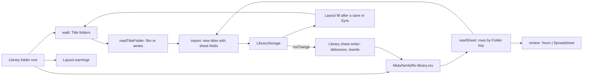

# 58: Folder layout

> **Initiative:** `folder-layout`
> **PRD:** `docs/PRDs/58-folder-layout.md` (to be written)
> **Plan:** `docs/PRDs/58-folder-layout-plan.md` (to be written)
> **Handoff:** `docs/handoff/handoff-folder-layout/`

This log is the `grill-me` session for step 41 of the build order, **Folder
layout** (the checklist's _Folder layout: one shape to scan, sync and
export_), held against the code as it stood on 2026-11-08 (`81551f8`). It is
an immutable snapshot of that moment. The session ran alone, and the
maintainer approved every recommendation in advance. Their brief: _one
consistent and clean structure; every movie and series, and its metadata,
images and subtitles, in its own folder for a single source of truth; the CSV
represents everything 1:1; keep the codebase consistent with its naming,
conventions, patterns and architecture._ The checklist's outline of step 41
was the starting point; where this log differs from it, this log rules.

## Background

What exists:

- **The walk** (`media/walkLibraryFolder/`) descends a **Library folder**
  from its root, never reading the root as a film (log 30 Q15), and stops at
  the first folder holding a video: that is a **Source folder**, scanned by
  `media/scanMovieFolder/`, which reads **only the files lying directly in
  it**. So a `Subtitles/` folder beside the video, an episode's own subtitle
  folder or an `Images/` folder are never opened.
- **Many shapes are read.** A genre shelf (`Drama/Amelie (2001)`) is
  descended; a release-named folder (`Die.Hard.1988.1080p`) is a film; a
  folder of several films is a **Collection folder** (`splitCollections`,
  log 41); a folder of loose tagged videos is a **Show folder**, and so is
  the parent of **Season folders** named `Season 1`, `Season 01`, `Seizoen 1`,
  `S01` or `Specials` (`groupShows.seasonOf`, log 51). A poster is the image
  named `poster`, `folder` or `cover`, else the first image; a backdrop
  `fanart` or `backdrop`; a Collection film's poster `<stem>-poster`.
- **The sheet is two tables.** The **Sheet writer** writes a **Titles sheet**
  (sixteen `EXPORT_COLUMNS`) and an **Episodes sheet** (nine
  `EXPORT_EPISODE_COLUMNS`): two worksheets in xlsx, `<name>.csv` and
  `<name>-episodes.csv` in csv. The **Sheet reader** reads the first
  worksheet only, so episodes never come back in, and `SheetRow` carries no
  image, subtitle or episode field.
- **An Export** (`exportRows`, `writeExport`) lays out one folder per title
  holding something, named `Heat (1995)` or `Severance (2022–)`: `poster`,
  `backdrop`, `stills/S01E03`, `seasons/S02`, a film's tracks as
  `English.srt` and an episode's as `subtitles/S01E03 English.srt`.
- **The Sync's Write targets** (`enrichment/writeBack/`) are two opt-in
  toggles under _Where it is saved_: the **Metadata sheet**
  (`familyflix-metadata.csv` in each Library folder's root, films only,
  created once and never rewritten) and a `poster.jpg` in each film's Source
  folder. Both create exclusively; neither ever replaces.
- **Art and subtitles are always copied** into the **Managed media
  directory**, whose own layout is FamilyFlix's (`movieFolder`, the **Series
  folder**). A **Frame still** is never written into a Library folder (log
  44).
- **A Movie has no Stills**; only an **Episode** does (`Episode.stillPath`).
- **The seed** (`db:seed-series`) writes series through storage under the
  reserved `__seed__/series/` prefix and lays out no folder on disk.
- The dev fixtures (`createImporter/fixture/`, `createImporter/seriesFixture/`)
  are in the old shapes: `Die.Hard.1988.1080p/` with `fanart.jpg`,
  `Drama/Amelie (2001)/` with `cover.png`, `Tidewater (2018)/` of loose
  tagged episodes.

## Problem

Settle the **one** shape every title folder in a Library folder has, which a
scan reads, a Sync and an Export write, and the one sheet that describes it
row for row, so that a Library folder alone is the library's source of truth
and can rebuild it offline. What is a title folder, what lies where inside
it, what is the sheet, who writes what into the folder and when, and what
becomes of everything the scan reads today?

## Questions and Answers

### Scope

1. **One initiative?** ✅ **One**, `folder-layout`, step 41, log 58. ❌ Not
   built here: converting an existing library to the layout (a separate tool
   outside FamilyFlix, as step 40's tidy became); watching folders for
   changes (log 30 Q3); two installs writing one Library folder at the same
   moment (Q24).

2. **Is the old shape still read beside the new?** ❌ **No.** One layout is
   read and nothing else, so there is one rule to test and to explain.
   FamilyFlix is before v1.0.0; a title already held from an old-shape folder
   keeps playing from its stored path (nothing is deleted or relinked), but a
   scan no longer reads its folder (Q21).

3. **A prototype?** ✅ **Two amendments and a handoff README**, made in this
   session (CLAUDE.md: amend the prototype in a grill-me first):
   `feat.EnrichmentFlow` (_Where it is saved_, Q17), `feat.ExportModal` (the
   _Include_ descriptions, Q19) and the model in `FamilyFlix.dc.html`; the
   layout itself, which has no screen, is drawn as a tree in
   `docs/handoff/handoff-folder-layout/README.md`.

### The title folder

4. **What is a Title folder?** ✅ **A folder lying directly in a Library
   folder's root, named `Title (Year)`**: the title as the family reads it, a
   space, the four-digit year in brackets (`/^(.+) \((\d{4})\)$/`). A
   series is named by its **first** year: `Severance (2022)`, never
   `Severance (2022–)`. The name is the title's **Folder key** (Q12), so the
   scan reads its title and year straight off it, with no **Title guess**.
   ❌ **Collection folders and genre shelves**: four Star Wars films are four
   Title folders in the root; two films sharing a title differ by year.
   ❌ **A year-less name** (`Heat`): it is not in the layout, so it is not
   read (Q21); TMDB knows the year of anything the family owns.

5. **A film or a series?** ✅ **By what it holds.** A Title folder holding a
   video loose is a **film**. One holding **Season folders** and no loose
   video is a **series**. One holding both is neither and is not read
   (Q21). ❌ **A `Type` marker file or the sheet deciding**: the folder must
   read the same with or without its sheet.

6. **A film's folder?** ✅ One video, its art and its tracks:

   ```text
   Heat (1995)/
     Heat.1995.1080p.mkv          its one video, loose, any name
     Images/
       poster.jpg                 a name ending in `poster`
       backdrop.jpg               a name ending in `backdrop`
     Subtitles/
       English.srt                its tracks, loose, language by name
       Heat.1995.pt.srt
   ```

   **One** loose video. A second loose video is the `no-video` **Problem**
   it is today (_more than one video_), never a Collection. Extras go in a
   folder of their own (`Extras/`), which is not read. ❌ **`Images/Stills/`
   for a film** (the outline): a Movie has no Stills, so the folder would
   hold nothing FamilyFlix reads. ❌ **Reading extras by name**
   (`splitCollections`' extras words): "nothing else is read" means a second
   loose video is a Problem, not a guess.

7. **A series' folder?** ✅ Season folders under the series' own art:

   ```text
   Severance (2022)/
     Images/
       poster.jpg                 the series' poster
       backdrop.jpg               the series' backdrop
     Season 01/
       Severance.S01E01.Good.News.About.Hell.mkv
       Severance.S01E02.mkv
       Images/
         poster.jpg               the Season poster
         Stills/
           S01E01.jpg             a Still, by the Episode tag in its name
       Subtitles/
         S01E01/
           English.srt            the episode's tracks, language by name
           Dutch.srt
     Season 00/                   specials
   ```

   - A **Season folder** is named `Season NN`, the number in two digits or
     more (`/^Season (\d{2,})$/i`); `Season 00` holds the specials. ❌
     `Season 1`, `Seizoen 1`, `S01`, `Specials` and a release name (log 51's
     readings): one spelling.
   - An episode's video lies loose in its Season folder and is numbered by
     its **Episode tag** (`episodeTag`, so `S01E01`, `Episode 12` and
     `Aflevering 3` read as today), the folder's season winning over the
     tag's. A video no rule numbers, or a second claiming a number, is
     **Unplaced**, as today.
   - A video lying loose at the series' root makes the folder neither a
     film nor a series (Q5), so it is not read: an episode belongs in its
     Season folder. ❌ **A show folder of loose tagged videos** (`groupShows`'
     second reading).

8. **How is an image read?** ✅ **By role, off the end of its name.** In an
   `Images/` folder, the image (`isImageFilename`) whose stem, case folded,
   **ends in `poster`** is the poster and the one ending in **`backdrop`**
   the backdrop, so names may carry the title and year
   (`moviea-2012-poster.jpg`, `poster.png`). Two images claiming one role:
   the first by name order, as `scanMovieFolder` picks today. A Still is the
   image in `Images/Stills/` whose name carries an Episode tag of that
   season (`S01E01.jpg`, `severance-s01e01.png`). Anything else in `Images/`
   is not read. ❌ `folder`, `cover` and `fanart`, and the first-image
   fallback: one rule, by role.

9. **How is a subtitle read?** ✅ A film's tracks are the subtitle files
   (`isSubtitleFilename`) lying loose in its `Subtitles/`; an episode's are
   those in `Season NN/Subtitles/S01E01/`, the folder named by the episode's
   Episode tag (`spellEpisodeTag`). Each track's language is
   `detectSubtitleLanguage` of its name, as today (`English.srt`,
   `heat.pt.srt`). ❌ **The stem rule** (`videoOf`): a track's folder says
   whose it is, so a subtitle no longer has to start with its video's name.

10. **The `Meta/` folder?** ✅ **Each Library folder's root holds `Meta/`,
    FamilyFlix's own**, holding the **Library sheet** (Q13). The walk never
    reads `Meta/` as a title. Q14 is the one place FamilyFlix replaces a file
    in a Library folder.

### The one sheet

11. **One table?** ✅ **Yes: one row per Movie, Series, Season and Episode,**
    under a `Type` column (`Movie`, `Series`, `Season`, `Episode`), a cell
    blank where the type has no such field or where its value is derived
    from the rows under it (a Series' Status, a Season's episode count). It
    replaces the Titles and Episodes sheets in CSV (one `.csv`) and xlsx (one
    worksheet, `Library`) alike. ❌ **Two tables kept for the Export**: the
    brief is one sheet, 1:1. ❌ **The `Seasons` and `Episodes` count
    columns**: the Season and Episode rows are the count.

12. **How does a row name its title?** ✅ **A `Folder` column on every row**:
    the Title folder's name, the **Folder key** (`Severance (2022)`). A
    Season row adds its `Season`, an Episode row its `Season` and `Episode`.
    That is how a row is matched to a folder: exactly, case folded, never by
    a fuzzy title match. A hand-made sheet with no `Folder` column, or a
    blank cell, matches by `Title (Year)` spelled from its Title and Year
    cells, and `matchRows` keeps its `no-folder` and `ambiguous` outcomes for
    a key no folder, or two Library folders, hold. With no `Type` column every
    row is a `Movie`, so a sheet written before this step still imports.

13. **The columns?** ✅ `SHEET_COLUMNS` in `src/types/export.ts`, one list
    replacing `EXPORT_COLUMNS` and `EXPORT_EPISODE_COLUMNS`:

    | Column        | Movie | Series | Season | Episode | Cell                                          |
    | ------------- | :---: | :----: | :----: | :-----: | --------------------------------------------- |
    | `Type`        |   ✓   |   ✓    |   ✓    |    ✓    | the row's type                                |
    | `Folder`      |   ✓   |   ✓    |   ✓    |    ✓    | the **Folder key**                            |
    | `Season`      |       |        |   ✓    |    ✓    | the number                                    |
    | `Episode`     |       |        |        |    ✓    | the number                                    |
    | `Title`       |   ✓   |   ✓    |        |    ✓    | as stored                                     |
    | `Year`        |   ✓   |   ✓    |        |         | a film's year; a series' Year range (`2022–`) |
    | `Air date`    |       |        |        |    ✓    | ISO date                                      |
    | `Runtime`     |   ✓   |        |        |    ✓    | minutes                                       |
    | `Genres`      |   ✓   |   ✓    |        |         | joined `, `                                   |
    | `Director`    |   ✓   |   ✓    |        |         | a series' creator                             |
    | `Cast`        |   ✓   |   ✓    |        |         | joined `, `                                   |
    | `Synopsis`    |   ✓   |   ✓    |        |    ✓    | as stored                                     |
    | `Rating`      |   ✓   |   ✓    |        |         | the family's, 0–10                            |
    | `TMDB rating` |   ✓   |   ✓    |        |         | the **TMDB score**                            |
    | `TMDB id`     |   ✓   |   ✓    |        |         | so a rebuild needs no second Sync             |
    | `Status`      |   ✓   |        |        |    ✓    | `Watched`, `In progress`, `Unwatched`         |
    | `Favorite`    |   ✓   |   ✓    |        |         | `Yes` or blank                                |
    | `Video`       |   ✓   |        |        |    ✓    | relative path                                 |
    | `Subtitles`   |   ✓   |        |        |    ✓    | relative paths, joined `\|`                   |
    | `Poster`      |   ✓   |   ✓    |   ✓    |         | relative path                                 |
    | `Backdrop`    |   ✓   |   ✓    |        |         | relative path                                 |
    | `Still`       |       |        |        |    ✓    | relative path                                 |

    Every path cell is relative to the root holding the Title folder (the
    Library folder's, or the **Export folder**'s), with forward slashes:
    `Heat (1995)/Images/poster.jpg`. A cell names only a file that is there
    in the layout. Subtitle paths are joined by `|` because `|` is the one
    separator no Windows filename can hold. ❌ **The video path, never**
    (log 14): it was an absolute path in the maintainer's machine; a relative
    one inside the layout is the 1:1 the brief asks for, and says where a
    video goes in an Export. ❌ **Resume positions, the Details state, the
    Still source, Import mode**: the household's sitting state and
    FamilyFlix's own bookkeeping, not the library's facts; a rebuilt library
    starts with each `In progress` title at its start.

### Who writes into a Library folder

14. **When is the Library sheet written?** ✅ **Whenever a row it holds would
    change.** `Meta/familyflix-library.csv` (CSV always, behind its BOM) holds
    one row set per title recorded against that Library folder with a
    **Source folder** (Q22): its films and series, their seasons and
    episodes, A–Z by Folder key, then season, then number. It is rewritten
    a few seconds after the last change that alters one of its cells (an
    add, an edit, a delete, a Clear details, a Sync, an import, a scan, a
    rating, a heart, a Status crossing), written to a temporary file in
    `Meta/` and renamed over the old one, so a reader never meets half a
    sheet. A watch tick that changes no cell writes nothing. `Meta/` is made
    when absent. An **Unreachable** folder's sheet is written the next time
    a change or a scan finds it reachable. Flushed on shutdown. ❌
    **Created once and never rewritten** (today's Metadata sheet): a sheet
    that goes stale is no source of truth. ❌ **Only after a link, import or
    Sync** (the outline): an edit or a rating would leave the sheet behind
    the library.

15. **What notices a change?** ✅ **The library storage.** `LibraryStorage`
    gains one listener, `onChange(listener: (folderIds: string[]) => void)`,
    called by every write that changes a title's row with the Library
    folders it touched, so no route, importer or Sync has to remember to
    call it. The **Library sheet writer** (`import-export/createLibrarySheet/`)
    is wired to it in the server's startup, beside the other domains, and
    owns the debounce, the rewrite and the flush. ❌ **Each route calling the
    writer**: one forgotten call is a stale sheet, and routes are HTTP only.

16. **And while a review is open?** ✅ **Held.** A Library folder whose sheet
    a **Current run** read (Q20) is not rewritten until the run closes: the
    sheet's differing values wait in review as _Yours | Spreadsheet_, and a
    rewrite would erase them before the press. When the run closes the sheet
    is rewritten from the library, so a skipped difference is the family's
    value. A **Factory reset** never rewrites a sheet: it erases the library,
    and an empty rewrite would erase the one thing that can rebuild it.

17. **What else does FamilyFlix write into a Title folder?** ✅ **The Layout
    fill: what it holds that the layout lacks**, and only that. After a save
    (an add, an edit, an import, a scan's import) or a Sync, for a title with
    a Source folder in a reachable Library folder, each of its files whose
    slot in the layout is empty is written there, created exclusively:
    - the poster as `Images/poster.<ext>` and the backdrop as
      `Images/backdrop.<ext>`, when no image there ends in that role;
    - a Season poster as `Season NN/Images/poster.<ext>`;
    - a Still as `Season NN/Images/Stills/S01E01.<ext>`, when its **Still
      source** is `tmdb` or `picked`; a **Frame still** stays out (log 44);
    - a subtitle track as `Subtitles/<Language>.<ext>` (an episode's under
      `Season NN/Subtitles/S01E01/`), when no track of that language is
      there; a second of one language `<Language> (2).<ext>`.

    A file already in the slot is never replaced, whatever FamilyFlix holds;
    a folder that can't be written is one Warning line and nothing else. The
    Sync logs each written file as today's `↓ poster.jpg  →  <path>`. ❌ **The
    Write target toggles**: _Metadata sheet in the collection root_ and
    _Posters into each movie folder_ go. The sheet is no longer a choice
    (Q14), and art the layout lacks is always filled, or the folder is not
    the source of truth. _Where it is saved_ draws _Your library_ and _Your
    library folders_, both marked _Always_ (the handoff).

18. **What does that do to the boundary?** ✅ CLAUDE.md's rule becomes: _The
    only writers into a Library folder are the **Layout fill**, which only
    ever adds what isn't there, and the **Library sheet writer**, the one
    replacer, which only ever rewrites `Meta/familyflix-library.csv`. An
    Export only ever adds its own new folder._ _FamilyFlix deletes nothing
    outside the Managed media directory_ holds: a Delete takes the title's
    row out of the sheet and leaves every file the Layout fill wrote, as it
    leaves the video.

### Export

19. **An Export folder?** ✅ **The same layout less the videos.** The Export
    folder (named by the **Export name**, made exclusively, as today) holds
    `Meta/familyflix-library.<csv|xlsx>` in the **Export format**, and a Title
    folder per title carrying something: with _Images_ on, every poster,
    backdrop, Season poster and Still FamilyFlix holds (Frame stills
    included: an Export is the maintainer's own copy); with _Subtitles_ on,
    every track; each in the place Q6 and Q7 give it, named as Q17 names it.
    The sheet carries every row of the library, its path cells naming the
    files that travelled (and, for `Video`, where the video goes); a cell
    whose file did not travel is blank. Two titles with one Folder key are
    numbered as today (`Heat (1995) (1)`), with a Warning line, since that
    folder is not in the layout. ❌ **The Export name on the sheet**: in
    `Meta/` the sheet is always `familyflix-library`, so an Export's
    folders merged into a Library folder by hand are a Library folder.
    _Include_'s descriptions say where each goes (the handoff).

20. **"The scan reads an export back whole"?** ✅ **Two ways, one rule.**
    - **A Folder scan reads its Library folder's `Meta/` sheet** as that
      folder's sheet, the way _Import from spreadsheet_ reads one: a new
      title imports with every field and art the sheet and its folder hold,
      with no Sync; for a held title the sheet fills what is empty and its
      differing values wait in review as _Yours | Spreadsheet_ (log 40). The
      `.csv` is read when there, else the `.xlsx`. So an Export's folders
      copied over a Library folder of videos (the folder names merge), or a
      Library folder carried to a fresh install, scan back to the library
      whole.
    - **_Import from spreadsheet_ reads every row type**, episodes included,
      and resolves a row's path cells against the Library folder its Folder
      key was matched in, so an Export's sheet uploaded on its own still
      brings its text fields.

    ❌ **Reading a folder without a video as a title**: an Export folder in
    a Library folder's root (the **Export destination**'s default) is passed
    by in silence, as today (log 31's edge), because it holds `Meta/`.

### What the scan does with everything else

21. **What is not in the layout?** ✅ **Not read, and said once.** The walk
    reads only the root's Title folders. Each root entry it leaves is one
    Warning line, never a Problem (a Problem is a title to settle; these are
    folders to fix by hand or by the separate tool):

    - `⚠ Drama isn't named Title (Year), left out`
    - `⚠ Heat (1995) holds no video or Season folder, left out`
    - `⚠ Severance (2022) holds loose videos and Season folders, left out`
    - `⚠ 98 videos lie loose at the top of E:\Movies, left out` (one line
      per Library folder, step 40's rule)

    Passed in silence: `Meta/`, a folder holding `Meta/` (an Export folder),
    and system folders (a name starting with `.` or `$`, or
    `System Volume Information`). Inside a Title folder, anything Q6 to Q9
    do not name is passed in silence (`Extras/`, `.nfo` files).

22. **What is recorded?** ✅ A title's **Source folder** is its Folder key:
    the Title folder's name, relative to its Library folder, always one
    level. A film's **Source file** is never set (no Collection folders); an
    episode's is its path inside the Title folder (`Season 01/<video>`), as
    today. A hand add (the **Path bridge**, the **Show folder pick**) of a
    video under a Library folder records its Source folder only when the
    video lies in a Title folder of the layout; otherwise it links with no
    Source folder, so it has no row in any Library sheet and no Layout fill.
    A title added from outside every Library folder is copied, as today, and
    is in no sheet.

23. **The Show folder pick?** ✅ **Reads the layout, like the scan** (step
    31's "the same rules a folder scan uses"): the picked folder's Season
    folders, each episode numbered by its tag, its Unplaced videos listed for
    the form, a picked Season folder standing for its series as today. A
    picked folder of loose tagged videos answers them as Unplaced, which the
    form numbers by hand. The client's `readSeasonFolder` mirrors the new
    `seasonOf`, its drift guard updated with it.

24. **Two installs, one folder?** ✅ **Out of scope,** but safe by Q16: the
    PC and the Deck each rewrite the sheet from their own library, and each
    scan meets the other's values as differences to settle in review, never
    as silent overwrites. ❌ **Locking or merging the sheet**.

### Units, names and documents

25. **Which units change?** ✅ The table under Design. The layout's reading
    is in `media/` (the code that reads a Library folder's disk), its rules
    over a held library in `import-export/`, the Layout fill in
    `enrichment/writeBack/`'s place as an `import-export/` unit (it now
    serves every save, not only a Sync, so it leaves `enrichment/`), and the
    sheet's one table in `exportRows` and `writeSheet`. Retired:
    `splitCollections`, the Collection branch of `placeFilmFolder`, the
    loose-show branch of `groupShows`, the Write target check and its
    toggles, `SHEET_NAME`'s `familyflix-metadata.csv`.

26. **The fixtures and the seed?** ✅ Both fixtures move to the layout:
    `fixture/root/Die Hard (1988)/` (`Images/poster.jpg`,
    `Images/backdrop.jpg`, `Subtitles/en.srt`, `Subtitles/pt.srt`) and
    `fixture/root/Amelie (2001)/` (no shelf); `seriesFixture/root/` gains
    `Tidewater (2018)/Season 01/`, and each show a `Subtitles/S01E01/` track.
    Their `library.csv` and `library.xlsx` become the one sheet with `Folder`
    keys. ❌ **Moving `db:seed-series`** (the outline): it writes no folder
    on disk, only storage rows under `__seed__/series/`, so the layout does
    not reach it.

27. **The new terms?** ✅ **Folder layout**, **Title folder**, **Folder
    key**, **Images folder**, **Subtitles folder**, **Meta folder**,
    **Library sheet**, **Library sheet writer**, **Layout fill**, **Sheet
    columns**, **Row type**, **Layout warning**. Updated: **Source folder**,
    **Season folder**, **Show folder**, **Export folder**, **Export file**,
    **Sheet reader**, **Sheet writer**, **Library folder**. Retired:
    **Collection folder**, **Metadata sheet**, **Write target**, **Titles
    sheet**, **Episodes sheet**.

28. **Which documents change?** ✅ The glossary (Q27); CLAUDE.md's boundary
    (Q18) and its _Dev library_ line; the checklist's step 41;
    `COMPONENT-SPEC.md`'s `feat.EnrichmentFlow` and `feat.ExportModal`
    rows; the docblocks of `walkLibraryFolder`, `scanMovieFolder`,
    `groupShows`, `readSheet`, `writeSheet`, `exportRows`, `writeExport` and
    `createImporter`.

## Design

### Chosen and rejected

- ✅ Title folders in the root named `Title (Year)`, a series by its first
  year; ❌ shelves, Collections, year-less names, the old shapes beside it.
- ✅ A film by its loose video, a series by its `Season NN` folders; ❌ a
  marker file, loose shows.
- ✅ Images by role off the end of the name; ❌ `folder`, `cover`, `fanart`,
  the first-image fallback, film Stills.
- ✅ Subtitles by folder; ❌ the stem rule.
- ✅ One sheet, a `Type` and a `Folder` on every row, relative paths;
  ❌ two tables, count columns, absolute video paths.
- ✅ The Library sheet rewritten on every change through storage's listener,
  held while a review is open, never by a Factory reset; ❌ written once,
  written only after imports.
- ✅ The Layout fill after every save and Sync, never replacing, never a
  Frame still; ❌ the Write target toggles.
- ✅ The scan reads `Meta/`; an Export is the layout less videos; ❌ the
  Export name on the sheet.
- ✅ What is not in the layout is one Warning line; ❌ a Problem per folder.

### Types

```ts
// src/types/export.ts (replacing EXPORT_COLUMNS and EXPORT_EPISODE_COLUMNS)
/** The four kinds of row the one sheet holds, its `Type` cell. */
export const ROW_TYPES = ['Movie', 'Series', 'Season', 'Episode'] as const;
export type RowType = (typeof ROW_TYPES)[number];

/** The **Sheet columns**, in order: one table for every row type (Q13). */
export const SHEET_COLUMNS = [
  'Type',
  'Folder',
  'Season',
  'Episode',
  'Title',
  'Year',
  'Air date',
  'Runtime',
  'Genres',
  'Director',
  'Cast',
  'Synopsis',
  'Rating',
  'TMDB rating',
  'TMDB id',
  'Status',
  'Favorite',
  'Video',
  'Subtitles',
  'Poster',
  'Backdrop',
  'Still',
] as const;
export type SheetColumn = (typeof SHEET_COLUMNS)[number];
```

```ts
// server/src/media/readTitleFolder/readTitleFolder.ts (scanMovieFolder's successor)
/** One Title folder as the layout reads it (Q4 to Q9). */
export type TitleFolderScan =
  | {
      kind: 'film';
      dir: string;
      key: FolderKey;
      videos: string[];
      poster: string | null;
      backdrop: string | null;
      subtitles: SubtitleFound[];
    }
  | {
      kind: 'series';
      dir: string;
      key: FolderKey;
      poster: string | null;
      backdrop: string | null;
      seasons: SeasonFolderScan[];
    };

export interface SeasonFolderScan {
  number: number;
  /** Absolute, in name order. */
  videos: string[];
  poster: string | null;
  /** By the Episode tag in each Still's name. */
  stills: Map<string, string>;
  /** By the `S01E01` folder each track lies in. */
  subtitles: Map<string, SubtitleFound[]>;
}

/** The **Folder key**: what `Title (Year)` says. */
export interface FolderKey {
  name: string;
  title: string;
  year: number;
}
export function folderKeyOf(name: string): FolderKey | null;

// server/src/media/walkLibraryFolder/walkLibraryFolder.ts
export interface LayoutWalk {
  titles: TitleFolderScan[];
  /** The **Layout warnings**, one per root entry left out (Q21). */
  warnings: LogLine[];
  /** The `Meta/` sheet's absolute path, `null` for none. */
  sheet: string | null;
}
export function walkLibraryFolder(
  root: string,
  onFound?: (scan: TitleFolderScan) => void,
  onUnreadable?: (dir: string) => void
): Promise<LayoutWalk>;
```

```ts
// server/src/library (LibraryStorage)
/** Called after every write that changes a title's sheet row, with its folders. */
onChange(listener: (folderIds: string[]) => void): () => void;

// server/src/import-export/createLibrarySheet/createLibrarySheet.ts
export const LIBRARY_SHEET = 'Meta/familyflix-library.csv';
export interface LibrarySheet {
  /** Mark folders changed; their sheets are rewritten after the debounce. */
  touch(folderIds: string[]): void;
  /** Hold a folder's sheet while a run's review holds its values (Q16). */
  hold(folderId: string): void;
  release(folderId: string): void;
  /** Write every pending sheet now: on shutdown. */
  flush(): Promise<void>;
}

// server/src/import-export/fillLayout/fillLayout.ts (writeBack's successor)
export interface LayoutFillOutcome {
  written: string[];
  lines: LogLine[];
}
export function fillLayout(
  root: string,
  title: HeldTitleFiles
): Promise<LayoutFillOutcome>;
```

```ts
// server/src/import-export/readSheet/readSheet.ts
export interface SheetRow {
  type: RowType;
  /** The Folder cell, or `Title (Year)` spelled from Title and Year. */
  folder: string | null;
  season: number | null;
  episode: number | null;
  // ...today's fields, then:
  airDate: string | null;
  runtime: number | null;
  tmdbScore: number | null;
  tmdbId: number | null;
  favorite: boolean;
  /** Relative paths, as written. */
  video: string | null;
  subtitles: string[];
  poster: string | null;
  backdrop: string | null;
  still: string | null;
}
```

### The units

| Unit                                 | Where                                          | Change                                                           |
| ------------------------------------ | ---------------------------------------------- | ---------------------------------------------------------------- |
| `folderKeyOf`                        | `server/src/media/folderKey/`                  | new, pure: `Title (Year)` read and spelled                       |
| `readTitleFolder`                    | `server/src/media/readTitleFolder/`            | new: one Title folder by Q5 to Q9; replaces `scanMovieFolder`    |
| `walkLibraryFolder`                  | `server/src/media/walkLibraryFolder/`          | the root's Title folders only, the Layout warnings, the sheet    |
| `groupShows`                         | `server/src/import-export/groupShows/`         | numbers a series' Season folders; `seasonOf` is `Season NN` only |
| `splitCollections`                   | `server/src/import-export/splitCollections/`   | retired                                                          |
| `placeFilmFolder`, `placeShowFolder` | `server/src/import-export/`                    | a Title folder or nothing; no Source file for a film             |
| `readShowFolder`                     | `server/src/import-export/readShowFolder/`     | reads the layout                                                 |
| `exportRows`                         | `server/src/import-export/exportRows/`         | one table, every row type; the layout's file plan                |
| `writeSheet`, `readSheet`            | `server/src/import-export/`                    | one table; every row type, the path cells                        |
| `matchRows`                          | `server/src/import-export/matchRows/`          | by Folder key first                                              |
| `writeExport`                        | `server/src/import-export/writeExport/`        | `Meta/familyflix-library.<ext>`, the layout less videos          |
| `createLibrarySheet`                 | `server/src/import-export/createLibrarySheet/` | new: the debounced rewrite, hold, flush                          |
| `fillLayout`                         | `server/src/import-export/fillLayout/`         | new: the Layout fill; replaces `enrichment/writeBack/`           |
| `createImporter`                     | `server/src/import-export/createImporter/`     | reads `Meta/`, logs Layout warnings, holds the sheet in review   |
| `createEnrichment`                   | `server/src/enrichment/createEnrichment/`      | no Write targets; calls the Layout fill after a title's Sync     |
| `LibraryStorage`                     | `server/src/library/`                          | `onChange`                                                       |
| `resetDatabase`                      | `server/src/db/resetDatabase/`                 | never touches a Library sheet                                    |
| `EnrichmentFlow` setup               | `src/features/enrichment/`                     | _Where it is saved_: two _Always_ rows, no toggles               |
| `ExportDialog`                       | `src/features/import-export/`                  | the _Include_ descriptions                                       |
| `readSeasonFolder`                   | `src/utils/`                                   | `Season NN` only, mirrored                                       |

### The flow



## Implementation Plan

1. **The documents first.** `COMPONENT-SPEC.md`'s `feat.EnrichmentFlow` and
   `feat.ExportModal` rows, CLAUDE.md's boundary and _Dev library_ (Q18,
   Q28). No code.
2. **One film in the layout.** `folderKeyOf`, `readTitleFolder`'s film,
   the walk's root-only rule and its Layout warnings, `placeFilmFolder`, the
   film fixture moved. Demo: `Die Hard (1988)/` scans to a film with its
   poster, backdrop and two tracks from `Images/` and `Subtitles/`, and
   `Drama/` is one Warning line.
3. **One series in the layout.** `readTitleFolder`'s series, `Season NN`,
   Stills and per-episode subtitle folders, `groupShows` and `readShowFolder`
   narrowed, the series fixture moved, `readSeasonFolder` mirrored. Demo:
   `Tidewater (2018)/Season 01/` scans to a series with its Season poster,
   a Still and an episode's track.
4. **The one sheet.** `SHEET_COLUMNS`, `exportRows`, `writeSheet`,
   `readSheet` and `matchRows` by Folder key; the Export writes the layout
   less videos with `Meta/`. Demo: an export of the fixture library is one
   `familyflix-library.xlsx` with Movie, Series, Season and Episode rows,
   and its folders mirror the layout.
5. **The Library sheet.** `LibraryStorage.onChange`, `createLibrarySheet`,
   the hold during review, the flush on shutdown, the Factory reset's
   exemption. Demo: rating a film rewrites `E:\Movies\Meta\familyflix-library.csv`
   seconds later with its new Rating cell.
6. **The scan reads `Meta/`.** The importer's sheet from `Meta/`, path cells
   resolved, differences held in review. Demo: a Factory reset, then _Scan
   new folders_ on the same Library folder, gives back every title with its
   details, ratings, hearts, Status and art, with no Sync.
7. **The Layout fill.** `fillLayout` replacing `writeBack`, called after a
   save and a Sync; the Sync's _Where it is saved_ without toggles. Demo: a
   Sync of a film with an empty `Images/` writes `poster.jpg` and
   `backdrop.jpg` there and leaves a `heat-poster.png` already present.
8. **The documents** (Q28).

## Trade-offs

- **Easier:** a Library folder is the library. Its Title folders hold every
  title's video, art and subtitles in one place, its `Meta/` sheet every
  field, so a fresh install, a second machine or a Factory reset rebuilds the
  whole library offline with one scan. One reading rule replaces six shapes,
  the sheet is one table both a person and the importer read, and an Export
  is the same shape, so it merges back by copying folders.
- **Harder:** every existing library must be converted to the layout before
  a scan reads it, by a tool outside FamilyFlix; until then its held titles
  play but rescans find nothing. FamilyFlix now replaces a file inside a
  Library folder (the one sheet in `Meta/`) and writes art into every title
  folder on every save, where it used to write only on an opted-in Sync. Art
  already in the layout wins over a newer pick in FamilyFlix, so after an
  edit the folder and the app can show different posters until the
  maintainer replaces the file by hand.
- **Out of scope:** converting old shapes; reading year-less or shelved
  folders; resume positions in the sheet; merging two installs' sheets;
  watching folders; any change to the Managed media directory's own layout.
