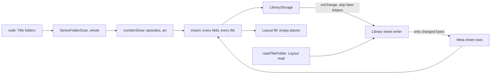

# 59: Rebuild whole

> **Initiative:** `rebuild-whole`
> **PRD:** `docs/PRDs/59-rebuild-whole.md` (to be written)
> **Plan:** `docs/PRDs/59-rebuild-whole-plan.md` (to be written)
> **Handoff:** `docs/handoff/handoff-rebuild-whole/`

This log is the `grill-me` session for step 42 of the build order, **Rebuild
whole** (the checklist's _Rebuild whole: every sheet field and series art_),
held against the code as it stood on 2026-11-09 (`077b91cd`). It is an
immutable snapshot of that moment. The session ran alone, and the maintainer
approved every recommendation in advance. Their brief: _after the
folder-layout feature we stumbled on bugs while testing; use the bug ticket as
the handoff; keep the codebase consistent with its naming, conventions,
patterns and architecture._ The ticket (issue 546, deleted after this
session) is kept whole in the handoff; its nine findings are this log's
starting point, and log 58 rules wherever this log does not say otherwise.

## Background

Step 41 (log 58) gave every Library folder one **Folder layout** and a
**Library sheet** in `Meta/`, so a Factory reset, a fresh install or a second
machine rebuilds the library offline with one scan (log 58 Q20, the PRD's
story 86). A QA pass over the real server, a scratch library per scenario,
found that promise lossy:

- **The walk reads a series' art, the importer drops it.**
  `readTitleFolder` answers a `SeriesFolderScan` with its poster, backdrop
  and, per `SeasonFolderScan`, the Season poster and the Stills by tag. The
  importer's `scansOf` (`createImporter.ts`) flattens a series into one
  `FilmScan` per Season folder with `poster: null, backdrop: null`, and
  `groupShows` regroups them by parent into a `ShowScan`, which has no art
  field at all. `importShow` then calls `addSeries` and `addEpisode` with no
  art, and never `setSeasonPoster`.
- **The importer drops sheet fields.** `readSheet` parses all 22 **Sheet
  columns** into a `SheetRow`, but `importMatch` never reads `tmdbId`,
  `tmdbScore` or `runtime` (only the probe's), and `importShow` never reads
  the series' `tmdbId`, `tmdbScore` or `favorite`, or an episode's Status or
  `runtime`. `NewSeries` has no `isFavorite` or `tmdbScore`, and
  `NewEpisode` no `watched`. For a held title, `planSheetFields` covers none
  of them either.
- **The sheet is written from the library.** When the rebuild's run closes,
  `release` rewrites the sheet from the thinner library (log 58 Q16), so a
  skipped value is erased from `Meta/familyflix-library.csv` itself: lossy on
  the first rebuild, permanent on the second.
- **The sheet's path cells are the Export's.** `createLibrarySheet` writes
  through `exportRows`, whose `Planner` (`plannerFor`) names each file where
  an Export would put it (`Images/poster.jpg`, `Subtitles/English (2).srt`,
  `Stills/S01E03.jpg` for a Frame still never on disk), not the file the
  Title folder holds. An Episode's `Video` cell re-spells its Season folder
  (`spellSeasonFolder`) instead of using its **Source file**.
- **Two readers of a show.** The scan reads a Title folder by
  `readTitleFolder`; the **Show folder pick** (`readShowFolder`) walks its
  own `scansUnder`, which descends into any subfolder holding a video, so
  `Season 1/` (not a Season folder) is Unplaced there and silent in the scan.
- **A Title folder whose Season folders all hold no video** is read as a
  series with empty seasons: no title, no **Layout warning**.
- **A sheet row no Title folder holds** is dropped by a Folder scan in
  silence, and the rewrite on close takes it out of the sheet.
- **The importer has no `layoutFill`.** `createLayoutFill` is wired into the
  routes and `createEnrichment` only, though log 58 Q17 names "an import, a
  scan's import" among its callers. `matchRows` resolves a row's path cells,
  and nothing reads them.
- **Pending touches live in memory.** A hard kill inside the 3 s debounce
  loses them, and nothing rewrites the sheet until the next change. Worse,
  found while settling finding 9: a **New folder** (listed, `scannedAt`
  null) is written like any other, so after a Factory reset, adding the
  folder back and hand-adding one title into it rewrites its sheet with that
  one title, erasing the sheet that was to rebuild it.

## Problem

A Library folder is meant to be the library (log 58's trade-offs): its Title
folders hold every file, its sheet every field, and one scan gives it all
back. Today a rebuild returns series without art and titles without their TMDB
match, hearts and episode Status, then overwrites the sheet with the loss.
Which rules make the rebuild whole, and the sheet a true reading of its
folder, without a second reader, a second writer or a new screen?

## Questions and Answers

### Scope

1. **One step or nine fixes?** ✅ **One step, Rebuild whole**, its own
   initiative (`rebuild-whole`), every finding settled here and built as one
   PRD. The nine share one promise (story 86, a folder rebuilds its library)
   and three units (`createImporter`, `exportRows`, `createLibrarySheet`).
   ❌ **Issues under `folder-layout`**: that initiative closed with issue 545
   and its refactor; reopening it would tick a Done step back. ❌ **Fixing
   only the two High findings**: findings 3, 6 and 9 are the same data loss
   by another road.

2. **What proves it?** ✅ **The round trip.** A library written to its
   Library sheet, Factory reset, and rebuilt by _Scan new folders_ holds the
   same titles, fields and art, and the sheet the run's close writes is byte
   for byte the sheet the scan read. One acceptance test over the dev
   fixtures, a film and a series with every column filled, asserts both. Each
   finding also starts from its own RED test (the ticket's baseline: no
   existing test catches any of them).

### Series art (finding 1)

3. **Where is the art lost, and where is it carried?** ✅ **Nowhere: a
   series reaches the importer whole.** `scansOf` stops flattening a series;
   the walk's `SeriesFolderScan` is numbered as it stands by
   `numberShow(series)`, which replaces `groupShows` in
   `import-export/numberShow/` (log 58 already named its job "numbers a
   series' Season folders"; since log 58 it groups nothing, the walk does).
   `ShowScan` gains the series' `poster` and `backdrop` and its `seasons`
   (`{ number, poster }`), and `ShowEpisode` gains its `still`, by its tag
   from the Season folder's `stills`. `showFolderOf` moves with it.
   ❌ **Carrying art through the flattened scans**: a Season scan holding
   its series' poster is the wrong owner, and the regroup by `dirname` is a
   second reading of a shape the walk already read.

4. **What does `importShow` do with it?** ✅ **What `importMatch` does for a
   film:** every piece copied in with `media.copyIn` beside the episodes (art
   is always copied, CLAUDE.md), the poster and backdrop on `addSeries`, each
   Season poster by `setSeasonPoster` once its season has an episode, each
   Still on its `addEpisode` as `stillPath`, so its **Still source** is
   `picked` and no Sync replaces it (log 44). A copy that fails is the
   show's one `failed` Problem, as an episode's is today.

5. **A series already held, scanned before this fix?** ✅ **Its empty art is
   filled.** A held series' poster, backdrop, Season posters and its held
   episodes' Stills are taken from its Title folder where the library holds
   none, never replacing one (a Sync's or a hand pick), with no review row.
   Every family library scanned under step 41 holds its series with no art;
   a rescan is the repair. ❌ **A difference in review**: the library holds
   nothing to differ from.

### Every sheet field (finding 2)

6. **Which fields does a new title take from its row?** ✅ **Every one the
   Sheet columns give its Row type** (log 58 Q13):

   | Row type | Taken, beside today's                                                        |
   | -------- | ---------------------------------------------------------------------------- |
   | Movie    | `TMDB id`, `TMDB rating`, `Runtime` when the probe answers none              |
   | Series   | `TMDB id`, `TMDB rating`, `Favorite`                                         |
   | Episode  | `Status` (`Watched` marks it watched), `Runtime` when the probe answers none |

   `NewSeries` gains `isFavorite?` and `tmdbScore?`, `NewMovie` `tmdbScore?`
   if absent, `NewEpisode` `watched?`. A title rebuilt with its `TMDB id` has
   the **Details state** `synced`, so _Only what's missing_ passes it: "a
   rebuild needs no second Sync" (Q13's reason for the column).

7. **The probe or the sheet for Runtime?** ✅ **The probe, the sheet when it
   answers none.** The probe reads the file in hand; the cell is what a probe
   once read, or a hand-written guess. ❌ **The sheet first**: a re-encoded
   video would keep a stale runtime.

8. **And `In progress`?** ✅ **Unwatched, at its start**, as log 58 Q13 says
   ("a rebuilt library starts with each `In progress` title at its start")
   and as a film's row is read today: only `Watched` marks.

9. **A held title?** ✅ **The new fields fill only what is empty, never a
   difference.** `planSheetFields` gains them as fills: a `TMDB id` and
   `TMDB rating` where the held title has none, a Runtime where it has none,
   a `Favorite` `Yes` hearts a title not hearted (never unhearts), and an
   Episode row's `Watched` marks a held unwatched episode, as a film's does
   today. ❌ **_Yours | Spreadsheet_ rows for them**: a differing TMDB id is
   a Sync's business, a heart and a Status are the family's, and new review
   fields would amend the Import review prototype for no rebuild's sake.

10. **The ticket's guard, "don't let a release rewrite cells the run read
    and did not take"?** ✅ **Not built: the round trip (Q2) is the guard.**
    Once every field is taken, a release that writes blanks is a bug its test
    catches. ❌ **The guard**: it makes the sheet hold what the library does
    not, two truths, and log 58 Q16 settles that a skipped difference
    becomes the family's value when the run closes.

### Path cells (findings 3, 4, 8)

11. **What does a Library sheet's path cell name?** ✅ **The file its Title
    folder holds in that place, read off the disk.** The **Library sheet
    writer** reads each recorded Title folder with `readTitleFolder`, the
    scan's own reader, and its path cells come from that **Layout read**: a
    poster or backdrop by role (`Images/die-hard-1988-poster.jpg`), a Season
    poster, a Still by its tag (a **Frame still**, never written there, is
    blank), every track the `Subtitles/` place holds by its own name. So the
    sheet and the scan agree by construction, and story 40 ("a path cell
    names only a file that is there") holds. A folder that can't be read
    gives blank path cells and the rest of the row, as a sheet with no files.
    ❌ **Recording each file's Library-folder path at import or fill**: a new
    column per file in storage, stale the moment the family renames a file.
    ❌ **Leaving the cells to the Export's plan**: untrue the moment a name
    differs.

12. **How, without two `exportRows`?** ✅ **`exportRows` takes its path
    cells from a `PathCells` it is given**, the `Planner` made a parameter
    and keyed by layout place, not by spelled path:

    - the Export's **File plan** (`filePlan(include)`, today's `plannerFor`),
      which spells each place and plans the file into the Export folder;
    - the Library sheet's **Layout read** (`layoutCells(reads)`), which
      answers what each Title folder holds there, and plans nothing.

    `exportRows` stays pure and the one place a cell rule is spelled; the
    disk is read in `createLibrarySheet`, by `media/`'s reader.

13. **The `Video` cell?** ✅ **A film's one loose video, an episode's Source
    file**, in both sheets: `Severance (2022)/season 03/x.mkv` as it lies
    (finding 4, case kept for the Linux AppImage), the spelled Season folder
    only for an episode with no Source file (a copied add). ❌ **Re-spelling
    the Season folder**: on a case-sensitive file system it names nothing.

14. **Does the importer read a path cell?** ✅ **Only for a place the
    folder left empty.** The folder's own reading wins (the layout is the
    source of truth); a cell naming a file that is there fills a poster,
    backdrop, Season poster or Still the read did not find, and adds a track
    the read did not find. The `Video` cell is never read: the video is
    the folder's. ❌ **The cell first**: a stale sheet would beat the files.

15. **And the Layout fill after an import?** ✅ **Wired, as log 58 Q17 said.**
    `createImporter` gains the `layoutFill` dependency (from `main.ts`, as
    `createEnrichment` has it) and runs it after each title it imports or
    fills, film or series; each file written is the Sync's own `↓` line in
    the run's log, and a folder it can't write is one Warning line. A scan's
    art already lies in the layout, so it writes only what a path cell
    brought from outside it (Q14) and art a held title had that its folder
    lacks.

### The readers (findings 5, 7)

16. **One reader of a show?** ✅ **Yes: the pick reads the layout as the
    scan does** (log 58 Q23). `media/readTitleFolder/` exports
    `readSeasonFolders(dir)`, a folder's Season folders read and in number
    order, which `readTitleFolder` and `readShowFolder` both call, and
    `readShowFolder` numbers the result with `numberShow` (Q3). A picked
    Title folder reads its Season folders and nothing else (`Season 1/` and
    `Extras/` pass in silence, as in the scan); a picked Season folder reads
    itself, standing for its show; a picked folder of loose videos answers
    them as Unplaced, without descending. `scansUnder` is retired. ❌
    **Keeping `scansUnder` and teaching it the rule**: two readers drift,
    which is how this finding came about.

17. **Season folders, but no video in any?** ✅ **Left out as `empty`**, the
    same Layout warning, `⚠ Hollow Show (2020) holds no video or Season
folder, left out`: a Season folder holding no video is not one for the
    layout's purpose, so the line stays true. A series with one empty Season
    folder beside full ones is read, the empty season passing in silence. ❌
    **A fourth reason and line**: one more copy for the same fix by hand.

### What the scan and the sheet say (findings 6, 9)

18. **A sheet row no Title folder holds?** ✅ **One Warning line per such
    title**, in the Folder scan's log, worded as a Layout warning:
    `⚠ Heat (1995) (1) is in the sheet but has no folder, left out`. One
    line per Folder key, its Season and Episode rows with it. The rewrite on
    close still takes it out: the sheet mirrors the library (log 58 Q14),
    and the line is the family's notice that a renamed or moved folder lost
    its row. ❌ **A Problem in review**: a Problem is a title to settle, and
    a scan has no folder to offer it. ❌ **Keeping orphaned rows in the
    sheet**: a sheet holding what the library doesn't is no reading of it.

19. **A sheet write lost to a crash?** ✅ **Every run that reaches review
    touches every folder its walk read**, not only the folders whose sheet
    it held, so the sheet catches up at the next scan as well as the next
    change. And a rewrite whose bytes equal the file's is not written, so a
    catch-up that changes nothing touches no disk. ❌ **A rewrite of every
    folder at startup**: it wakes every external drive on every launch, for
    a loss the next scan repairs.

20. **A New folder's sheet?** ✅ **Never written until a scan has read the
    folder.** The Library sheet writer skips a folder whose `scannedAt` is
    null, as it skips an Unreachable one: until a run has walked it, its
    sheet is the record that will rebuild it, and a touch from a hand add
    would replace it with the one title held. The run that reaches review
    marks it scanned (log 54) and its close writes it (Q19). This extends
    log 58 Q16's Factory reset exemption to the folder added back after
    one.

### Units, names and documents

21. **Which units change?** ✅ The table under Design. Every change sits in
    the domain that already owns it: the readers in `media/`, the numbering,
    the importer, the sheet and its cells in `import-export/`, the new write
    fields in `library/` and `src/types/`. No route changes; `main.ts` wires
    `layoutFill` into the importer.

22. **The new terms?** ✅ **Layout read**, **Path cells**, **File plan**
    (the Export's `PathCells`, named in code until now), **Orphaned row**, **Round
    trip**. Updated: **Library sheet writer** (reads its folders, skips a New
    folder, writes only changed bytes), **Show folder read** (one reader),
    **Layout warning** (the orphaned row's line beside it). Retired:
    `groupShows`, `scansUnder` (units, not terms).

23. **Which documents change?** ✅ The glossary (Q22); the checklist's step
    42; the docblocks of `numberShow`, `readTitleFolder`, `readShowFolder`,
    `exportRows`, `createLibrarySheet`, `createImporter` and `planSheetFields`.
    CLAUDE.md is untouched: no boundary moves, and the writers into a
    Library folder are still the two it names. No prototype is amended: the
    two new log lines (Q15, Q18) are in the handoff's _Copy_ table.

## Design

### Chosen and rejected

- ✅ A series reaches the importer whole and `numberShow` carries its art;
  ❌ art through flattened Season scans.
- ✅ Every Sheet column a Row type has is taken by a new title, held titles
  fill-only; ❌ new review fields, ❌ the release guard.
- ✅ The probe's runtime, the sheet's when none; ❌ the sheet first.
- ✅ Library sheet path cells from the Layout read, `exportRows` given its
  `PathCells`; ❌ recorded file paths, ❌ the Export's plan.
- ✅ The folder first, a path cell for an empty place; the Layout fill after
  an import; ❌ the cell first.
- ✅ One reader of a show, `readSeasonFolders`; ❌ `scansUnder`.
- ✅ Empty Season folders are `empty`; an orphaned row is one Warning line.
- ✅ Every read folder touched at review, unchanged bytes not written, a New
  folder never written; ❌ a startup rewrite.

### Types

```ts
// server/src/import-export/numberShow/numberShow.ts (groupShows' successor)
export interface ShowEpisode {
  season: number;
  episode: number;
  title: string | null;
  video: string;
  subtitles: SubtitleFound[];
  /** Its **Still**, by its tag from the Season folder's `Images/Stills/`. */
  still: string | null;
}

export interface ShowScan {
  dir: string;
  name: string;
  poster: string | null;
  backdrop: string | null;
  /** Each Season folder's number and its **Season poster**. */
  seasons: { number: number; poster: string | null }[];
  episodes: ShowEpisode[];
  unplaced: string[];
  straySubtitles: string[];
}

/** Number one series' Season folders: its episodes, Unplaced and strays. */
export function numberShow(series: SeriesFolderScan): ShowScan;
export const showFolderOf: (dir: string) => string;
```

```ts
// server/src/media/readTitleFolder/readTitleFolder.ts
/** A folder's **Season folders**, read, in number order. */
export function readSeasonFolders(dir: string): Promise<SeasonFolderScan[]>;
```

```ts
// server/src/import-export/exportRows/exportRows.ts
/** A place in the layout a path cell names. */
export type LayoutPlace =
  | { kind: 'poster' | 'backdrop'; folder: string }
  | { kind: 'season-poster'; folder: string; season: number }
  | { kind: 'still'; folder: string; season: number; episode: number }
  | { kind: 'tracks'; folder: string; season?: number; episode?: number }
  | { kind: 'video'; folder: string; season?: number; sourceFile?: string };

/** Where a row's path cells come from: the **File plan** or a **Layout read**. */
export interface PathCells {
  image(place: LayoutPlace, storedPath: string | null): string | null;
  tracks(place: LayoutPlace, subtitles: readonly Subtitle[]): string[];
  video(place: LayoutPlace, storedPath: string | null): string | null;
}

export function exportRows(
  movies: readonly Movie[],
  series: readonly SeriesDetail[],
  cells: PathCells,
  sourceFolderOf?: (titleId: string) => string | null
): { table: ExportTable; warnings: string[] };

// server/src/import-export/filePlan/filePlan.ts (plannerFor, exported)
export function filePlan(include: ExportInclude): {
  cells: PathCells;
  files: ExportFile[];
};

// server/src/import-export/layoutCells/layoutCells.ts
/** The **Layout read**: each Title folder's files by place, by Folder key. */
export function layoutCells(
  reads: ReadonlyMap<string, TitleFolderScan>,
  root: string
): PathCells;
```

```ts
// src/types: the write fields a rebuild needs
interface NewMovie {
  tmdbScore?: number; // if absent today
}
interface NewSeries {
  isFavorite?: boolean;
  tmdbScore?: number;
}
interface NewEpisode {
  watched?: boolean;
}
```

```ts
// server/src/import-export/createImporter/createImporter.ts
export interface ImporterDeps {
  // today's, and:
  layoutFill: LayoutFill;
}
```

### The units

| Unit                 | Where                                          | Change                                                                                                                   |
| -------------------- | ---------------------------------------------- | ------------------------------------------------------------------------------------------------------------------------ |
| `readTitleFolder`    | `server/src/media/readTitleFolder/`            | `readSeasonFolders`; Season folders with no video are `empty`                                                            |
| `numberShow`         | `server/src/import-export/numberShow/`         | new, replaces `groupShows`: one series numbered, its art carried                                                         |
| `readShowFolder`     | `server/src/import-export/readShowFolder/`     | reads by `readSeasonFolders` and `numberShow`; `scansUnder` retired                                                      |
| `createImporter`     | `server/src/import-export/createImporter/`     | series art, every sheet field, path cells for empty places, the Layout fill, orphaned-row lines, touch every read folder |
| `planSheetFields`    | `server/src/import-export/planSheetFields/`    | the new fields as fills, an Episode row's Watched                                                                        |
| `exportRows`         | `server/src/import-export/exportRows/`         | given its `PathCells`; Video by Source file                                                                              |
| `filePlan`           | `server/src/import-export/filePlan/`           | new: `plannerFor` moved out, the Export's `PathCells`                                                                    |
| `layoutCells`        | `server/src/import-export/layoutCells/`        | new, pure: the Library sheet's `PathCells` from the Layout read                                                          |
| `createLibrarySheet` | `server/src/import-export/createLibrarySheet/` | reads its Title folders, skips a New folder, writes only changed bytes                                                   |
| `writeExport`        | `server/src/import-export/writeExport/`        | calls `exportRows` with `filePlan`                                                                                       |
| `LibraryStorage`     | `server/src/library/`                          | `addSeries` takes `isFavorite`, `tmdbScore`; `addEpisode` takes `watched`                                                |
| write types          | `src/types/series.ts`, `src/types/write.ts`    | Q6's fields                                                                                                              |
| `main.ts`            | `server/src/main.ts`                           | `layoutFill` into `createImporter`                                                                                       |

### The flow



## Implementation Plan

1. **Series art on a scan.** `readSeasonFolders`, `numberShow` carrying the
   art, `scansOf` no longer flattening, `importShow` copying it in, a held
   series' empty art filled. Demo: the ticket's `Tidewater (2018)` repro
   scans to a series poster, a Season 1 poster and an S01E01 Still.
2. **Every sheet field.** The write types, `addSeries`/`addEpisode`,
   `importMatch` and `importShow` taking Q6's fields, `planSheetFields`'s
   fills. Demo: the ticket's repro (heart a series, mark S01E01 watched,
   Factory reset, _Scan new folders_) keeps the heart and the Watched.
3. **Path cells from the Layout read.** `PathCells`, `filePlan`,
   `layoutCells`, `createLibrarySheet` reading its folders, the Video cell
   by Source file. Demo: `Images/die-hard-1988-poster.jpg` is the sheet's
   Poster cell; a Frame still's cell is blank.
4. **The round trip.** Q2's acceptance test over a film and a series with
   every column: rebuilt equal, the sheet byte for byte.
5. **Path cells into empty places, and the Layout fill.** Q14 and Q15. Demo:
   a sheet naming `Heat (1995)/heat.jpg` beside the video imports it as the
   poster, and the scan's log shows `↓ poster.jpg` into `Images/`.
6. **One reader of a show, and empty Season folders.** `readShowFolder` on
   `readSeasonFolders`; Q17. Demo: `Season 1/` is silent in the pick;
   `Hollow Show (2020)` is one Layout warning.
7. **What the scan and the sheet say.** The orphaned-row line, every read
   folder touched at review, unchanged bytes skipped, a New folder never
   written. Demo: a Factory reset, the folder added back, a hand add into it:
   the sheet is unchanged until the scan.
8. **The documents** (Q23).

## Trade-offs

- **Easier:** the rebuild is whole and provably so, by one round-trip test.
  The Library sheet is a true reading of its folder: a person following a
  path cell finds the file, and an _Import from spreadsheet_ of it imports
  the art. One reader serves the scan and the pick, so they can't disagree
  again. A family library scanned under step 41 repairs its series' art with
  one rescan.
- **Harder:** every sheet rewrite reads each recorded Title folder from disk
  (a few hundred directory reads for a large library, after the debounce),
  where it read only the database. A sheet written from two sources (the
  library's fields, the disk's paths) can name a file the library does not
  hold, by design: the folder is the source of truth. `exportRows` gains a
  parameter every caller passes.
- **Out of scope:** a Sync against real TMDB (the QA pass was offline), the
  Electron window's copy, the Ordered shutdown's flush on Windows, a
  read-only Title folder's Warning line, and Linux case sensitivity beyond
  the Video cell: the ticket's _Not covered_ list stands as it is. Merging
  two installs' sheets stays out (log 58 Q24).
