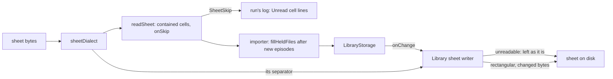

# 60: Rebuild edges

> **Initiative:** `rebuild-edges`
> **PRD:** `docs/PRDs/60-rebuild-edges.md` (to be written)
> **Plan:** `docs/PRDs/60-rebuild-edges-plan.md` (to be written)
> **Handoff:** `docs/handoff/handoff-rebuild-edges/`

This log is the `grill-me` session for step 43 of the build order, **Rebuild
edges**, held against the code as it stood on 2026-11-10 (`57b91cc1`). It is
an immutable snapshot of that moment. The session ran alone, and the
maintainer approved every recommendation in advance. Their brief: _after the
folder-layout and rebuild-whole features we stumbled on bugs while testing;
use the bug ticket as the handoff; keep the codebase consistent with its
naming, conventions, patterns and architecture._ The ticket (issue 562,
deleted after this session) is kept whole in the handoff; its ten findings are
this log's starting point, and logs 58 and 59 rule wherever this log does not
say otherwise.

## Background

Step 42 (log 59) made the **Round trip** hold: a library written to its
**Library sheet**, Factory reset and rebuilt by one scan comes back equal. A
second QA pass over the real server found the round trip sound and its edges
not:

- **A path cell is trusted.** `resolvePathCell` (`readSheet.ts`) joins a cell
  onto the Library folder and nothing checks that the result stays in the
  row's **Title folder**; `pathCellFills` checks only that the file exists. A
  `Poster` cell of `../secret.txt` copies that file into managed storage as a
  poster, and the **Layout fill** then writes it into the Title folder as
  `Images/poster.txt`. _Import from spreadsheet_ reads the same cells from any
  sheet it is handed.
- **The Sheet reader reads one dialect.** `openWorkbook` hands `exceljs` a
  comma-separated UTF-8 CSV. A sheet resaved by a Dutch or German Excel is
  `;`-separated, and Excel's plain _CSV_ is cp1252 with no BOM. The first
  reads as one column with no title (`Could not read …, scanned without it`),
  the second spells `Amélie` as `Am�lie`; either way the run's close then
  rewrites the sheet from the library (log 59 Q19) and the record is erased.
- **A held film takes nothing new from its folder.** `fillHeldArt`
  (`createImporter.ts`) fills a held series' empty art on a rescan (log 59
  Q5); a held film's poster, backdrop and tracks put in later are never read,
  though the Library sheet's path cells (read off the disk) already name them.
- **`fillHeldArt` runs before the run's new episodes.** It walks the seasons
  the library holds, so a season the same run adds misses its **Season
  poster** until a second scan; the in-loop Season poster is set only for a
  new series (`held === null`).
- **`POST /series` has no Held video check.** The movie add refuses a linked
  video a held title plays (`409 Heat already plays this file.`); the series
  add links it, and the sheet gains a numbered `Tidewater (2018) (1)` Folder
  key, which belongs only in an Export (log 58 Q19).
- **An Episode row's `Synopsis` cell is ticked in log 58 Q13's table**, but
  `Episode` has no synopsis and no screen draws one (`mol.EpisodeRow`).
- **The reader drops what it can't parse in silence.** `cellNumber` takes
  `8.5` and not `8,5`; `FAVORITE` and `WATCHED` fold anything unknown to
  false; two rows for one Folder key leave the last; and a Folder scan's
  `readMetaSheet` passes no `onBlankTitle`, so even a titleless row is silent
  there.
- **`detectSubtitleLanguage` knows English names and ISO codes only.**
  `Nederlands.srt` reads as English, and so does `heat.pt-BR.srt`, whose last
  piece is `BR`.
- **Both sheets are ragged.** `exceljs`' CSV writer drops a row's trailing
  empty cells, so a Season row under the 22-column header has three fields.

## Problem

The Library sheet is a file the maintainer opens in Excel, edits by hand and
saves back, and a Title folder is one they add files to over the years. Which
rules let a hand-kept sheet and a growing folder reach the library whole and
safely, without a second reader, a second writer or a new screen?

## Questions and Answers

### Scope

1. **One step or ten fixes?** ✅ **One step, Rebuild edges**, its own
   initiative (`rebuild-edges`), every finding settled here and built as one
   PRD. The findings share two units (`readSheet`, `createImporter`) and one
   promise: what the maintainer keeps by hand comes back. ❌ **Issues under
   `rebuild-whole`**: that step is Done with its refactor (issue 561);
   reopening it would tick it back.

2. **What proves it?** ✅ **Each finding's own RED test**, the ticket's
   baseline (no existing test catches any), and the **Round trip** test kept
   green, now also over a `;`-separated sheet (Q6).

### Path cells (finding 1)

3. **Which path cell is read?** ✅ **A contained one: relative, inside its
   own row's Title folder, naming its kind.** The **Sheet reader** checks it
   lexically, pure over the cell: its first segment is the row's **Folder
   key** (`sameFolderKey`), no segment is empty, `.` or `..` or holds `\` or
   `:`, and its extension fits its column: `Poster`, `Backdrop` and `Still`
   by `isImageFilename`, each `Subtitles` path by `isSubtitleFilename`. A cell
   that fails is read as blank and is an **Unread cell** (Q9). The `Video`
   cell is passed unchecked: it is never read (log 59 Q14). ❌ **A
   containment check in `resolvePathCell` or `pathCellFills`**: the rule would
   be spelled twice, once per caller, and the upload and the scan already meet
   in the reader. ❌ **Resolving and comparing real paths**: the reader is
   pure over bytes, and a lexical rule needs no disk.

4. **And a symlink inside the Title folder pointing out?** ❌ **Out of
   scope.** The family's own folder holding a link is the family's choice;
   the ticket's finding is a cell, and a cell can no longer climb out.

### Excel-saved sheets (finding 2)

5. **How does the reader take an Excel-saved CSV?** ✅ **It reads the
   sheet's **Sheet dialect** off its bytes.** The encoding: a UTF-8 BOM, or
   bytes that decode as UTF-8, are UTF-8; anything else is cp1252
   (`TextDecoder('windows-1252')`), Excel's plain _CSV_. The separator: `;`
   when the header row (outside quotes) holds more `;` than `,`, else `,`.
   `sheetDialect(bytes)` in `import-export/sheetDialect/` answers both, pure;
   `openWorkbook` decodes by it and hands `exceljs` its `delimiter`. An xlsx
   has no dialect. ❌ **Tabs and other separators**: no Excel the family runs
   saves them for _CSV_.

6. **Then the rewrite on close puts commas back?** ✅ **No: the Library sheet
   writer keeps the dialect it found.** A `;` sheet is rewritten `;`
   separated with decimal commas (`7,9`), the continental Excel's pair, so
   the maintainer's Excel opens it in columns; a `,` sheet keeps today's
   bytes. Both are written UTF-8 behind a BOM, which every Excel reads, so a
   cp1252 sheet is read once as cp1252 and written back as UTF-8. A new sheet
   is `,`. `writeSheet` takes the dialect (`{ separator: ',' | ';' }`, the
   decimal mark following it); the Export always writes `,`. ❌ **Always
   commas**: a Dutch Excel opens it as one column, the maintainer resaves it
   `;`, and the loop the ticket found comes back every edit.

7. **And a sheet that still doesn't read?** ✅ **It is never replaced.** The
   Library sheet writer reads the sheet on disk before it writes (it already
   does, to skip equal bytes, log 59 Q19); one the **Sheet reader** refuses
   is left as it is, as a **New folder**'s is (log 59 Q20), until it reads or
   is removed. The scan's line says so:
   `⚠ Could not read <path>, scanned without it and left as it is`. ❌
   **Moving it aside and writing a fresh one**: a new write into a Library
   folder, beside the two CLAUDE.md names.

8. **Decimal commas in a `,` sheet?** ✅ **Read in any sheet.** A number
   cell is `-?\d+([.,]\d+)?`, the comma read as the point: `8,5` is a
   Rating of 8.5, rounded to 9 as today; `7,9` a TMDB rating of 7.9. Only a
   quoted cell can hold one in a `,` sheet, so nothing else changes.

### Cells left unread (findings 6, 7)

9. **What does the reader say about a cell it can't read?** ✅ **One
   **Unread cell** Warning line per cell**, so the maintainer can fix the
   sheet before the rewrite on close erases it:
   `⚠ Heat (1995): Rating "8½" not read`, a Season row's
   `⚠ Tidewater (2018) Season 1: Poster "x.txt" not read`, an Episode row's
   `⚠ Tidewater (2018) S01E02: Status "half" not read`. A cell is unread
   when it is filled and its column's parse answers nothing: `Year`,
   `Season`, `Episode`, `Rating`, `Runtime`, `TMDB rating`, `TMDB id`, `Air
date`, a path cell (Q3), `Type` (still read as Movie, as a blank one is),
   and `Status` or `Favorite` holding a word of neither list. The no-lists
   are spelled beside the yes-lists: `Status` `no`, `false`, `0`,
   `unwatched`, `in progress`; `Favorite` `no`, `false`, `0`. A genre
   outside the pool keeps its own line. ❌ **New synonyms, `ja` and `nee`**:
   one language's words is a list without end; the line tells the
   maintainer to write `Yes`.

10. **How does the reader report them?** ✅ **Through its one callback,
    widened.** `onBlankTitle(rowNumber)` becomes `onSkip(skip: SheetSkip)`,
    the three things the reader leaves out: a titleless row (today's line),
    an unread cell, a duplicate row (Q11). The upload's `SheetRead` and the
    Folder scan's `readMetaSheet` both log every skip, so a Meta sheet's
    blank title is no longer silent.

11. **Two rows for one Folder key?** ✅ **The first is read, the rest are
    one line each:** `⚠ Heat (1995) is in the sheet twice, the first row
read`. A duplicate is the same **Row type**, Folder key (`sameFolderKey`),
    season and episode. The first, because a person reads a sheet top down.
    ❌ **The last, as today**: an accident of a `Map.set`, not a rule.

12. **An Episode row's `Synopsis` cell?** ✅ **Not an Episode's: log 58
    Q13's tick was wrong.** No screen draws an episode synopsis (`mol.EpisodeRow`,
    the Season page), so nothing stores one; the cell stays in
    the header, blank on an Episode row as on a Season row, and a filled one
    is an Unread cell. ❌ **Storing an episode synopsis**: a column, a
    migration and a Sync field for a text no screen draws; the prototype
    would need amending first.

### Files put in later (findings 3, 4, 8)

13. **A held film's art and tracks added to its folder later?** ✅ **Filled
    as a held series' are**, one rule for both, `fillHeldArt` widened into
    `fillHeldFiles`: a held film's empty poster and backdrop from its Title
    folder's read (path cells into empty places first, `filmWithCells`, as a
    new film's), and, for a film and each held episode alike, each track in
    the folder of a language the title holds none of. The language rule is
    the Layout fill's mirror (it writes a track only where none of its
    language is), so a track the fill wrote out is never read back in as a
    second copy. Never replacing, no review row. ❌ **Tracks by file
    identity**: managed copies have other paths; the language is what both
    sides already compare.

14. **What does the log say about it?** ✅ **The held title's `✓ Updated`
    line names what it took**, beside its **Sheet fills**: `poster`,
    `backdrop`, `season posters`, `stills`, `subtitles`, film and series
    alike. Today a held series' filled art is logged _Already in library_,
    which is untrue.

15. **A new season's poster on the same run?** ✅ **`fillHeldFiles` runs
    after the run's new episodes are in**, so it walks every season the
    series now holds; the in-loop Season poster stays for a new series only.
    One walk fills held and new seasons alike. ❌ **Dropping the `held ===
null` guard in the loop**: two places would set a held series' Season
    poster.

16. **`Nederlands.srt`, `heat.pt-BR.srt`?** ✅ **Each pool language's own
    name is a tag, and a region subtag is read past.** `CODES` gains the
    endonyms (`español`, `français`, `deutsch`, `português`, `italiano`,
    `nederlands`), matched with diacritics folded (`espanol` too); a last
    piece of two letters after a known code (`pt-BR`, `en_GB`) reads as the
    code. ❌ **A language library**: seven names are the pool.

### The rest (findings 5, 9, 10)

17. **`POST /series` with a held video?** ✅ **Refused by the Held video
    rule, as the movie add is:** `409 <Title> already plays this file.`,
    naming the first held episode video's holder, before anything is written.
    The check moves out of the movie route into one unit both routes call,
    `heldVideoRefusal(storage, placed)` in `routes/heldVideoRefusal/`, beside
    `foundPathRefusal`. ❌ **Refusing in `LibraryStorage.addSeries`**: storage
    holds no wording, and the refusal is HTTP's.

18. **The `↓` line's absolute path?** ✅ **By design: the line follows the
    prototype.** The Sync's own line in `FamilyFlix.dc.html` names the path
    under its Library folder's root (`E:\Movies\…`), which is what
    `fillLayout` writes. The rebuild-whole handoff's _Copy_ example
    (`Heat (1995)/Images/poster.jpg`) was a shorthand; this log's handoff
    records the line as the prototype draws it. ❌ **A relative path**: it
    would amend the prototype for a line that is already true.

19. **Ragged rows?** ✅ **Every row written as wide as its header.**
    `writeSheet` pads each row to the header's width with empty cells, so
    both sheets are rectangular (RFC 4180). The Round trip still holds byte
    for byte; every Library sheet on disk is rewritten once, at its next
    touch.

### Units, names and documents

20. **Which units change?** ✅ The table under Design, each in the domain
    that owns it: the reader, its dialect and the sheet writer in
    `import-export/`, the language tags in `media/`, the refusal in
    `routes/`. No new domain, no new route.

21. **The new terms?** ✅ **Sheet dialect**, **Unread cell**. Updated:
    **Sheet reader** (dialect, contained path cells, `onSkip`), **Sheet
    writer** (dialect, rectangular rows), **Library sheet writer** (keeps the
    dialect, never replaces an unreadable sheet), **Held video** (the series
    add's refusal), **Path cells** (contained), **Language pool** (endonyms
    as tags).

22. **Which documents change?** ✅ The glossary (Q21); the checklist's step
    43; a dev-journal line correcting log 58 Q13's Episode Synopsis tick (a
    log is immutable); the docblocks of `readSheet`, `writeSheet`,
    `createLibrarySheet`, `createImporter`, `detectSubtitleLanguage` and
    `pathCellFills`. CLAUDE.md is untouched: the writers into a Library
    folder are still the two it names. No prototype is amended: the new log
    lines are in the handoff's _Copy_ table.

## Design

### Chosen and rejected

- ✅ A path cell contained in its row's Title folder and naming its kind,
  checked once by the reader; ❌ a check per caller, ❌ real paths.
- ✅ The Sheet dialect read (UTF-8 or cp1252, `,` or `;`) and kept on
  rewrite; an unreadable sheet never replaced; ❌ always commas, ❌ moving a
  sheet aside.
- ✅ One Unread cell line per cell, the first of two rows read; ❌ new
  synonyms, ❌ the last row.
- ✅ No Episode synopsis; ❌ storing one.
- ✅ One `fillHeldFiles` for film and series, after the new episodes, tracks
  by language; ❌ tracks by file.
- ✅ Endonyms and region subtags; the series add's Held video refusal;
  rectangular rows; ❌ a relative `↓` path.

### Types

```ts
// server/src/import-export/sheetDialect/sheetDialect.ts
/** How a CSV sheet is spelled: its encoding and its separator. */
export interface SheetDialect {
  encoding: 'utf-8' | 'windows-1252';
  /** `;` brings the decimal comma with it. */
  separator: ',' | ';';
}
/** A CSV sheet's dialect, read off its bytes: BOM, valid UTF-8, header row. */
export function sheetDialect(bytes: Buffer): SheetDialect;
```

```ts
// server/src/import-export/readSheet/readSheet.ts
/** What the reader leaves out, each one Warning line. */
export type SheetSkip =
  | { kind: 'blank-title'; rowNumber: number }
  | { kind: 'unread-cell'; label: string; column: SheetColumn; text: string }
  | { kind: 'duplicate'; label: string };

export function readSheet(
  bytes: Buffer,
  filename: string,
  onSkip?: (skip: SheetSkip) => void
): Promise<SheetRow[]>;

/** A skip as its Log line's text. */
export function skipLine(skip: SheetSkip): string;
```

```ts
// server/src/import-export/writeSheet/writeSheet.ts
export function writeSheet(
  table: ExportTable,
  format: ExportFormat,
  separator?: SheetDialect['separator'] // ',' unless given
): Promise<Buffer>;
```

```ts
// server/src/routes/heldVideoRefusal/heldVideoRefusal.ts
/** The 409 sentence for the first placed video a held title plays, or `null`. */
export function heldVideoRefusal(
  storage: Pick<LibraryStorage, 'titleHolding' | 'getMovie' | 'getSeries'>,
  placed: readonly (StoredVideo | null)[]
): string | null;
```

### The units

| Unit                     | Where                                          | Change                                                                                                   |
| ------------------------ | ---------------------------------------------- | -------------------------------------------------------------------------------------------------------- |
| `sheetDialect`           | `server/src/import-export/sheetDialect/`       | new, pure: encoding and separator off a CSV's bytes                                                      |
| `readSheet`              | `server/src/import-export/readSheet/`          | decodes by dialect; contained path cells; decimal commas; `onSkip`, `skipLine`; first row                |
| `writeSheet`             | `server/src/import-export/writeSheet/`         | a separator (decimal mark with it); rows padded to the header                                            |
| `createLibrarySheet`     | `server/src/import-export/createLibrarySheet/` | keeps the sheet's dialect; never replaces a sheet that doesn't read                                      |
| `createImporter`         | `server/src/import-export/createImporter/`     | logs every skip in both runs; `fillHeldFiles` for films too, after new episodes; `✓ Updated` names files |
| `detectSubtitleLanguage` | `server/src/media/detectSubtitleLanguage/`     | endonyms, diacritics folded, region subtags                                                              |
| `heldVideoRefusal`       | `server/src/routes/heldVideoRefusal/`          | new: the Held video 409, from the movie route; `POST /series` calls it too                               |

### The flow



## Implementation Plan

1. **Contained path cells.** The reader's rule, an Unread cell for a cell
   that fails it, `skipLine` logged by both runs. Demo: the ticket's Ronin
   repro copies nothing and writes nothing; its log names both cells.
2. **The Sheet dialect.** `sheetDialect`, decoding and the `;` separator,
   decimal commas. Demo: the ticket's Heat repro, `;`-saved and cp1252,
   rebuilds with its rating and heart.
3. **The dialect kept, an unreadable sheet left.** `writeSheet`'s separator,
   `createLibrarySheet` reading it off the file and refusing to replace a
   sheet that doesn't read. Demo: a `;` sheet is rewritten `;` with `7,9`;
   a corrupt sheet survives a rating change byte for byte.
4. **Unread cells and duplicates.** Every column's Unread cell, the no-lists,
   the first row read. Demo: the ticket's finding 7 table, one line each.
5. **Held files.** `fillHeldFiles` for films, tracks by language, after new
   episodes, the `✓ Updated` names. Demo: the ticket's Heat and Sev repros on
   one scan each.
6. **Track languages.** Endonyms and region subtags. Demo: `Nederlands.srt`
   is Dutch, `heat.pt-BR.srt` Portuguese.
7. **The series add's refusal, rectangular rows.** `heldVideoRefusal`, the
   padding. Demo: the ticket's Tidewater `POST /series` is a 409; every row of
   both sheets has 22 fields.
8. **The documents** (Q22).

## Trade-offs

- **Easier:** a hand-kept sheet is safe to keep by hand: whatever Excel the
  maintainer saves it from reads back, keeps its dialect, and a cell the
  reader can't take is named in the log before the rewrite erases it. A sheet
  can no longer reach outside its title's folder. A Title folder grows (art,
  tracks, a season with its poster) and one rescan brings it in, film or
  series.
- **Harder:** the reader holds one more rule per path column, and the writer
  one more read of the file it replaces. A `;` sheet's decimal commas are a
  second spelling the Round trip test must cover. A sheet that never reads is
  never rewritten, so the library and that sheet drift until the maintainer
  fixes it; the scan's line is the only notice.
- **Out of scope:** symlinks inside a Title folder (Q4); an episode synopsis
  (Q12); a series add naming one video twice in one request; tab-separated
  sheets; the ticket's _Not covered_ list (a real Sync, the Electron window,
  the shutdown flush, Linux case sensitivity, external drives) stands as it
  is. The ticket's _By design_ notes stand as logs 58 and 59 settled them.
