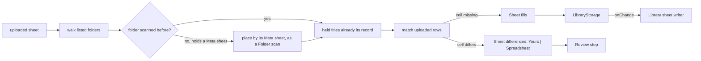

# 61: Export round trip

> **Initiative:** `export-round-trip`
> **PRD:** `docs/PRDs/61-export-round-trip.md` (to be written)
> **Plan:** `docs/PRDs/61-export-round-trip-plan.md` (to be written)
> **Handoff:** `docs/handoff/handoff-export-round-trip/`

This log is the `grill-me` session for step 44 of the build order, **Export
round trip**, held against the code as it stood on 2026-11-12 (`53241fbb`).
It is an immutable snapshot of that moment. The session ran alone, and the
maintainer approved every recommendation in advance. Their brief: _after the
folder-layout, rebuild-whole and rebuild-edges features we stumbled on bugs
while testing; use the bug ticket as the handoff; keep the codebase
consistent with its naming, conventions, patterns and architecture._ The
ticket (issue 580, deleted after this session) is kept whole in the handoff;
its five findings are this log's starting point, and logs 58, 59 and 60 rule
wherever this log does not say otherwise.

## Background

Step 43 (log 60) made a hand-kept sheet and a growing folder reach the
library safely. A third QA pass over the real server found every finding of
the previous ticket fixed and the **Round trip** sound: a library rebuilt
from its **Library sheet** after a Factory reset is equal, and the sheet the
same byte for byte. The **Export** as a backup is not:

- **The Export spells every Folder key from the title.** `createLibrarySheet`
  hands `exportRows` its `sourceFolderOf`, and `writeExport` hands it none,
  so an Export row's `Folder` (and its Title folder in the **Export folder**)
  is `folderKeyName(title, year)`. A title renamed in the app, by a Sync
  (`Amelie (2001)` synced to `Amélie`), or with its year corrected names a
  folder that is not on disk. Log 58 Q19 and Q20's premise, that an Export's
  folders copied over a Library folder of videos scan back whole, breaks for
  every such title, and an upload after a Factory reset gives two Problems
  (`no-folder` and `no-row`) where it should give none.
- **An upload never reads the folder's own sheet.** A sheet run (`execute`,
  `createImporter.ts`) walks each listed folder and ignores the
  `Meta/familyflix-library.csv` the walk finds; only a **Folder scan** reads
  it (`readMetaSheet`). After a Factory reset no title is held, so an older
  Export uploaded imports its own values unopposed, and the **Library sheet
  writer** then rewrites the newer Meta sheet from that library. The record
  the reset left in place to rebuild from is gone, and the log never says
  the two sheets disagreed.
- **A Title folder's doubles are picked in silence.** `readTitleFolder` reads
  a Poster or Backdrop "by role, the first by name order", a Still by its
  **Episode tag**, and every track in `Subtitles/`. An Export carries files
  under their **Layout place** names (`poster.png`, `Dutch.srt`, `S01E02.png`),
  so copied over a Title folder holding its own (`heat-1995-POSTER.png`,
  `Nederlands.srt`) each role is filled twice: the reader silently reads
  another poster than before, and a new title imports `Dutch` twice.
- **A Folder key is folded for case only.** `sameFolderKey` compares
  `toLowerCase()`; `readSheet`'s duplicate `rowKey` and `exportRows`'
  `claimFolder` fold the same way inline. A folder named in Unicode NFD (a
  library copied from a Mac) never matches a row typed or saved by Excel in
  NFC, and `⚠ Amélie (2001) is in the sheet but has no folder` reads as
  nonsense.
- **A show with specials resumes on S00E01.** `nextEpisodeOf` takes the first
  unwatched episode in season order, and since log 58 made `Season 00` the
  specials' place, any rebuilt show with a special offers _Play S00E01_ with
  S01E01 and S01E02 watched.

## Problem

An Export is the backup the family keeps of its library. Which rules let it
give the library back whole (uploaded after a Factory reset, or copied over a
Library folder of videos) without ever erasing the newer record a Library
folder already holds, and without a second reader, a second writer or a new
screen?

## Questions and Answers

### Scope

1. **A new step, or more of `rebuild-edges`?** ✅ **A new step, Export round
   trip**, its own initiative (`export-round-trip`), every finding settled
   here and built as one PRD. ❌ **Issues under `rebuild-edges`**: step 43 is
   Done with its refactor (issue 579), and log 60 Q1 settled that a Done step
   is not reopened. The ticket's _Initiative_ line names where it was found,
   not where it is built.

2. **What proves it?** ✅ **Each finding's own RED test** (the ticket's
   baseline: no existing test catches any), the **Round trip** test kept
   green, and one **Export round trip** test beside it: a title renamed in
   the app is exported, the library Factory reset, and the Export both
   uploaded and copied over a Library folder of bare videos; each gives the
   library back equal, with no Problem.

### The Export's Folder keys (finding 1)

3. **Which Folder key does an Export row carry?** ✅ **The Library sheet's:
   the title's Source folder when it has one, else `Title (Year)` spelled.**
   One rule, `sourceFoldersOf(titles)` in `import-export/sourceFoldersOf/`,
   pure: every title recorded against a Library folder with a Source folder,
   by id. `createLibrarySheet` takes it for its folder's titles (today's
   inline `contentOf` map), and the Export route hands it to `writeExport`
   with the rest of its `ExportContent`, which passes it on to `exportRows`
   as the sheet's `sourceFolderOf` already is. The `Title` cell is the
   title's, as in the Library sheet, so a renamed title keeps its new name
   and its own folder. ❌ **Spelling the key from the title**: the ticket's
   bug. ❌ **Reading each Title folder from disk in the Export**: the Source
   folder is already recorded, and an Export must not need its Library folder
   to be reachable.

4. **Two Library folders holding one Folder key?** ✅ **Numbered as today.**
   `claimFolder` already numbers a second title on one key `(1)`, `(2)`, …
   with its Warning line (log 58 Q19); one Export spans every Library folder,
   so the Source folder key can collide where the spelled one did not, and
   the numbering is that case's answer. A title in no Library folder (a
   browser add, a copy) keeps its spelled `Title (Year)`.

### An upload and the folder's own sheet (finding 2)

5. **What does an upload do with a Library folder's own Meta sheet?** ✅
   **It reads it first, in a folder never scanned.** A sheet run's walked
   folder whose `scannedAt` is `null` and which holds a **Library sheet** is
   placed by that sheet first, as a **Folder scan** places it
   (`readMetaSheet`, every column read back, the **Round trip**'s rules);
   the uploaded rows are then matched over the titles it placed, which are
   held by then. A held title takes the upload's **Sheet fills** for the
   cells it lacks, and each cell the two sheets disagree on is a **Sheet
   difference** in the **Review step**, _Yours | Spreadsheet_, Yours being
   the folder's own record. The newer record is never overwritten unasked,
   and the review is the notice that the sheets disagreed. ❌ **Not
   rewriting a Meta sheet the run did not read**: the Library sheet writer
   follows the library, so the next touch rewrites it anyway; the loss is
   deferred, not prevented. ❌ **Refusing an upload until the folder is
   scanned**: a new refusal on the import screen, which the prototype does
   not draw. ❌ **The newer cell wins**: a sheet carries no date per cell.

6. **And a folder already scanned?** ✅ **Unchanged.** Its Library sheet is
   the library: the writer rewrites it on every change (log 59), so the held
   titles already are its record, and the upload's disagreeing cells are
   filed as Sheet differences today. Only a folder the library has not read
   yet holds a record the library does not.

7. **Where does the rule live?** ✅ **In `createImporter`, by composing what
   is there.** The Folder scan's per-folder placing (Meta rows read, matched
   by `matchRows`, placed, held titles filled) is drawn out of `executeScan`
   into one step both runs call; the sheet run calls it for each unscanned
   folder with a sheet before it matches the upload. No new run, no new
   phase, no new route. ❌ **Running a whole Folder scan, then the upload**:
   two `✓ … complete` lines and two trips to review for one start.

### Doubles in a Title folder (finding 3)

8. **An Export copied over a Title folder that holds its own art?** ✅ **A
   doubled place is one Layout warning, not a silent pick.** The **Layout
   read** reads as today (a role's first file by name order), and every
   **Layout place** two files fill is a **Doubled place**, reported by
   `readTitleFolder` and worded by the walk beside its other Layout warnings:
   `⚠ Heat (1995) holds 2 posters, heat-1995-POSTER.png read`. The maintainer
   deletes the one they don't want; the next scan is quiet. ❌ **The Export
   keeping a held file's own name**: an Export is written from managed
   storage by its **File plan**, and the layout names are what make it
   readable anywhere; doubles also come from any hand copy, which a naming
   rule in the Export would not catch.

9. **And two tracks of one language?** ✅ **The same rule: one track per
   language per place.** A title folder's `Subtitles/` (and each episode's)
   reads the first track of each language by name order, the rest a Doubled
   place line, `⚠ Heat (1995) holds 2 Dutch tracks, Dutch.srt read`. It is
   the language rule `fillHeldFiles` and the **Layout fill** already keep
   (log 60 Q13): a title never holds two tracks of one language, new or
   held, so the subtitle menu never lists Dutch twice. ❌ **Reading both**:
   the pool names a track by language alone, so two are indistinguishable
   to the family.

10. **Which places can double?** ✅ **Every role the read reads by:** a
    film's or series' Poster and Backdrop, a Season poster, a Still per
    Episode tag, a track language per Subtitles folder. Lines name the place
    as the Unread cell lines do (log 60 Q9):
    `⚠ Tidewater (2018) Season 1 holds 2 posters, poster.png read` and
    `⚠ Tidewater (2018) S01E02 holds 2 Stills, S01E02.png read`. The
    Library sheet's path cells name the file read, as they always name what
    the read found.

### Folder keys in NFD (finding 4)

11. **How are two Folder keys compared?** ✅ **Folded once:
    `foldFolderKey(key)`, NFC then lower case**, beside `sameFolderKey` in
    `media/folderKeyOf/`. `sameFolderKey` compares two folds, and `readSheet`'s
    `rowKey` and `exportRows`' `claimFolder`, which fold inline today, call
    it, so the rule is spelled once. The Library sheet still writes the
    disk's own bytes, so the Round trip stays byte for byte. ❌ **Writing
    keys in NFC**: the sheet would stop naming the folder on disk.

12. **And a path cell under a row matched by its fold?** ✅ **Resolved under
    the folder's own name.** A path cell's first segment is its row's Folder
    key (log 60 Q3); once the row is matched to a Title folder, the cell is
    resolved with that segment replaced by the folder's name on disk, so a
    folded match also reaches the folder's files. `resolvePathCell` takes
    the matched folder's name. ❌ **Joining the cell as typed**: an NFC
    segment does not open an NFD folder.

### Specials (finding 5)

13. **Which episode does _Play_ offer a show with specials?** ✅ **Specials
    only when nothing else is left, or one is part-watched.** `nextEpisodeOf`
    answers the first part-watched episode of any season, else the first
    unwatched outside Season 0, else the first outside Season 0, and only a
    list holding nothing but specials (the Season 0 page, a show of specials
    alone) falls back to today's rule over the specials. One rule serves the
    **Series page** and each **Season page**, as now. The ticket's show
    offers _Play S01E03_. ❌ **Sorting Season 0 last**: the Series page draws
    its seasons in number order, as the prototype does. ❌ **Filing it
    separately**: one rule, found by this ticket's pass, and cheap.

14. **And the Up next card?** ❌ **Out of scope.** It plays the next episode
    in series order from the one that ended, which after the last special is
    S01E01; the ticket found nothing there.

### Units, names and documents

15. **Which units change?** ✅ The table under Design, each in the domain
    that owns it: the Folder keys and Source folders in `import-export/` and
    `media/`, the Layout read's doubles in `media/`, the upload's first read
    in `import-export/`, the Next episode in `library/`. No new domain, no new
    route, no new screen.

16. **The new terms?** ✅ **Export round trip**, **Doubled place**. Updated:
    **Export** (Folder keys by Source folder), **Folder key** (compared by
    `foldFolderKey`), **Bulk import** (an unscanned folder's sheet read
    first), **Layout read** and **Layout warning** (a Doubled place), **Next
    episode** (specials last).

17. **Which documents change?** ✅ The glossary (Q16); the checklist's step
    44; the dev journal's entry for this session; the docblocks of
    `exportRows`, `writeExport`, `createLibrarySheet`, `createImporter`,
    `readTitleFolder`, `folderKeyOf` and `nextEpisodeOf`. CLAUDE.md is
    untouched: the writers into a Library folder are still the two it names,
    and an Export still only adds its own folder. No prototype is amended:
    the new log lines are in the handoff's _Copy_ table.

## Design

### Chosen and rejected

- ✅ An Export's Folder key by its title's Source folder, one
  `sourceFoldersOf` for both sheets; ❌ spelled from the title, ❌ read off
  disk.
- ✅ An upload places a never-scanned folder by its own sheet first, the
  upload's disagreements filed as Sheet differences; ❌ not rewriting, ❌
  refusing, ❌ newest wins.
- ✅ A Doubled place as one Layout warning, one track per language; ❌ the
  Export keeping file names, ❌ two tracks of one language.
- ✅ One `foldFolderKey`, NFC and case; a path cell resolved under the
  matched folder's name; ❌ NFC keys written.
- ✅ Specials offered last; ❌ Season 0 sorted last.

### Types

```ts
// server/src/import-export/sourceFoldersOf/sourceFoldersOf.ts
/** Each title's Source folder by its id, for those recorded against `folderId`, or against any. */
export function sourceFoldersOf(
  titles: StoredLibraryTitles,
  folderId?: string
): Map<string, string>;
```

```ts
// server/src/import-export/writeExport/writeExport.ts
export interface ExportContent {
  movies: readonly Movie[];
  series: readonly SeriesDetail[];
  /** Each title's **Source folder** by id, its Folder key in the Export. */
  sourceFolders: ReadonlyMap<string, string>;
}
```

```ts
// server/src/media/folderKeyOf/folderKeyOf.ts
/** A Folder key as two keys are compared: NFC, then lower case. */
export const foldFolderKey = (key: string): string =>
  key.normalize('NFC').toLowerCase();
export const sameFolderKey = (a: string, b: string): boolean =>
  foldFolderKey(a) === foldFolderKey(b);
```

```ts
// server/src/media/readTitleFolder/readTitleFolder.ts
/** A Layout place two files or more fill: the one read and how many there were. */
export interface DoubledPlace {
  place: 'poster' | 'backdrop' | 'season-poster' | 'still' | 'track';
  season?: number;
  episode?: number;
  /** The track language, for `track`. */
  language?: string;
  read: string;
  count: number;
}
// FilmFolderScan, SeasonFolderScan and SeriesFolderScan each gain
// `doubled: DoubledPlace[]`, worded by the walk as Layout warnings.
```

### The units

| Unit                 | Where                                          | Change                                                                                    |
| -------------------- | ---------------------------------------------- | ----------------------------------------------------------------------------------------- |
| `sourceFoldersOf`    | `server/src/import-export/sourceFoldersOf/`    | new, pure: each recorded title's Source folder by id                                      |
| `writeExport`        | `server/src/import-export/writeExport/`        | `ExportContent.sourceFolders`, handed to `exportRows`                                     |
| `routes/index.ts`    | `server/src/routes/`                           | the Export route builds `sourceFolders` with the rest of its content                      |
| `createLibrarySheet` | `server/src/import-export/createLibrarySheet/` | its folder's map by `sourceFoldersOf`                                                     |
| `exportRows`         | `server/src/import-export/exportRows/`         | `claimFolder` by `foldFolderKey`                                                          |
| `folderKeyOf`        | `server/src/media/folderKeyOf/`                | `foldFolderKey`; `sameFolderKey` by it                                                    |
| `readSheet`          | `server/src/import-export/readSheet/`          | `rowKey` by `foldFolderKey`; `resolvePathCell` under the matched folder's name            |
| `readTitleFolder`    | `server/src/media/readTitleFolder/`            | one track per language; every Doubled place reported                                      |
| `createImporter`     | `server/src/import-export/createImporter/`     | the Doubled place lines; the scan's per-folder placing shared; an upload's unscanned read |
| `nextEpisodeOf`      | `server/src/library/series/nextEpisodeOf/`     | specials last                                                                             |

### The upload's flow



## Implementation Plan

1. **The Export's Folder keys.** `sourceFoldersOf`, `ExportContent`, the
   route. Demo: the ticket's Amélie repro, exported, Factory reset and
   uploaded, has no Problem and every field back; copied over the bare
   videos, it scans back whole.
2. **An upload reads the folder's sheet first.** The scan's per-folder
   placing shared, called for an unscanned folder. Demo: the ticket's Heat
   repro keeps 9 and its heart, and the review offers _Yours 9 |
   Spreadsheet 5_.
3. **Doubled places.** One track per language, every Doubled place a line.
   Demo: the ticket's merged Heat holds `Dutch, English`, and the log names
   each doubled poster, backdrop, Season poster and Still.
4. **Folds.** `foldFolderKey` in its three callers; the path cell under the
   matched name. Demo: the ticket's NFD Amélie scans with rating 7 and no
   Orphaned row.
5. **Specials last.** `nextEpisodeOf`. Demo: the ticket's show offers _Play
   S01E03_.
6. **The documents** (Q17).

## Trade-offs

- **Easier:** an Export is a backup the family can trust: renamed titles
  come back from it, uploaded or copied over, and an old one can't erase a
  newer record; a disagreement is a choice in review, not a loss. A Title
  folder's doubles are named instead of guessed at, and a folder from a Mac
  matches its sheet.
- **Harder:** an upload into a folder never scanned does a scan's work first,
  so its review can hold differences the maintainer did not expect from "an
  upload"; that is the point, but it is more to read. An Export's Title
  folders can now carry `(1)` suffixes for titles in two Library folders on
  one key, where the spelled key differed.
- **Out of scope:** the Up next card's order (Q14); merging an Export over a
  Library folder by name (the Doubled place line is the answer); a Library
  folder's sheet newer than a scanned library (the writer keeps them equal);
  the ticket's _Not covered_ list (a real Sync, the Electron window, the
  shutdown flush, Linux case sensitivity, external drives). The ticket's _By
  design_ notes stand as logs 58, 59 and 60 settled them.
