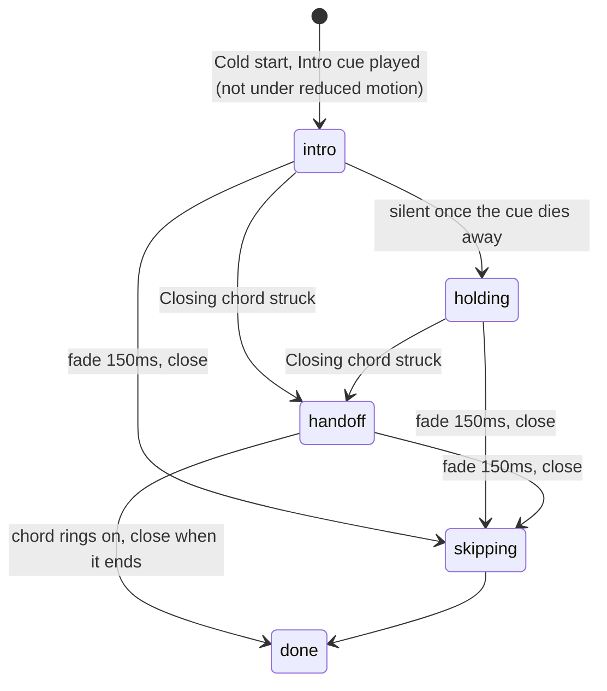

# 62: Welcome tune

> **Initiative:** `welcome-tune`
> **PRD:** `docs/PRDs/62-welcome-tune.md` (to be written)
> **Plan:** `docs/PRDs/62-welcome-tune-plan.md` (to be written)
> **Handoff:** `docs/handoff/handoff-welcome-tune/`

This log is the `grill-me` session for step 45 of the build order, **Welcome
tune**, held against the code as it stood on 2026-11-12 (`c2ee3c7c`). It is an
immutable snapshot of that moment. The session ran alone, and the maintainer
approved every recommendation in advance, asking that the codebase stay
consistent with its naming, code conventions, patterns and architecture.
Log 55 rules wherever this log does not say otherwise; this log reopens only
its scope call _Sound: the handoff has none_ (Q1, Trade-offs).

## Background

Step 45, as the checklist planned it: _a short, catchy tune plays with the
Welcome splash on a Cold start, its notes in sync with the animation: the Fs
landing, the letters rising, the light sweeping, and a closing chord as the
wordmark glides into the header. No mute control for now; one can come
later._

What the code does today, read before the session:

| Fact                  | Today                                                                                                                                                                                          |
| --------------------- | ---------------------------------------------------------------------------------------------------------------------------------------------------------------------------------------------- |
| Who decides it plays  | `WelcomeProvider` (`src/App/WelcomeProvider/`): a **Cold start** on the **Launch entry**, read once; `reducedMotion` read once                                                                 |
| The phases            | `welcomeStep` (`src/App/welcomeStep/`): `intro` → `holding`? → `handoff` → `done`, or `skipping` → `done`; the provider's `setTimeout` clock                                                   |
| The intro's numbers   | split: `INTRO_MS = 1950`, `HANDOFF_MS`, `STILL_*`, `SKIP_MS` in `WelcomeProvider.tsx`; the drop (520ms, F2 at 150), letters (`520 + i·40`) and sweeps as literals in `WelcomeSplash.styles.ts` |
| An F's landing        | `drop`'s `55%` keyframe (`translateY(5%)`, opacity 1): 286ms for F1, 436ms for F2                                                                                                              |
| Sound in the renderer | only the player's `<video>`; no `AudioContext` anywhere; `volumePreference` is the player's own                                                                                                |
| The renderer's CSP    | `RENDERER_CSP` (`server/src/routes/rendererRouter/`): `media-src 'self' blob:`; Web Audio's own nodes fetch nothing                                                                            |
| The window            | `electron/main.ts` `webPreferences`: no `autoplayPolicy`, so Electron's default, `no-user-gesture-required`; the player already leans on it                                                    |
| The handoff           | `docs/handoff/handoff-welcome-splash/`, frozen as received (log 55 Q2); its README says _No sound_                                                                                             |

Three facts shape most answers. The welcome's clock is the provider's
timers and the animation's CSS delays, so a tune in sync has to be keyed off
the same numbers, not a recording of them. The welcome can hold for as long
as the home needs, so the closing chord cannot be a fixed time after the
start. And a browser tab, unlike the shell, refuses sound before a gesture.

## Problem

Score the **Welcome splash**: a short tune whose notes fall on what the
animation draws, that follows every path the welcome can take (the hold, a
skip, reduced motion, a window that may not play sound) and that stays in sync
by construction when either side changes.

## Questions and Answers

### Scope

1. **One initiative?** ✅ **One**, `welcome-tune`, step 45, log 62: the tune
   and nothing else. It reopens log 55's _Sound: the handoff has none_ for the
   Welcome splash alone. ❌ **A mute control**: the checklist puts it later; a
   Settings row with nothing to toggle is not drawn (CLAUDE.md, _Settings_).
   ❌ **Sound anywhere else** (the **Start-up splash**, snackbars, the player's
   chrome).

2. **What is the spec?** ✅ **A new handoff, `docs/handoff/handoff-welcome-tune/`,
   its README the score**, written in this session: every note's time, pitch,
   length, voice and level, and the rules it follows. A tune has no picture,
   so the score is its prototype, and `handoff-welcome-splash/` stays frozen as
   log 55 Q2 left it. Phase 1 adds a _Welcome tune_ paragraph to
   `COMPONENT-SPEC.md`'s Welcome splash section pointing at it. ❌ **Amending
   the splash prototype with audio**: it is frozen, and its timeline is the
   prototype's 1750ms intro, not ours.

3. **What is it called?** ✅ The **Welcome tune**, after the step; its two
   parts are the **Intro cue** (the notes with the **Welcome intro**) and the
   **Closing chord** (with the **Wordmark handoff**). ❌ _Jingle_: the
   checklist row's word, not the thing's name. ❌ _Intro music_, _sound_.

### How it sounds

4. **A recording or synthesised?** ✅ **Synthesised with Web Audio**, every
   note an `OscillatorNode` through its own `GainNode` envelope into one
   master `GainNode`, scheduled on the `AudioContext`'s own clock. The score is
   data in the code, keyed off the welcome's own numbers (Q8), so a change to
   the animation moves the notes with it; nothing to license, nothing to
   bundle, no CSP change. ❌ **An audio file**: it bakes the timeline in, needs
   a second file for the chord (the hold splits them), and an
   `HTMLAudioElement`'s start latency is not ours to schedule. ❌ **A library**
   (Tone.js and the like): a dependency for a dozen notes.

5. **Which notes?** ✅ **F major, as the mark**: the score in the handoff,
   in short:
   - **The Fs landing**: a pluck on each F's landing frame, `F3` at 286ms and
     `F4` at 436ms, the octave the two Fs make.
   - **The letters rising**: a pluck on each letter's start, `520 + i·40`, up
     the F major pentatonic, _Family_ `F4 G4 A4 C5 D5 F5`, _Flix_ `A5 C6 D6
F6`, so the run ends on F again as the wordmark completes.
   - **The light sweeping**: one swell, `C6` and `F6`, from the mark sweep's
     start (1000ms), at its height at the sweep's middle (1350ms), silent by
     the intro's end (1950ms).
   - **The Closing chord**: `F2 C3 F3 A3 C4 F4` as bells, struck at the
     **Wordmark handoff**'s start and left to ring 1800ms, past the 500ms
     handoff, so the home arrives under it.

   ❌ **A melody of its own over the animation**: the step asks for notes
   that fall on what is drawn, and a run on the letters is what makes it
   catchy.

6. **Which voices?** ✅ **Three, each one envelope**: a _pluck_ (triangle,
   5ms rise, exponential fall over its length), a _bell_ (sine, with a sine an
   octave up at a quarter of its level, 10ms rise, exponential fall) and a
   _swell_ (sine, linear rise over 350ms, half the mark sweep, linear fall to
   silence at its end). The voices live with the player of the score (Q9), the
   notes name them. ❌ **Filters, reverb, noise**: more nodes for no
   difference the family would hear on TV speakers.

7. **How loud?** ✅ **One fixed master level, 0.3**, the notes' levels
   relative to it, the chord's six bells summing under full scale. It follows
   the system's volume alone. ❌ **The player's `volumePreference`**: the
   player's own (a feature's module, not the App's), and a film's volume is no
   guide to a two-second tune. ❌ **A volume setting**: Q1.

### In sync

8. **How does it stay in sync?** ✅ **One timeline, read by both sides.** The
   welcome's numbers move into `src/App/welcomeTimeline/` (`welcomeTimeline.ts`
   - test): the drop (`DROP_MS`, `DROP_DELAYS`, `DROP_LANDING = 0.55`), the
     letters (`LETTER_START`, `LETTER_STEP`, `LETTER_MS`), the sweeps
     (`MARK_SWEEP_START`, `MARK_SWEEP_MS`, `LETTER_SWEEP_START`,
     `LETTER_SWEEP_STEP`, `LETTER_SWEEP_MS`) and the clock (`INTRO_MS`,
     `HANDOFF_MS`, `STILL_INTRO_MS`, `STILL_HANDOFF_MS`, `SKIP_MS`).
     `WelcomeSplash.styles.ts` interpolates them (the `drop` keyframe's landing
     step included), `WelcomeProvider` builds its clocks from them, and the
     score computes each note's time from them. Its test holds the rule
     `INTRO_MS`'s docblock states today: the intro outlasts the last letter's
     sweep. ❌ **The score's times as literals**: two copies of one timeline
     drift at the first retune.

9. **Which units?** ✅ Three, in `src/App/` beside the welcome, each in its
   own folder:
   - `welcomeScore/` (`welcomeScore.ts` + test): pure data, the `WelcomeNote`
     type, `INTRO_CUE` and `CLOSING_CHORD`, times relative to the cue's start.
   - `createWelcomeTune/` (`createWelcomeTune.ts` + test): the only code that
     touches Web Audio, the `create*` factory as `createImporter` and
     `createUpdates` are; it makes the context and plays, fades and closes.
   - `useWelcomeTune/` (`useWelcomeTune.ts` + test): the React wiring,
     `useWelcomeTune(phase, { played, reducedMotion })`, called once by
     `WelcomeProvider`, which already owns everything it reads.

   ❌ **Inside `WelcomeProvider`**: it is 261 lines of phases and geometry
   already. ❌ **A `features/` unit or `src/hooks/`**: no domain, no wire, and
   no second user; it is App furniture, as the welcome is (log 55 Q7).

10. **When is each cue played?** ✅ **By phase, as the welcome changes it**:
    the **Intro cue** when the welcome starts (the provider's mount, with
    `played`); the **Closing chord** when the phase becomes `handoff`,
    whenever that is. So the **Welcome hold** is silent (the intro cue has
    died away by 1950ms and the chord waits for the home), and the chord
    always meets the glide. ❌ **The chord at a fixed 1950ms**: a held welcome
    would land its chord on a loader.

11. **What anchors the notes?** ✅ **The context's clock at the moment a cue is
    played**: each note at `currentTime + at / 1000`. The animation's own clock
    is its first paint; the two start in the same commit, the tune perhaps a
    few ms late while the context starts, never early and never squeezed. ❌
    **Compensating for output latency**: a note can't be scheduled before
    now, and a lag of a frame is under what anyone hears against a 40ms run.

### Every path

12. **A skip?** ✅ **The tune fades out over the skip's own 150ms** (`SKIP_MS`),
    whatever is sounding, then the context closes: a ramp of the master gain
    to 0 on the phase `skipping`. A skip that comes in the hold (`skipped`)
    reaches `skipping`, never `handoff`, so it plays no chord. ❌ **Jumping to
    the Closing chord**: the family pressed a key to get in, not for a
    flourish.

13. **At the end?** ✅ **The chord rings on, then the context closes**: at
    `done` the tune is told to finish, and closes once its last note has died
    away. An unmount (never, in the app; every test's teardown) closes it at
    once.

14. **Reduced motion?** ✅ **The Closing chord alone, at the reduced
    handoff's start** (900ms). The Intro cue marks drops, letters and a sweep
    the reduced timeline does not draw; the arrival it still draws, as fades.
    ❌ **The whole tune over fades**: notes on motion that isn't there. ❌
    **Silence**: reduced motion is about motion, not sound, and the chord is
    the arrival.

15. **A window that may not play sound?** ✅ **Silence, the welcome
    unchanged.** No `AudioContext` (jsdom, an old engine), or one that throws
    on construction (no audio device on Linux), gives a silent tune: every
    call does nothing. A context the browser keeps `suspended` (a browser tab
    before any gesture) is never resumed: a skip is a gesture, but the tune is
    over by then. ❌ **Resuming on the skip's gesture**: Q12 fades it anyway.

16. **And the shell?** ✅ **`autoplayPolicy: 'no-user-gesture-required'`
    spelled in `electron/main.ts`'s `webPreferences`**, with a line saying the
    Welcome tune and the player rely on it. It is Electron's default today,
    so nothing changes but the dependency being written where it is chosen.
    ❌ **Leaning on the default unsaid**: a future Electron changing it would
    silence the tune with no test failing. ❌ **A pure `electron/` unit for
    it**: it is one constant option, wiring as the window's other
    `webPreferences` are.

17. **Only on a Cold start?** ✅ **Exactly when the Welcome splash plays**:
    `useWelcomeTune` does nothing unless `played`. A reload, a deep link and a
    **Slow start**'s tile stay silent; the **Start-up splash** never plays it.

### Tests

18. **What proves it?** ✅ **The score's sync as unit tests, the plumbing
    against a fake context.**
    - `welcomeScore.test.ts`: each landing pluck on its F's `DROP_LANDING`
      frame; each letter's pluck on its letter's start, ten of them; the swell
      from `MARK_SWEEP_START` to `INTRO_MS`; every intro note ends by
      `INTRO_MS`; the chord at 0; the summed peak under full scale at the
      master level.
    - `createWelcomeTune.test.ts`, against `src/test-support/stubAudioContext/`
      (the `stubMediaElement` pattern): each note an oscillator at its pitch's
      frequency and time; the fade's ramp and the close after it; `finish`
      closing after the last note; a missing or throwing constructor silent.
    - `WelcomeProvider.tune.test.tsx`, the provider's tests split by concern
      as today: a Cold start plays the Intro cue; the handoff the chord, held
      or not; a skip fades with no chord; reduced motion plays the chord alone;
      no welcome, no context.

    ❌ **Asserting by ear in tests**: the walk (phase 4) is the ear.

### Units, names and documents

19. **The new terms?** ✅ **Welcome tune**, **Intro cue**, **Closing chord**.
    Updated: **Welcome splash** (with its tune), **Welcome hold** (silent),
    **Wordmark handoff** (strikes the Closing chord).

20. **Which documents change?** ✅ The new handoff (Q2); `COMPONENT-SPEC.md`'s
    Welcome splash section (phase 1); the glossary (Q19); the checklist's step
    45; the dev journal's entry for this session; the docblocks of
    `WelcomeProvider`, `WelcomeSplash.styles` and `main.ts`'s `openWindow`.
    CLAUDE.md is untouched: no domain, wire or rule changes, and the tune is
    no network client.

## Design

### Chosen and rejected

- ✅ Synthesised with Web Audio, the score as data; ❌ an audio file, ❌ a
  library.
- ✅ One `welcomeTimeline` read by the splash, the provider and the score; ❌
  the score's own copy of the times.
- ✅ The Intro cue at the start, the Closing chord on `handoff`; ❌ the chord
  at a fixed time.
- ✅ A skip fades over 150ms; ❌ a skip to the chord.
- ✅ Reduced motion: the chord alone; ❌ the whole tune, ❌ silence.
- ✅ Silent where sound is refused or missing; ❌ resuming on a gesture.
- ✅ The shell's `autoplayPolicy` spelled out; ❌ the default unsaid.

### Types

```ts
// src/App/welcomeScore/welcomeScore.ts
/** How a note is drawn from its oscillator (the voices of `createWelcomeTune`). */
export type WelcomeVoice = 'pluck' | 'bell' | 'swell';

/** One note of the **Welcome tune**. */
export interface WelcomeNote {
  /** When it is struck, in ms from its cue's start. */
  at: number;
  /** MIDI note number: 60 is middle C. */
  pitch: number;
  /** How long until it has died away, in ms. */
  length: number;
  voice: WelcomeVoice;
  /** Its peak, 0 to 1, under the tune's master level. */
  level: number;
}

/** The **Intro cue**: the Fs landing, the letters rising, the light sweeping. */
export const INTRO_CUE: readonly WelcomeNote[];
/** The **Closing chord**, struck as the **Wordmark handoff** starts. */
export const CLOSING_CHORD: readonly WelcomeNote[];
```

```ts
// src/App/createWelcomeTune/createWelcomeTune.ts
export interface WelcomeTune {
  /** Schedule a cue's notes from now, on the context's clock. */
  play(cue: readonly WelcomeNote[]): void;
  /** Ramp everything to silence over `ms`, then close. */
  fadeOut(ms: number): void;
  /** Close once the last note played has died away. */
  finish(): void;
}

/** A tune on a new `AudioContext`; a silent one where there is none or it throws. */
export function createWelcomeTune(): WelcomeTune;
```

```ts
// src/App/useWelcomeTune/useWelcomeTune.ts
export function useWelcomeTune(
  phase: WelcomePhase,
  options: { played: boolean; reducedMotion: boolean }
): void;
```

### The tune against the phases



### The units

| Unit                         | Where                        | Change                                                              |
| ---------------------------- | ---------------------------- | ------------------------------------------------------------------- |
| `welcomeTimeline` (new)      | `src/App/welcomeTimeline/`   | the welcome's every number, one copy                                |
| `welcomeScore` (new)         | `src/App/welcomeScore/`      | `WelcomeNote`, `INTRO_CUE`, `CLOSING_CHORD`, timed off the timeline |
| `createWelcomeTune` (new)    | `src/App/createWelcomeTune/` | the Web Audio player: voices, master level, fade, close             |
| `useWelcomeTune` (new)       | `src/App/useWelcomeTune/`    | plays each cue as the phase changes                                 |
| `stubAudioContext` (new)     | `src/test-support/`          | a recording fake `AudioContext`                                     |
| `WelcomeProvider` (ch.)      | `src/App/WelcomeProvider/`   | clocks from the timeline; calls `useWelcomeTune`                    |
| `WelcomeSplash.styles` (ch.) | `src/App/WelcomeSplash/`     | delays and durations from the timeline                              |
| `main.ts` (ch.)              | `electron/`                  | `autoplayPolicy: 'no-user-gesture-required'`, said why              |

## Implementation Plan

1. **A chord that lands.** `createWelcomeTune` with the bell voice,
   `stubAudioContext`, `useWelcomeTune` playing `CLOSING_CHORD` on `handoff`
   and finishing at `done`, the shell's `autoplayPolicy`, the
   `COMPONENT-SPEC.md` paragraph. Demo: a cold start in the shell ends on a
   chord as the wordmark lands.
2. **The Intro cue.** `welcomeTimeline` lifted, the splash and provider on
   it, no change drawn; `INTRO_CUE` with the pluck and swell voices, played
   at the start. Demo: the Fs, the run and the sweep heard on their frames.
3. **Every path.** A skip's fade, the silent hold, reduced motion's chord
   alone, a silent tune where Web Audio is missing or refused.
4. **Walk it live, by ear.** In the shell, on Windows and the Deck: a cold
   start on Movies and Series, a skip by click and key, a held start, a
   reload (silent), reduced motion; then the documents of Q20. A retune by
   ear amends the handoff's score first.

## Trade-offs

- **Easier:** the tune can't drift from the animation, since both read one
  timeline and the chord follows the phase, not the clock; it costs no asset,
  no dependency and no CSP change; a retune is a table edit.
- **Harder:** every cold start makes a sound, with no way to turn it off
  short of the system's volume, until a mute control is its own step; a
  browser tab is silent, so a developer hears it only in the shell; the
  welcome's numbers now live in a module of their own rather than beside the
  rules that use them.
- **Out of scope:** a mute control or volume setting (Q1); sound on the
  **Start-up splash**, a reload or anywhere else; following the player's
  volume (Q7); a recorded or licensed tune (Q4).
