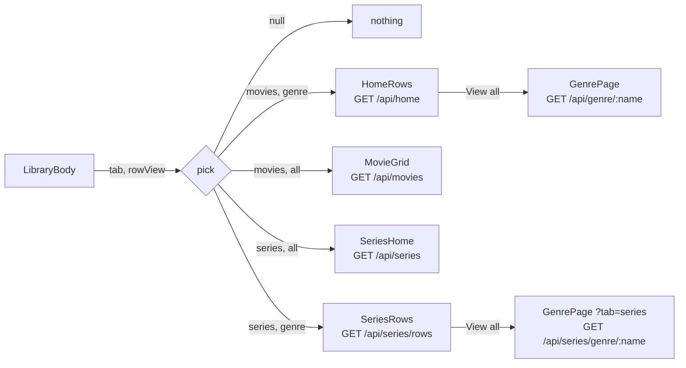

# 63: Row view

> **Initiative:** `row-view`
> **PRD:** `docs/PRDs/63-row-view.md` (to be written)
> **Plan:** `docs/PRDs/63-row-view-plan.md` (to be written)
> **Handoff:** `docs/handoff/handoff-row-view/`

This log is the `grill-me` session for step 46 of the build order, **Row
view**, held against the code as it stood on 2026-11-13 (`bf25ef47`). It is an
immutable snapshot of that moment. The session ran alone, and the maintainer
approved every recommendation in advance, asking that the codebase stay
consistent with its naming, code conventions, patterns and architecture.
Logs 02 (browse grid), 22 (series), 49 (Start tab) and 51 (the **Other row**)
rule wherever this log does not say otherwise.

## Background

Step 46, as the checklist planned it: _a switch on both the Movies and the
Series tab between All, every title in one grid, and By genre, a row per
genre, so either tab can be browsed either way._

What the code does today, read before the session:

| Fact                    | Today                                                                                                                                                                                  |
| ----------------------- | -------------------------------------------------------------------------------------------------------------------------------------------------------------------------------------- |
| Who picks the body      | `LibraryBody` (`src/features/library/LibraryBody/`): `SeriesHome` under Series, `HomeRows` under Movies, off `useLibraryTab()`                                                         |
| The Movies tab          | `HomeRows` + `useHomeRows` over `GET /api/home` (`HomePayload`): Continue row, Favorites row, a **Genre row** per populated genre (15 cards, true count), the **Other row** last       |
| The Series tab          | `SeriesHome` over `GET /api/series` (`SeriesHomePayload`): episode Continue row, Favorites row derived from the grid (15), _All series_, `N series · M episodes`, the **Library grid** |
| An uncapped movie list  | none on the home; only the **Genre page** (`/api/genre/:name`, `/api/genre-less`), uncapped, Movies only                                                                               |
| Series genres           | every `Series` carries `genres`; `/api/series/genres` counts them for the Series tab's Genre dropdown; no series row or series Genre page exists                                       |
| The header              | `LibraryTabs` + `LibrarySearch` in `headerStart`, `LibraryFilters` (Genre, ★, Sort `FilterDropdown`s) in `headerEnd`                                                                   |
| Household display prefs | `settings` table rows read by `createSettings` (`choiceOf` for a closed list), held app-wide by `DisplayPreferenceProvider` (`useHeldValue`, one `save*` per preference in `src/App/`) |
| What the URL holds      | the **Library tab** and the **Library query** (`q`, `genre`, `rating`, `sort`); nothing about how the body is laid out                                                                 |
| The prototype           | `page.LibraryPage.dc.html` draws rows under Movies and _All series_ under Series; no switch                                                                                            |

Three facts shape most answers. Each tab already has one of the two faces,
so the step is two new bodies (Movies as a grid, Series as rows) and a switch,
not a new screen. A genre row promises a **View all**, and no series has a
Genre page to open. And the family's choice has to outlast a relaunch, so it
is a household preference, where the Start tab already lives.

## Problem

Let either **Library tab** be browsed either way, _All_ (every title in one
grid) or _By genre_ (a row per genre), chosen by a switch on the home,
remembered per tab for the household, and drawn as a 1:1 extension of what
each tab draws today, so a Movies grid reads as the Series grid does and Series
rows read as the Movies rows do.

## Questions and Answers

### Scope

1. **One initiative?** ✅ **One**, `row-view`, step 46, log 63: the switch,
   the two new bodies, and the series Genre page a series row's **View all**
   needs. ❌ **A Settings row for it**: the switch on the home is the control,
   and a second place to set one choice is two answers to "where did my view
   go". ❌ **Other layouts** (a list, a denser grid, sizes): the step names two.

2. **What is the spec?** ✅ **A handoff README, `docs/handoff/handoff-row-view/README.md`,
   written in this session**, naming the switch, its copy, where it sits and
   what each tab draws under each view, every face included. Phase 1 amends
   `page.LibraryPage.dc.html`, the model in `FamilyFlix.dc.html` and
   `COMPONENT-SPEC.md` to it, as issue 445 amended the prototype for log 51's
   Other row. Both new bodies are compositions of drawn pieces (the Library
   grid, Genre rows, the count line), so nothing new is designed, only placed.
   ❌ **Building it off the README alone**: the prototype is the spec, so it
   learns the switch before the code does.

3. **What is it called?** ✅ The **Row view**, the step's name, a per-tab
   household choice between two values, **All** and **By genre**. The control
   is the **Row view switch**. ❌ _Layout_, _mode_, _display_: _layout_ is
   `layouts/`, _mode_ is the Genre page's (`GenrePageMode`) and the
   **Import mode**'s, _display_ is the **Display group**'s. ❌ _Grid view_ /
   _list view_: _All_ is what the family reads on the pill.

### The switch

4. **What is it?** ✅ **A fourth `FilterDropdown` in the header's end slot**,
   after Sort, labelled _View_, its value _All_ or _By genre_, its two options
   checked as the other pills' are. It reads as one of the header's choices
   about what the body shows, which is what it is, and reuses a drawn
   molecule. ❌ **A second `PillTabs`**: two segmented controls in one header
   read as two tab bars, and the Movies / Series one must stay the tab bar.
   ❌ **An icon pair** (grid / rows): the family reads words, not glyphs. ❌
   **On the body's first heading**: under _By genre_ there is no heading to
   carry it.

5. **Where does the code live?** ✅ **`features/library/RowViewSwitch/`**,
   rendered by `LibraryPage` in `headerEnd` after `LibraryFilters`, as
   `LibraryTabs` is a library unit in `headerStart`. Its options come from a
   pure builder, `features/library/rowViewOptions/` (+ test), the
   `sortOptions` / `ratingOptions` shape: `(current, onChoose) =>
FilterOption[]`. ❌ **Inside `LibraryFilters`**: that is the search
   feature's, and it writes the URL; this writes a preference.

6. **Per tab or one for both?** ✅ **Per tab.** Each **Library tab** keeps its
   own Row view; the switch shows and sets the current tab's. Today's faces
   are the defaults: **Movies `By genre`, Series `All`**, so an upgrade changes
   nothing on screen until someone switches. ❌ **One shared value**: flipping
   Movies to a grid would flip Series to rows, and the two libraries differ in
   size by an order of magnitude.

### Remembering it

7. **Where is it kept?** ✅ **Two household settings, `movie-row-view` and
   `series-row-view`**, in the `settings` table beside `start-tab`, read with
   `choiceOf(key, ROW_VIEWS, default)`, so a stored value off the list reads as
   the default. It travels with the backup and holds across relaunches, and
   both parents see the house's choice. ❌ **The URL** (`?view=`): a second
   source beside the setting, and a shared or bookmarked link would override
   the household's choice. ❌ **`localStorage`**: the player's volume
   precedent lives in one browser profile and outside the backup; a
   household choice belongs in the household's table, as the Start tab does.

8. **The types?** ✅ In `src/types/browse.ts`, beside `LIBRARY_TABS`:
   `ROW_VIEWS = ['all', 'genre'] as const` and `RowView`. In
   `src/types/settings.ts`: `DEFAULT_MOVIE_ROW_VIEW: RowView = 'genre'`,
   `DEFAULT_SERIES_ROW_VIEW: RowView = 'all'`, and `Settings` gains
   `movieRowView` and `seriesRowView`. Flat fields, as every other preference
   is, so the settings write keeps its one-field body. ❌ **A
   `rowViews: Record<LibraryTab, RowView>` field**: the one nested shape in a
   flat settings object, and the write route would need a second body shape.

9. **How does the app hold it?** ✅ **`DisplayPreferenceProvider` holds both**,
   two more `useHeldValue`s over `src/App/saveMovieRowView/` and
   `src/App/saveSeriesRowView/` (one save per preference, as today), and
   `DisplayPreferenceApi` gains `movieRowView`, `setMovieRowView`,
   `seriesRowView`, `setSeriesRowView`. A switch is the provider's bargain:
   shown at once, posted, the echo kept, put back on refusal, no snackbar
   (none is drawn in the prototype). A feature hook,
   `features/library/useRowView/` (+ test), reads the current tab and hands
   back `{ rowView, setRowView }` for it, so neither the switch nor the body
   knows there are two settings.

10. **Before the read lands?** ✅ **Blank until it lands**, the house rule: the
    body and the switch draw nothing while the tab's Row view is `null`. On a
    refused read the provider lands the two **defaults** for the Row views
    alone, because the home must draw something and a refusal is no
    preference (`useStartTabSettled`'s words); the other preferences keep
    `null` after a refusal as today. ❌ **Drawing the default at once**: a
    Series household would see the grid load and then flip to rows, two
    loads and a jump. ❌ **A settled flag on the provider**: one more member
    for the one consumer that needs it, where landing the default says the
    same thing.

### What each tab draws

11. **Movies, _All_?** ✅ **The Series tab's face, in movies**: the Continue
    row, the Favorites row (the grid's hearted movies, in its order, capped at
    15, derived with `shelvedFavorites` as `SeriesHome` does), the heading
    _All movies_, the count line `N movies` (`1 movie`), and the **Library
    grid** of every movie the **Library query** keeps, uncapped, the
    genre-less films among them. ❌ **The genre rows' Continue and Favorites
    from the rows payload**: a second request for one screen.

12. **Where do the movies come from?** ✅ **A new read, `GET /api/movies`**,
    narrowed by the one **Library query** through `libraryQueryOr400`, as
    `/home` and `/series` are, answering `MovieGridPayload { movies: Movie[];
continueWatching: Movie[] }`: the browse query uncapped in the caller's
    sort, and the continue section `getHome` already builds, built by the same
    `listSection` call. It lives in the `home` domain as `getMovieGrid(query)`
    beside `getHome`. `GET /movies` is free (only `/movies/:id` and the add's
    `POST` use the path). ❌ **`/home?view=all`**: one route answering two
    shapes. ❌ **Grouping on the client from the rows payload**: rows are
    capped at 15, so the grid would be missing films.

13. **Series, _By genre_?** ✅ **The Movies tab's face, in series**: the
    episode Continue row, the Favorites row (hearted series, capped at 15, in
    the caller's sort), a **Genre row** per populated series genre (busiest
    first, as `/api/series/genres` orders them, 15 cards, the genre's true
    count on **View all**), and last the **Other row**, titled _Other series_,
    every series with no genre. A genre filter narrows it to that genre's row
    and leaves the Other row out, as on Movies. ❌ **Uncapped series rows with
    no View all**: a row that looks like the Movies row and behaves unlike it.

14. **Where do the rows come from?** ✅ **A new read, `GET /api/series/rows`**,
    registered ahead of `/series/:id`, answering `SeriesRowsPayload { rows:
SeriesRow[]; other: SeriesRow | null; favorites: Series[];
continueWatching: EpisodeContinueEntry[] }`, `SeriesRow` being `HomeRow`'s
    shape in series (`{ genre, count, series }`). Built on the server in the
    series `browse` slice as `getSeriesRows(query)`, `getHome`'s rules
    (`HOME_ROW_LIMIT`, the genre filter deciding which rows exist, sections
    built independently) over series. ❌ **Grouping `/api/series` on the
    client**: two homes building rows by two different rules, and the busiest
    order would need the genre counts fetched beside it.

15. **A series row's View all?** ✅ **The Genre page, for series:
    `/genre/:name?tab=series`**, and the Other row's
    `/genre-less?tab=series`. The Genre page reads the **Library tab** off its
    URL with `useLibraryTab()`, as the home does, so the tab rides the link
    the way it rides the home's, omitted at Movies. Under Series it loads
    `GET /api/series/genre/:name` and `GET /api/series/genre-less` (registered
    ahead of `/series/:id`, `genreQueryOr400` as the movie routes), answering
    `GenrePayload`'s shape in series, and its cards open the series page.
    Heading, count line (`N of M titles`, already kind-neutral), search and
    sort are unchanged; the `other` mode's heading is _Other series_. The
    **Carried sort** rides the link as on Movies. ❌ **View all as the Series
    tab under _All_ narrowed by `?genre=`**: it would rewrite the household's
    Row view to follow a link. ❌ **A `/series/genre/:name` route of its
    own**: a second Genre page for one difference, the kind.

16. **Do the faces change with the view?** ✅ **No: the loading, failure,
    empty and miss faces belong to the tab, not the view.** Movies draws
    skeletons while loading (rows under _By genre_; under _All_ a grid of
    `SkeletonCard`s, as the Genre page's grid does), _Your library is empty_
    when it holds nothing, and its search / filter miss copy as today. Series
    draws nothing until its payload lands, its empty face is _All series_ over
    `0 series · 0 episodes` in either view (an empty library has no genre to
    row), and its miss copy as today. Each failure is its tab's
    `RetryableFailure`. ❌ **New copy per view**: nothing a family member
    would read differently.

17. **The query and the switch?** ✅ **Independent.** A switch keeps the
    search, genre, rating and sort (they are the URL's, and a switch writes
    no URL), and reloads only because the body changes. A genre filter under
    _All_ narrows the grid; under _By genre_ it leaves one row. Switching tabs
    shows that tab's own Row view. Back from a title returns to the view the
    household holds, which is the one it left.

### Units, names and documents

18. **The units?** ✅ The four bodies keep one name pattern, kind then shape,
    with the two that exist untouched:
    - Movies _By genre_: `home/HomeRows` + `home/useHomeRows` (unchanged).
    - Movies _All_: `home/MovieGrid/` (new), `SeriesHome`'s shape, its load
      inline as `SeriesHome`'s is.
    - Series _All_: `series/SeriesHome` (unchanged).
    - Series _By genre_: `series/SeriesRows/` + `series/useSeriesRows/` (new),
      `HomeRows` / `useHomeRows`' shape over `seriesCardView`, reusing
      `GenreRow`, `ContinueRow`, `FavoritesRow`, `RetryableFailure`.
    - `LibraryBody` picks among the four off `useLibraryTab()` and
      `useRowView()`, drawing nothing while the view is `null`.

    The Genre page's provider, `genre/GenreMovies`, learns the tab and keeps
    its name for now; a rename to a kind-neutral one (and `SeriesHome` to
    `SeriesGrid`) is the refactor's to propose, not this step's. ❌ **One
    generic `TitleRows` / `TitleGrid` over both kinds now**: the two payloads
    differ (episodes vs movies in Continue, the episode count), and a
    generalisation belongs after both exist.

19. **The new terms?** ✅ **Row view**, **All**, **By genre**, **Row view
    switch**, **Other series row**. Updated: **Browse home**, **Series tab**,
    **Genre page**, **Other row**, **View all**, **Library grid**, **Favorites
    row**.

20. **Which documents change?** ✅ The new handoff README (Q2); the
    prototype, its model and `COMPONENT-SPEC.md` (phase 1); the glossary
    (Q19); the checklist's step 46; the dev journal's entry for this session;
    the docblocks of `LibraryBody`, `SeriesHome`, `GenreMovies`, `GenrePage`,
    `DisplayPreferenceProvider` and the `/home` and `/series` routes. CLAUDE.md
    is untouched: no new domain, wire rule or product rule.

### Tests

21. **What proves it?** ✅ Each new unit's own test, and the joins at the
    level they live:
    - Server: `settings.test.ts` (both keys, defaults, an off-list value);
      `home.test.ts` for `getMovieGrid` (uncapped, the query, the continue
      section as `getHome`'s); the series browse tests for `getSeriesRows`
      and the two series genre reads (cap, true count, busiest order, the
      genre filter, Other); `routes.settings.test.ts`, a new
      `routes.movieGrid.test.ts` and `routes.seriesRows.test.ts` (shapes,
      400s, `/series/rows` and `/series/genre/...` not read as a series id).
    - Client: `rowViewOptions.test.ts`; `useRowView.test.tsx`;
      `RowViewSwitch.test.tsx`; `MovieGrid.test.tsx` and
      `SeriesRows.test.tsx` (every face of Q16); the provider's test (the two
      values, the refusal landing the defaults); `GenreMovies.test.tsx` under
      `?tab=series`; `LibraryPage.test.tsx` (the switch in the header, the
      body following it per tab).

## Design

### Chosen and rejected

- ✅ A per-tab household setting; ❌ one value for both, ❌ the URL, ❌
  `localStorage`.
- ✅ A _View_ `FilterDropdown` after Sort; ❌ a second `PillTabs`, ❌ icons.
- ✅ Defaults that match today (Movies _By genre_, Series _All_).
- ✅ Blank until it lands, a refusal landing the defaults; ❌ the default at
  once.
- ✅ Two new server reads, `/movies` and `/series/rows`, built in their
  domains; ❌ a view parameter on today's reads, ❌ grouping on the client.
- ✅ The Genre page for series through `?tab=series`; ❌ View all as a
  narrowed grid, ❌ a second Genre page.
- ✅ The faces belong to the tab; ❌ new copy per view.

### Types

```ts
// src/types/browse.ts
/** The **Row view**s a Library tab can be browsed in. */
export const ROW_VIEWS = ['all', 'genre'] as const;
/** One of {@link ROW_VIEWS}: **All**, one grid, or **By genre**, a row per genre. */
export type RowView = (typeof ROW_VIEWS)[number];

/** What `GET /api/movies` answers: the Movies tab under **All**. */
export interface MovieGridPayload {
  /** Every movie the Library query keeps, uncapped, in its sort. */
  movies: Movie[];
  continueWatching: Movie[];
}
```

```ts
// src/types/series.ts
/** One series genre's row: `HomeRow` in series. */
export interface SeriesRow {
  genre: string;
  /** The genre's true total, not the 15 the row carries. */
  count: number;
  series: Series[];
}

/** What `GET /api/series/rows` answers: the Series tab **By genre**. */
export interface SeriesRowsPayload {
  rows: SeriesRow[];
  /** The **Other series row**; `null` when every series has a genre. */
  other: SeriesRow | null;
  favorites: Series[];
  continueWatching: EpisodeContinueEntry[];
}
```

```ts
// src/types/settings.ts
export const DEFAULT_MOVIE_ROW_VIEW: RowView = 'genre';
export const DEFAULT_SERIES_ROW_VIEW: RowView = 'all';

export interface Settings {
  // ...as today
  /** How the Movies tab is browsed. */
  movieRowView: RowView;
  /** How the Series tab is browsed. */
  seriesRowView: RowView;
}
```

```ts
// src/features/library/useRowView/useRowView.ts
/** The current Library tab's Row view, `null` until it lands, and its setter. */
export function useRowView(): {
  rowView: RowView | null;
  setRowView: (view: RowView) => Promise<void>;
};
```

### The body, picked



### The units

| Unit                                          | Where                                   | Change                                                                     |
| --------------------------------------------- | --------------------------------------- | -------------------------------------------------------------------------- |
| `ROW_VIEWS`, `RowView`, payloads (new)        | `src/types/browse.ts`, `series.ts`      | the vocabulary and the two new payloads                                    |
| `settings` (ch.)                              | `server/src/library/settings/`          | `movie-row-view`, `series-row-view`, read by `choiceOf`, written one key   |
| `getMovieGrid` (new)                          | `server/src/library/home/`              | the uncapped grid and the continue section                                 |
| `getSeriesRows`, series genre (new)           | `server/src/library/series/browse/`     | rows, Other, favorites, continue; one genre's and the genre-less series    |
| routes (ch.)                                  | `server/src/routes/index.ts`            | `GET /movies`, `/series/rows`, `/series/genre/:name`, `/series/genre-less` |
| `saveMovieRowView`, `saveSeriesRowView` (new) | `src/App/`                              | one save per preference                                                    |
| `DisplayPreferenceProvider` (ch.)             | `src/App/DisplayPreferenceProvider/`    | holds both; a refused read lands their defaults                            |
| `useRowView` (new)                            | `src/features/library/useRowView/`      | the current tab's view and setter                                          |
| `rowViewOptions` (new)                        | `src/features/library/rowViewOptions/`  | the pill's two options                                                     |
| `RowViewSwitch` (new)                         | `src/features/library/RowViewSwitch/`   | the _View_ pill                                                            |
| `MovieGrid` (new)                             | `src/features/library/home/MovieGrid/`  | Movies under **All**                                                       |
| `SeriesRows`, `useSeriesRows` (new)           | `src/features/library/series/`          | Series **By genre**                                                        |
| `LibraryBody` (ch.)                           | `src/features/library/LibraryBody/`     | picks among four                                                           |
| `GenreMovies`, `GenrePage` (ch.)              | `src/features/library/genre/`, `pages/` | the tab off the URL; series reads and cards                                |
| `LibraryPage` (ch.)                           | `src/pages/LibraryPage/`                | the switch after `LibraryFilters`                                          |

## Implementation Plan

1. **Movies as one grid.** The prototype, its model and `COMPONENT-SPEC.md`
   amended to the handoff; `ROW_VIEWS`, the two settings and their saves, the
   provider and `useRowView`; `rowViewOptions` and `RowViewSwitch` in the
   header; `GET /api/movies` and `MovieGrid`; `LibraryBody` picking on Movies.
   Demo: Movies switched to _All_ shows every film in one grid, and still does
   after a relaunch; Series is untouched.
2. **Series by genre.** `GET /api/series/rows`, `SeriesRows` and
   `useSeriesRows` with the Other series row; the series Genre page through
   `?tab=series` and its two reads. Demo: Series switched to _By genre_ shows
   a row per genre, and _View all_ opens the genre's series.
3. **Every face.** Q16's faces in both new bodies, the hearts across rows and
   shelf (`withHeart`'s rule over series), the refused read landing the
   defaults, the switch blank until it lands.
4. **Walk it live.** In the shell on the dev library with
   `npm run db:seed-series`: each tab both ways, a filter and a search under
   each, a heart on a row and on the grid, View all on a series row and on
   Other series, a relaunch keeping both choices; then the documents of Q20.

## Trade-offs

- **Easier:** either tab browses either way with no new screen, only four
  bodies built from drawn pieces; the choice is the household's, kept with
  the library, and today's faces are the defaults, so nobody's home moves
  until they ask; the Genre page learns series once, for both the row and the
  Other row.
- **Harder:** two new reads and two series genre reads widen the server's
  surface by four routes; the Genre page's provider now serves two kinds
  under a movie's name until the refactor renames it; a view is not
  shareable as a link, by design.
- **Out of scope:** a Settings row for the view (Q1); further layouts (Q1); a
  view in the URL (Q7); generic kind-neutral bodies (Q18); a series
  equivalent of the Genre dropdown's movie counts beyond what
  `/api/series/genres` already gives.
