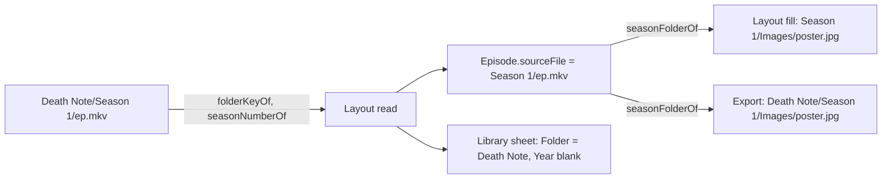

# 64: Rescan a folder

> **Initiative:** `rescan-a-folder`
> **PRD:** `docs/PRDs/64-rescan-a-folder.md` (to be written)
> **Plan:** `docs/PRDs/64-rescan-a-folder-plan.md` (to be written)
> **Handoff:** `docs/handoff/handoff-folder-layout/` (amended)

This log is the `grill-me` session for step 47 of the build order, **Rescan a
folder**, held against the code as it stood on 2026-11-15 (`9219ad9b`). It is
an immutable snapshot of that moment. The session ran alone, and the
maintainer approved every recommendation in advance. Their brief, from
testing the latest release: _after linking a folder, if I add new series and
movies in that already linked folder, then rescan the folder, almost none of
the new movies/series are found. The hard rule of naming a movie/series with
a `(yyyy)` I would like to have optional; same with seasons having an `xx`
format: `Season 1` should also be legit. Only when a movie/series carries the
same name yet is from different years. Simplify this for the end user as much
as possible while keeping a clean data architecture for our CSV and Excel
files for re-exporting/importing. Do this one alone. Keep the codebase
consistent with our naming and code conventions, patterns and architecture._
Log 58 (**Folder layout**) rules wherever this log does not say otherwise;
where they differ, this log rules.

## Background

What exists:

- **The rescan already exists.** _Scan all folders_ re-walks every listed
  **Library folder** (log 54 Q6: _still how a new season dropped into a held
  folder arrives_); held titles are passed by the **Already in library**
  rules and copy nothing. A per-row Scan was rejected twice (log 30 Q16,
  log 54 Q6).
- **The walk reads a root folder only when its name is a Folder key.**
  `media/folderKeyOf/` reads `/^(.+) \((\d{4})\)$/`; anything else is
  `readTitleFolder`'s `left-out` with reason `no-key`, and the walk's only
  trace is the **Layout warning** `⚠ Death Note isn't named Title (Year),
left out`, buried in the Activity log.
- **A series' seasons are read only when named `Season NN`.**
  `media/seasonNumberOf/` reads `/^season (\d{2,})$/i`; `readSeasonFolders`
  passes `Season 1` in silence, so `Death Note/Season 1/` is a folder with no
  video and no Season folder: `empty`, left out too. The client's
  `readSeasonFolder` (movie form) mirrors the rule, held to it by the drift
  guard over `test-support/seasonFolderCases/`.
- **So the rescan "finds almost nothing"**: every new folder the household
  named the way they read it (`Heat`, `Death Note/Season 1`) is left out by
  name. This is the whole of the bug; nothing else in the walk refuses them.
- **The year is already optional everywhere past the name.** `Movie.year` and
  `Series.year` are `number | null`; the importer's `guessedRow`, the sheet's
  `spelledKey` (`readSheet`), the Export's `folderKeyName` (`exportRows`) and
  the Sync's search ladder each already handle a `null` year.
- **FamilyFlix spells `Season NN` itself in three writers**: the **Layout
  fill** (`fillLayout`: a Season poster, a Still, an episode's track), the
  Export's **File plan** (`filePlan.seasonDir`) and the Export's `videoCell`
  for an episode with no **Source file**. The **Library sheet**'s path cells
  come from the **Layout read** of disk (`layoutCells`), so they already name
  whatever folder is there.
- **Matching a sheet row to a folder** (`matchRows`) is by **Folder key**,
  exactly, case folded; a hand-made sheet with no `Folder` cell spells
  `Title (Year)` from its Title and Year cells.

## Problem

Let a rescan find what the household dropped into a linked Library folder
under the names they would naturally give it, a year only where two titles
share a name and `Season 1` as good as `Season 01`, without FamilyFlix ever
writing a second spelling of a folder beside theirs, and without loosening
what the sheet says or how a row finds its folder.

## Questions and Answers

### Scope

1. **One initiative, and what is in it?** ✅ **One**, `rescan-a-folder`,
   step 47, log 64: **the Folder layout's names relaxed**, and every reader
   and writer of them made to agree. ❌ **A Rescan on each Folder row** (the
   checklist's draft): _Scan all folders_ is the rescan, and it now finds
   what it missed; log 30 Q16 and log 54 Q6 stand. ❌ **A removal pass** (a
   held title whose video is gone) and ❌ **left-out folders in the run's
   review**: the brief is _this one alone_. Both move, unchanged, into a
   draft step 48, **Missing videos**, for their own grill-me. With names
   relaxed, the only folders still left out are `empty` and `mixed`, real
   faults a Layout warning already words.

2. **A prototype?** ❌ **No screen changes**: no copy anywhere in the app
   teaches the naming rule, and the run's screen and its warnings are drawn
   as they are. ✅ **The layout's handoff README is amended** (CLAUDE.md:
   amend the prototype first): its tree and rules now say the year is
   optional and `Season 1` is read.

### The Title folder

3. **What names a Title folder now?** ✅ **Any folder directly in the root**
   (system folders, `Meta/` and an Export folder still pass in silence). Its
   name is its **Folder key**, whole and verbatim, as today. A name ending in
   ` (YYYY)` reads its title before the brackets and that year; any other name
   reads as the title itself, year `null`. ❌ **Guessing a title out of a
   release name** (`Die.Hard.1988.1080p` → _Die Hard_, 1988): log 58 Q4's
   _no Title guess_ stands. The folder's name is what the family reads in the
   grid, so the one rule they need is "name the folder as you want to see
   it". A Sync fills the year from TMDB as it fills any empty field.

4. **And a year range, `Severance (2022–)`?** ✅ **Read as its first year.**
   `(2022–)`, `(2022-)`, `(2022–2025)` and `(2022-2025)` read year 2022, so a
   series named the way an Export once named it, or the way a family types
   it, is not read as the title _Severance (2022–)_. FamilyFlix still never
   writes a range into a name (log 58 Q4).

5. **When is the year needed?** ✅ **Only to tell two titles of one name
   apart**, and the disk already enforces it: one Library folder cannot hold
   two folders named `Heat`, so the second is `Heat (1986)`; `Heat` and
   `Heat (1986)` are two Folder keys and two titles. ❌ **FamilyFlix
   requiring it, warning about it or renaming for it**: there is nothing to
   enforce that the filesystem does not.

6. **`folderKeyOf`'s shape?** ✅ **It always answers.**
   `folderKeyOf(name): FolderKey`, `FolderKey.year: number | null`. The
   `no-key` **Left-out reason** and its warning are retired; `placeTitleFolder`
   loses its name check (a Path bridge pick of `E:\Movies\Heat\heat.mkv` now
   records Source folder `Heat`). `spellFolderKey(title, year: number | null)`
   spells `Title` for a `null` year, absorbing `readSheet.spelledKey` and
   `exportRows.folderKeyName`, which each re-wrote it.

### The Season folder

7. **What names a Season folder now?** ✅ **`Season N`, any number of
   digits, case folded**: `Season 1`, `Season 01`, `season 001` are season 1;
   `Season 0` and `Season 00` the specials (`/^season (\d+)$/i`). ❌ **Log
   51's wider spellings** (`Seizoen 1`, `S01`, `Specials`): the brief names
   `Season 1`, and each further spelling is one more rule to test and
   explain; `seasonFolderCases` keeps them answering `null`. The client's
   `readSeasonFolder` mirrors it under the same drift guard.

8. **Two folders claiming one season, `Season 1` and `Season 01`?** ✅ **A
   Doubled place**, as log 61 reads every other: the first by name order is
   read (`Season 01`), the other passed, and the walk words one Layout
   warning, `⚠ Death Note holds 2 Season 1 folders, Season 01 read`.
   `DoubledWhere` gains `{ place: 'season'; season: number }`. ❌ **Merging
   their episodes**: two folders of one number is a fault to fix by hand, and
   a merge would number two videos as one episode.

### What FamilyFlix writes

9. **Which spelling does FamilyFlix write?** ✅ **The household's, where they
   have one.** A season's folder is the folder its episodes lie in, read off
   the first segment of a held episode's **Source file** (`Season 1/ep.mkv` →
   `Season 1`); only a season with none recorded is spelled `Season 01`
   (`spellSeasonFolder`, unchanged). One pure unit,
   `import-export/seasonFolderOf/` → `seasonFolderOf(sourceFiles, season)`,
   answers it for both writers:
   - the **Layout fill**: `HeldSeasonFiles` gains `folder: string`, so a
     Season poster, a Still and a track land in `Season 1/Images/…`, never in
     a new `Season 01/` beside it;
   - the **Export**: each season place carries its season folder, so an
     Export's art lies in the folders its `Video` cells already name, and
     copied back over the Library folder it merges, not doubles.

   ❌ **Reading the disk in the writers**: the stored Source file already
   says it, the Layout fill stays a pure plan over held data, and an Export
   reads no Library folder. ❌ **Normalising to `Season 01` everywhere**: the
   Layout fill would create a second Season folder the next scan reads as a
   Doubled place, and FamilyFlix renames nothing (log 58 Q18).

10. **And the Title folder's name in an Export?** ✅ **Unchanged**: the
    title's Source folder when it has one (`Heat`), else `spellFolderKey`
    (`Heat (1995)`, or `Heat` with no year). Two titles with one Folder key
    are still numbered with a Warning line (`Heat (1)`).

### The sheet

11. **What does the sheet carry?** ✅ **What it carries today.** `Folder` is
    the Title folder's own name (`Heat`), `Year` the title's year (blank, or
    1995 once a Sync fills it), and every path cell what the Layout read
    found (`Death Note/Season 1/Images/poster.jpg`). The Folder key and the
    year are two cells, so an unyeared folder and a yeared title live side by
    side without either being rewritten. No column, row type or Sheet
    dialect changes, so every sheet written before this step reads as it did.

12. **A hand-made row, `Heat` and `1995`, against a folder `Heat`?** ✅
    **Matched by the bare title when the spelled key finds nothing.**
    `matchRows` tries the row's Folder key first, as today; when no folder
    holds it and the row has a year, a folder whose key is the row's title
    alone (`foldFolderKey`) matches, its outcomes (`ambiguous` for two,
    `no-folder` for none) as for any key. ❌ **Matching by title only, always**:
    `Heat (1995)` and `Heat (1986)` both on disk must still be told apart by
    the row's year.

### Units, names and documents

13. **Which units change?** ✅ The table under Design. No migration, no
    route, no wire type, no page.

14. **The tests?** ✅ Table cases first, as log 58 did: `folderKeyOf` (a
    bare name, a year, a range, text after the bracket), `seasonFolderCases`
    (`Season 1`, `Season 001`, `Season 0` now numbered; `Seizoen 1`, `S01`
    still `null`), `seasonFolderOf`; then `readTitleFolder` (a yearless film,
    a `Season 1` series, a doubled season), `walkLibraryFolder` (no `no-key`
    line; the doubled-season line), `fillLayout` and `filePlan` (art written
    into `Season 1/`), `matchRows` (the bare-title fallback, and its refusal
    when the spelled key exists). The dev fixture gains no folder: the cases
    live in the units' own temp folders.

15. **The new terms?** ✅ **Season folder name** (new). Updated: **Folder
    key**, **Title folder**, **Season folder**, **Layout warning**, **Doubled
    place**. Retired: the `no-key` reason.

16. **Which documents change?** ✅ The glossary (Q15); the checklist's step
    47, and a draft step 48 (Q1); the layout handoff README (Q2); the
    docblocks of `folderKeyOf`, `seasonNumberOf`, `readTitleFolder`,
    `walkLibraryFolder`, `placeTitleFolder`, `fillLayout`, `filePlan` and
    `matchRows`. CLAUDE.md's _Dev library_ line still holds: its fixture
    folders stay in the full spelling.

## Design

### Chosen and rejected

- ✅ A name is a Title folder; a trailing `(YYYY)` or range is its year.
  ❌ Title guessing; ❌ the year required.
- ✅ `Season N`, any digits. ❌ `Seizoen`, `S01`, `Specials`.
- ✅ Writers keep the household's season folder via the Source file.
  ❌ Normalising; ❌ disk reads in the writers.
- ✅ A doubled season is a Doubled place. ❌ Merging.
- ✅ Bare-title fallback in `matchRows`. ❌ Title-only matching.
- ❌ A per-row Rescan; ❌ the removal pass (step 48).

### Types

```ts
// server/src/media/folderKeyOf/folderKeyOf.ts
export interface FolderKey {
  name: string;
  title: string;
  year: number | null; // was number
}
/** `Title (YYYY)` or `Title (YYYY–)`/`(YYYY–YYYY)`, dash or en dash. */
const FOLDER_YEAR = /^(.+) \((\d{4})(?:[-–](\d{4})?)?\)$/;
export function folderKeyOf(name: string): FolderKey; // was FolderKey | null
export const spellFolderKey = (title: string, year: number | null): string;

// server/src/media/seasonNumberOf/seasonNumberOf.ts
const SEASON_FOLDER = /^season (\d+)$/i; // was (\d{2,})

// server/src/media/readTitleFolder/readTitleFolder.ts
export type LeftOutReason = 'empty' | 'mixed'; // 'no-key' retired
type DoubledWhere = /* today's */ | { place: 'season'; season: number };

// server/src/import-export/seasonFolderOf/seasonFolderOf.ts
/** A season's folder: its episodes' Source files' first segment, else `Season 01`. */
export function seasonFolderOf(
  sourceFiles: readonly (string | null)[],
  season: number
): string;

// server/src/import-export/fillLayout/fillLayout.ts
export interface HeldSeasonFiles {
  number: number;
  folder: string; // new: the Season folder name
  poster: string | null;
  episodes: HeldEpisodeFiles[];
}

// server/src/import-export/exportRows/exportRows.ts
// each season-scoped ImagePlace, TrackPlace and VideoPlace gains
seasonFolder?: string;
```

### The units

| Unit                                        | Change                                                       |
| ------------------------------------------- | ------------------------------------------------------------ |
| `media/folderKeyOf/`                        | year optional, a range's first year, always answers          |
| `media/seasonNumberOf/`                     | `Season N`, any digits                                       |
| `media/readTitleFolder/`                    | `no-key` retired; a doubled season number is a Doubled place |
| `media/walkLibraryFolder/`                  | `no-key` warning gone; the doubled-season warning            |
| `import-export/placeTitleFolder/`           | no name check                                                |
| `import-export/seasonFolderOf/` (new)       | a season's folder from its Source files                      |
| `import-export/createLayoutFill/`           | builds `HeldSeasonFiles.folder` by `seasonFolderOf`          |
| `import-export/fillLayout/`                 | writes into `season.folder`                                  |
| `import-export/exportRows/`, `filePlan/`    | season places carry and use `seasonFolder`                   |
| `import-export/readSheet/`                  | `spelledKey` → `spellFolderKey`                              |
| `import-export/matchRows/`                  | the bare-title fallback                                      |
| `src/features/movie-form/readSeasonFolder/` | mirrors `Season N`                                           |
| `test-support/seasonFolderCases/`           | the one table moved                                          |



## Implementation Plan

1. **The names read.** `folderKeyOf` and `seasonNumberOf` relaxed,
   `seasonFolderCases` and the client mirror moved, `no-key` retired through
   `readTitleFolder`, `walkLibraryFolder` and `placeTitleFolder`. Demo: drop
   `Heat/heat.mkv` and `Death Note/Season 1/` into the dev Library folder;
   _Scan all folders_ imports both.
2. **The doubled season.** The `season` Doubled place and its warning.
3. **The writers agree.** `seasonFolderOf`; the Layout fill and the Export
   write into `Season 1/`; `spellFolderKey` takes a `null` year. Demo: Sync
   Death Note; its poster lands in `Death Note/Season 1/Images/`, and an
   Export's art lies beside its Video cells.
4. **The sheet matches.** `matchRows`' bare-title fallback.
5. **The documents** (Q16), and a walk in the shell on the dev library.

## Trade-offs

- **Easier:** a family names a folder as they want to read it, and a rescan
  finds it; `Season 1` works; nothing FamilyFlix writes ever doubles a folder
  the household made; the sheet's columns, and every sheet already written,
  are untouched.
- **Harder:** a release-named folder now imports under its release name
  instead of being left out, so the grid can show `Die.Hard.1988.1080p` until
  the folder is renamed or the title edited; a numbered Export duplicate
  (`Heat (1)`) reads back as that title; FamilyFlix's own spelling and the
  household's can differ inside one Library folder.
- **Out of scope:** a per-row Rescan (Q1); a held title whose video is gone,
  and left-out folders in review (draft step 48); Title guessing (Q3); log
  51's other season spellings (Q7); renaming folders to a canonical spelling.
