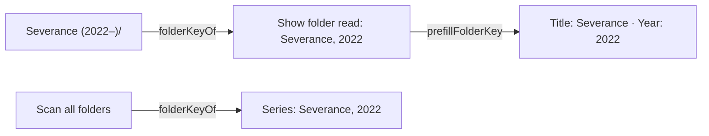

# 65: Show folder title

> **Initiative:** `show-folder-title`
> **PRD:** `docs/PRDs/65-show-folder-title.md` (to be written)
> **Plan:** `docs/PRDs/65-show-folder-title-plan.md` (to be written)
> **Handoff:** `docs/handoff/feat.MovieForm.dc.html` (amended)

This log is the `grill-me` session for step 48 of the build order, **Show
folder title**, held against the code as it stood on 2026-11-16 (`5d90fdf8`).
It is an immutable snapshot of that moment. The session ran alone from issue
626, and the maintainer approved every recommendation in advance, asking that
the codebase stay consistent with its naming, code conventions, patterns and
architecture. Log 64 (**Rescan a folder**) rules wherever this log does not
say otherwise.

## Background

What exists:

- **A scan reads a Title folder's name by `folderKeyOf`** (log 64 Q3, Q4):
  a trailing ` (YYYY)` is the year, a range (`(2022–)`, `(2022-2025)`) its
  first year, and any other name is the title itself, verbatim, year `null`.
  No title is guessed: the folder's name is what the family reads in the grid.
- **The movie form's Show folder pick does not.** `readShowFolder`
  (`server/src/import-export/readShowFolder/`) answers
  `titleGuess: titleGuess(basename(showFolder))`, the importer's older rule
  (`import-export/titleKey/`): dots and underscores read as spaces, **Release
  noise** cut, a trailing `(YYYY)`, `[YYYY]`, bare year or quality tag
  stripped. It strips `(2022)` but not `(2022–)`, so a picked
  `Severance (2022–)/` types _Severance (2022–)_ where _Scan all folders_
  reads _Severance_, 2022. Found by issue 625's closing round, filed as 626.
- **The pick fills the title only.** `useShowFolderPick` calls
  `prefillTitle(read.titleGuess, pickedTitle.current)`; `useMovieForm`'s
  `prefillTitle` fills an empty title, or one the earlier pick filled, and
  never a typed one (log 29 Q19, log 51 Phase 15). The year field is never
  touched, though a key's year is right there.
- **`titleGuess` has one caller**, `readShowFolder`. Its helpers
  `dropReleaseNoise` and `stripTails` also serve `searchQuery`, the Sync's
  **Search query**.
- **The form's other prefill** is `titleFromFilename`, on a picked video's
  file name (movie video slot, first episode file). A file name is not a
  Title folder, so no scan reads it.
- **The wire**: `ShowFolderRead.titleGuess: string` (`src/types/form.ts`),
  read by `useShowFolderPick` for the prefill and as the held refusal's
  fallback title (`Severance is already in your library.`).

## Problem

Make the Show folder pick name a show the way a scan names the same folder,
so the form never types a title the library would not, and settle what the
pick does with the year the name carries and with names the old guess cleaned.

## Questions and Answers

### Scope

1. **One initiative, and what is in it?** ✅ **One**, `show-folder-title`,
   step 48, log 65: the **Show folder read** answers the picked folder's
   **Folder key**, and the form prefills its title and year from it.
   ❌ **`titleFromFilename`**: it reads a video's file name, which no scan
   reads as a title; a release-named file is the norm there and its guess
   is right to clean it. ❌ **Missing videos**: still step 49, its own
   grill-me.

2. **A prototype change?** ✅ **One comment in `feat.MovieForm.dc.html`**:
   _an empty title takes the Title guess_ becomes _an empty title takes the
   folder's title, and an empty year its year, both read as a scan reads
   the folder_. No layout, state or copy the user sees changes: the Year
   field is already drawn beside the title.

### The title

3. **Does the pick read the Folder key?** ✅ **Yes,
   `folderKeyOf(basename(showFolder))`**, the scan's own reader, so a pick
   and a scan of one folder agree, and `Severance (2022–)/` types
   _Severance_. A picked **Season folder** is still titled by its Show
   folder (`showFolderOf`), unchanged.

4. **A name the old guess cleaned, `Severance.S01.1080p.WEB-DL` or
   `Seinfeld 1989`?** ✅ **Typed verbatim, as a scan reads it** (log 64 Q3:
   no Title guess). The title field is a prefill the maintainer can edit
   before Save, and the one rule stays "name the folder as you want to see
   it". ❌ **`titleGuess` over the key's title**: two rules for one folder,
   a pick under a Library folder would title a show unlike the scan of its
   sibling, and the guess drops a bare `1989` as a year it then never fills.
   ❌ **Guessing only outside a Library folder**: a third rule, keyed on
   Link versus Copy, for a case the household's folders do not have.

5. **And `titleGuess` itself?** ✅ **Deleted**, with its test rows: it has
   no caller left. `dropReleaseNoise`, `stripTails` and `RELEASE_NOISE` stay
   for `searchQuery`; `titleKey` is untouched.

### The year

6. **Does the pick fill the year too?** ✅ **Yes**, the key's year as the
   field's text (`String(year)`, `2022` for a range): the folder already
   says it, and a scan of it would store it. A `null` year fills nothing.
   The Sync still fills an empty year from TMDB, as for any field.

7. **Which year does it replace?** ✅ **The title's rule, field by field**:
   the year is filled when it is empty or still the year the earlier pick
   filled, and a typed year always stays. So a second pick of `Heat/` after
   `Heat (1995)/` empties a picked `1995`, and a pick never overwrites what
   the maintainer typed, before or after. ❌ **Title and year as one
   unit** (both replaced or neither): a typed title with an untouched year
   should still take the folder's year.

### The wire and the hook

8. **What does the read answer?** ✅ **`title: string` and
   `year: number | null`** on `ShowFolderRead`, replacing `titleGuess`,
   documented as the picked folder's Folder key. ❌ **A nested
   `folderKey`**: `FolderKey` is the server's (`media/folderKeyOf/`), with a
   `name` the form never needs; two flat fields read as a series' own.

9. **How does the hook hand them to the form?** ✅ `useShowFolderPick`'s
   input `prefillTitle` becomes **`prefillFolderKey(key, picked)`**, both
   `Pick<ShowFolderRead, 'title' | 'year'>` (`picked` `null` before any
   pick), and its ref `pickedTitle` becomes `pickedKey`. `useMovieForm`
   applies Q7 to each field in one `setValues`. The held refusal reads
   `held?.series.title ?? read.title`.

### Units, names and documents

10. **Which units change?** ✅ The table under Design. No migration, no
    route change beyond the answered shape, no page, no new unit.

11. **The tests?** ✅ `readShowFolder`: each `titleGuess` expectation
    becomes `title` and `year`; new rows for `Severance (2022–)` (Severance,
    2022), `Heat` (Heat, `null`) and a release name kept verbatim.
    `routes.showFolder`: the answered shape. `useShowFolderPick` and
    `MovieForm.showFolderTitle`: an empty year filled, a typed year kept, a
    second pick replacing the picked year (and emptying it for a yearless
    folder). `titleKey.test.ts` loses its `titleGuess` table.

12. **The terms?** ✅ No new term. Updated: **Show folder read** (answers the
    Folder key's title and year, no guess), **Title guess** (only
    `titleFromFilename` now), **Show folder pick** (fills the year too).

13. **Which documents change?** ✅ The glossary (Q12); the checklist's step
    48; the prototype comment (Q2); the docblocks of `readShowFolder`,
    `ShowFolderRead`, `useShowFolderPick` and `useMovieForm`'s prefill. Issue
    626 is closed with a comment naming this log; the PRD and its issues
    carry the work.

## Design

### Chosen and rejected

- ✅ The pick reads the Folder key, the scan's own reader.
  ❌ `titleGuess` on top; ❌ a guess only outside a Library folder.
- ✅ The year prefilled, each field by the picked-or-empty rule.
  ❌ Title and year replaced as one.
- ✅ `title` and `year` flat on the wire. ❌ A nested `folderKey`.
- ✅ `titleGuess` deleted. ❌ Touching `titleFromFilename`.

### Types

```ts
// src/types/form.ts
export interface ShowFolderRead {
  path: string;
  /** The picked folder's Folder key: its title, by `folderKeyOf`. */
  title: string; // was titleGuess
  /** Its year, a range's first; `null` for a name without one. */
  year: number | null; // new
  libraryFolderId: string | null;
  heldSeriesId: string | null;
  episodes: ShowFolderEpisode[];
  unplaced: ShowFolderVideo[];
  straySubtitles: number;
}

// src/features/movie-form/useShowFolderPick/useShowFolderPick.ts
type PickedKey = Pick<ShowFolderRead, 'title' | 'year'>;
export interface UseShowFolderPickInput {
  /** Fill each of title and year when empty or still `picked`'s. */
  prefillFolderKey: (key: PickedKey, picked: PickedKey | null) => void; // was prefillTitle
  // plainAdd, holdShowFolder, removeShowFolder, setShowLink unchanged
}
```

```ts
// server/src/import-export/readShowFolder/readShowFolder.ts
const { title, year } = folderKeyOf(basename(showFolder));
// read: { path: dir, title, year, libraryFolderId, ... }
```

### The units

| Unit                                         | Change                                                   |
| -------------------------------------------- | -------------------------------------------------------- |
| `server/src/import-export/readShowFolder/`   | answers `title` and `year` by `folderKeyOf`              |
| `server/src/import-export/titleKey/`         | `titleGuess` deleted                                     |
| `src/types/form.ts`                          | `ShowFolderRead.titleGuess` → `title`, `year`            |
| `src/features/movie-form/useShowFolderPick/` | `prefillFolderKey`, `pickedKey`, refusal by `title`      |
| `src/features/movie-form/useMovieForm/`      | `prefillFolderKey`: title and year, each picked-or-empty |



## Implementation Plan

1. **The read answers the key.** `readShowFolder` and `ShowFolderRead` move
   to `title` and `year`; the hook prefills the title from `title`; the
   refusal reads `read.title`. Demo: pick `Severance (2022–)/` in the shell;
   the title reads _Severance_.
2. **The year is prefilled.** `prefillFolderKey` fills the year by the
   picked-or-empty rule. Demo: the Year field reads 2022; a second pick of
   a yearless folder empties it; a typed year stays.
3. **The guess retires.** `titleGuess` and its test table go; the documents
   (Q13).

## Trade-offs

- **Easier:** a pick and a scan of one folder name one show; the form's
  year is right without a Sync; one rule reads a folder's name everywhere,
  and one heuristic less to keep in step.
- **Harder:** a release-named show folder types its release name into the
  title, to be edited before Save, where the old guess cleaned it; a bare
  `Seinfeld 1989` keeps its number in the title.
- **Out of scope:** `titleFromFilename` (Q1); renaming a picked folder; any
  change to what a pick holds-checks or numbers; Missing videos (step 49).
