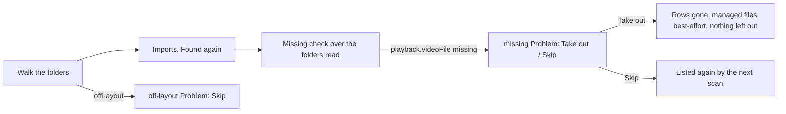

# 66: Missing videos

> **Initiative:** `missing-videos`
> **PRD:** `docs/PRDs/66-missing-videos.md` (to be written)
> **Plan:** `docs/PRDs/66-missing-videos-plan.md` (to be written)
> **Handoff:** `docs/handoff/mol.ProblemRow.dc.html` (amended)

This log is the `grill-me` session for step 49 of the build order, **Missing
videos**, held against the code as it stood on 2026-11-16 (`9388d25b`). It is
an immutable snapshot of that moment. The session ran alone, and the
maintainer approved every recommendation in advance, asking that the codebase
stay consistent with its naming, code conventions, patterns and architecture.
Log 51 (**Library audit**) and log 64 (**Rescan a folder**) rule wherever this
log does not say otherwise.

## Background

What exists:

- **A Missing video is already a term** (log 51 follow-up): a held film whose
  `playback.videoFile` answers `missing`; `unreachable` is not missing. The
  importer reads every held film's video once per run (`missingFilms`) for
  the **Missing video** rule, third in **Already in library**, and a film
  that rule or its folder on record finds is **Found again**. Films only;
  an episode has no Missing video yet.
- **Nothing tells the household a video is gone.** A film whose file was
  deleted from a linked **Library folder** stays in the grid, and pressing
  play is the first anyone hears of it. A series' gone episodes likewise.
- **A folder the Folder layout turns away** (`readTitleFolder`'s `left-out`,
  reason `empty` or `mixed`) is one **Layout warning** line
  (`walkLibraryFolder`'s `WARNING`), seen only by opening the run's
  **Activity log**. Since log 64 these are the only folders a walk leaves
  out, beside the root's loose videos.
- **The Review step** lists **Problems** by kind (`PROBLEM_KINDS`, the
  **Kind filter**, the **Review groups**); `differs`, `ambiguous` and
  `no-row` are settled on the row, every kind can be skipped (**Dismiss**),
  and the presses answer without a confirm.
- **Taking a title out** today is the **Delete** (`DELETE /api/movies/:id`,
  `/series/:id`): rows first, the managed folder best-effort, each linked
  video recorded as a **Left-out video** so the next scan does not bring it
  back. The **Series edit job** removes episodes the same way, its
  `removedPaths` unlinked by `media.removeFile`.
- **Draft step 49** (log 64 Q1) left three open questions: whether a removal
  pass runs on every scan, how a missing episode is drawn against a missing
  film, and whether a renamed or moved file is still Found again first.

## Problem

Let a scan notice what is no longer on disk and list it for the household to
keep or take out of the library, nothing leaving on its own and nothing on
disk touched; and name in the run's review, not only in its log, every folder
the Folder layout still turns away.

## Questions and Answers

### Scope

1. **One initiative, and what is in it?** ✅ **One**, `missing-videos`, step
   49, log 66: the **Missing check** (a held title whose video is gone,
   listed in review) and **Off-layout folders** in review. Both are "what a
   scan saw but could not settle", and both land in the same Review step.
   ❌ **The root's loose videos in review**: **Tidy into folders** owns them,
   and their one line per Library folder stays a warning. ❌ **Doubled
   places in review**: each is read (the first by name), so nothing is left
   unsettled; they stay warnings.

2. **A prototype change?** ✅ **`mol.ProblemRow.dc.html` is amended**: a
   `missing` row's face, its _Take out_ button, and no _Resolve_ on
   `missing` or `off-layout`; `COMPONENT-SPEC.md`'s ProblemRow row says the
   same. The Review step, its tiles, filter and groups are unchanged: the
   new kinds flow through them as every kind does.

### The Missing check

3. **When does it run?** ✅ **On every run that walks Library folders**:
   _Scan new folders_, _Scan all folders_ and a sheet import, once the walk
   and its imports are done and before review. Over the held titles of the
   Library folders the run **read**: a title whose `library_folder_id` is
   one of them. So _Scan new folders_ checks only the new folders' titles,
   and an **Unreachable** folder's titles are never checked.
   ❌ **A separate _Check for missing_ press**: one more button for what a
   rescan is already for. ❌ **The whole library on every run**: a scan of
   one new folder would list titles of folders it never looked at.
   ❌ **On launch, in the background**: a scan is the one place FamilyFlix
   looks at a Library folder.

4. **What counts as missing?** ✅ **A Missing video, film or episode**:
   `playback.videoFile` answers `missing` for the title's video, or for one
   or more of a series' episodes. `unreachable` is never missing. A copied
   title whose original left its Library folder still plays its Managed
   copy, so it is not missing. The **Missing video** term widens to
   episodes; the **Missing video** rule stays films only (log 51).

5. **Is a moved or renamed file Found again first?** ✅ **Yes, by running
   last**: the check reads the disk after every import of the run, so a
   film that its folder on record or the Missing video rule found again
   already plays and is not listed. ❌ **Found again for episodes**: log
   51's _films only_ stands; an episode renamed in its Season folder is
   listed missing, and once taken out, the next _Scan all folders_ reads
   the renamed file afresh.

### The `missing` Problem

6. **What is it?** ✅ **A new Problem kind, `missing`, soft** (the title is
   held), one per title, carrying `movieId` or `seriesId`. Label _Missing_,
   dot `danger` (the title will not play). ❌ **One Problem per episode**: a
   whole show deleted would be 24 rows; the title is what the household
   recognises. ❌ **A screen of its own**: the Review step already lists,
   filters, groups and skips.

7. **Its copy?** ✅ Title: the held title's own title. Reason:
   - a film: _Its video, heat.mkv, is no longer on disk._
   - a series, every episode gone: _None of its 24 episodes' videos are on
     disk._
   - some episodes: _S01E02, S01E03 and S02E01 are no longer on disk._, the
     first three tags in season and episode order, then _and 2 more_.

   And one Warning line each in the Activity log:
   `⚠ Heat (1995) is missing its video`,
   `⚠ Tidewater (2018) is missing 3 episode videos` (spelled by
   `spellFolderKey`).

8. **How is it settled?** ✅ **On the row**, as `differs` is: the face draws
   **Take out**, `Button` `secondary` `sm`, worded _Take out of library_
   for a film or a show with every episode gone, else _Take out 3
   episodes_ (_Take out 1 episode_). _Skip_ keeps it. No _Resolve_: the
   form cannot bring a file back, and a new video is picked from the title's
   own Edit. No confirm: every review press answers at once, the video is
   already gone, and the press is the household's own choice. ❌ **The
   Delete dialog**: its What goes / What stays speaks of files on disk,
   none of which is left, and it has no face for some episodes. ❌ **A Bulk
   _Take out all_**: a destructive press over many titles stays one at a
   time; _Skip all_ (keep all) is offered as for any kind.

9. **What does Take out do?** ✅ **A Delete of what is missing, leaving
   nothing out**:
   - a film: its rows, then its managed folder best-effort, as the movie
     route's `DELETE`;
   - a series with every episode gone: as the series route's `DELETE`;
   - some episodes: their rows (and their tracks by cascade), the files no
     row points at any more unlinked by `media.removeFile`, as the Series
     edit job removes an episode.

   ❌ **Recording a Left-out video**, as a Delete does: there is no file to
   leave out, and if the household puts it back the next scan should bring
   it in, not silently pass it.

10. **And Skip?** ✅ **A Dismiss, nothing remembered**: the next scan lists
    the title again for as long as its video is gone. Nothing leaves on its
    own. ❌ **A kept-missing table**: one more state to explain and to clear
    for a title that still will not play.

11. **The wire?** ✅ `POST /api/import/current/problems/:id/take-out` →
    `importer.takeOutMissing(id): boolean`, `apply`'s precedent: `204` once
    taken out and the Problem off, `404` (the Skip's own) for a Problem not
    there or not `missing`. The importer holds `storage` and `media`, so no
    route learns what a Take out deletes. The client: `ProblemRow`'s
    `onTakeOut`, `ImportReview`'s `onTakeOut(id)`, the **Run hook**'s
    `takeOut`, a feature wire `takeOutMissing` in
    `features/import-export/api/`.

### Off-layout folders

12. **What is one, and how is it drawn?** ✅ **A new Problem kind,
    `off-layout`, hard**, one per root folder the walk turns away (`empty`
    or `mixed`), titled by the folder's own name, its reason the warning's
    words: _Holds no video or Season folder._, _Holds loose videos and
    Season folders._ Label _Off layout_, dot `textFaint`. _Skip_ only: the
    fix is on disk, and the next scan reads the folder once it is. The
    Layout warning line stays in the log. ❌ **Reusing `no-video`**: that is
    a Sheet row matched to a folder, its Resolve prefilled from the row.
    ❌ **Resolve into the form**: a `mixed` folder is neither a film nor a
    show until it is sorted.

13. **How does the walk answer it?** ✅ **Structurally, beside the
    warnings**: `LayoutWalk.offLayout: OffLayoutFolder[]`, each
    `{ dir, name, reason: LeftOutReason }`, so the importer files a Problem
    without reading a warning's text. Every run files them again while the
    folder stays off layout.

### Units, names and documents

14. **Which units change?** ✅ The table under Design. No migration; one
    route; no page.

15. **The tests?** ✅ `walkLibraryFolder`: `offLayout` for an empty and a
    mixed folder. `createImporter` (a `missingCheck` suite): a gone film
    listed, a Found again film not listed, an unreachable folder's titles
    not listed, a new-folders scan not listing an unwalked folder's title,
    a series with some and with all episodes gone, `takeOutMissing` for
    each, and no Left-out video recorded; an `off-layout` Problem per
    folder. `routes`: `take-out`'s `204` and `404`. Client: `ProblemRow`'s
    face and labels, `ImportReview` reporting `onTakeOut`, the Run hook's
    redraw, `importView`'s hard kinds.

16. **The terms?** ✅ New: **Missing check**, **Take out**, **Off-layout
    folder**. Updated: **Missing video** (episodes too), **Problem** (the two
    kinds), **Layout warning** (an empty or mixed folder is also a Problem).

17. **Which documents change?** ✅ The glossary (Q16); the checklist's step
    49; the ProblemRow prototype and `COMPONENT-SPEC.md` (Q2); the
    docblocks of `walkLibraryFolder`, `PROBLEM_KINDS`, `ImportProblem`,
    `ProblemRow` and `ImportReview`.

## Design

### Chosen and rejected

- ✅ The Missing check on every run, over the folders it read, after its
  imports. ❌ A separate press; ❌ the whole library; ❌ on launch.
- ✅ One soft `missing` Problem per title. ❌ One per episode; ❌ a screen.
- ✅ Take out on the row, no confirm, nothing left out. ❌ The Delete
  dialog; ❌ a bulk Take out; ❌ a Left-out video.
- ✅ Skip keeps, nothing remembered. ❌ A kept-missing table.
- ✅ A hard `off-layout` Problem per folder, Skip only. ❌ Reusing
  `no-video`; ❌ Resolve; ❌ loose videos or Doubled places as Problems.

### Types

```ts
// src/types/import.ts
export const PROBLEM_KINDS = [
  'no-folder',
  'ambiguous',
  'no-video',
  'no-row',
  'failed',
  'unplaced',
  'off-layout', // new, hard
  'missing-meta',
  'differs',
  'missing', // new, soft
] as const;

export interface ImportProblem {
  // ...unchanged; `missing` carries movieId or seriesId
  /** Set on a `missing` Problem: the press's words, `Take out 3 episodes`. */
  takeOut?: string;
}

// server/src/media/walkLibraryFolder/walkLibraryFolder.ts
export interface OffLayoutFolder {
  dir: string;
  name: string;
  reason: LeftOutReason;
}
export interface LayoutWalk {
  titles: WalkedTitle[];
  warnings: string[];
  offLayout: OffLayoutFolder[]; // new
  sheet: string | null;
}

// server/src/import-export/createImporter/createImporter.ts
export interface Importer {
  // ...
  /** Take out a `missing` Problem's title or episodes; `false` for none. */
  takeOutMissing(id: string): boolean;
}

// server/src/library/series/write/write.ts
/** Delete these episodes; the paths no row points at any more. */
removeEpisodes(seriesId: string, episodeIds: readonly string[]): string[];
```

### The units

| Unit                                       | Change                                                    |
| ------------------------------------------ | --------------------------------------------------------- |
| `src/types/import.ts`                      | `off-layout`, `missing`; `ImportProblem.takeOut`          |
| `server/src/media/walkLibraryFolder/`      | answers `offLayout` beside the warnings                   |
| `server/src/import-export/createImporter/` | files `off-layout`; the Missing check; `takeOutMissing`   |
| `server/src/library/series/write/`         | `removeEpisodes`                                          |
| `server/src/routes/`                       | `POST /import/current/problems/:id/take-out`              |
| `src/features/import-export/api/`          | `takeOutMissing`                                          |
| `src/features/import-export/useImportRun/` | `takeOut`, the row off on `204`                           |
| `src/features/import-export/ProblemRow/`   | the `missing` face; no Resolve on `missing`, `off-layout` |
| `src/features/import-export/ImportReview/` | `onTakeOut`                                               |
| `src/features/import-export/importView/`   | labels and the hard kinds                                 |



## Implementation Plan

1. **A gone film is listed.** The Missing check over films, the soft
   `missing` kind, its reason and warning line, the row with Skip. Demo:
   delete `Die Hard (1988)/` from the dev Library folder; _Scan all
   folders_ lists _Die Hard_ under _Missing_.
2. **Take out a film.** `takeOutMissing`, the route, the row's _Take out of
   library_. Demo: press it; Die Hard leaves the grid; put the folder back
   and the next scan imports it.
3. **Gone episodes.** The check over episodes, the folded reason,
   `removeEpisodes`, _Take out N episodes_. Demo: delete one of
   `Tidewater (2018)/Season 01/`'s videos.
4. **Off-layout folders.** `LayoutWalk.offLayout` and the hard
   `off-layout` kind. Demo: an empty `Heat/` is listed under _Off layout_.
5. **The documents** (Q17), and a walk in the shell on the dev library.

## Trade-offs

- **Easier:** the household learns from a rescan what they deleted, and
  takes it out with one press per title; a renamed or moved film is found
  again before anyone is asked; every folder a scan could not read is
  named where the household looks.
- **Harder:** a title kept on purpose (a film on a drive that is sometimes
  reorganised) is asked about on every scan; a renamed episode is listed
  missing rather than found again; an empty folder left on disk on purpose
  is listed every scan until it is removed or filled.
- **Out of scope:** loose root videos and Doubled places in review (Q1);
  Found again for episodes (Q5); remembering a kept title (Q10); a bulk
  Take out (Q8); a missing title drawn in the grid or on its detail page.
