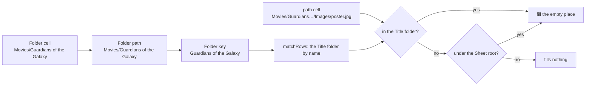

# 67: Export paths

> **Initiative:** `export-paths`
> **PRD:** `docs/PRDs/67-export-paths.md` (to be written)
> **Plan:** `docs/PRDs/67-export-paths-plan.md` (to be written)
> **Handoff:** none; no screen changes, and no prototype is amended

This log is the `grill-me` session for step 50 of the build order, **Export
paths**, held against the code as it stood on 2026-11-17 (`548d75a5`). It is
an immutable snapshot of that moment. The session ran alone, and the
maintainer approved every recommendation in advance, asking that the codebase
stay consistent with its naming, code conventions, patterns and architecture.
Logs 58 (**Folder layout**), 59 and 61 (**Export round trip**) rule wherever
this log does not say otherwise. The step's draft in the checklist (its
_What happened_, two bugs, one _seen beside_ and one side effect) is this
log's starting point.

## Background

Testing v0.16.1 on the real library (`D:\Movies`, its `Movies\` and `Series\`
then linked as two Library folders): an Export taken while `D:\Movies` itself
was the Library folder, uploaded after the library was emptied, matched one
title. What the code does today:

- **A Source folder is spelled by `path.relative`.** `placeTitleFolder`,
  `filmSourceOf`, `importShow`, `heldShow` and `readShowFolder` each record
  or look up `relative(libraryFolder.path, dir)`: native separators. Since
  log 58 every placer takes only a **Title folder** lying directly in the
  root, so a new Source folder is one segment; a library imported before log
  58 (the descending scan rule) still holds Source folders like
  `Movies\Guardians of the Galaxy`. A **Source file** is already spelled with
  `/` (`sourceFileOf`).
- **Both sheets write the Source folder whole.** `exportRows`'
  `titleFolderOf` takes `sourceFolders.get(id)` verbatim (log 61 Q3), so the
  Export's `Folder` cell is `Movies\Guardians of the Galaxy`, its path cells
  `Movies\Guardians of the Galaxy/Images/poster.jpg`, and `copyPlanned`
  writes the Title folder a level deep in the **Export folder**.
- **A row matches by the whole cell.** `matchRows`' `foldersFor` compares a
  scanned Title folder's own name against `row.folder`; a key with a segment
  before it never matches, and the bare-title fallback saves only a title
  whose folder is spelled exactly as its title.
- **A path cell is read against the Library folder only.** `readSheet`'s
  `isContained` blanks a cell whose segment holds a backslash; a contained
  cell is resolved by `resolvePathCell` (the first segment swapped for the
  matched folder's name) under the matched Title folder, in `matchRows`'
  `resolvedRow` and again in `pathCellFills`. An Export's cells name its own
  copies, relative to the Export folder, where nothing is looked for.
- **The Import route takes a sheet path** (`importer.start(sheetPath, …)`),
  and an Export writes its sheet as `Meta/familyflix-library.<csv|xlsx>`,
  so where an uploaded sheet lies is known to the run.
- **A Resolve sends Copy.** `useImportMode` draws the **Import mode** and
  reads a picked video's path through the **Path bridge** only on a plain
  add; a Resolve always uploads its picked video's bytes, so a `no-folder`
  row resolved by a pick in a Link run copies the film into the **Managed
  media directory**. The server already places a **Found file** by the run's
  mode (`placeFoundVideo(…, current.mode)`).

## Problem

Make the **Export round trip** hold for any library shape: a library whose
Source folders lie a level deeper than its Library folder's root, exported,
emptied and fed its own Export (uploaded, or copied over its Library folders),
gives every title back with no Problem and every poster set, and a Resolve
in a Link run links.

## Questions and Answers

### Scope

1. **One initiative, and what is in it?** ✅ **One**, `export-paths`, step
   50, log 67: the two bugs, the side effect, and the separator. All four
   are "the round trip breaks on a path", found by one test on one library.
   ❌ **Loose art in a Title folder** (the draft's _seen beside_): Q14.

2. **What proves it?** ✅ **Each bug's RED test**, the **Round trip** and
   **Export round trip** tests kept green, and one route test of the
   maintainer's case: a library holding titles at `Movies/<title>` under one
   Library folder is exported; the library is Factory reset, the inner
   folder linked, and the Export's sheet uploaded from its `Meta/` folder:
   every title is back, no Problem, every poster set. A second fixture keeps
   an Export from v0.16.1 (backslash keys, nested folders) as it was written,
   so the sheets already in the household's hands are read too.

### The Source folder's spelling

3. **How is a Source folder spelled?** ✅ **With `/` on every platform**,
   as a Source file already is: one `sourceFolderOf(root, dir)` beside
   `placeTitleFolder` (in its folder, as `sourceFileOf` lives beside
   `placeFilmFolder`), `relative(root, dir).split(sep).join('/')`, called by
   every site that records or looks one up (`placeTitleFolder`,
   `filmSourceOf`, `importShow`, `heldShow`, `readShowFolder`'s
   `heldSeriesAt`). Today every new Source folder is one segment, so this
   changes no value written; it makes the rule one spelling.

4. **And the Source folders already stored with `\`?** ✅ **Left as they
   are; every reader splits on both.** Only a pre-log-58 import wrote a
   Source folder of two segments, no placer can write one now, and the one
   place their spelling matters is the Folder key (Q5), which splits on `/`
   and `\` alike. ❌ **A migration rewriting `\` to `/`**: on Linux a
   backslash is a legal name character, and a migration cannot know which
   platform wrote the row; it buys nothing Q5 does not.

### The Folder key a sheet writes

5. **Which Folder key does a title with a deep Source folder get?** ✅ **Its
   Title folder's own name: the Source folder's last segment**, in both
   sheets, so log 61 Q3's one rule stands with one more step:
   `titleFolderOf` answers `titleFolderName(sourceFolder)`, a pure helper in
   `media/folderKeyOf/` beside `foldFolderKey` (split on `/` and `\`, the
   last segment). The **Folder layout** puts every Title folder in the root,
   so an Export lays `Movies/Guardians of the Galaxy` out as
   `Guardians of the Galaxy/` and copied over a re-linked
   `D:\Movies\Movies` it lands where a scan reads it. Two titles whose last
   segments fold equal are numbered `(1)`, `(2)` with their Warning line, as
   any clash is (log 61 Q4). ❌ **The whole Source folder with `/`**: the
   Export keeps a shape the layout does not read, and a copy over a Library
   folder lands a level too deep, the draft's bug. ❌ **Spelling it from the
   title**: log 61's bug.

6. **And the Library sheet's path cells for such a title?** ✅ **Relative to
   the folder holding its Title folder**, so every path cell starts with its
   row's Folder key whatever the depth. `createLibrarySheet` reads each
   recorded Title folder where it lies (`join(root, sourceFolder)`, as
   today) and keys the read by its Folder key; `layoutCells` makes each cell
   relative to the read's parent rather than the Library folder. For a
   title in the root the two are the same folder, and the **Round trip**
   stays byte for byte.

### Reading a Folder cell

7. **How does the reader read a `Folder` cell?** ✅ **As a path: `\` read as
   `/`, its last segment the Folder key, the whole the row's Folder path.**
   `SheetRow.folder` stays the **Folder key**; a new `SheetRow.folderPath`
   holds the cell's segments joined by `/` (`Movies/Guardians of the
Galaxy`; equal to `folder` for every sheet written from now on). A sheet
   is a document that travels between platforms, and FamilyFlix's own
   wrote `\` until this step. Duplicate rows (`rowKey`) are told apart by
   the Folder path's fold. ❌ **Matching the whole cell against a folder's
   path under its Library folder**: a Title folder now lies in the root, so
   the cell's parents name a Library folder that is no longer one.

8. **How is a row matched, then?** ✅ **Unchanged, by its Folder key**:
   `foldersFor` compares a scanned Title folder's name with `row.folder`,
   now the last segment, so `Movies\Guardians of the Galaxy` finds
   `Guardians of the Galaxy/` in whichever Library folder it lies. Two such
   folders stay `ambiguous`. ❌ **Widening the bare-title fallback**
   (`Vol 2` for `Vol. 2/`, a `(2016)` folder for a yearless row): a match is
   never fuzzy (log 13); the Export now writes the folder's own name, so the
   fallback is not on the round trip's road.

### Reading a path cell

9. **When is a path cell contained?** ✅ **When it lies under its row's
   Folder path**: `\` read as `/` first, then the leading segments fold
   equal to the Folder path's, no segment empty, `.` or `..`, none holding a
   colon, and the last naming its column's kind. A cell of a sheet written
   from now on starts with its one-segment Folder key, as today; a v0.16.1
   Export's `Movies\Guardians of the Galaxy/Images/poster.jpg` reads as
   `Movies/Guardians of the Galaxy/Images/poster.jpg` under the Folder path
   `Movies/Guardians of the Galaxy`. ❌ **Keeping the backslash refusal**:
   it blanks every cell FamilyFlix itself wrote on Windows; reading `\` as a
   separator before the segment checks keeps `..\` out all the same.

10. **Where is a path cell's file looked for?** ✅ **In two places, in
    order, the read always winning first**:
    1. **In the matched Title folder**: the Folder path's segments replaced
       by the folder's own path (`resolvePathCell(dir, folderPath, cell)`,
       log 61 Q12's rule, widened from one segment to the Folder path);
    2. **Under the Sheet root**: the cell joined as written to the folder
       the sheet's paths are relative to.

    The first file that is there fills the empty place, as today; a cell
    naming nothing in either fills nothing. ❌ **The Sheet root first**:
    the Title folder is the household's own, and an uploaded Library
    sheet's root is that same Library folder.

11. **What is the Sheet root?** ✅ **The folder holding the sheet's `Meta/`
    folder when the sheet lies in one, else the sheet's own folder**:
    `sheetRootOf(sheetPath)`, pure, in `import-export/sheetRootOf/`. For a
    Library sheet it is its Library folder, for an Export's sheet its
    Export folder, for a hand sheet beside its Title folders that folder. A
    Folder scan's Meta sheet is resolved the same way, so nothing differs
    for it. ❌ **Asking for the Export folder on the Setup step**: one more
    field the prototype does not draw, for what the sheet's path already
    says.

12. **Who resolves the cells?** ✅ **`pathCellFills` alone.** `matchRows`
    stops resolving (`resolvedRow` goes; a **Match** carries its row as
    read), and `filmWithCells` and `showWithCells` take the run's Sheet root
    and resolve each cell by Q10, so the `isAbsolute` pass-through goes too.
    Matching is matching, and one unit reads a cell's file. The `Video`
    cell is never read, as today.

13. **And an Export copied over a Library folder?** ✅ **Q5 is the whole
    answer**: an Export written from now on is in the Folder layout, flat.
    ❌ **Reading a v0.16.1 Export's nested folders as copied**: those
    folders are the Export's, not the library's; its sheet uploaded (Q11)
    is the road back, and the household can move the inner folders up by
    hand.

### Loose art

14. **Does a loose `poster.jpg` beside the video count?** ❌ **No, the
    Folder layout stays one shape.** The **Layout read** takes art only from
    `Images/`, as log 58 settled; the round trip no longer needs loose art,
    since the Export carries the posters under `Images/` and Q10 reads them
    back, and the **Layout fill** then writes each into its Title folder's
    empty `Images/` place. Reading loose art is a spec change to the Folder
    layout and would make every Doubled place rule (log 61 Q8) ask which of
    two places wins. Out of scope; not filed.

### The Resolve's picked video

15. **What does a Resolve send for a picked video in the shell?** ✅ **Its
    path, as an add does, when it lies under a Library folder**: the
    **Movie form** reads a Resolve's picked video through the **Path
    bridge** and asks the containing read, as `useImportMode` does for a
    plain add; under a Library folder it travels as a **Found file**, which
    the server already places by the run's **Import mode**
    (`placeFoundVideo`), so a Link run links it. Under none, or in a
    browser, it uploads its bytes and is copied, as today. The Import mode
    control stays undrawn on a Resolve: the run's mode is the choice. No
    server change. ❌ **Drawing the Import mode on a Resolve**: the run
    already chose, and the prototype draws none.

### Units, names and documents

16. **The new terms?** ✅ **Sheet root**, **Folder path**. Updated: **Source
    folder** (spelled with `/`), **Folder key** (a Folder cell's last
    segment), **Sheet columns** (path cells under the Folder path, read
    against the Title folder then the Sheet root), **Export round trip**
    (any library shape), **Resolve** (a shell pick under a Library folder
    travels as its path).

17. **Which documents change?** ✅ This log; the glossary (Q16); the
    checklist's step 50. The docblocks of every unit in the table below.
    CLAUDE.md is untouched: the writers into a Library folder are still the
    two it names, and the Movie form rule ("in the shell an add links by
    default") now holds for a Resolve's pick too without a new sentence. No
    prototype is amended: nothing drawn changes.

## Design

### Chosen and rejected

- ✅ Source folders spelled with `/` by one `sourceFolderOf`; ❌ a migration
  of stored `\`.
- ✅ A sheet's Folder key is the Title folder's own name, the Export laid
  out flat; ❌ the whole Source folder, ❌ spelled from the title.
- ✅ A Folder cell read as a Folder path, `\` as `/`, matched by its last
  segment; ❌ a widened bare-title fallback.
- ✅ A path cell looked for in the Title folder, then under the **Sheet
  root**; ❌ the Sheet root first, ❌ an Export folder field.
- ✅ A Resolve's shell pick under a Library folder travels as its path; ❌
  the Import mode drawn on a Resolve.
- ❌ Loose art read (Q14).

### Types

```ts
// server/src/import-export/placeTitleFolder/placeTitleFolder.ts
/** A **Source folder**: `dir` relative to its Library folder `root`, with `/` whatever the platform. */
export const sourceFolderOf = (root: string, dir: string): string =>
  relative(root, dir).split(sep).join('/');
```

```ts
// server/src/media/folderKeyOf/folderKeyOf.ts
/** A **Source folder**'s or **Folder path**'s Title folder name: its last segment, `/` or `\`. */
export const titleFolderName = (path: string): string =>
  path
    .split(/[\\/]/)
    .filter((segment) => segment !== '')
    .at(-1) ?? path;
```

```ts
// server/src/import-export/readSheet/readSheet.ts
export interface SheetRow {
  // …
  /** The **Folder key**: the `Folder` cell's last segment. */
  folder: string;
  /** The **Folder path**: the `Folder` cell's segments joined by `/`. */
  folderPath: string;
}
```

```ts
// server/src/import-export/sheetRootOf/sheetRootOf.ts
/** The **Sheet root**: the folder holding the sheet's `Meta/` folder, else the sheet's own. */
export function sheetRootOf(sheetPath: string): string;
```

```ts
// server/src/import-export/readSheet/readSheet.ts
/** A path cell in the matched Title folder `dir`: its Folder path replaced by `dir`. */
export function resolvePathCell(
  dir: string,
  folderPath: string,
  cell: string
): string;
```

```ts
// server/src/import-export/pathCellFills/pathCellFills.ts
export function filmWithCells(
  scan: FilmScan,
  row: SheetRow,
  sheetRoot: string
): Promise<FilmScan>;
export function showWithCells(
  show: ShowScan,
  row: SheetRow,
  rows: readonly SheetRow[],
  sheetRoot: string
): Promise<ShowScan>;
```

### The units

| Unit                 | Where                                          | Change                                                                     |
| -------------------- | ---------------------------------------------- | -------------------------------------------------------------------------- |
| `placeTitleFolder`   | `server/src/import-export/placeTitleFolder/`   | `sourceFolderOf`; its own Source folder by it                              |
| `placeFilmFolder`    | `server/src/import-export/placeFilmFolder/`    | `filmSourceOf` by `sourceFolderOf`                                         |
| `readShowFolder`     | `server/src/import-export/readShowFolder/`     | `heldSeriesAt` asked by `sourceFolderOf`                                   |
| `folderKeyOf`        | `server/src/media/folderKeyOf/`                | `titleFolderName`                                                          |
| `exportRows`         | `server/src/import-export/exportRows/`         | `titleFolderOf` by `titleFolderName`                                       |
| `createLibrarySheet` | `server/src/import-export/createLibrarySheet/` | each read keyed by its Folder key                                          |
| `layoutCells`        | `server/src/import-export/layoutCells/`        | cells relative to each read's parent                                       |
| `readSheet`          | `server/src/import-export/readSheet/`          | `SheetRow.folderPath`; `\` as `/`; containment under it; `resolvePathCell` |
| `sheetRootOf`        | `server/src/import-export/sheetRootOf/`        | new, pure                                                                  |
| `matchRows`          | `server/src/import-export/matchRows/`          | `resolvedRow` goes                                                         |
| `pathCellFills`      | `server/src/import-export/pathCellFills/`      | Title folder, then Sheet root                                              |
| `createImporter`     | `server/src/import-export/createImporter/`     | `sourceFolderOf` at its two sites; the Sheet root handed to the fills      |
| `useImportMode`      | `src/features/movie-form/useImportMode/`       | a Resolve's pick read and asked, its mode the run's                        |

### A path cell's road



## Implementation Plan

1. **The Export's art back from its sheet.** `sheetRootOf`, `folderPath`,
   the backslash read as a separator, containment under the Folder path,
   `pathCellFills` reading the Sheet root, `resolvedRow` gone. Demo: the
   v0.16.1 Export fixture's sheet, uploaded over a re-linked inner folder,
   matches every title by its Folder key and fills every poster.
2. **The Export writes the layout.** `titleFolderName`, `titleFolderOf`,
   the Library sheet's reads and `layoutCells`. Demo: a library holding
   `Movies/<title>` Source folders exports flat, `Folder` cells one segment,
   and the folders copied over the inner folder scan back whole.
3. **One spelling for a Source folder.** `sourceFolderOf` at every site.
   Demo: no change in behaviour; the unit's own test pins `/`.
4. **The Resolve links.** `useImportMode` on a Resolve. Demo: a `no-folder`
   row resolved by picking its video in a Link run keeps its Library folder.
5. **The documents** (Q17).

## Trade-offs

- **Easier:** every Export the household holds, the v0.16.1 ones included,
  gives the library back from its sheet; a new Export is in the Folder
  layout whatever shape the library was in; a sheet from Windows reads on
  Linux and back. Matching stays exact.
- **Harder:** a sheet's art can now come from outside the Library folders,
  from wherever the sheet lies, so an uploaded sheet's folder is read as
  well as the library's; it is read-only and its files are copied into
  managed storage like any art. Two deep titles sharing a last segment now
  number apart in the Export where their whole paths did not clash.
- **Out of scope:** loose art (Q14); fuzzy matching for hand-typed keys
  (Q8); reading a v0.16.1 Export's nested folders copied over a Library
  folder (Q13); migrating stored Source folders (Q4).
