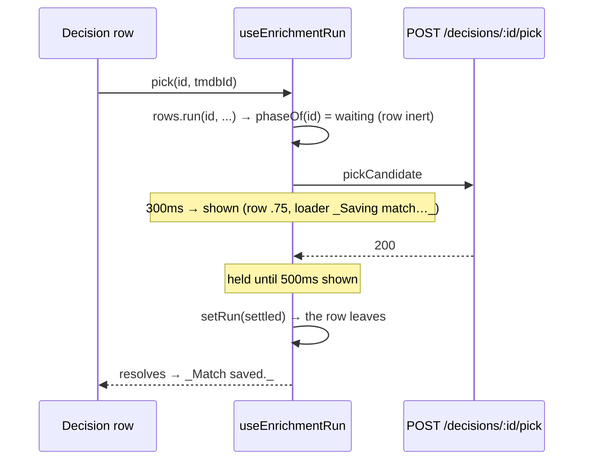

# 69: Silent waits

> **Initiative:** `silent-waits`
> **PRD:** `docs/PRDs/69-silent-waits.md` (to be written)
> **Handoff:** `docs/handoff/handoff-loading-states/`, read as received; no
> prototype is amended

This log is the `grill-me` session for step 51 of the build order, **Silent
waits**, held against the code as it stood on 2026-11-19 (`e566dd90`) and the
audit the checklist records under step 51. It is an immutable snapshot of
that moment. Log 53 (**Loading states**) rules wherever this log does not say
otherwise. The session ran alone, and the maintainer approved every
recommendation in advance, asking that the codebase stay consistent with its
naming, code conventions, patterns and architecture.

## Background

Log 53 gave every form and dialog press the **Loader timing**
(`useDelayedBusy`), the **Busy button** and the **Dialog loader**. The audit
of 2026-11-19 found the presses it never reached, each one a **Silent wait**:
the press waits on the server with nothing drawn, and can be pressed again.
What the code does today:

| Spot                         | Today                                                                                                                                                                      |
| ---------------------------- | -------------------------------------------------------------------------------------------------------------------------------------------------------------------------- |
| Sync review, Decision row    | `pick`, `apply`, `dismiss`, `search` in `useEnrichmentRun` await the route, then `setRun`; `EnrichmentFlow` swallows a refusal. The row draws nothing and stays pressable. |
| Sync review, _Skip all_      | `skipMany` the same; the ghost button stays live                                                                                                                           |
| Sync review, Season choice   | `chooseSeasonPoster` the same; the poster stays pressable                                                                                                                  |
| Start sync / _Fetch details_ | `start` in `useEnrichmentRun`, `void`ed by `onStart`; the button stays live until the first snapshot                                                                       |
| Import review, Problem row   | `skip`, `apply`, `pick`, `importAsGuessed`, `takeOut` in `useImportRun`, the same shape                                                                                    |
| Import review, bulk          | `skipMany`, `importManyAsGuessed` the same                                                                                                                                 |
| _Start import_               | disabled only while the form is unfilled                                                                                                                                   |
| Library folders, Folder row  | `remove` and `bringBack` in `useLibraryFolders` await the route; the ✕ and _Bring back_ stay live                                                                          |
| _Scan new / all folders_     | `useFolderScan`'s `scanning: boolean` disables both at once; no label                                                                                                      |
| Edit form                    | `loadFormRecord(job)` fills the form when it lands; until then the add's empty face, _Add a movie_ and _Add to library_                                                    |
| Show folder pick             | after the dialog closes, `readShowFolder` runs with nothing drawn                                                                                                          |

Two facts shape most answers. `useDelayedBusy` holds one phase, but a review
has many rows, each pressable on its own. And every run hook settles a row
in the same breath as its request (`await route; setRun(...)`), so the hold
that **Loader timing** puts before an outcome has nowhere to sit unless the
timing wraps the request inside the hook.

## Problem

Make every press in the audit say at once that it is locked, and after 300ms
that it is working, in a face the loading-states handoff already draws, with
one statement of the timing rule and no new prototype.

## Questions and Answers

### Scope

1. **One initiative?** ✅ **One**, `silent-waits`, step 51, log 69: every spot
   in the table above. ❌ Not built here: anything the audit lists as
   **Already covered**; a failure line on a refused row press (today's silent
   refusal stays: the row returns to its idle face, pressable again; a
   **Silent wait** is about the wait, and a failure face would want its own
   prototype); server-reported progress for any of these presses.

2. **Is a prototype amended?** ✅ **No.** Each face below is one the
   loading-states handoff already draws: the **Busy button**, its _Inside a
   row_ loader (handoff table row 5: an 18px `inline` **Logo loader** in the
   row's status slot, the row at opacity .75, its controls locked) and the
   **Skeleton**. The handoff's _Not used here: Import and TMDB enrichment_ is
   read as the running screens, which have their live log; a review press
   comes after that log is done and draws in the row, never beside the log.
   Log 53 Q14 dropped row 5 only because its one caller, Manage library's
   _Sync with TMDB_, leaves the row.

### The row

3. **What does a row or card press draw?** ✅ **A Busy row**, the handoff's
   row 5. From the press (`waiting`) the row is locked: `inert`, so every
   control in it (candidate cards, the **Folder picker**, the field diff,
   the title search, _Skip_) is out of reach with its own face kept, and
   `aria-busy`. Once **Shown**, the row is at opacity .75 and an 18px
   `inline` `LogoLoader` with its label stands in the row's status slot.
   ❌ A **Busy label** on the pressed control: the checklist's wording, but a
   Busy label is a button's, and most row presses are cards, not buttons.
   ❌ The grey `disabled` face: log 53 Q9, it says unavailable, not working.

4. **Which slot?** ✅ **The status slot, per row**: the Decision row's and
   the Problem row's kind `Dot`; the **Folder row**'s line (_N titles_), the
   row having no dot; a **Season choice**'s held-poster caption. The slot's
   own content returns when the row goes back to `idle`.

5. **What does the loader say?** ✅ **The press's _-ing_ words**, in the
   app's voice (log 53 Q3), chosen by the row from the press it reported:

   | Row           | Press                                                                                          | Label                                                                           |
   | ------------- | ---------------------------------------------------------------------------------------------- | ------------------------------------------------------------------------------- |
   | Decision row  | a candidate / _Search_ / _Apply choices_ / _Skip_, _Keep all mine_                             | _Saving match…_ / _Searching TMDB…_ / _Updating details…_ / _Skipping…_         |
   | Problem row   | a candidate folder / _Import as “…”_ / _Apply choices_ / _Take out…_ / _Skip_, _Keep all mine_ | _Importing…_ / _Importing…_ / _Updating details…_ / _Taking out…_ / _Skipping…_ |
   | Folder row    | ✕ / _Bring back_                                                                               | _Removing…_ / _Bringing back…_                                                  |
   | Season choice | a poster                                                                                       | _Saving poster…_                                                                |

   Which press it was is the row's own state, as which choice was pressed is
   already `SeasonChoices`' own; the phase is the hook's.

6. **The prototype's _Searching TMDB…_ snackbar?** ✅ **Kept.** It is the
   prototype's (`FamilyFlix.dc.html`, `searchEnrich`), and the Product Rule
   keeps a snackbar wherever the prototype draws one; it comes at once, the
   row's loader only past 300ms. ❌ Dropping it: amends the prototype for no
   gain.

### Timing

7. **Who owns a row's phase?** ✅ **The hook that owns the request**:
   `useEnrichmentRun`, `useImportRun`, `useLibraryFolders`. Each wraps the
   route call, and only the route call, in the timing, and settles the row
   (`setRun`, `setFolders`) after the promise, so the row leaves or redraws
   after the hold, and a snackbar (_Match saved._) follows it too (log 53
   Q7). ❌ The row wrapping its own press: the row would leave mid-hold,
   the flicker the 500ms exists to prevent.

8. **One phase, many rows?** ✅ **A keyed sibling of `useDelayedBusy`**,
   `useDelayedBusyByKey` in `src/hooks/useDelayedBusyByKey/` (two features
   use it), keyed by a row's id:

   ```ts
   // src/hooks/useDelayedBusyByKey/useDelayedBusyByKey.ts
   export interface DelayedBusyByKey {
     /** A key's **Busy phase**: `idle` for any key not running. */
     phaseOf: (key: string) => BusyPhase;
     run: <T>(key: string, work: () => Promise<T>) => Promise<T>;
   }
   export function useDelayedBusyByKey(): DelayedBusyByKey;
   ```

   The rule itself stays stated once: the body of `useDelayedBusy.run` moves
   to an exported `onLoaderTiming(work, setPhase)` beside it, which both
   hooks call. `SHOW_AFTER_MS` and `MIN_SHOWN_MS` stay where they are.
   ❌ A phase map inside each run hook: three copies of the timing.
   ❌ Locking the whole review on any press: rows are independent, and log
   42 (**Review at scale**) is about working down many of them quickly.

9. **What do the hooks answer?** ✅ **`rowPhase(id)`** on each of the three,
   the same name in all, plus `seasonPhase(season)` on `useEnrichmentRun`
   (a second keyed instance, keyed by `String(season)`). A run hook's row
   methods keep their signatures and still reject on a refusal.

### Bulk and start presses

10. **_Skip all_ and _Import all as guessed_?** ✅ **Busy buttons**, each on
    its own `useDelayedBusy` in its run hook: `skippingAll` on both,
    `importingAll` on `useImportRun`; _Skipping…_ and _Importing…_. While
    one is past `idle`, every row is locked: the review hands each row
    `waiting`, so it is `inert` and draws no loader of its own; the button
    carries the one loader (never two for one wait).

11. **_Start sync_, _Fetch details_ and _Start import_?** ✅ **Busy
    buttons**, `starting: BusyPhase` on `useEnrichmentRun` and
    `useImportRun`: _Starting…_ for _Start sync_ and _Start import_,
    _Fetching…_ for a single title's _Fetch details_. The first
    snapshot is held after the hold, so the progress screen opens after it.
    **Started on arrival** presses the same `onStart`, so its button shows the
    same face. _Start import_ stays disabled while its form is unfilled.

12. **_Scan new folders_ and _Scan all folders_?** ✅ **`useFolderScan`'s
    `scanning` becomes a `BusyPhase`**, on `useDelayedBusy`, beside `scope:
ScanScope | null`, the press's own. The pressed button is the Busy button
    (_Scanning…_); the other is disabled. The navigation to `/import`, on a
    `201` or a `409`, follows the hold.

### Reads

13. **The edit form's wait?** ✅ **A form Skeleton**, `LoadingForm` in
    `features/movie-form/LoadingForm/`, the `LoadingDetail` /
    `LoadingSeries` pattern: the real form's frame imported from
    `MovieForm.styles.ts`, **Skeleton** blocks for the heading, the fields
    and the files card, `role="status"` with _Loading movie_ or _Loading
    series_ by the job's kind, its insides `aria-hidden`. Drawn while the
    job names a record (an edit, a series edit, a Resolve) and its read has
    not answered; no save button is drawn, so nothing can be added twice
    or typed over. A Skeleton is a read's face, not an action's, so it draws
    at once, with no **Loader timing** (as the detail pages do). A read that
    answers nothing still leaves the add standing, as today.
    `useMovieForm` answers `loading: boolean`. ❌ Drawing the form and
    locking it: it still says _Add a movie_.

14. **The Show folder pick?** ✅ **The _＋ Add show folder_ control is
    busy** while the read runs, after the dialog closes: locked at once, and
    past 300ms an 18px `inline` `LogoLoader`, _Reading folder…_, in its place
    within its row (the control is a dashed add-row, not a `Button`).
    `useShowFolderPick` answers `reading: BusyPhase`, on `useDelayedBusy`,
    wrapping `readShowFolder` and the held series' title read, never the
    dialog. `useMovieForm` passes it on as `readingShowFolder`.

### Documents

15. **Which documents change?** ✅ The checklist's step 51 entry (its
    _Busy label_ for rows read as the **Busy row**); the glossary (a
    **Silent waits** section); the docblocks of every unit Q3 to Q14
    touches. No `COMPONENT-SPEC.md` row: no `prim.*` or `mol.*` is added.

## Design

### Chosen and rejected

- ✅ The handoff's _Inside a row_ loader as the **Busy row**; ❌ a Busy label
  on a card, ❌ an amended prototype.
- ✅ The timing inside the request's hook, keyed per row; ❌ in the row.
- ✅ The timing stated once, `onLoaderTiming`; ❌ a copy per hook.
- ✅ A form **Skeleton** at once; ❌ the add's face, ❌ a timed loader for a read.
- ✅ A refusal returns the row to idle, as today; ❌ a failure face (no prototype).

### The units

| Unit                                                                                          | Where                              | What                                                               |
| --------------------------------------------------------------------------------------------- | ---------------------------------- | ------------------------------------------------------------------ |
| `onLoaderTiming` (new export)                                                                 | `hooks/useDelayedBusy/`            | the 300 / 500 rule as a function; `useDelayedBusy.run` calls it    |
| `useDelayedBusyByKey` (new)                                                                   | `hooks/useDelayedBusyByKey/`       | the rule per key: `phaseOf`, `run`                                 |
| `busyRow` (new)                                                                               | `styles/busyRow.ts`                | the shown row's opacity .75 and `cursor: progress`, one css helper |
| `useEnrichmentRun` (ch.)                                                                      | `features/enrichment/`             | `rowPhase`, `seasonPhase`, `skippingAll`, `starting`               |
| `DecisionRow`, `SeasonChoices`, `EnrichmentReview`, `EnrichmentSetup`, `EnrichmentFlow` (ch.) | `features/enrichment/`             | the Busy row, the busy _Skip all_ and Start                        |
| `useImportRun` (ch.)                                                                          | `features/import-export/`          | `rowPhase`, `skippingAll`, `importingAll`, `starting`              |
| `ProblemRow`, `ImportReview`, `ImportSetup`, `ImportFlow` (ch.)                               | `features/import-export/`          | the Busy row, the busy bulk buttons and _Start import_             |
| `useLibraryFolders`, `FolderRow`, `FolderListEditor` (ch.)                                    | `features/import-export/`          | `rowPhase`; the Folder row as a Busy row                           |
| `useFolderScan`, `LibraryFolders` (ch.)                                                       | `features/import-export/`          | `scanning: BusyPhase`, `scope`; _Scanning…_                        |
| `LoadingForm` (new)                                                                           | `features/movie-form/LoadingForm/` | the form Skeleton                                                  |
| `useMovieForm`, `MovieForm`, `useShowFolderPick`, `SeriesFormFiles` (ch.)                     | `features/movie-form/`             | `loading`; `reading` as `readingShowFolder`; _Reading folder…_     |

### A row press, timed



## Implementation Plan

1. **One row, end to end.** `onLoaderTiming`, `useDelayedBusyByKey`,
   `busyRow`; `useEnrichmentRun.rowPhase` and the Decision row's pick as a
   Busy row.
2. **The Sync review whole.** The Decision row's other presses, the Season
   choice, _Skip all_, Start.
3. **The Import review.** The Problem row's presses, both bulk buttons,
   _Start import_.
4. **Library folders.** The Folder row's ✕ and _Bring back_, the scans.
5. **The form.** `LoadingForm`; the Show folder pick's read.
6. **Walk it live.** Each spot of the audit with the write held open in the
   browser, as the audit did; then the documents of Q15.

## Trade-offs

- **Easier:** no press in the app can be sent twice while it waits; a slow
  TMDB or a slow drive reads as working, not broken; one timing rule now
  serves one control or a hundred rows.
- **Harder:** every run hook carries keyed phases beside its run; a row
  press's outcome waits up to 500ms more past 300ms (log 53's accepted cost);
  `inert` takes focus out of a working row, so focus falls back to the page
  when it was on the pressed control.
- **Out of scope:** a failure face for a refused row press; progress for any
  of these; anything the audit lists as **Already covered**.
