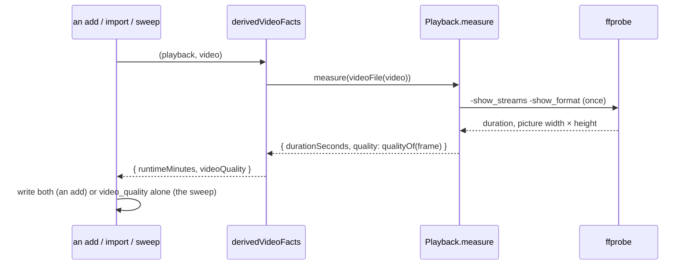

# 70: Video quality

> **Initiative:** `video-quality`
> **PRD:** `docs/PRDs/70-video-quality.md` (to be written)
> **Handoff:** `docs/handoff/handoff-video-quality/`

This log is the `grill-me` session for step 52 of the build order, **Video
quality**, held against the code as it stood on 2026-11-20 (`5fa9170a`). It is
an immutable snapshot of that moment. The session ran alone, and the
maintainer approved every recommendation in advance, asking that the codebase
stay consistent with its naming, code conventions, patterns and architecture.
Logs 26 (codecs), 43 (TMDB ratings), 46 (audio tracks), 58 (folder layout) and
63 (row view) rule wherever this log does not say otherwise.

## Background

Step 52, as the checklist planned it: _each poster carries a small tag
reading 4K, 1080p, 720p, 480p or SD, read by ffprobe from the video stream's
frame size and stored when a title is imported, with a one-time backfill for
the library already held; a Settings toggle, on by default; a quality filter
while it is on; a quality column in the Library sheet._ It left two things
open: what a series poster shows when its episodes differ, and where the
toggle and the tag sit in the prototype.

What the code does today, read before the session:

| Fact                     | Today                                                                                                                                                                                                      |
| ------------------------ | ---------------------------------------------------------------------------------------------------------------------------------------------------------------------------------------------------------- |
| The probe                | `playback/probe/` reads ffprobe's JSON into `MediaProbe { container, videoCodec, audioStreams, durationSeconds }`; the picture stream is the first video stream not `attached_pic`. No frame size is read. |
| A stored fact from bytes | `derivedRuntime(playback, video)` → `runtimeMinutes`, at 10 call sites (the importer's adds, Found again, Resolve, and the routes' add, edit and series saves); it never throws, `null` for no answer      |
| Its probe                | `Playback.duration(file)`: the probe, else the MP4 `mvhd`. Its one caller is `derivedRuntime`.                                                                                                             |
| Schema                   | migration 16 is the last; `movies.runtime_minutes`, `episodes.runtime_minutes`. A migration is SQL only and cannot probe a file.                                                                           |
| The poster card          | `mol.PosterCard`: heart top-left, watched badge top-right, progress bar along the bottom, the **Default poster**'s title overlay at the bottom; the title and the **Star row** below the art               |
| A display preference     | `tmdbRatings`: `settings.tmdb-ratings`, held by `DisplayPreferenceProvider`, read by `useTmdbRatings()`, handed to `view(movie, tmdbRatings)` and `seriesCardView(series, tmdbRatings)` at 8 call sites    |
| The filters              | `LibraryFilters`: Genre, Rating (a minimum, `?rating=`, 400 for a bad value), Sort; the Row view's _View_ after them. Each pill a pure builder (`ratingOptions`)                                           |
| The Library sheet        | `SHEET_COLUMNS` (`src/types/export.ts`), written by `exportRows`, read by `readSheet` through header aliases; an import takes the probe's runtime first, the sheet's when the probe answers none           |
| Server start             | `server/src/main.ts`: storage, the sheet writer, playback, importer, enrichment, `listen`, then the **Ordered shutdown**. Nothing runs in the background after start.                                      |

## Problem

1. Nothing tells the family how sharp a film is before they press play.
2. The library already held has never been asked, and a migration cannot ask.
3. A series has many files, which may not agree.

## Questions and Answers

### Scope

1. **One initiative?** ✅ **One**, `video-quality`, step 52, log 70: the
   **Video quality** of every movie and episode, stored; its **Quality tag**
   on every **Poster card**; the **Quality sweep** for titles already held;
   the _Show video quality_ toggle; the **Quality filter**; the sheet's
   _Quality_ column. ❌ Not built: a tag on the **Continue card**, the
   **Season card**, an **Episode row** or the **Movie detail page** (the
   step asks for posters, and the detail page is one press from the poster);
   a sort by quality; HDR, codec, bitrate or audio channels on the tag; a
   quality the **Movie form** lets anyone type.

2. **A prototype change?** ✅ **Yes**, specified in
   `docs/handoff/handoff-video-quality/README.md` until phase 1 amends
   `mol.PosterCard.dc.html`, `page.LibraryPage.dc.html`,
   `page.SettingsPage.dc.html`, the model in `FamilyFlix.dc.html` and
   `COMPONENT-SPEC.md` to it (log 63's way). One new atom, `prim.MetaTag`
   (Q11).

### The value

3. **What is a Video quality?** ✅ **One rung of the Quality ladder**, top
   down: `4K`, `1080p`, `720p`, `480p`, `SD`. A **server and wire** type:

   ```ts
   // src/types/movie.ts
   /** The **Quality ladder**, best first. */
   export const VIDEO_QUALITIES = [
     '4K',
     '1080p',
     '720p',
     '480p',
     'SD',
   ] as const;
   export type VideoQuality = (typeof VIDEO_QUALITIES)[number];
   ```

   ❌ Storing pixels (`width`, `height`): every reader would bucket them
   again; the rung is the fact the household reads. ❌ `1440p`, `2K`,
   `8K`: rungs the step never named, folded into their neighbours.

4. **How is a frame size read as a rung?** ✅ By its **Nominal height**:
   the larger of the frame's height and its width × 9/16, so a widescreen
   `1920x800` is 1080 and a 4:3 `1440x1080` is 1080. The rung is the first
   whose floor it reaches:

   | Rung    | Nominal height | e.g.                                             |
   | ------- | -------------- | ------------------------------------------------ |
   | `4K`    | ≥ 1620         | `3840x2160`, `3840x1600`, `4096x1716`            |
   | `1080p` | ≥ 900          | `1920x1080`, `1920x800`, `2560x1440`, `1600x900` |
   | `720p`  | ≥ 600          | `1280x720`, `1280x544`                           |
   | `480p`  | ≥ 420          | `720x480`, `720x576` (a DVD), `960x540`          |
   | `SD`    | below          | `640x360`, `480x270`                             |

   Each floor is halfway between two rungs, so a crop or an odd encode lands
   on its nearer rung. The coded frame is read as ffprobe gives it
   (`width`, `height` of the picture stream `videoCodecOf` already picks);
   an anamorphic file's coded height already tells its rung, so the sample
   aspect ratio is not read. A missing or nought dimension is no rung.
   `qualityOf(frame): VideoQuality | null` in
   `server/src/playback/qualityOf/`, pure, with a test per row above.

5. **What does the probe learn?** ✅ `MediaProbe.frameSize: { width:
number; height: number } | null`, the picture stream's, beside
   `videoCodec` and read off the same stream. Server side, `playback/` only.

6. **A file nothing could probe?** ✅ **No rung, `NULL`**, and no tag:
   no component, a file ffprobe will not open, a picture stream with no
   size. ❌ The MP4 header's `tkhd` size as a fallback, the way `duration`
   falls back to `mvhd`: FFmpeg is the bundled **Default component**, so a
   machine with none is the edge, and the **Quality sweep** (Q9) fills the
   gap on the next start once a component is there.

### Storing it

7. **Where is it stored?** ✅ **Migration 17**: `video_quality TEXT` on
   `movies` and `episodes`, `NULL` until measured; nothing backfilled by the
   migration (it cannot probe). `Movie.videoQuality` and
   `Episode.videoQuality: VideoQuality | null` on the wire; `MoviePatch` and
   the episode inputs take it as they take `runtimeMinutes`.

8. **Who writes it?** ✅ **Wherever a runtime is derived, a quality is
   too, from one probe.** `derivedRuntime` becomes **`derivedVideoFacts(
playback, video): VideoFacts`** in `playback/derivedVideoFacts/`, and
   `Playback.duration(file)` becomes `Playback.measure(file): VideoMeasure`:

   ```ts
   // server/src/playback/createPlayback/createPlayback.ts
   export interface VideoMeasure {
     /** The probe's length, else the MP4 `mvhd`'s; `null` when neither says. */
     durationSeconds: number | null;
     /** The probe's frame size on the **Quality ladder**; `null` when it says none. */
     quality: VideoQuality | null;
   }

   // server/src/playback/derivedVideoFacts/derivedVideoFacts.ts
   export interface VideoFacts {
     runtimeMinutes: number | null;
     videoQuality: VideoQuality | null;
   }
   ```

   All 10 call sites take both; a site that falls back to the sheet's
   runtime falls back to its quality the same way (Q17). Still never
   throws. ❌ A `derivedQuality` sibling: two ffprobe spawns per file, a
   second at every site, and on a linked import of a thousand films that is
   minutes. ❌ Keeping `duration` beside `measure`: it would have no caller.

9. **How is the library already held measured?** ✅ **The Quality sweep**:
   once the server listens, every movie and episode whose `video_quality`
   is `NULL` and whose video is there is measured one at a time and its
   quality written, alone (`storage.recordVideoQuality(kind, id,
quality)`); nothing else on the row is touched. It yields to the event
   loop between files (`setImmediate`), so a request waits behind at most
   one probe (the probe is `spawnSync`); a file `videoFile` answers
   `missing` or `unreachable` for is passed over. It runs on **every**
   start, so a title that could not be probed is asked again next time (a
   component installed later fills it); one that was measured is never
   asked again. The **Ordered shutdown** stops it before the database
   closes. `createQualitySweep({ storage, playback })` in
   `server/src/playback/createQualitySweep/`, wired in `main.ts`, with
   `start()` and `stop(): Promise<void>`; `storage.unmeasuredVideos()`
   answers what is left, movies first, A to Z.
   ❌ The checklist's _one-time_: a flag that says "swept" would leave a
   title nothing could probe untagged for good. ❌ A _Measure library_
   button: the household should never have to ask. ❌ Re-probing every
   title on every start: a file's frame does not change under it, and a
   replaced video is measured by its save (Q8). ❌ Folding runtimes into the
   sweep: a held runtime is the household's or the sheet's, and this
   feature writes only quality.

10. **What does a series carry?** ✅ **Its Series quality**: the rung most
    of its measured episodes are on, a tie going to the better rung; `NULL`
    when none is measured. Derived on every read, never stored, as
    `Series.videoQuality`. In `library/series/` as one SQL subquery built by
    a helper (`qualityRank(column)`, a `CASE` over `VIDEO_QUALITIES`, so
    the ladder's order is stated once, in the constant), shared by the
    series reads and the **Quality filter**. ❌ The best episode's rung: a
    show whose first season is DVD and whose last is 4K would read _4K_ on
    the poster and play DVD on _Play_. ❌ The worst: one stray SD extra
    would mark a 1080p show SD. ❌ A range (_720p–1080p_): two values on a
    tag the size of one word. ❌ A stored `series.video_quality`: every
    episode writer would have to keep it true.

### The tag

11. **Where does the tag sit?** ✅ **At the end of the Star row**, below
    the art: the row becomes a flex row, stars left, tag right, centred on
    one line. The art's four corners and its bottom edge are all taken (the
    heart, the watched badge, the progress bar, the Default poster's title).
    It is a new atom, **`prim.MetaTag`** (`src/primitives/MetaTag/`): a
    word in a hairline box, 11px sans at weight 600, `letter-spacing:
.04em`, padding `2px 6px`, `1px solid` `border` token, a `4px` radius
    (`radius.sm`, 8px, would round a box this small into a pill), `textDim`,
    no fill, `line-height: 1`, never a control. Props `{ label:
string }`. ❌ `prim.Chip` at `sm`: 14px with `6px 14px` padding, as wide
    as half a card. ❌ On the art: it would cover a poster's own lettering
    or collide with the badge and the bar.

12. **What does the card read?** ✅ `PosterCardMovie.quality: VideoQuality
| null`, the tag drawn when it is not `null`. `view` and
    `seriesCardView` decide it: the title's `videoQuality` while the
    toggle is on, else `null`. Their second argument becomes one object,
    `CardPreferences { tmdbRatings: boolean; qualityTags: boolean }`,
    answered by `useCardPreferences()` in `src/App/useCardPreferences/`,
    which replaces `useTmdbRatings()` at the 8 card call sites. ❌ A third
    positional boolean. ❌ The molecule reading the preference: no domain
    knowledge in `components/`.

13. **What is announced?** ✅ **Nothing more.** The card's accessible name
    stays its title, as its stars are not announced; the tag is a visual
    glance, and the detail page is where a title is read out.

### Settings

14. **The toggle?** ✅ A fourth row in Settings → **Display**, after _Fill
    in ratings from TMDB_ and before _Start on_: _Show video quality_,
    "Tag each poster with how sharp its video is: 4K, 1080p, 720p, 480p or
    SD. Turning this off also hides the quality filter." A `prim.Toggle`
    labelled _Show video quality_, drawn once the settings read lands, as
    its neighbours are. `settings.quality-tags`, `Settings.qualityTags`,
    **on** until set; `POST /api/settings/quality-tags { value: boolean }`,
    a **Single-signal write** (400 for a non-boolean). Held by
    `DisplayPreferenceProvider` as `qualityTags: boolean | null`
    (`null` until landed), `setQualityTags` beside `setTmdbRatings`,
    written by `src/App/saveQualityTags/`. No snackbar (the prototype draws
    none for its neighbours).

### The filter

15. **What does it filter by?** ✅ **A minimum**, as the rating pill does:
    _All qualities_, _4K_, _1080p+_, _720p+_, _480p+_, in that order, no
    counts (a scale, not shelves). _SD+_ is not a row: it is every measured
    title, which reads as a filter that does nothing. A title with no
    quality is dropped by any minimum, as an unrated title is by a rating
    minimum. `?quality=1080p` on the URL (the rung lowercased, `4k`),
    `LibraryQuery.minQuality?: VideoQuality`; the routes that read
    `?rating=` read it, a value off the ladder `400 Invalid quality: …`.
    Movies on `video_quality`, series on their **Series quality** (Q10).
    `qualityOptions` / `qualityLabel` in `features/search/qualityOptions/`,
    `ratingOptions`' shape. ❌ An exact match: _1080p_ would hide every 4K
    film from someone asking for good ones.

16. **The pill?** ✅ A `mol.FilterDropdown` labelled _Quality_ between
    _Rating_ and _Sort_, value _All qualities_ until chosen. It is **drawn
    only while the toggle is on** and once the settings read has landed. While
    the toggle is off, `useLibraryQuery` ignores `?quality=` on the URL, so
    a link carrying one shows the whole library; turning the toggle off
    never rewrites a URL. Both tabs, the **Genre page** too, wherever the
    Rating pill is.

### The Library sheet

17. **The column?** ✅ **`Quality`**, after `Runtime` in `SHEET_COLUMNS`,
    on Movie and Episode rows; blank on Series and Season rows (a Series
    quality is derived, not held) and for a title with none. Written by
    every **Sheet writer** (the **Library sheet** and an **Export**).
    Read back by `readSheet` under the aliases `quality` and
    `resolution`, case folded (`4k`, `1080P`); a value off the ladder is an
    **Unread cell**, reported as every other is. On an import **the
    probe's rung wins and the sheet's stands in when the probe answers
    none**, the runtime's rule: a linked video on a drive with no component
    still keeps the quality its sheet carries. A sheet without the column
    (every sheet before this step) reads as it does today.

### Development

18. **The dev library?** ✅ The fixture's videos are measured by the
    import as any are. `npm run db:seed-series` writes a quality on its mock
    episodes, mixed within one show and tied in another, so the **Series
    quality** rule is visible; mock episodes have no files, so the sweep
    passes them over.

### Documents

19. **Which documents change?** ✅ The checklist's step 52 entry; the
    glossary (a **Video quality** section); the handoff README, then the
    prototype and `COMPONENT-SPEC.md` (`prim.MetaTag`, PosterCard's Star
    row, the Quality pill, the Display row) in phase 1; the docblocks of
    `probe`, `createPlayback`, `derivedVideoFacts`, `view`,
    `seriesCardView`, `LibraryFilters`, `DisplaySection`.

## Design

### Chosen and rejected

- ✅ A stored rung, one probe per file with the runtime; ❌ stored pixels,
  ❌ a second probe.
- ✅ The **Nominal height** with halfway floors; ❌ height alone (a
  widescreen 1080p film is 800 high).
- ✅ A sweep of the unmeasured on every start; ❌ one-time, ❌ a button.
- ✅ The **Series quality** as the most common rung, ties up; ❌ best, worst, a range.
- ✅ A minimum filter, drawn only with the toggle on; ❌ exact match.
- ✅ The tag on the Star row; ❌ on the art.

### The units

| Unit                                                              | Where                                     | What                                                                  |
| ----------------------------------------------------------------- | ----------------------------------------- | --------------------------------------------------------------------- |
| `VIDEO_QUALITIES`, `VideoQuality` (new)                           | `src/types/movie.ts`                      | the **Quality ladder**                                                |
| `probe` (ch.)                                                     | `server/src/playback/probe/`              | `frameSize`                                                           |
| `qualityOf` (new)                                                 | `server/src/playback/qualityOf/`          | frame size → rung, by **Nominal height**                              |
| `createPlayback` (ch.)                                            | `server/src/playback/createPlayback/`     | `measure` replaces `duration`                                         |
| `derivedVideoFacts` (renamed from `derivedRuntime`)               | `server/src/playback/derivedVideoFacts/`  | runtime and quality, never throws                                     |
| `createQualitySweep` (new)                                        | `server/src/playback/createQualitySweep/` | the **Quality sweep**; `main.ts` and `orderedShutdown` wire it        |
| migration 17; `unmeasuredVideos`, `recordVideoQuality` (new)      | `server/src/db/`, `server/src/library/`   | the columns; the sweep's read and write                               |
| `qualityRank` (new); browse (ch.)                                 | `server/src/library/`                     | the ladder in SQL; **Series quality**; `minQuality` in both browses   |
| routes (ch.)                                                      | `server/src/routes/index.ts`              | `?quality=`; `quality-tags`; the 10 sites through `derivedVideoFacts` |
| `SHEET_COLUMNS`, `exportRows`, `readSheet` (ch.)                  | `src/types/export.ts`, `import-export/`   | the `Quality` column                                                  |
| `MetaTag` (new)                                                   | `src/primitives/MetaTag/`                 | the boxed word                                                        |
| `PosterCard` (ch.)                                                | `src/components/PosterCard/`              | the tag at the Star row's end                                         |
| `useCardPreferences`, `saveQualityTags` (new)                     | `src/App/`                                | `CardPreferences`; the toggle's write                                 |
| `DisplayPreferenceProvider`, `view`, `seriesCardView` (ch.)       | `src/App/`, `src/features/library/`       | `qualityTags`; `quality` on the card                                  |
| `qualityOptions` (new); `LibraryFilters`, `useLibraryQuery` (ch.) | `src/features/search/`                    | the **Quality filter**                                                |
| `DisplaySection` (ch.)                                            | `src/features/settings/`                  | _Show video quality_                                                  |

### One title, measured



## Implementation Plan

1. **One film, end to end.** The prototype amended to the handoff;
   `VideoQuality`; `frameSize`, `qualityOf`, `measure`, `derivedVideoFacts`
   at every site; migration 17; `Movie.videoQuality`; `MetaTag`; the tag on
   a movie's Poster card, always drawn.
2. **The Quality sweep.** `unmeasuredVideos`, `recordVideoQuality`,
   `createQualitySweep`, its wiring and its stop in the Ordered shutdown.
3. **Series.** `Episode.videoQuality`, `qualityRank`, the **Series
   quality** on the series reads and its card; the seed.
4. **The toggle.** `quality-tags`, `DisplayPreferenceProvider`,
   `useCardPreferences` at the 8 sites, the Display row.
5. **The filter.** `?quality=` on both browses, `qualityOptions`, the pill.
6. **The sheet.** The `Quality` column written and read back.
7. **Walk it live** over the dev library and a mixed folder; then the
   documents of Q19.

## Trade-offs

- **Easier:** a glance tells a DVD rip from a 4K file; the library already
  held is tagged without anyone asking; every future fact read from a
  video's bytes has `derivedVideoFacts` and one probe to join.
- **Harder:** the server does background work after start for the first
  time, so the Ordered shutdown has one more thing to stop; every start
  probes the files nothing could read before; `view`'s callers move to an
  options object; a 15s probe timeout on one bad file holds every request
  for that long once per start.
- **Out of scope:** tags off the Poster card, a quality sort, HDR or codec
  on the tag, a hand-typed quality, the MP4 header as a fallback.
