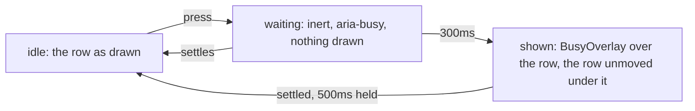

# 71: Busy overlay

> **Initiative:** `busy-overlay`
> **PRD:** `docs/PRDs/71-busy-overlay.md` (to be written)
> **Handoff:** `docs/handoff/handoff-loading-states/`, amended here: its
> table row 5, its _Inside a row_ size, row 3 and the rule _Lock the
> control, not the layout_

This log is the `grill-me` session for step 53 of the build order, **Busy
overlay**, held against the code as it stood on 2026-11-21 (`e69d4832`). It
is an immutable snapshot of that moment. Logs 53 (**Loading states**) and 69
(**Silent waits**) rule wherever this log does not say otherwise; it amends
log 69 Q3 and Q4. The session ran alone, and the maintainer approved every
recommendation in advance, asking that the codebase stay consistent with its
naming, code conventions, patterns and architecture, and that no other
loading state shift what is around it either.

## Background

Log 69 drew a **Busy row** as the handoff's row 5: once **Shown**, the row
dims to .75 and an 18px `inline` **Logo loader** with its _-ing_ label stands
in the row's status slot. The slot is narrower than the loader, so the row
reflows:

| Row                       | Status slot                         | Once Shown today                                                         |
| ------------------------- | ----------------------------------- | ------------------------------------------------------------------------ |
| Decision row, Problem row | the 8px kind `Dot` in `Head`        | the loader and _Saving match…_ take its place; title and posters move    |
| Folder row                | the _N titles_ `Line` under `Path`  | the line's text becomes the 18px mark beside its label; the row can grow |
| Season choice             | the 112px held-poster `HeldCaption` | the mark and _Saving poster…_ squeeze into 112px and wrap                |

The maintainer asked the same of every other loading face. The audit, read
from the code:

| Face                                  | Where                                                        | Shifts?                                                                                                                                                                                                       |
| ------------------------------------- | ------------------------------------------------------------ | ------------------------------------------------------------------------------------------------------------------------------------------------------------------------------------------------------------- |
| **Busy row**                          | `DecisionRow`, `ProblemRow`, `FolderRow`, `SeasonChoices`    | **Yes**, the table above                                                                                                                                                                                      |
| **Busy button**                       | `primitives/Button/`                                         | **Yes, where the Busy label is wider**: the idle width is held as `min-width`, so a wider label still grows it. _Add_ → _Adding…_ beside the folder field, _Skip all_ → _Skipping…_, an Export's _Exporting…_ |
| **Dialog loader**                     | `components/DialogLoader/`, the Delete and Reset dialogs     | **Yes**: once Shown the dialog returns a second `Modal`, `bare`, `min-height: 250px`, so the card is remounted (its pop-in runs again) and shrinks from the dialog's height to the loader's                   |
| _＋ Add show folder_ reading          | `SeriesFormFiles`                                            | No: the box is a fixed 42px; the loader replaces its label inside it                                                                                                                                          |
| **Component drop zone**, busy         | `features/settings/ComponentDropZone/`                       | No: the same title and line, their words swapped                                                                                                                                                              |
| **Player notice**                     | `features/player/PlayerNotice/`                              | No: drawn in the big-play circle's geometry                                                                                                                                                                   |
| **Start-up splash**, **Welcome hold** | `electron/splashPage/`, `App/WelcomeSplash/`                 | No: full screen; the hold beats in the mark's own place                                                                                                                                                       |
| **Skeletons**, **Form skeleton**      | `LoadingDetail`, `LoadingSeries`, `LoadingForm`, `Skeleton*` | No: a read's first paint in the page's own frame; nothing stood there to move                                                                                                                                 |
| A running Import or Sync              | the live logs                                                | No: a screen of its own                                                                                                                                                                                       |
| **Busy label** shine                  | `Button.styles.ts`                                           | No: a moving mask, nothing laid out                                                                                                                                                                           |

## Problem

Draw every action loader so that nothing around it moves when it appears or
goes: a Busy row's loader over the row, a Busy button at one width, a Dialog
loader at its dialog's size, with one statement of each and the prototype
amended first.

## Questions and Answers

### Scope

1. **One initiative?** ✅ **One**, `busy-overlay`, step 53, log 71: the
   **Busy row**'s face (the step as filed), and the two other faces the
   audit found shifting, the **Busy button** and the **Dialog loader**. They
   are one rule, _a loader never moves what is around it_, and one walk.
   ❌ Three steps: three walks of the same screens for one rule.
   ❌ Not built here: the faces the audit lists as not shifting; a Settings
   read drawing nothing until it lands (content arriving, the Product Rule's,
   not a loader); a **Skeleton**'s fidelity to the page that replaces it.

2. **Is the prototype amended?** ✅ **Yes, first**, as CLAUDE.md asks of
   anything the prototype gets wrong: the loading-states README's row 5 and
   _Inside a row_ size draw the overlay; its row 3 says the dialog keeps its
   size; its rule _Lock the control, not the layout_ (in the README and in
   `Loading States.dc.html`'s `rules`) says how. No demo is redrawn: the
   prototype draws no row, its save button has a fixed `min-width: 136px`
   wider than both its labels, and its delete demo already sits in one fixed
   box. `screenshots/05-rules.png` keeps its old sentence.

### The Busy row

3. **What does a Shown Busy row draw?** ✅ **A Busy overlay**: a scrim with
   a light blur over the whole row or card, the 18px `inline` **Logo
   loader** and its _-ing_ label centred on it. It replaces the dim to .75.
   The row under it is laid out exactly as at `idle`, so nothing moves as it
   comes or goes. ❌ Reserving the loader's width in the slot at `idle`:
   every idle row would carry a gap for a loader it rarely draws.
   ❌ A fixed-width slot: the 8px dot would sit in a 120px hole.

4. **What does it look like?** ✅ The scrim is `rgba(20, 17, 13, 0.55)`, `bg`
   at .55, the **Player notice** circle's, under `backdrop-filter: blur(4px)`,
   the `Modal` scrim's and the favourite button's light blur; `inset: 0`,
   `border-radius: inherit`, `cursor: progress`, a grid centring the loader,
   and the `ffFade` 0.18s the **Dialog loader** fades in on (the loader keeps
   its own pop-in). The label is the loader's 15/600 `text`, readable on the
   scrim over any row. ❌ The `scrim` token (.72): the Modal's, a page-wide
   dim; a row should stay faintly there. ❌ No blur: the row's text would
   read through the label.

5. **What becomes of the status slot?** ✅ **It keeps its content**: the
   kind `Dot`, the _N titles_ line, the held-poster caption, all under the
   overlay. Amends log 69 Q4, which had the loader take the slot's place.

6. **The lock and the timing?** ✅ **Unchanged.** From `waiting` the root is
   `inert` and `aria-busy` (`busyRowLock`), drawing nothing; the overlay only
   once `shown`, under **Loader timing**; `useBusyRow` still names the press
   and refuses a second. A bulk press still hands its rows `waiting` and
   draws its one loader in its **Busy button** (log 69 Q10).

7. **Which unit draws it?** ✅ **A molecule, `BusyOverlay`**, in
   `components/BusyOverlay/` (`BusyOverlay.tsx`, `.styles.ts`, `.test.tsx`),
   in the `components` barrel: it composes the `LogoLoader` atom and knows
   nothing of a Decision or a folder. Its root is absolutely positioned, so
   the Busy row's root becomes its containing block:

   ```ts
   // src/components/BusyOverlay/BusyOverlay.tsx
   export interface BusyOverlayProps {
     /** The press's _-ing_ words: _Saving match…_, _Removing…_. */
     label: string;
   }
   export function BusyOverlay({ label }: BusyOverlayProps): JSX.Element;
   ```

   Each row draws it last in its root, `{label !== null ? <BusyOverlay
label={label} /> : null}` (the Season choice on `busy === 'shown'`).
   `styles/busyRow.ts`'s `busyRow` becomes the root's `position: relative`,
   at every phase so the root never changes as the overlay comes; the
   opacity and the cursor go (the overlay carries the cursor).
   `BUSY_ROW_LOADER_SIZE` stays there, read by `BusyOverlay` and by
   _＋ Add show folder_. ❌ A css helper with a pseudo-element: it cannot
   hold the loader. ❌ In `styles/`: a unit that renders is a component.

8. **_＋ Add show folder_?** ✅ **Unchanged**: it is a dashed 42px control,
   not a Busy row; its loader already replaces its label inside its own
   fixed box, and nothing moves.

### The Busy button

9. **How does a button keep one width?** ✅ **Both labels in one grid
   cell**: the face lays out its label and, when it has one, its
   `busyLabel` in the same cell, the one not drawn `visibility: hidden` and
   `aria-hidden`. The button is always as wide as its wider label, so the
   swap moves nothing, and the held-width measure (`heldWidth`, the layout
   effect, the ref) goes. Where the busy label is the wider (_Adding…_,
   _Skipping…_) the idle button is that much wider; elsewhere nothing
   changes. ❌ Today's `min-width`: holds a shrink, not a growth.
   ❌ A fixed `width` at the idle width: clips or wraps the wider label.

### The Dialog loader

10. **How does a dialog keep its size?** ✅ **The Dialog loader is drawn
    inside the dialog's own card**, over its idle face, which stays laid out
    but `visibility: hidden` (so out of the tab order and the accessible
    tree), header and ✕ included. The card keeps its size and is never
    remounted, so its pop-in runs once; a failure shows the idle face again
    in the same card. `Modal` takes `loader?: string`: given, the card is
    `aria-busy` and draws `<DialogLoader label={loader} />` over its face,
    and takes focus, as on open, since its focused button is hidden.
    `DialogLoader` becomes that layer, `inset: 0`, the 64px loader centred on
    `surface2`, with no `Modal` of its own. The four dialogs drop their early
    `return <DialogLoader … />` for `<Modal … loader={shown ? label : undefined}>`.
    ❌ Holding the measured height on a second `Modal`: still a remount and a
    second pop-in. ❌ A blurred scrim, as on a row: the handoff has the
    dialog become the progress view, no heading, no Cancel.

### Documents

11. **Which documents change?** ✅ The handoff README and the prototype's
    rule (Q2); `COMPONENT-SPEC.md`: a `BusyOverlay` section and the
    `DialogLoader` and `Modal` sections; the checklist's step 53 entry,
    widened to the three faces; the glossary (a **Busy overlay** section);
    the docblocks of every unit Q3 to Q10 touch.

## Design

### Chosen and rejected

- ✅ A loader over what is busy, never in its flow; ❌ a reserved slot, ❌ a
  fixed slot.
- ✅ `BusyOverlay`, a molecule; ❌ a css helper.
- ✅ A button as wide as its wider label, by layout; ❌ a measured
  `min-width`, ❌ a fixed width.
- ✅ The Dialog loader inside the dialog's own card; ❌ a second `Modal`.
- ✅ The prototype amended first; ❌ building against row 5 as drawn.

### The units

| Unit                                                                                | Where                      | What                                                                 |
| ----------------------------------------------------------------------------------- | -------------------------- | -------------------------------------------------------------------- |
| `BusyOverlay` (new)                                                                 | `components/BusyOverlay/`  | the scrim, the blur, the 18px loader and its label, centred          |
| `busyRow` (ch.)                                                                     | `styles/busyRow.ts`        | `position: relative`; no opacity, no cursor                          |
| `DecisionRow`, `ProblemRow`, `FolderRow`, `SeasonChoices` (ch.)                     | `features/…/`              | the slot keeps its content; `BusyOverlay` last in the root           |
| `Button`, `Button.styles.ts` (ch.)                                                  | `primitives/Button/`       | both labels in one cell; the held-width measure goes                 |
| `Modal` (ch.)                                                                       | `components/Modal/`        | `loader?: string`: the face hidden, the Dialog loader over it, focus |
| `DialogLoader` (ch.)                                                                | `components/DialogLoader/` | the layer over the card, no `Modal` of its own                       |
| `DeleteTitleDialog`, `DeleteMovieDialog`, `DeleteSeriesDialog`, `ResetDialog` (ch.) | `features/…/`              | one `Modal`, its `loader` once Shown                                 |

### A Busy row, Shown



## Implementation Plan

1. **One row, end to end.** `BusyOverlay`, `busyRow`'s containing block, and
   the Decision row drawing it with its dot kept.
2. **Every Busy row.** The Problem row, the Folder row, the Season choice.
3. **The Busy button.** Both labels in one cell; the measure goes.
4. **The Dialog loader.** `Modal`'s `loader`, `DialogLoader` as its layer,
   the four dialogs.
5. **Walk it live.** Each face with its write held open, a row's box and a
   button's width measured before and after **Shown**; then the documents
   of Q11.

## Trade-offs

- **Easier:** one rule for every action loader, checked by measuring; a
  shown row reads as a whole working, not a row with a gap; a dialog's
  failure returns in the same card with no second pop-in.
- **Harder:** a row's root is a containing block, so anything absolutely
  placed inside it is placed against the row; an idle button whose busy
  label is the wider is a few pixels wider than the prototype draws it.
- **Kept as is:** the overlay, like log 69's slot loader, sits inside the
  `inert` root, so its `status` is out of the accessibility tree while the
  root says `aria-busy`. Moving the lock off the root is a change of its
  own, not of the face.
- **Out of scope:** the faces the audit lists as not shifting; Settings'
  read-then-draw; a Skeleton's fidelity.
