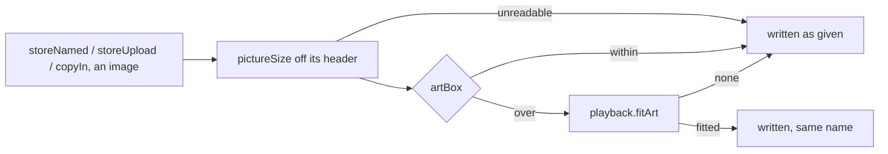

# 72: Seamless art

> **Initiative:** `seamless-art`
> **PRD:** `docs/PRDs/72-seamless-art.md` (to be written)
> **Handoff:** none amended; `COMPONENT-SPEC.md`'s **Detail backdrop**
> already draws it with no motion, and nothing drawn changes

This log is the `grill-me` session for step 54 of the build order, **Seamless
art**, held against the code as it stood on 2026-11-22 (`31876443`). It is an
immutable snapshot of that moment. The session ran alone, and the maintainer
approved every recommendation in advance, asking that the codebase stay
consistent with its naming, code conventions, patterns and architecture. It
amends the step's planned **Cache** bullet (Q13).

## Background

Testing a library of 400 titles, a detail page draws its poster and text at
once, but the backdrop takes 1.5 to 2 seconds and paints in bands, top to
bottom. The step's plan read three causes off the code; this session read the
rest:

| What                     | Where                                                           | Today                                                                                                      |
| ------------------------ | --------------------------------------------------------------- | ---------------------------------------------------------------------------------------------------------- |
| TMDB art                 | `tmdbClient`'s `IMAGE_BASE`, `.../t/p/original`                 | backdrops 3840x2160 at 0.8 to 2.4 MB, posters about 1 MB                                                   |
| **Frame still**          | `playback/frameArgs/`                                           | the video's native size, no scale filter: a 4K episode gives a 4K Still                                    |
| Form art, imported art   | `Media.storeUpload`, `Media.copyIn`                             | the bytes as given, any size                                                                               |
| Every image write        | `Media.storeNamed`, `storeUpload`, `copyIn`                     | all three funnel through `createMedia`, which knows an image by its name (`fileKinds`' `IMAGE_EXTENSIONS`) |
| The backdrop's first ask | `DetailBackdrop` over `Artwork`, a CSS `background-image`       | first asked once the detail page draws; the poster is the card's own file, already loaded                  |
| The image route          | `express.static(mediaPath)` under `/api/images`                 | `max-age=0` with an ETag and `Last-Modified`: revalidated, never held for a lifetime                       |
| Where a backdrop is      | `MovieDetail`, `SeriesDetail`, `SeasonEpisodes`                 | three draws of one `DetailBackdrop`; `PosterCardMovie` comes off a `Movie`, which carries `backdropPath`   |
| The frames               | `MovieDetail`'s `PosterFrame` 300px, `SeriesDetail`'s 260px     | the largest poster drawn; a backdrop fills the viewport under the **Backdrop veil**                        |
| An image library         | `sharp`, a devDependency                                        | read only by `electron/scripts/buildIcon.mjs`; nothing shipped decodes or encodes a picture but FFmpeg     |
| A background pass        | `playback/createQualitySweep/`, started in `server/src/main.ts` | on every start once the server listens, one file at a time, yielding; stopped by the **Ordered shutdown**  |

## Problem

Open a detail page whole, backdrop included: keep art at screen size, new art
stored at that size and held art shrunk once on disk, offline; fetch and
decode the backdrop before it is drawn; and settle the step's three open
questions (what shrinks, where new art comes from, whether it fades).

## Questions and Answers

### Scope

1. **One initiative?** ✅ **One**, `seamless-art`, step 54, log 72: the art's
   size (Q3 to Q7), the **Warm start** (Q8 to Q12) and the cache (Q13). One
   symptom, one walk. ❌ Two steps (size, then warm start): either alone
   leaves the page opening in two beats on a large library.

2. **Is the prototype amended?** ✅ **No**: `COMPONENT-SPEC.md` draws the
   **Detail backdrop** with "no motion, no blur", and this step keeps it
   (Q11). Only the spec's words for when it is drawn change (Q14).

### Art size

3. **What is screen size?** ✅ **The Art box, read off the picture's own
   shape**: a landscape picture (width at least its height: a backdrop, a
   Still) at most **1920px wide**; a portrait one (a poster, a **Season
   poster**) at most **780px wide**, the 300px detail poster frame at 2.6x.
   Never enlarged, the height following. A pure unit,
   `server/src/media/artBox/artBox.ts`:

   ```ts
   export interface PictureSize {
     width: number;
     height: number;
   }
   /** The **Art box**: the widest a picture of this shape is kept. */
   export const LANDSCAPE_ART_WIDTH = 1920;
   export const PORTRAIT_ART_WIDTH = 780;
   /** The width to fit `size` to, or `null` when it is within its box. */
   export function artBox(size: PictureSize): number | null;
   ```

   ❌ A box by role: `storeUpload` and `copyIn` write by filename and a form
   upload keeps its own name, so media does not know a poster from a
   backdrop. ❌ One box for every picture: a 1920 poster is 1280x1920, and a
   grid of 400 decodes them all.

4. **What shrinks a picture?** ✅ **FFmpeg, the Playback component**, through
   a new `Playback.fitArt`, beside `frame`: the **Frame still** is the
   precedent, a picture FFmpeg makes behind `playback/`. `fitArgs`, a pure
   unit beside `frameArgs`, spells the argv: the picture on stdin, a Lanczos
   `scale=<width>:-2`, written to stdout in its own format (`mjpeg -q:v 3`
   for a JPEG, `png` for a PNG, `libwebp` for a WebP). The call is held to
   the **Fit budget**, 10 s, as `frame` is to the **Frame budget**:

   ```ts
   // server/src/playback/createPlayback/createPlayback.ts
   export type ArtFormat = 'jpeg' | 'png' | 'webp';
   export type FitOutcome =
     | { kind: 'fitted'; picture: Buffer }
     | { kind: 'none'; reason: 'no-component' | 'failed' | 'timed-out' };
   fitArt(picture: Buffer, width: number, format: ArtFormat): Promise<FitOutcome>;
   ```

   With no component, a replaced one that cannot encode the format, or any
   failure, the answer is `none` and the picture is kept as it is: never a
   broken file. ❌ `sharp` in the shipping server: a native module, a third
   thing to package per **Platform build**; today it is dev-only, for the
   icon. ❌ Electron's `nativeImage`: the server is a Node app that also runs
   standalone, outside the shell. ❌ A pure-JS decoder: slow, JPEG only, a new
   dependency. ❌ The renderer's canvas: `src/` never touches the filesystem.

5. **Where does new art get its size?** ✅ **In the media domain, at every
   image write**: `createMedia` takes `playback: Pick<Playback, 'fitArt'>`
   (the `QualitySweepDeps` shape), and `storeNamed`, and `storeUpload` and
   `copyIn` for an image name (`isImageFilename`), read the picture whole,
   read its **Picture size** off its header (a pure unit,
   `server/src/media/pictureSize/`, JPEG SOF, PNG IHDR, WebP VP8/VP8L/VP8X;
   `null` for a header it cannot read, which is kept as is), fit it if
   `artBox` says so, and write it under the name they always did. Every
   source is covered by the one funnel: a Sync, a **Season poster** choice,
   a **Frame still**, the movie and series forms, a **Bulk import**, a
   rescan. ❌ Each caller fitting its own: six call sites to keep in step,
   and the next one forgets. ❌ Fitting on the way out, in the image route:
   every start pays it again.

6. **TMDB at `w1280`, or `original` fitted on arrival?** ✅ **`original`,
   fitted on arrival** (Q5): one rule for every source, and TMDB has no
   1920 rung for backdrops (`w300`, `w780`, `w1280`, `original`). `IMAGE_BASE`
   stays. ❌ `w1280` backdrops and `w780` posters: a second rule for TMDB
   art only, a softer backdrop than the box, and uploads and imports still
   need the fit. The Decision row's `CANDIDATE_POSTER_BASE` (`w185`) is
   unchanged: it is a url drawn, never stored.

7. **Art already held?** ✅ **The Art sweep**, `server/src/media/createArtSweep/`,
   the **Quality sweep**'s twin: on every start once the server listens,
   beside it in `main.ts`, and stopped by the **Ordered shutdown**. It walks
   every held image the rows name (`storage.heldArt()`: posters, backdrops,
   Season posters, Stills), reads each one's Picture size, and asks
   `media.fitStored(storedPath)` of each over its box, one at a time,
   yielding to the event loop between two. `fitStored` writes the fitted
   picture to a `.part` beside it and renames it over the original, so a
   request never reads half a file; a rename that fails (a file held open on
   Windows) leaves the original for the next start.
   - **Once**: a fitted picture is within its box, so no start asks it
     again; no column, no migration, no flag.
   - **Offline**: nothing is fetched; TMDB art held once is never
     downloaded again, by a Sync or by this step (the plan's rule, kept).
   - **Only the Managed copy**: art is always copied in, so every row's
     image is under the **Managed media directory**, and `fitStored` writes
     nowhere else. A **Library folder**'s art is never rewritten; a Layout
     fill of an art-less folder writes the fitted copy.
   - **No component**: the sweep fits nothing and the next start asks again.
     ❌ A one-time pass behind a settings flag: a start with no component
     would mark it done unfitted. ❌ Probing each file with ffprobe: 1200
     spawns per start, where a header read is a few KB.

### The Warm start

8. **When is a backdrop warmed?** ✅ **On a Poster card's pointer enter and
   focus**: the card emits a new `onWarm`, as it emits `onOpen`, and the
   feature drawing it (`LibraryGrid`, `CardCarousel`, `GenreTitles`) calls
   `warmArt(card.backdropUrl)`. `PosterCardMovie` gains `backdropUrl`, its
   view models (`view`, `seriesCardView`) filling it from `imageUrl`. A
   hover lands a few hundred ms before a press, which a 1920 JPEG's fetch
   and decode fit in. ❌ Warming every card a grid draws: 400 decodes for
   the one page opened. ❌ The `ContinueCard`: it opens the player. ❌ The
   `SeasonCard`: the Season page's backdrop is the series' own, already
   drawn behind it.

9. **Which unit warms?** ✅ **`src/api/warmArt/warmArt.ts`**, the one request
   for a picture ahead of its draw, shared by the library, movie-detail and
   series features:

   ```ts
   /** Fetch and decode `url` ahead; the last 8 stay held, decoded. */
   export function warmArt(url: string | null): Promise<void>;
   /** Whether `url` is fetched and decoded now. */
   export function isWarm(url: string): boolean;
   ```

   A `new Image()` and its `decode()`; the last 8 elements are kept, so
   Chromium keeps their pictures decoded, and a url already warm or warming
   is not asked twice. A failure settles quietly and is not held. ❌ In
   `src/utils/`: it holds state and talks to the server, and a util is a
   pure helper.

10. **How is the backdrop drawn only once decoded?** ✅ **`useDecodedArt`**,
    `src/hooks/useDecodedArt/`: `useDecodedArt(url: string | null): string |
null` answers the url once `warmArt` has it decoded, at the first render
    when `isWarm`, and `null` until then; a picture that fails stays `null`,
    the **Gradient fallback** alone. `MovieDetail`, `SeriesDetail` and
    `SeasonEpisodes` pass its answer to `DetailBackdrop`, whose props do not
    change. A page opened warm draws its backdrop in its first paint; one
    opened cold (a direct url, Back, the keyboard from elsewhere) draws the
    gradient, then the whole backdrop in one frame, never in bands.
    ❌ Inside `DetailBackdrop`: a molecule fetches nothing. ❌ The ``
    mode of `Artwork`: the gating alone is what keeps the bands away, and
    the background layer is the spec's.

11. **Does the backdrop fade in?** ✅ **No**: the spec draws it with no
    motion, and a warm page has it in its first paint, where a fade would
    hold back art that is already there. Cold, it appears whole over its
    gradient under the veil, which already darkens it by .65 to .85.
    ❌ A fade: amends the prototype, for the cold path only.

12. **The detail poster?** ✅ **Unchanged**: it is the card's own file, warm
    from the grid, now at most 780 wide.

### The cache

13. **A lifetime on `/api/images`?** ✅ **No; amends the plan.** The route
    keeps revalidation, `max-age=0` with its ETag and `Last-Modified`,
    `express.static`'s default, stated in its comment as a decision. A
    stored image is rewritten under its own name (the Art sweep's fit, a
    form upload of the same name) and a **Factory reset** reuses folder
    names, so a lifetime would go on drawing the old picture across starts
    in Chromium's disk cache. Within a session a url once loaded is reused
    by the document without asking again; across starts one 304 over
    loopback is a millisecond, and the size and the decode were the cost.
    The walk (phase 5) measures a second visit; if it asks again, the cache
    reopens in a grill-me. ❌ A lifetime with a versioned url: every read,
    type and view model carries a version for a millisecond. ❌ Names
    carrying the bytes' hash: the name leaks into an **Export**'s files.

### Documents

14. **Which documents change?** ✅ `COMPONENT-SPEC.md`: `DetailBackdrop` (its
    url drawn once decoded) and `PosterCard` (`onWarm`); the checklist's
    step 54 entry; the glossary (a **Seamless art** section); the docblocks
    of every unit Q3 to Q13 touch, `tmdbClient`'s `IMAGE_BASE` and the image
    route's comment among them.

## Design

### Chosen and rejected

- ✅ The **Art box** by the picture's shape, 1920 landscape, 780 portrait;
  ❌ a box by role, ❌ one box.
- ✅ FFmpeg through `Playback.fitArt`; ❌ `sharp`, ❌ `nativeImage`, ❌ a JS
  decoder, ❌ the renderer.
- ✅ Fitted in `createMedia` at every image write; ❌ per caller, ❌ on the
  way out.
- ✅ TMDB `original`, fitted on arrival; ❌ `w1280`/`w780`.
- ✅ The **Art sweep** on every start; ❌ a one-time flag, ❌ ffprobe.
- ✅ The **Warm start** on a Poster card's hover and focus; ❌ the whole grid.
- ✅ `useDecodedArt` in the features; ❌ in the molecule. ✅ No fade.
- ✅ Revalidation kept; ❌ a lifetime, ❌ hashed names.

### The units

| Unit                                                  | Where                                 | What                                                           |
| ----------------------------------------------------- | ------------------------------------- | -------------------------------------------------------------- |
| `artBox` (new)                                        | `server/src/media/artBox/`            | the width to fit a picture to, or `null`                       |
| `pictureSize` (new)                                   | `server/src/media/pictureSize/`       | a JPEG, PNG or WebP header's width and height, or `null`       |
| `fitArgs` (new)                                       | `server/src/playback/fitArgs/`        | the argv: stdin, Lanczos scale, stdout in the picture's format |
| `Playback.fitArt` (new)                               | `server/src/playback/createPlayback/` | the fit under the **Fit budget**, `none` without a component   |
| `createMedia` (ch.)                                   | `server/src/media/createMedia/`       | takes `playback`; every image write fitted; `fitStored`        |
| `createArtSweep` (new)                                | `server/src/media/createArtSweep/`    | the held images over their box, fitted one at a time           |
| `storage.heldArt` (new)                               | `server/src/library/`                 | every image path the rows name                                 |
| `main.ts`, `orderedShutdown` (ch.)                    | `server/src/`, `server/src/shell/`    | media given playback; the Art sweep started and stopped        |
| `warmArt` (new)                                       | `src/api/warmArt/`                    | fetch and decode ahead; the last 8 held                        |
| `useDecodedArt` (new)                                 | `src/hooks/useDecodedArt/`            | the url once decoded, `null` until then                        |
| `PosterCard`, `PosterCardMovie` (ch.)                 | `src/components/`, `src/types/`       | `onWarm` on pointer enter and focus; `backdropUrl`             |
| `LibraryGrid`, `CardCarousel`, `GenreTitles` (ch.)    | `src/features/library/`               | `onWarm={() => warmArt(card.backdropUrl)}`                     |
| `MovieDetail`, `SeriesDetail`, `SeasonEpisodes` (ch.) | `src/features/…/`                     | `DetailBackdrop url={useDecodedArt(view.backdropUrl)}`         |

### A picture written



## Implementation Plan

1. **One backdrop, end to end.** `pictureSize`, `artBox`, `fitArgs`,
   `Playback.fitArt`, and `storeNamed` fitting: a Sync's backdrop lands at
   1920 wide.
2. **Every image write.** `storeUpload` and `copyIn` for an image name: the
   forms, a Bulk import, a rescan.
3. **The Art sweep.** `storage.heldArt`, `fitStored`, `createArtSweep`,
   started in `main.ts` and stopped in the Ordered shutdown.
4. **The Warm start.** `warmArt`, `useDecodedArt`, the card's `onWarm`, the
   three features that draw a card and the three that draw a backdrop.
5. **Walk it live.** The 400-title library: the media directory's art sizes
   before and after a start; a detail page opened from a hover and cold,
   its backdrop timed; a second visit's requests read in DevTools (Q13);
   then the documents of Q14.

## Trade-offs

- **Easier:** one size rule for every source, enforced where every image is
  written; a large library's grid and detail pages decode a tenth of the
  bytes; the media directory shrinks with no network; nothing new to
  package.
- **Harder:** art fitting rests on the replaceable FFmpeg: with none, new art
  is stored as given until a start finds a component; an image write now
  reads the picture whole before it lands (a few MB at most).
- **Kept as is:** a stored image rewritten under its own name is drawn old
  until the next start in a session that already loaded it (the Season
  poster choice already writes a new name for this); the Art sweep's fit is
  the same picture smaller, so it does not matter there.
- **Out of scope:** a cache lifetime (Q13); fitting a **Library folder**'s
  art; warming from anything but a Poster card; the Decision row's TMDB
  candidates, drawn off TMDB at `w185`.
