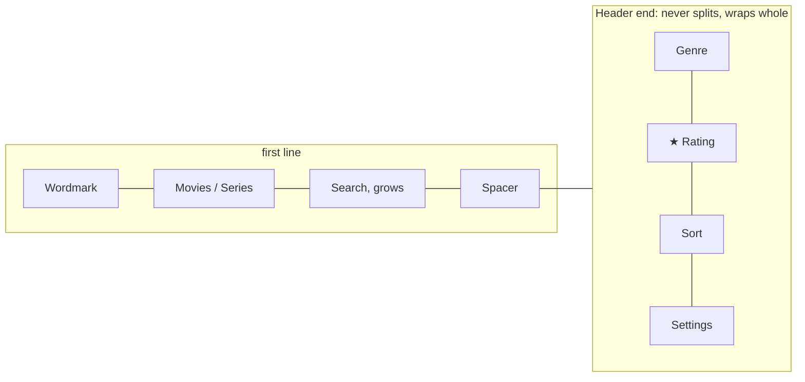

# 73: Header fit

> **Initiative:** `header-fit`
> **PRD:** `docs/PRDs/73-header-fit.md` (to be written)
> **Handoff:** `docs/handoff/handoff-header-fit/`

This log is the `grill-me` session for step 55 of the build order, **Header
fit**, held against the code as it stood on 2026-11-23 (`b36a7401`). It is an
immutable snapshot of that moment. The session ran alone, and the maintainer
approved every recommendation in advance, asking that the codebase stay
consistent with its naming, code conventions, patterns and architecture.
Logs 05 (search and filter), 63 (row view) and 70 (video quality) rule
wherever this log does not say otherwise; this log retires log 63's **Row
view switch** (its Q4 and Q5) and log 70's **Quality filter** (its Q15 and
Q16), and adds a fit rule the step's plan did not have (Q3).

## Background

Step 55, as the checklist planned it on 2026-11-23: _every filter pill and the
Settings button stay in reach, by drawing two fewer pills._ The _View_ pill
moves into the Genre dropdown, and the _Quality_ pill goes. It left five
things open: the new row's name, what the pill reads under **All**, what a
held `?quality=` URL does, whether the route keeps `minQuality`, and the
prototype amendment.

What the code does today, read before the session:

| Fact                      | Today                                                                                                                                                                                                                             |
| ------------------------- | --------------------------------------------------------------------------------------------------------------------------------------------------------------------------------------------------------------------------------- |
| The header                | `MainLayout`: the **Wordmark**, `headerStart` (`LibraryTabs`, `LibrarySearch`), a `Spacer`, `headerEnd` (`LibraryFilters`, `RowViewSwitch`), the Settings `IconButton`; one flex row, `gap` 24px, no wrap                         |
| The end slot              | Genre, Rating (★), Quality (only while _Show video quality_ is on), Sort, then _View_: five `FilterDropdown`s                                                                                                                     |
| Measured, hidden Electron | at any width the header's content is **1696px** wide; the search bar stops shrinking at 245px; at 1024, 1280 and 1440 the last pills and Settings sit past the window's edge                                                      |
| Without Quality and View  | about **1314px**: the Genre pill 169, Rating 141, Sort 194, Settings 46, the Wordmark 136, the tabs 184                                                                                                                           |
| The window                | `electron/main.ts`: `minWidth: 1024`                                                                                                                                                                                              |
| The Genre dropdown        | `genreOptions(list, selected, onSelect)`: _All Genres_ with the library total, then each genre busiest first; it writes `?genre=` only                                                                                            |
| The Row view              | `useRowView()` in `features/library/`, read by `RowViewSwitch` and `LibraryBody`; two household settings; `null` until the settings read lands, and `StartTabGate` already waits on that read                                     |
| The **All** headings      | _All movies_ in `MovieGrid`, _All series_ in `SeriesGrid` and `SeriesRows`, each a literal                                                                                                                                        |
| The Quality filter        | `qualityOptions`, `setQuality`, `honouredLibraryQuery`, `parseMinQuality` (client and route), `LibraryQuery.minQuality`, two browse `WHERE`s, `routes.qualityFilter.test.ts`; `qualityRankSql` also serves the **Series quality** |
| The toggle's copy         | _Tag each poster with how sharp its video is: 4K, 1080p, 720p, 480p or SD. Turning this off also hides the quality filter._                                                                                                       |

The measurement settles the step's premise: two fewer pills is necessary but
not enough. The header needs about 1314px, the window may be 1024px, and a
longer genre name or a future pill would push it out again. The step needs a
rule that keeps the end of the header in reach at any width, as well as the
two pills fewer.

## Problem

Keep every filter pill and the Settings button on screen at every window
width the shell allows, with two fewer pills to draw: the **Row view** chosen
from the Genre dropdown, and no **Quality filter**.

## Questions and Answers

### Scope

1. **One initiative?** ✅ **One**, `header-fit`, step 55, log 73: the Row view
   in the Genre dropdown, the Quality filter gone end to end, and the
   **Header end** that wraps whole. ❌ Not built: a narrower **Genre page**
   header (it carries Back, a heading, a search and Sort, and fits); a
   collapsed search; any change to what a body draws.

2. **The spec?** ✅ **A handoff README, `docs/handoff/handoff-header-fit/README.md`,
   written in this session**, until phase 1 amends `page.LibraryPage.dc.html`,
   `page.SettingsPage.dc.html`, the model in `FamilyFlix.dc.html` and
   `COMPONENT-SPEC.md` to it, log 63's way. The older handoff READMEs
   (`handoff-row-view`, `handoff-video-quality`) stay as written: they are
   history, and the prototype is the spec once amended.

### The fit

3. **Is two fewer pills enough?** ✅ **No, measured: about 1314px against a
   1024px window.** Two fewer pills, and the **Header end** wraps whole to a
   second line when the first cannot hold it. ❌ **Smaller gaps, no captions,
   a smaller Wordmark**: each saves tens of pixels, together still over 1024,
   and the next long genre name undoes them. ❌ **A header that scrolls
   sideways**: a hidden Settings button is still out of reach. ❌ **A _More_
   menu for the pills that do not fit**: a pill behind a press, and a new
   molecule. ❌ **The search collapsed to an icon**: a new interaction, for
   the one control the family types into.

4. **What wraps, and how?** ✅ **The Header end: the `headerEnd` slot and the
   Settings button as one unit**, a styled box in `MainLayout`
   (`HeaderEnd` in `MainLayout.styles.ts`): `display: flex`, the header's 24px
   `gap`, `flex: 0 0 auto`, never wrapping inside, `margin-left: auto`. The
   header takes `flex-wrap: wrap` and a 12px `row-gap` (`space.s3`). When the
   first line cannot hold it, the Header end moves to a second line,
   right-aligned, whole; the Wordmark, the tabs and the search keep the
   first, and the search grows into what it left. Nothing in it shrinks, so
   no pill truncates. With the three pills that remain it wraps below about
   1347px (the first line's 64px padding, the Wordmark, the tabs, the
   search's 245px floor and four gaps, beside a 622px Header end), so a
   1366px laptop keeps one line. ❌ **Settings kept on the first line while
   the pills wrap**: CSS cannot tell a wrapped line apart without a fixed
   breakpoint, and pill widths move with the genre chosen. ❌ **A fixed
   breakpoint (a media or container query)**: the right width depends on
   what the pills read. ❌ **Each pill wrapping alone**: Settings would land
   on a line by itself.

5. **Which screens?** ✅ **Every `MainLayout` screen**: the browse home is its
   one caller with filters, and the rule is the layout's (structure only, a
   template's job), so no page knows about it. `GenreLayout` is untouched.

### The Row view in the Genre dropdown

6. **The dropdown's rows?** ✅ In this order: **_All Genres_**, which is
   **By genre**; then **the tab's _All_ row**, which is **All**; then each
   genre, busiest first, as today. The first two are the **View rows**. Both
   carry the tab's total (`list.total`): each is every title, arranged two
   ways. ❌ **A divider between the View rows and the genres**: `Menu` draws
   none, and the counts already read as one list of shelves.

7. **The new row's name?** ✅ **_All movies_ on Movies, _All series_ on
   Series**: the heading the **All** face already draws above its grid, so the
   row, the pill and the page say the same words. The words are stated once,
   in a new pure helper, `allTitlesLabel(tab: LibraryTab): string` in
   `src/utils/allTitlesLabel/` (+ test), read by `MovieGrid`, `SeriesGrid`,
   `SeriesRows` and the dropdown. ❌ **_Show no genre_** (the working title):
   it reads as "the titles with no genre", which is the **Other row**. ❌
   **_All_** (the old pill's word): beside _All Genres_ it reads as the same
   row. ❌ **_One grid_, _No rows_**: words about the layout, not the
   library.

8. **What the pill reads?** ✅ **The chosen row's label**, as every pill does:
   a genre while `?genre=` is set; otherwise _All Genres_ under **By genre**
   and _All movies_ / _All series_ under **All**. Its caption stays _Genre_,
   its accessible name `Genre: {value}`.

9. **Which row is checked?** ✅ **The genre's while `?genre=` is set, else the
   View row of the tab's Row view.** Exactly one row is checked, always.

10. **What choosing a row does?** ✅ **A View row takes `?genre=` off and sets
    the tab's Row view** (`setGenre('')`, then `setRowView(view)`, the
    provider's bargain: shown at once, no snackbar). **A genre writes
    `?genre=` alone** and leaves the Row view as it is, so the body draws
    that genre the held way, as today: one **Genre row** and its **View all**
    under **By genre**, a narrowed **Library grid** under **All**. The search,
    the rating and the sort are untouched either way. ❌ **A genre always
    drawn as a grid**: a filter that silently changes the view, and a change
    to the bodies this step does not make. ❌ **A genre remembered per view**:
    the URL has one genre.

11. **Before the Row view lands?** ✅ **The Genre pill draws nothing while the
    tab's Row view is `null`**, the house rule, as `RowViewSwitch` does
    today. In practice it is never seen: `StartTabGate` waits on the same
    settings read, and a refused read lands the Row view defaults (log 63
    Q10). The genre list keeps its own rule: _All Genres_ alone, and now the
    tab's _All_ row, until it arrives or if it never does.

12. **Series?** ✅ **The same dropdown**, counted in series as today: it
    starts on _All series_, the Series default, and _All Genres_ gives its
    **Genre rows** and the **Other series row**. Nothing downstream changes:
    the Genre rows, **View all**, the **Genre page** and the four bodies stay
    as they are.

13. **Where does the code live?** ✅
    - `genreOptions` (`features/search/genreOptions/`) learns the View rows
      and stays a pure builder:

      ```ts
      /** What the Genre dropdown holds: a genre, or none and a Row view. */
      export type GenreSelection = { genre: string } | { rowView: RowView };

      /** The pill's value: the genre, _All Genres_, or the tab's _All_ row. */
      export function genreLabel(
        selection: GenreSelection,
        allTitles: string
      ): string;

      /** _All Genres_, the tab's _All_ row, then each genre busiest first. */
      export function genreOptions(
        list: GenreListPayload,
        selection: GenreSelection,
        allTitles: string,
        onSelect: (selection: GenreSelection) => void
      ): FilterOption[];
      ```

      `GenreSelection` lives in the unit: one feature reads it.

    - `LibraryFilters` builds the selection from `query.genre` and
      `useRowView()`, and does the two writes of Q10.
    - `useRowView` moves to **`src/hooks/useRowView/`** (+ its test): the
      search feature now reads it beside the library feature's `LibraryBody`,
      and a hook two features use lives there.
    - `RowViewSwitch` and `rowViewOptions` (with `rowViewLabel`) are deleted,
      with their tests; `LibraryPage`'s end slot is `LibraryFilters` alone.
      ❌ **The Genre pill moved into `features/library/`**: it writes the URL
      beside the other pills, which is the search feature's job.

### The Quality filter goes

14. **What goes?** ✅ **All of it, client and server**: the _Quality_ pill;
    `qualityOptions` (`QUALITY_CUTOFFS`, `qualityLabel`, `ALL_QUALITIES`);
    `setQuality`; `honouredLibraryQuery`, whose one reason was the filter;
    `parseMinQuality` in `src/utils/` and in the routes; `quality` in
    `parseLibraryQuery` and `toLibraryQueryParams`; `minQuality` on
    `LibraryQuery` and `MovieQuery`; the two browse `WHERE`s; and their tests
    (`routes.qualityFilter.test.ts`, the `*.quality.test.*` files of the
    units above). `useLibraryQuery` and `useSettledLibraryQuery` stop
    reading `useQualityTags`. Kept: the **Video quality**, the **Quality
    tag**, the **Quality sweep**, the sheet's _Quality_ column,
    `qualityRankSql` (the **Series quality** reads it) and _Show video
    quality_.

15. **A held `?quality=` URL?** ✅ **Read past, as any unknown parameter**: the
    client no longer parses it and the route no longer answers 400 for it,
    so the library shows whole. It stays on the URL until the next write
    happens to carry it along, harmless. ❌ **Stripping it on load**: a
    writer for a parameter nothing reads.

16. **Does the route keep `minQuality`?** ✅ **No.** Nothing would call it,
    and an unused parameter is a contract to keep true for no one. A route
    test pins the new behaviour: `GET /api/home?quality=4k` and
    `GET /api/series?quality=nope` answer 200 with the whole library.

17. **The toggle's copy?** ✅ **_Tag each poster with how sharp its video is:
    4K, 1080p, 720p, 480p or SD._** The second sentence goes with the
    filter. _Show video quality_ now turns only the **Quality tag** on or
    off; `useQualityTags`' and `DisplaySection`'s docblocks say so.

### Names and documents

18. **The terms?** ✅ New: **Header end**, **View rows**. Retired: **Row view
    switch**, **Quality filter**. Updated: **Row view**, **All**, **Header
    slot**, **Card preferences**, **Quality tag**.

19. **Which documents change?** ✅ The handoff README (Q2); the prototype,
    its model, `page.SettingsPage.dc.html` and `COMPONENT-SPEC.md` (phase 1);
    the glossary (Q18); the checklist's step 55; the docblocks of
    `MainLayout`, `LibraryPage`, `LibraryFilters`, `genreOptions`,
    `useLibraryQuery`, `useQualityTags`, `DisplaySection`, `LibraryBody` and
    the routes' `libraryQueryOr400`. CLAUDE.md and the README are untouched:
    no folder, domain or rule changes.

### Tests

20. **What proves it?** ✅
    - `genreOptions.test.ts`: the order, both View rows' labels and counts per
      tab, which row is checked (a genre, else the view), what each row
      reports, `genreLabel` for each selection.
    - `allTitlesLabel.test.ts`: both tabs.
    - `LibraryFilters.test.tsx`: three pills, no Quality pill with the toggle
      on; the Genre pill blank while the view is `null`; a View row clearing
      `?genre=` and setting the view; a genre leaving the view alone.
    - `useRowView.test.tsx`, moved with the hook.
    - `MainLayout.test.tsx`: the Settings button sits inside the Header end
      beside the `headerEnd` slot. jsdom does no layout, so the wrap itself is
      proved in the walk.
    - Server: the `?quality=` route test of Q16; the browse tests lose their
      `minQuality` cases.
    - `DisplaySection.test.tsx`: the new description.

## Design

### Chosen and rejected

- ✅ Two fewer pills **and** a Header end that wraps whole; ❌ two fewer pills
  alone (measured 1314px), ❌ smaller gaps or captions, ❌ a sideways scroll,
  ❌ a _More_ menu, ❌ a collapsed search, ❌ a fixed breakpoint.
- ✅ The Row view as the Genre dropdown's two **View rows**, _All Genres_ and
  _All movies_ / _All series_; ❌ _Show no genre_, ❌ _All_.
- ✅ A genre leaves the Row view as it is; ❌ a genre forcing the grid.
- ✅ The Quality filter removed end to end, a held `?quality=` read past; ❌
  the route keeping `minQuality`, ❌ stripping the parameter.

### The header



| Width       | What the household sees                                                                 |
| ----------- | --------------------------------------------------------------------------------------- |
| ≥ ~1347px   | one line, as today less two pills                                                       |
| 1024–1347px | the Wordmark, tabs and search on the first line; the Header end below it, right-aligned |

### The Genre dropdown

| Row                         | Count        | Checked when                    | Choosing it                       |
| --------------------------- | ------------ | ------------------------------- | --------------------------------- |
| _All Genres_                | `list.total` | no `?genre=`, view **By genre** | `?genre=` off, view **By genre**  |
| _All movies_ / _All series_ | `list.total` | no `?genre=`, view **All**      | `?genre=` off, view **All**       |
| each genre, busiest first   | its count    | `?genre=` is it                 | `?genre=` set, view left as it is |

### The units

| Unit                                                                                           | Where                                       | Change                                                       |
| ---------------------------------------------------------------------------------------------- | ------------------------------------------- | ------------------------------------------------------------ |
| `MainLayout` (ch.)                                                                             | `src/layouts/MainLayout/`                   | `HeaderEnd` round `headerEnd` and Settings; the header wraps |
| `allTitlesLabel` (new)                                                                         | `src/utils/allTitlesLabel/`                 | _All movies_ / _All series_                                  |
| `MovieGrid`, `SeriesGrid`, `SeriesRows` (ch.)                                                  | `src/features/library/`                     | their heading through `allTitlesLabel`                       |
| `useRowView` (moved)                                                                           | `src/hooks/useRowView/`                     | from `features/library/`, unchanged                          |
| `genreOptions` (ch.)                                                                           | `src/features/search/genreOptions/`         | the View rows, `GenreSelection`, `genreLabel`                |
| `LibraryFilters` (ch.)                                                                         | `src/features/search/LibraryFilters/`       | three pills; the Genre pill sets the Row view                |
| `RowViewSwitch`, `rowViewOptions` (deleted)                                                    | `src/features/library/`                     | gone                                                         |
| `LibraryPage` (ch.)                                                                            | `src/pages/LibraryPage/`                    | the end slot is `LibraryFilters` alone                       |
| `qualityOptions`, `honouredLibraryQuery`, `parseMinQuality` (deleted)                          | `src/features/search/`, `src/utils/`        | gone                                                         |
| `useLibraryQuery`, `useSettledLibraryQuery`, `parseLibraryQuery`, `toLibraryQueryParams` (ch.) | `src/features/`, `src/utils/`               | no `quality`                                                 |
| `LibraryQuery`, `MovieQuery` (ch.)                                                             | `src/types/browse.ts`                       | no `minQuality`                                              |
| routes, both browses (ch.)                                                                     | `server/src/routes/`, `server/src/library/` | no `?quality=`, no `minQuality` `WHERE`                      |
| `DisplaySection` (ch.)                                                                         | `src/features/settings/DisplaySection/`     | the description's one sentence                               |

## Implementation Plan

1. **The Row view in the Genre dropdown.** The prototype, its model and
   `COMPONENT-SPEC.md` amended to the handoff; `allTitlesLabel` and the three
   headings; `useRowView` moved; `genreOptions` with the View rows;
   `LibraryFilters` setting the view; `RowViewSwitch` and `rowViewOptions`
   deleted. Demo: on Movies, _All movies_ in the Genre dropdown draws the
   grid and _All Genres_ the rows, and the choice holds over a relaunch; on
   Series the pill starts on _All series_.
2. **The Quality filter goes.** The pill, the client parse and write, the
   route's parse and 400, `minQuality` in both browses, the toggle's
   sentence, `page.SettingsPage.dc.html`. Demo: `/?quality=4k` shows the
   whole library; the toggle still hides the tags.
3. **The Header end.** `HeaderEnd` and the wrap in `MainLayout`. Walk it
   live in the shell at 1024, 1280, 1366 and 1920 wide, both tabs, a long
   genre chosen: every pill and Settings on screen, nothing truncated; then
   the documents of Q19.

## Trade-offs

- **Easier:** the header holds at every width the window allows, now and for
  the next pill; the Genre dropdown says how the tab is browsed in the words
  the page draws; one choice fewer for the family, and one filter fewer for
  the code to keep true end to end.
- **Harder:** below about 1347px the header takes two lines, about 58px
  more, so the body starts lower in a narrow window; one pill now writes
  both the URL and a household setting; a held `?quality=` lingers on a URL
  unread.
- **Out of scope:** the Genre page's header (Q1); a quality filter by any
  other route (a sort, a search word); a narrower header by smaller type or
  gaps (Q3).
