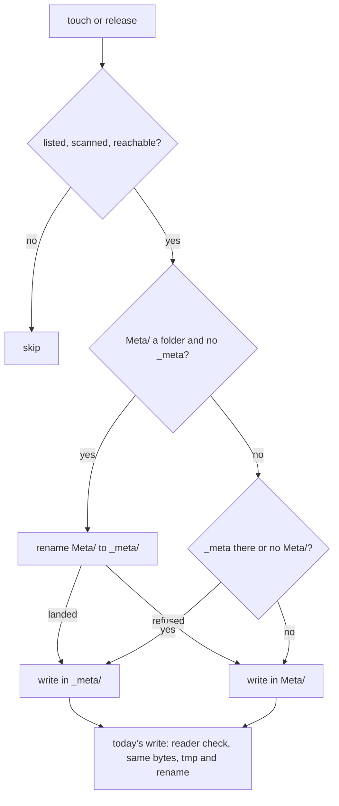

# 74: Sheet in sight

> **Initiative:** `sheet-in-sight`
> **PRD:** `docs/PRDs/74-sheet-in-sight.md`, issue #700
> **Handoff:** `docs/handoff/handoff-sheet-in-sight/`

This log is the `grill-me` session for step 56 of the build order, **Sheet in
sight**, held against the code as it stood on 2026-11-23 (`f9147521`). It is
an immutable snapshot of that moment. The session ran alone, and the
maintainer approved every recommendation in advance, asking that the codebase
stay consistent with its naming, code conventions, patterns and architecture.
Logs 41 (the sheet catch-up), 58 (folder layout), 61 (export round trip) and
67 (export paths) rule wherever this log does not say otherwise; this log
renames log 58's **Meta folder** and adds one write to the **Library sheet
writer**, the **Meta move** (Q4).

## Background

Step 56 came out of a **Factory reset** in real use. A maintainer added films
through the Movie form, posters linked by hand, then reset and scanned the
same Library folder again: the posters came back on their own. The **Library
sheet** did its job, but nobody knew it was there, so a reset that says
_Erase everything_ seemed not to. `Meta/` also sorts among hundreds of Title
folders, out of sight.

The checklist planned it on 2026-11-23: `Meta/` becomes `_meta/`, the
sheet is said aloud where a folder comes in and in the Reset dialog, and no
opt-out toggle. It left four things open: a way to start truly clean, the
line's wording and place, how Linux file managers sort `_meta`, and the
prototype amendment.

What the code does today, read before the session:

| Fact                    | Today                                                                                                                                                                                                                               |
| ----------------------- | ----------------------------------------------------------------------------------------------------------------------------------------------------------------------------------------------------------------------------------- |
| The name                | `META_FOLDER = 'Meta'` and `LIBRARY_SHEET_STEM` in `server/src/media/folderLayout/`; every reader and writer imports them                                                                                                           |
| The walk                | `walkLibraryFolder` passes a root folder named `Meta`, a system folder or an **Export folder** (`holdsMeta`: a folder holding `Meta/`) in silence; `sheetIn` answers `Meta/familyflix-library.csv`, else `.xlsx`, else `null`       |
| The **Sheet root**      | `sheetRootOf(sheetPath)`: the folder above the sheet's folder when that folder is named `Meta`, else the sheet's own folder                                                                                                         |
| The writer              | `createLibrarySheet`: `LIBRARY_SHEET = 'Meta/familyflix-library.csv'`; `writeOne` skips an unlisted, unscanned or unreachable folder, then a sheet the reader refuses, then a sheet whose bytes already match                       |
| When it writes          | `storage.onChange` touches each Library folder a write changed; a run's `release` rewrites each folder whose sheet it held, so every **Folder scan** and **Bulk import** that read a folder ends in a write to it                   |
| The Export              | `writeExport` writes `Meta/familyflix-library.<csv\|xlsx>` inside its new **Export folder**                                                                                                                                         |
| The importer            | reads the sheet through the walk's `sheet` path and `sheetRootOf`; it names `Meta/` only in docblocks                                                                                                                               |
| Where a folder comes in | `FolderShapes` (_What the scanner accepts_), drawn by **Import setup** and the Library folders page's group **Scan**, no props                                                                                                      |
| The Reset dialog        | `ResetDialog`'s `WHAT_STAYS`: _Your library folders and every file in them_ · _Your exports_ · _FamilyFlix itself_, plain strings                                                                                                   |
| The rules               | CLAUDE.md: the Library sheet writer "only ever rewrites `Meta/familyflix-library.csv`"; the glossary's **Meta folder**, **Library sheet**, **Library folder**, **Export folder**, **Export file**, **Sheet root**, **Title folder** |
| A precedent             | the **Delete dialog**'s _What stays_ already reads _Your original in its library folder, Scan all folders would bring it back_                                                                                                      |

## Problem

The **Library sheet** makes a reset recoverable, but the maintainer cannot see
it and is never told about it. Put the **Meta folder** where Explorer shows it
first, and say what it is and what it brings back where a folder comes in and
where a reset is confirmed, without breaking a library or an Export written
with `Meta/`.

## Questions and Answers

### Scope

1. **One initiative?** ✅ **One**, `sheet-in-sight`, step 56, log 74: the new
   name with both names read, the **Meta move**, and two lines of copy. ❌ Not
   built: an opt-out toggle (Q12), a _Start clean_ choice (Q11), a sheet
   viewer or an _Open folder_ button, any change to what the sheet holds.

2. **The spec?** ✅ **A handoff README,
   `docs/handoff/handoff-sheet-in-sight/README.md`, written in this
   session**, until phase 3 amends `feat.ImportFlow.dc.html`,
   `page.LibraryFoldersPage.dc.html`, `page.SettingsPage.dc.html` and
   `COMPONENT-SPEC.md` to it, log 73's way. The older handoff READMEs that
   say `Meta/` (`handoff-rebuild-whole`, `handoff-rebuild-edges`,
   `handoff-export-round-trip`) stay as written: they are history.

### The name

3. **Which name?** ✅ **`_meta`**, as planned. In Windows Explorer a leading
   underscore sorts above every name that starts with a letter or a digit,
   so the folder heads a Library folder of `Title (Year)` folders. Lowercase
   marks it as FamilyFlix's own, as the file inside it, `familyflix-library.csv`,
   already is; the household's slots (`Images`, `Subtitles`, `Season 01`)
   keep their capitals. ❌ **`_Meta`**: one capital among machine names says
   nothing the underscore does not. ❌ **`!meta`, `00 Meta`**: odd to read,
   and a digit prefix reads as a title. ❌ **`.familyflix`**: hidden by
   default on Linux and treated as a **system folder** by the walk, the
   opposite of in sight. The one edge: a Title folder opening on certain
   punctuation (`(500) Days of Summer`, `'71`) may sort above it; still at
   the top of the list.

4. **A held `Meta/`?** ✅ **Read, and moved by the writer: the Meta move.**
   Before writing a folder's sheet, after its three skips (unlisted,
   unscanned, unreachable), the **Library sheet writer** renames the root's
   `Meta/` to `_meta/` when `Meta/` is a folder and `_meta` is not there.
   One `rename`, so everything in it moves with it, an `.xlsx` included, and
   nothing is deleted. Then the write goes on as today, into `_meta/`. The
   move does not wait for a changed cell: a folder whose bytes already match
   is still moved. ❌ **Write into `_meta/` and leave `Meta/`**: two sheets,
   and the stale one comes back the day the maintainer deletes `_meta/` to
   start clean. ❌ **Copy the sheet across and delete `Meta/`**: a delete
   inside a Library folder, which FamilyFlix never does. ❌ **Move every
   folder at startup**: a new write trigger, when every rating and every scan
   already touches the folder.

5. **When both are there?** ✅ **`_meta/` rules and `Meta/` is left alone**:
   no move, no merge, no warning. The walk reads `_meta/`'s sheet; `Meta/`
   passes in silence. It only happens by hand, or by copying an old Export's
   folders into a library already moved. ❌ **A Layout warning**: a line the
   maintainer cannot act on in the app.

6. **A move that fails?** ✅ **The sheet is written where it lies, in
   `Meta/`, and the move is tried again at the next write.** On Windows a
   sheet open in Excel holds its folder, and the rename is refused; the
   library must not stop recording because of it. So the writer settles the
   folder to write in first: `_meta/` when it is there or the move landed or
   there is no `Meta/`, else `Meta/`. ❌ **Skip the write**: the sheet falls
   behind the library. ❌ **Write a second sheet in `_meta/`**: Q4's two
   sheets.

7. **Who reads either name?** ✅ **Every reader, by one rule in
   `folderLayout`**:

   ```ts
   /** The **Meta folder**: `_meta/` in a Library folder's or an Export's root. */
   export const META_FOLDER = '_meta';

   /** The **Old Meta folder**: `Meta/`, read until the **Meta move**. */
   export const OLD_META_FOLDER = 'Meta';

   /** Whether a root folder's name is a Meta folder's, either name. */
   export const isMetaFolder = (name: string): boolean =>
     name === META_FOLDER || name === OLD_META_FOLDER;
   ```

   - `walkLibraryFolder`: a root folder passes in silence when
     `isMetaFolder(entry.name)`; `holdsMeta` knows an **Export folder** by
     either name; `sheetIn` reads `_meta/` first, then `Meta/`, each `.csv`
     before `.xlsx`.
   - `sheetRootOf`: the folder above when `isMetaFolder(basename(folder))`, so
     a sheet uploaded out of an old Export's `Meta/` still finds its art.
   - The importer changes only its docblocks: it reads through the walk.
   - Exact names, as today: the walk compares what `readdir` gives, and
     Windows gives the folder's own spelling.

8. **The Export?** ✅ **Written to `_meta/` from now on**, through
   `META_FOLDER`; an old Export with `Meta/` is read as before (Q7). An Export
   folder is never moved: it is not a Library folder, and the writer never
   touches it. ❌ **An Export keeping `Meta/` for old readers**: the only
   reader is FamilyFlix, which reads both.

9. **Linux?** ✅ **Not chased.** GNOME Files and Dolphin sort by the system's
   collation, which in many locales sets the underscore aside, so `_meta` may
   sort among the M's. The household runs Windows; on Linux the two lines of
   Q10 and Q13 still say where the sheet is. ❌ **A name chosen for Linux
   too** (`!meta`, `0meta`): Q3's objections, for a machine the family does
   not use.

### Said aloud

10. **Where a folder comes in?** ✅ **One more line in `FolderShapes`**, the
    **Sheet note**: _What the scanner accepts_ is drawn on exactly the two
    screens a Library folder comes in by (**Import setup** and the Library
    folders page's group **Scan**), it already speaks of what the scanner
    reads, and it takes no props, so both screens say it the same. It is a
    second paragraph in the folder-first rule's style (`AcceptsRule`, 13px
    sans, 8px above), the path in `Mono`, backslashes as the shapes above it
    have:

    > FamilyFlix keeps a sheet of each folder’s titles in
    > `_meta\familyflix-library.csv` and reads it first, so a scan after a
    > reset or on another computer brings every title back as it was,
    > ratings, hearts and what’s been watched included.

    ❌ **A line on the Library folders page's add row**: one of the two
    screens only, and a new element there. ❌ **A snackbar after an add**:
    the prototype draws none (CLAUDE.md). ❌ **A new molecule**: one line
    in a block both screens already draw. ❌ **_Status_** in the line: the
    column's name, not the household's words; the Reset dialog says _watch
    history_ and the sheet holds only what's been watched, not positions.

11. **Starting truly clean?** ✅ **No new choice: delete `_meta/` by hand**,
    now that it heads the folder, and the Reset dialog says so (Q13). The
    writer writes a fresh sheet from the clean library at the scan's end.
    ❌ **A _Start clean_ choice on a scan that ignores the sheet**: a new
    control and a new scan mode for one maintainer once, and the sheet left
    on disk would disagree with the library until every folder's next write.

12. **An opt-out toggle?** ✅ **None**, as planned: the sheet is what makes a
    reset recoverable; an Export is a snapshot in its own folder and goes
    stale with the first rating after it. Log 58 made the sheet no longer a
    choice (story 70), and this step keeps that.

13. **The Reset dialog?** ✅ **One more item under _What stays_, second**,
    after the folders it lives in:

    | Item                                                                                                                                   |
    | -------------------------------------------------------------------------------------------------------------------------------------- |
    | Your library folders and every file in them                                                                                            |
    | Each library folder’s \_meta sheet: scanning the folder again brings its titles back as they were (delete \_meta first to start clean) |
    | Your exports                                                                                                                           |
    | FamilyFlix itself                                                                                                                      |

    A plain string in `WHAT_STAYS`, as the others are; no mono, no new
    markup. ❌ **Rewording the first item to carry it**: the folders line
    stays true and short. ❌ **A note under the lists**: a new element in a
    dialog that already draws two lists; the Delete dialog says its _Scan all
    folders would bring it back_ as an item, and this follows it.

### Names and documents

14. **The terms?** ✅ New: **Old Meta folder**, **Meta move**, **Sheet
    note**. Updated: **Meta folder**, **Library sheet**, **Library folder**,
    **Export folder**, **Export file**, **Sheet root**, **Title folder**,
    **Reset dialog**.

15. **Which documents change?** ✅ The handoff README (Q2); in phase 3
    `feat.ImportFlow.dc.html`, `page.LibraryFoldersPage.dc.html`,
    `page.SettingsPage.dc.html` and `COMPONENT-SPEC.md` (its **ImportFlow**,
    **LibraryFolders** and **ResetDialog** rows); the glossary (Q14); the
    checklist's step 56; CLAUDE.md's Architectural Boundaries line on the
    Library folder's writers (the writer now rewrites
    `_meta/familyflix-library.csv` and makes the one **Meta move**); the
    docblocks of `folderLayout`, `walkLibraryFolder`, `sheetRootOf`,
    `createLibrarySheet`, `writeExport`, `createImporter`, `FolderShapes`
    and `ResetDialog`. The README is untouched: no top-level folder or rule
    of its own changes.

### Tests

16. **What proves it?** ✅
    - `folderLayout.test.ts`: `isMetaFolder` takes `_meta` and `Meta`, and
      refuses `meta`, `_Meta`, `Meta (2019)`.
    - `walkLibraryFolder.test.ts`: `_meta/` and `Meta/` both pass in
      silence; a folder holding either is an Export folder; the sheet from
      `_meta/` when there, else from `Meta/`, `.csv` before `.xlsx` in each.
    - `sheetRootOf.test.ts`: both names answer the folder above.
    - `createLibrarySheet.metaMove.test.ts`, a new suite named by its
      concern: a held `Meta/` moved whole, a second file in it moved too,
      and the sheet written into `_meta/`; moved even when the bytes match;
      both folders there: `Meta/` untouched, `_meta/` written; a refused
      rename (a mocked `rename`) writes into `Meta/`, and the next write
      moves it; an unscanned or unreachable folder not moved.
    - `writeExport` and the export route tests: the sheet under `_meta/`.
    - The importer's suites keep their `Meta/` fixtures where they stand
      for an old library or an old Export (`oldExport`, `exportFolder`,
      `sheetRoot`), and the round-trip suites read `_meta/`.
    - `FolderShapes.test.tsx`: the Sheet note, its path in mono.
    - `ResetDialog.test.tsx`: _What stays_ lists four items, the sheet's
      second.

## Design

### Chosen and rejected

- ✅ `_meta/`, both names read, the writer's **Meta move**; ❌ leaving
  `Meta/` beside `_meta/`, ❌ a delete, ❌ a move at startup, ❌ a name
  chosen for Linux.
- ✅ A refused move writes where the sheet lies, and tries again; ❌ a
  skipped write.
- ✅ Said in `FolderShapes` and the Reset dialog; ❌ a snackbar, ❌ a new
  molecule, ❌ a note under the lists.
- ✅ Start clean by deleting `_meta/`; ❌ a _Start clean_ choice, ❌ an
  opt-out toggle.

### The writer, one folder



### The units

| Unit                       | Where                                          | Change                                                                     |
| -------------------------- | ---------------------------------------------- | -------------------------------------------------------------------------- |
| `folderLayout` (ch.)       | `server/src/media/folderLayout/`               | `META_FOLDER = '_meta'`, `OLD_META_FOLDER`, `isMetaFolder`                 |
| `walkLibraryFolder` (ch.)  | `server/src/media/walkLibraryFolder/`          | either name passed, known as an Export, read for the sheet, `_meta/` first |
| `sheetRootOf` (ch.)        | `server/src/import-export/sheetRootOf/`        | either name                                                                |
| `createLibrarySheet` (ch.) | `server/src/import-export/createLibrarySheet/` | the **Meta move**, and the folder to write in settled before each write    |
| `writeExport` (ch.)        | `server/src/import-export/writeExport/`        | `_meta/` through the constant; docblock                                    |
| `createImporter` (ch.)     | `server/src/import-export/createImporter/`     | docblocks only                                                             |
| `FolderShapes` (ch.)       | `src/features/import-export/FolderShapes/`     | the **Sheet note**                                                         |
| `ResetDialog` (ch.)        | `src/features/settings/ResetDialog/`           | the second _What stays_ item                                               |

`LIBRARY_SHEET` and its temporary file keep their names and follow
`META_FOLDER`; the writer joins the settled folder with the sheet's name
rather than the fixed path when the move was refused.

## Implementation Plan

1. **The new name, both read.** `folderLayout`'s constants and
   `isMetaFolder`; the walk and `sheetRootOf` reading either name; the
   writer and the Export writing `_meta/`. Demo: a fresh Library folder
   scanned and rated grows `_meta/familyflix-library.csv`, first in
   Explorer; an Export lands `_meta/`; an old Export with `Meta/` still
   imports with its art.
2. **The Meta move.** The writer's move and its refused path. Demo: copy a
   library with `Meta/`, scan it: `Meta/` is now `_meta/` with every file it
   held; with the sheet open in Excel the scan still records, in `Meta/`,
   and the next rating after Excel closes moves it.
3. **Said aloud.** The prototype and `COMPONENT-SPEC.md` amended to the
   handoff; the Sheet note in `FolderShapes`; the Reset dialog's item; the
   documents of Q15. Walk it live in the shell: Import setup and the Library
   folders page draw the note, the Reset dialog lists four items under
   _What stays_, and a reset then a scan brings the library back.

## Trade-offs

- **Easier:** the sheet is the first thing in a Library folder, and the
  maintainer is told what it is twice, before a scan and before a reset; a
  clean start is one visible folder to delete.
- **Harder:** the writer now renames a folder once, a second kind of write
  inside a Library folder, which CLAUDE.md's rule must say; every reader
  knows two names for good, since an Export written before this step may
  turn up years later.
- **Out of scope:** a _Start clean_ choice (Q11), an opt-out (Q12), sorting
  on Linux (Q9), any change to the sheet's columns or to when it is written.
