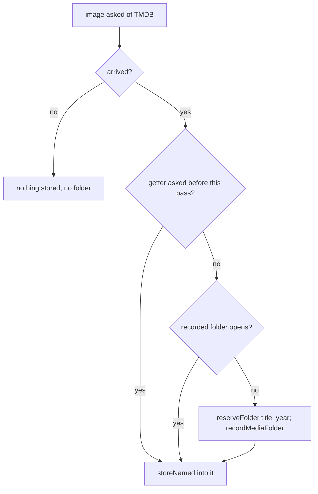

# 75: Poster pick

> **Initiative:** `poster-pick`
> **PRD:** to come, from `write-a-prd`
> **Handoff:** `docs/handoff/handoff-poster-pick/`

This log is the `grill-me` session for step 57 of the build order, **Poster
pick**, held against the code as it stood on 2026-11-24 (`817f7d95`). It is
an immutable snapshot of that moment. The session ran alone, and the
maintainer approved every recommendation in advance, asking that the codebase
stay consistent with its naming, code conventions, patterns and architecture.
Logs 33 (single-title Sync), 39 (season posters), 41 (link or copy), 45 (add
and sync), 48 (add a show folder) and 69 (silent waits) rule wherever this
log does not say otherwise; this log restores log 41's rule that a linked
title still has a **Media folder** for everything but its videos, and adds
one line to the **Season choice**'s card.

## Background

Step 57 came out of a single-series Sync in real use. On the Death Note
series page, the Sync's review offered each season a row of TMDB posters,
but pressing one set nothing: the held tile kept reading _No poster yet_,
however many times a poster was pressed.

What the code does today, read before the session:

| Fact                    | Today                                                                                                                                                                                                                                                   |
| ----------------------- | ------------------------------------------------------------------------------------------------------------------------------------------------------------------------------------------------------------------------------------------------------- |
| The rule                | the glossary's **Series folder**: "reserved for a linked show too, holding everything but its videos (log 41)"                                                                                                                                          |
| A Show folder pick      | `POST /series` reserves a Series folder only when a part sends bytes or `findsFiles` (a video or subtitle to copy in); a pick of linked videos with no art sends neither, so the row is written with `media_folder` `NULL`                              |
| A linked Movie form add | `POST /movies` reserves only for a part with bytes or a found video copied in; a linked video with no art leaves `media_folder` `NULL`, the same gap                                                                                                    |
| A Bulk import           | always reserves (`importMatch`, the show's `held?.folder ?? media.reserveFolder`): no gap                                                                                                                                                               |
| An edit                 | `PATCH /movies/:id` and `PATCH /series/:id` open the recorded folder, else reserve one and record it as `mediaFolder` when the edit commits (log 51's follow-up)                                                                                        |
| The Sync                | `storeImage(current, folder: string \| null, …)` answers `null` for a `null` folder; `writeShow` reads `seriesFolder` once; `writeEpisodes` skips every Still (TMDB's and the **Frame still**) while `seriesFolder === null`; `write` (a film) the same |
| The Season choice       | `chooseSeasonPoster`: `mediaFolderOf('series', id) === null` answers `not-found`, which the route sends as `404` _No sync holds that season._                                                                                                           |
| The page                | `EnrichmentFlow.onChooseSeasonPoster` swallows the rejection; `SeasonChoices` keeps its local `picked` mark on the pressed card, so the card reads chosen while the tile reads _No poster yet_                                                          |
| The prototype           | `feat.EnrichmentFlow.dc.html` and COMPONENT-SPEC's **Seasons**: "A press stores that image … no snackbar, no confirm"; no refused state drawn                                                                                                           |
| Tests                   | no suite pins the folder-less skip; `createEnrichment.mediaFolder.test.ts` pins that art goes into the recorded folder                                                                                                                                  |

So every Sync of a show or film added linked without art stores nothing at
all: no poster, no backdrop, no Season poster, no Still. **Add and sync**
(log 45) hits it on every such add.

## Problem

Make a picked season poster land, and every image a Sync writes with it, for
a title that was added with no **Media folder**; and make a refused pick say
so instead of looking chosen.

## Questions and Answers

### Scope

1. **One initiative?** ✅ **One**, `poster-pick`, step 57, log 75: the
   folder reserved when art first needs one, for every image a Sync or a
   Season choice writes, films too; and the **Poster refusal** line. ❌ Not
   built: a migration (Q4), a change to the adds (Q3), a snackbar (Q9), any
   change to what a Sync fetches or offers.

2. **The spec?** ✅ **A handoff README,
   `docs/handoff/handoff-poster-pick/README.md`, written in this session**,
   until the last phase amends `feat.EnrichmentFlow.dc.html` and
   `COMPONENT-SPEC.md` (its **Seasons** paragraph) to it, log 74's way. The
   server half has no face and needs no prototype.

### The folder

3. **Where is the gap closed?** ✅ **In the Sync, the one writer that finds
   it**: the first time a Sync or a Season choice has an image in hand for a
   title with no usable Media folder, it reserves one by the title's name and
   year (`media.reserveFolder`) and records it, and the title keeps it from
   then on. It is the edits' rule (log 51), moved to the other writer of
   art. ❌ **Reserve on every add, empty**: fixes new adds but not the held
   rows, so the Sync needs the fallback anyway, and an add that never takes
   art would leave an empty folder behind. ❌ **Store a linked title's art in
   its Library folder**: the Layout fill already copies art there, and
   CLAUDE.md lets nothing else write into a Library folder.

4. **A held library?** ✅ **Fixed at its next Sync, no migration.** The
   migrations are SQL only; one that made folders on disk would be the
   first, and it would make an empty folder for every linked title that may
   never be synced. The maintainer will Sync the show again to pick its
   posters, which is the moment the folder is needed. ❌ **A migration**, for
   that reason.

5. **When exactly is it reserved?** ✅ **After the image has arrived, just
   before it is stored**, through a lazy getter made once per title pass, so
   a Sync whose fields leave out Poster, or whose TMDB images fail, makes no
   folder. The getter's answer is memoised: the poster, the backdrop, each
   Season poster and each Still of one pass share the one folder. A recorded
   folder that is gone (`openFolder` answers `null`) is reserved over and the
   new one recorded, as the edits do. A store that fails after the reserve
   leaves the folder recorded and empty; the next Sync reuses it. ❌
   **Reserve before fetching**: an empty folder for a Sync that stores
   nothing.

6. **The unit?** ✅ **`lateReserve`, a new enrichment module**, in its own
   folder with its test:

   ```ts
   // server/src/enrichment/lateReserve/lateReserve.ts
   /**
    * A title's **Media folder** as a lazy getter: the recorded one when it
    * opens, else one reserved by the title's name and year and recorded,
    * the **Late reserve**. Answers the recorded name `storeNamed` takes;
    * reserves at most once, however often it is asked.
    */
   export function lateReserve(
     deps: { storage: LibraryStorage; media: Media },
     kind: 'movie' | 'series',
     title: { id: string; title: string; year: number | null }
   ): () => string;
   ```

   Plus one storage write beside `mediaFolderOf` in
   `server/src/library/enrich/enrich.ts`:

   ```ts
   /** Record `folder` as the title's **Media folder**, over a gone one. */
   recordMediaFolder(kind: 'movie' | 'series', id: string, folder: string): void;
   ```

   It throws what `reserveFolder` throws; every caller already wraps its
   store in a `try`, so a disk that refuses reads as an image not stored.
   ❌ **The getter inside `media/`**: `Media` knows folders, not rows; the
   storage write belongs to the library domain, and enrichment is where both
   are composed, as the routes compose them for an edit. ❌ **A name like
   `artFolder`**: a second word for the Media folder.

7. **What changes in `createEnrichment`?** ✅ `storeImage` takes `folder: ()
=> string` and calls it inside its `try`, after the image is in hand; its
   `folder === null` branch goes. `write` (a film) makes one
   `lateReserve(deps, 'movie', movie)` for its poster and backdrop.
   `writeShow` makes one for the series and hands it to `writeSeries` and
   `writeEpisodes`, whose `seriesFolder !== null` guard goes, so the Frame
   still is taken again too. `chooseSeasonPoster` makes its own, called
   inside its `try` after the image arrived; its `folder === null →
not-found` goes, so `not-found` means only "no single-series run holds
   that season", as its docblock already says.

8. **Films too?** ✅ **Yes**, by the same unit: a linked film added through
   the Movie form with no art has the same gap, and `write` is the same
   shape. ❌ **Series only**: the planned title says "on a linked show too",
   but leaving the film's half would be the same bug found again.

### The refused pick

9. **What does a refused pick show?** ✅ **A line on the season's card, the
   Poster refusal**, not a snackbar: CLAUDE.md allows a snackbar only where
   the prototype draws one, the Seasons section is drawn "no snackbar", and a
   line beside the tile says which season failed when several are being
   picked. ❌ **A snackbar**, for those reasons. ❌ **The server's sentence**
   (`Couldn’t reach TMDB.`, `The poster could not be saved.`): a new error
   class on the wire for words the household cannot act on differently; the
   remedy is the same press.

10. **Its copy and place?** ✅ _That poster wasn’t saved. Try again._, under
    the picker inside the season's card, 13px sans in `--color-danger`, 10px
    above, `role="status"`. Drawn once the season's **Busy phase** is back to
    `idle` after a refusal (the Loader timing's rule, log 69), and gone at the
    season's next press. While it is drawn no choice of that season carries
    the pressed mark, so the card never reads chosen when nothing was. The
    held caption (_No poster yet_ / _Current poster_) stays as it is: it
    tells the truth already.

11. **Who holds it?** ✅ **The run hook**, beside `seasonPhase`:
    `useEnrichmentRun` answers `seasonRefused(season): boolean`, set when a
    season's `saveSeasonPoster` rejects and cleared when that season is sent
    again; the hook still rejects to the caller. `EnrichmentReview` passes it
    through to `SeasonChoices` as a `seasonRefused` prop, as it passes
    `seasonPhase`. `EnrichmentFlow`'s catch stays, its comment saying the
    card says so. ❌ **State in `SeasonChoices`** off a promise-returning
    `onChoose`: every other review callback is `void`, and the hook already
    keys each season's phase.

### Names and documents

12. **The terms?** ✅ New: **Late reserve**, **Poster refusal**. Updated:
    **Media folder**, **Series folder**, **Season choice**.

13. **Which documents change?** ✅ The handoff README (Q2); in the last
    phase `feat.EnrichmentFlow.dc.html` (a refused state on one season card)
    and `COMPONENT-SPEC.md`'s **Seasons** paragraph; the glossary (Q12); the
    checklist's step 57; the docblocks of `storeImage`, `writeSeries`,
    `writeShow`, `chooseSeasonPoster` (in the `Enrichment` interface too),
    `SeasonChoices` and `useEnrichmentRun`. CLAUDE.md and the README are
    untouched: no rule or top-level folder changes; the Media folder was
    always meant to be there.

### Tests

14. **What proves it?** ✅
    - `lateReserve.test.ts`: a recorded folder that opens is answered and
      nothing reserved; none recorded, one reserved by title and year and
      recorded; a recorded folder that is gone, reserved over and recorded;
      asked three times, reserved once; never asked, nothing reserved.
    - `enrich.test.ts` (or the storage suite that holds `mediaFolderOf`):
      `recordMediaFolder` for a film and a series.
    - `createEnrichment.lateReserve.test.ts`, a new suite named by its
      concern, over a real library and `Media` and the fake TMDB: a series
      with no Media folder synced lands its poster, backdrop, Season posters
      and Stills in one new folder, recorded; a film the same; Poster off, no
      folder made; a Season choice on such a series answers `chosen` and the
      held tile's url follows it.
    - `createEnrichment.seasonChoices.test.ts`: the `not-found` case for a
      folder-less series goes; `not-found` stays for no run.
    - `useEnrichmentRun.seasonPoster.test.ts`: a refused choice answers
      `seasonRefused(n) === true` once idle; the next press clears it; another
      season is untouched.
    - `SeasonChoices.test.tsx`: with `seasonRefused` the line is drawn under
      the picker and no choice is pressed; without it, no line.

## Design

### Chosen and rejected

- ✅ The **Late reserve** in the Sync and the Season choice, after the image
  arrives; ❌ reserving on every add, ❌ a migration, ❌ art in the Library
  folder, ❌ reserving before the fetch.
- ✅ Films and series by one unit; ❌ series only.
- ✅ The **Poster refusal** line, held by the hook; ❌ a snackbar, ❌ the
  server's sentence, ❌ state in `SeasonChoices`.

### One image stored



### The units

| Unit                     | Where                                       | Change                                                                             |
| ------------------------ | ------------------------------------------- | ---------------------------------------------------------------------------------- |
| `lateReserve` (new)      | `server/src/enrichment/lateReserve/`        | the lazy, memoised Media folder                                                    |
| `LibraryStorage` (ch.)   | `server/src/library/enrich/`                | `recordMediaFolder(kind, id, folder)`                                              |
| `createEnrichment` (ch.) | `server/src/enrichment/createEnrichment/`   | `storeImage` takes the getter; `write`, `writeShow`, `chooseSeasonPoster` make one |
| `useEnrichmentRun` (ch.) | `src/features/enrichment/useEnrichmentRun/` | `seasonRefused(season)`                                                            |
| `EnrichmentReview` (ch.) | `src/features/enrichment/EnrichmentReview/` | passes `seasonRefused` through                                                     |
| `EnrichmentFlow` (ch.)   | `src/features/enrichment/EnrichmentFlow/`   | hands `seasonRefused` down; the catch's comment                                    |
| `SeasonChoices` (ch.)    | `src/features/enrichment/SeasonChoices/`    | the **Poster refusal** line; no pressed mark while refused                         |

## Implementation Plan

1. **A linked show's poster lands.** `recordMediaFolder`, `lateReserve`,
   and `chooseSeasonPoster` and `writeShow` (with `writeSeries` and
   `writeEpisodes`) using it. Demo: add a show by the **Show folder pick**
   with no art, Sync it alone: its poster, backdrop, Season posters and
   Stills land, and pressing a season's poster replaces the held tile.
2. **A linked film's art lands.** `write` on the same unit. Demo: add a
   linked film with no art through the Movie form with _Add and sync_: its
   poster and backdrop land.
3. **A refused pick says so.** The prototype and COMPONENT-SPEC amended to
   the handoff; `seasonRefused` in the hook, the review and the Flow; the
   line in `SeasonChoices`. Walk it live in the shell: with the network cut
   after the review opens, a press draws _That poster wasn’t saved. Try
   again._ on that season's card and no choice reads pressed; with it back, a
   press lands and the line goes.

## Trade-offs

- **Easier:** every title has a Media folder by the time it holds art,
  however it was added, so the Sync, the Layout fill and a Delete find one
  rule; a refused pick is no longer mistaken for a chosen one.
- **Harder:** the Sync now creates folders in the managed directory, a write
  only adds and edits made before; a reserve whose store then fails leaves
  one empty recorded folder (harmless, reused).
- **Out of scope:** the adds themselves (Q3), a migration (Q4), wording per
  refusal (Q9), and any change to which posters a Season choice offers.
