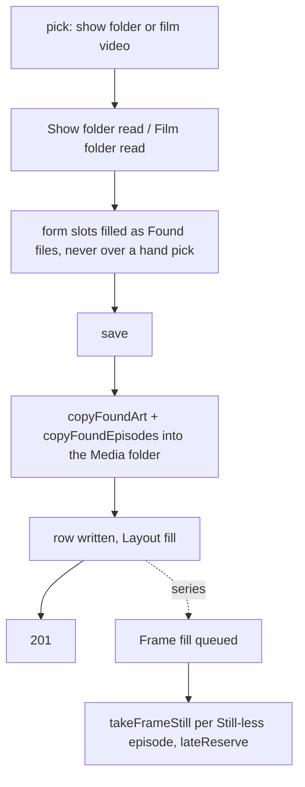

# 76: Whole add

> **Initiative:** `whole-add`
> **PRD:** to be written (`docs/PRDs/76-whole-add.md`)
> **Handoff:** `docs/handoff/handoff-whole-add/`

This log is the `grill-me` session for step 58 of the build order, **Whole
add**, held against the code as it stood on 2026-11-25 (`57db64ed`). It is an
immutable snapshot of that moment. The session ran alone, and the maintainer
approved every recommendation in advance, asking that the codebase stay
consistent with its naming, code conventions, patterns and architecture.
Logs 11 (the movie form), 41 (link or copy), 44 (frame stills), 48 (add a
show folder), 58 (the Folder layout), 69 (silent waits) and 75 (poster pick)
rule wherever this log does not say otherwise; this log lifts log 11's "the
form does not collect" a backdrop, and keeps log 41's rule that art is always
copied.

## Background

Step 58 came out of a walk through **Add a title** with a whole show in hand
(`The Show (2019)\`: a poster and a backdrop in `Images\`, four **Season
folders** of twelve episodes, each with its own `Images\poster.jpg` and a
`Subtitles\S01E01\` folder per episode). The checklist's step 58 lists what
the code does today; read again before the session:

| Fact                       | Today                                                                                                                                                                                                                                 |
| -------------------------- | ------------------------------------------------------------------------------------------------------------------------------------------------------------------------------------------------------------------------------------- |
| The Show folder read       | `readShowFolder`'s `showUnder` calls `numberShow` with `poster: null, backdrop: null`; `numberShow` already carries each **Season poster** and each episode's **Still** (`ShowScan`), but `ShowFolderRead` answers neither            |
| The art reader             | `readTitleFolder` reads a folder's `Images/` poster and backdrop by role inline; `readSeasonFolder` reads a season's poster and its `Images/Stills/` by **Episode tag**                                                               |
| The series add's wire      | `POST /series` takes a found video (`videoPath`) and found tracks (`storedSubtitles`); the poster, each Season poster and each Still only as bytes                                                                                    |
| The movie add's wire       | `POST /movies` takes a found video (`videoPath`); the poster only as bytes; tracks "**Bytes only**, on this route"                                                                                                                    |
| The form                   | `MovieFormValues.poster`; "There is no backdrop beside it"; `SeasonPosterSlot`s and a **Still** slot per row (`stills`, none in a Series Resolve); `MovieFormFile` has a `found` arm                                                  |
| A movie video pick         | `useImportMode.readVideo`: the **Path bridge**'s path and the containing read (`GET /library-folders/containing`), nothing else                                                                                                       |
| Found kinds                | `foundPathRefusal(path, 'video' \| 'subtitle')`                                                                                                                                                                                       |
| The Frame still            | taken only inside a Sync's `writeEpisodes` (`playback.frame`, `<stem>.frame.jpg` by `storeNamed` into the Series folder's `season-NN/`, Still source `frame`); the **Layout fill** never writes one                                   |
| A folder Still's source    | the scan stores `picked` (`createImporter`)                                                                                                                                                                                           |
| _What the scanner accepts_ | `FolderShapes`: three shapes, two of them retired by log 58 (`subs.en.srt` beside the video, loose episodes at a show's root), the folder-first rule (also retired: the season comes only from the Season folder), the **Sheet note** |

## Problem

Let **Add a title** give the same complete title a **Folder scan** gives,
movie and series, with or without TMDB: a Backdrop, the art and tracks the
picked folder already holds, and Stills for a show no Sync will ever reach;
and make _What the scanner accepts_ say the layout as log 58 reads it.

## Questions and Answers

### Scope

1. **One initiative?** ✅ **One**, `whole-add`, step 58, log 76: the
   **Backdrop** slot, **Folder art** from the **Show folder pick** and the
   **Film folder read**, the **Frame fill**, and the rewritten scanner block.
   ❌ Not built: any folder read in a browser (Q13), a Backdrop on a Resolve
   (Q4), a Frame fill after a Folder scan or a Resolve (Q19), merging the
   containing read into the Film folder read (Q12).

2. **The spec?** ✅ **A handoff README,
   `docs/handoff/handoff-whole-add/README.md`, written in this session**,
   until the last phase amends `feat.MovieForm.dc.html` (the Backdrop slot on
   both kinds), `feat.ImportFlow.dc.html` and `page.LibraryFoldersPage.dc.html`
   (the scanner block) and `COMPONENT-SPEC.md` to it, log 75's way.

### The Backdrop slot

3. **Where is it drawn?** ✅ **Directly under Poster** in both kinds' Files
   card, the same `mol.FileField`: label _Backdrop_, choose label _Choose
   backdrop image_, the `poster` icon (the image glyph; no new icon). On the
   series kind it sits between Poster and _Season posters_. In the shell and
   in a browser alike: a browser sends bytes.

4. **Which contexts?** ✅ **The add and the edit**, both kinds. ❌ **A
   Resolve**: the importer's `resolveMovie` / `resolveSeries` take a `poster`
   and no backdrop, and a control whose mechanism doesn't exist isn't drawn
   (CLAUDE.md), the precedent being the Still slot (`stills: false` on a
   Series Resolve). A Resolve's backdrop is a follow-up.

5. **Its wire?** ✅ **The Poster's, word for word**: a `backdrop` part for a
   Picked file, a `backdropPath` field for a held **Stored path** on an edit
   or a **Found file** on an add (Q7). On an edit the body is the whole
   record: neither is a removed backdrop, and the file it replaced goes after
   the commit, as a replaced poster does. `MovieFormValues` gains
   `backdrop: MovieFormFile | null`; `loadFormRecord` fills it from the held
   `backdropPath`; the uploads collectors (`collectUploads`,
   `collectEpisodeUploads`) take a `backdrop` part as they take `poster`; the
   add and edit routes store it as `backdrop_path`. The docblock "There is no
   backdrop beside it" and the route's "the form does not collect one" go.
   The **Layout fill** already writes a backdrop into `Images\`.

### Folder art on the wire

6. **Linked or copied?** ✅ **Copied, always**: CLAUDE.md's media rule (art
   and subtitles are always copied) and log 41 stand. A Found image is copied
   by `Media.copyIn` (which fits art on its way in) into the title's **Media
   folder**; an add whose only copies are images still reserves one, so every
   title holding art has one at save (log 75's rule, met at the add). ❌
   **Linking art where it lies**: a second kind of stored art path, and the
   Library folder's copy is the Layout fill's to own.

7. **How does each found image travel?** ✅ **As its absolute path in the
   field a held one uses**, read on the **add** as a Found file and refused by
   `foundPathRefusal` unless absolute and of its kind; `FoundKind` gains
   `'image'` (`isImageFilename`). The fields: `posterPath` and `backdropPath`
   (both kinds), a `seasonPoster` field's `path`, an `episode` field's
   `stillPath`, and on the movie add a found track's `subtitlePath`, which the
   add now reads ("Bytes only" goes). Where they land: a title's poster and
   backdrop at its Media folder's root; a Season poster and a Still in
   `season-NN/` (`media.seasonFolder`); a movie's tracks at the root, as
   picked ones. A Still that arrived this way has the **Still source**
   `picked`, as the scan's does, so a Sync never replaces it. A copy that
   breaks is the save's failure and takes the folder with it.

8. **Which units copy?** ✅ `copyFoundEpisodes` copies an episode's found
   `stillPath` beside its found tracks (it already owns each episode's files)
   and answers it in `CopiedEpisode.still`; a new
   `server/src/import-export/copyFoundArt/copyFoundArt.ts` copies a title's
   found poster, backdrop and Season posters for both adds:

   ```ts
   /** A title's **Folder art** as an add names it: absolute Found files. */
   export interface FoundArt {
     poster?: string;
     backdrop?: string;
     seasonPosters?: readonly { season: number; path: string }[];
   }
   /** Where each landed: its **Stored path**, Season posters by season. */
   export interface CopiedArt {
     poster?: string;
     backdrop?: string;
     seasonPosters: { season: number; path: string }[];
   }
   /**
    * Copy each found image of `art` into the Media folder `folder` with
    * `Media.copyIn`, a Season poster into its `season-NN/`. Rejects on the
    * first copy that breaks; the caller takes the folder back.
    */
   export function copyFoundArt(
     media: Media,
     folder: string,
     art: FoundArt
   ): Promise<CopiedArt>;
   ```

   ❌ **Copying inline in each route**: `POST /series` is already the longest
   route; the two adds share the rule.

### The Show folder pick

9. **What does the read answer?** ✅ **Its whole Layout read**:
   `ShowFolderRead` gains `poster` and `backdrop` (absolute or `null`) and
   `seasonPosters: { season: number; path: string }[]` (only the seasons
   holding one, in number order); `ShowFolderEpisode` gains `still: string |
null`. Read by the scan's own readers, no second rule: the art reader is
   lifted out of `readTitleFolder` as an export of
   `server/src/media/readTitleFolder/readTitleFolder.ts`,

   ```ts
   /** A folder's **Poster** and **Backdrop** by role from its `Images/`, the first of each by name order. */
   export async function readTitleArt(
     dir: string
   ): Promise<{ poster: string | null; backdrop: string | null }>;
   ```

   which `readTitleFolder` then calls, and `showUnder` passes it to
   `numberShow`. It reads the **Show folder** (`showFolderOf(dir)`), so a
   picked Season folder still brings its show's poster. A place two files
   fill reads the first by name order, the scan's rule; the form draws no
   **Doubled place**.

10. **How does the form take it?** ✅ **Into the slots, as Found files, the
    Folder key's rule**: a slot is filled when it is empty or still holds
    the earlier pick's file, never over one picked by hand. The Poster, the
    Backdrop, each _Season posters_ slot (drawn once the rows hold the
    season) and each row's Still slot. Each is replaceable and removable by
    hand like any slot. The Show folder row's ✕ takes the rows and every
    slot still holding the pick's art; a hand-replaced slot stays. Units:
    `showFolderRows` sets each row's `still`; `useShowFolderPick` takes
    `prefillFolderArt: (art: FolderArt, picked: FolderArt | null) => void`
    beside `prefillFolderKey`, and remembers the art it offered as it does
    the key; `useSeasonPosters` gains the same prefill for its slots. The
    shared shape lives in `src/types/form.ts`:

    ```ts
    /** The **Folder art** a pick found: absolute paths, `null` for none. */
    export interface FolderArt {
      poster: string | null;
      backdrop: string | null;
      /** Season posters by season number. */
      seasonPosters: Record<number, string>;
    }
    ```

### The movie pick

11. **When does a movie pick read its folder?** ✅ **In the shell, on a
    plain add, the moment a video is picked**, as the Show folder pick is
    offered only there. ❌ **A Resolve**: its Found files already fill the
    slots. ❌ **An edit**: the video is held, and a replacement pick filling
    art over a held title's would surprise.

12. **What answers?** ✅ **The Film folder read**, `GET
/api/film-folder?video=<absolute path>`, `importer.readFilmFolder` over a
    new `server/src/import-export/readFilmFolder/readFilmFolder.ts`:
    `readTitleFolder(dirname(video))`, and when that reads as a `film` whose
    videos include the picked one, its `poster`, `backdrop` and `subtitles`
    (path and language); anything else (a series, a left-out folder, a
    folder that cannot be read) answers all empty. A path that is not
    absolute or not a video is a `400` by `foundPathRefusal`.

        ```ts
        /** `src/types/form.ts`: what a movie pick's folder holds. */
        export interface FilmFolderRead {
          poster: string | null;
          backdrop: string | null;
          subtitles: { path: string; language: string }[];
        }
        ```

        ❌ **Folding it into the containing read**: the containing read is
        `useImportMode`'s and answers a Library folder; one read per question
        keeps both small. ❌ **Under `media/`**: a read the route asks of a
        domain goes through the importer, as `readShowFolder` does.

13. **A folder holding two videos?** ✅ **No Found-file choice**: the
    maintainer already picked the video, and the folder's art and tracks are
    the title's either way. The _more than one video_ **Problem** is a scan's,
    which has no pick. The fill is the same.

14. **How does the form take it?** ✅ **Q10's rule**: the Poster and
    Backdrop slots as Found files, each track a found row with its language
    after the hand-added rows; a later pick replaces only the earlier pick's
    fills; the video slot's ✕ takes the fills still in place. No loader: the
    read is two `readdir`s at the containing read's moment, which draws none
    either; an answer that lands after a later pick or after the ✕ changes
    nothing (the `videoPick` counter's rule). The unit is a hook of its own,
    `src/features/movie-form/useFilmFolderPick/`, on `useShowFolderPick`'s
    pattern, reading the path through `folderBridge()`; the wire call
    `readFilmFolder` joins `movie-form/api/`.

15. **And a browser?** ✅ **Unchanged**: it has no paths, so no folder read
    and no Show folder pick; it copies what it is given (CLAUDE.md), now with
    a Backdrop slot. ❌ **`<input webkitdirectory>`**: a second, client-side
    Layout reader and every byte uploaded, for the dev loop alone.

### Stills without a Sync

16. **When is a Frame still taken?** ✅ **After the save has answered, in the
    background: the Frame fill.** The series page draws each row's gradient
    until its Still lands and shows it on its next read. ❌ **On save**: up to
    48 takes of up to the 20 s **Frame budget** would hold the save. ❌ **On
    first view**: a read that writes files, and a season page spawning a
    process per row. ❌ **A job with a progress bar**: it moves no large file
    and blocks nothing, so the rule for **Large-file operations** does not
    apply, and nothing on screen waits for it.

17. **The unit?** ✅ `server/src/enrichment/createFrameFill/`, beside the
    Sync that already owns the Frame still and the **Late reserve**:

        ```ts
        export interface FrameFillDeps {
          storage: Pick<
            LibraryStorage,
            | 'getSeriesDetail'
            | 'stillSourcesOf'
            | 'enrichEpisode'
            | 'mediaFolderOf'
            | 'recordMediaFolder'
          >;
          media: Media;
          playback: Pick<Playback, 'frame'>;
        }
        /** The **Frame fill** a series save starts. */
        export interface FrameFill {
          /**
           * Take a **Frame still** for each of the series' episodes holding no
           * Still, queued behind any fill in flight, one take at a time; a
           * series already waiting is filled once. Resolves when its turn is
           * done; never rejects.
           */
          fill(seriesId: string): Promise<void>;
        }
        export function createFrameFill(deps: FrameFillDeps): FrameFill;
        ```

        At its turn it reads the series again (gone: nothing, so a Delete or a
        Reset mid-queue reserves no folder), takes each Still-less episode in
        season, then episode order, specials included, stores it through one
        `lateReserve` per series, and writes `stillPath` and `stillSource:

    'frame'`. Just before writing it reads the episode's Still source again:
    a Still that landed meanwhile wins, and the picture is dropped. The take
    and its name are lifted out of `writeEpisodes`into
   `server/src/enrichment/takeFrameStill/takeFrameStill.ts`, so the Sync and
    the fill spell `<stem>.frame.jpg`once. Wired in`server/src/main.ts`and
    injected into`createApiRouter`as`frameFill`, as `layoutFill`is;
   `POST /series`and`PATCH /series/:id`call`void frameFill.fill(id)`    after the Layout fill. Movies take none. ❌ **In`playback/`\*\*: playback
    knows no rows, and the Late reserve is enrichment's.

18. **A linked show's Stills in its folder?** ✅ **No change**: the Layout
    fill never writes a Frame still (log 44's rule, kept by log 58); a Still
    found in the folder came from its slot there, so the fill finds the slot
    full. A Frame still lives only in the Series folder.

19. **With a Sync, or after a scan?** ✅ **The Sync is unchanged**: it still
    takes a Frame still where TMDB offers none and replaces a `frame` Still
    with TMDB's, so _Add and sync_ ends with TMDB's stills where TMDB has
    them. A Sync that planned before a fill stored may store a second frame;
    the older file stays in the Series folder, unreferenced, and goes with
    it on a Delete. A **Folder scan** and a **Resolve** start no Frame fill:
    a follow-up, filed when the PRD is cut.

### The scanner block

20. **What does _What the scanner accepts_ say?** ✅ **The layout as log 58
    reads it**, in `FolderShapes` (its name kept): a movie and a series
    example side by side in mono, then three rules in the sans rule style,
    then the **Sheet note** as it stands. The copy and layout are the
    handoff's. ❌ **The three shape lines kept and corrected**: one line per
    shape cannot show `Images\` and `Subtitles\`.

### Names and documents

21. **The terms?** ✅ New: **Folder art**, **Film folder read**, **Frame
    fill**. Updated: **Show folder read**, **Show folder pick**, **Found
    file**, **Frame still**, **Backdrop**, **Copy-in**.

22. **Which documents change?** ✅ The handoff README (Q2); in the last phase
    `feat.MovieForm.dc.html`, `feat.ImportFlow.dc.html`,
    `page.LibraryFoldersPage.dc.html` and `COMPONENT-SPEC.md` (**MovieForm**'s
    Files and **ImportFlow** / **LibraryFolders**' `FolderShapes`
    descriptions); the glossary (Q21); the checklist's step 58; CLAUDE.md's
    **Movie form** product rule (a show taken whole "with its art", a film's
    art and tracks read from its folder); the docblocks of `MovieFormValues`,
    `ShowFolderRead`, `readShowFolder`, `useShowFolderPick`,
    `copyFoundEpisodes`, `foundPathRefusal`, `writeEpisodes` and the two add
    routes. The README is untouched: no top-level folder or rule changes.

### Tests

23. **What proves it?** ✅
    - `readTitleFolder` suites unchanged and passing (the lift is a
      refactor); `readTitleArt` covered by a new
      `readTitleFolder.titleArt.test.ts`.
    - `readShowFolder.art.test.ts`: the show's poster and backdrop, each
      Season poster, each episode's Still; a picked Season folder answers its
      show's art; a folder with none answers `null`s and no Season posters.
    - `readFilmFolder.test.ts`: a film's art and tracks; a series folder, a
      left-out one and an unreadable one answer empty; a folder of two videos
      answers its art.
    - `copyFoundArt.test.ts`; `copyFoundEpisodes` gains the still case.
    - `routes.addSeriesFolderArt.test.ts`, `routes.addMovieFolderArt.test.ts`:
      found art copied into a reserved Media folder for a linked title, a
      found Still stored as `picked`, a relative or wrong-kind path refused
      with nothing on disk; `routes.backdrop.test.ts`: a backdrop added,
      kept, replaced and removed on both kinds' edit; `routes.filmFolder.test.ts`.
    - `createFrameFill.test.ts` over a real library, Media and a fake
      `frame`: every Still-less episode filled, a held Still untouched, a
      second `fill` while queued filled once, a series deleted while queued
      reserves nothing, a Still landing mid-take wins.
    - `routes.frameFill.test.ts`: a series add answers before the fill ends,
      and the Stills land after.
    - Form: `useShowFolderPick.art.test.ts`, `useFilmFolderPick.test.ts`,
      `MovieForm.backdrop.test.tsx`, `MovieForm.folderArt.test.tsx` (a pick
      fills the slots, never over a hand pick; the ✕ takes them back);
      `formValues.test.ts` for `showFolderRows`' Still.
    - `FolderShapes.test.tsx`: the two examples, the three rules, the Sheet
      note.

## Design

### Chosen and rejected

- ✅ A **Backdrop** slot under Poster on add and edit, both kinds, on the
  Poster's wire; ❌ on a Resolve.
- ✅ **Folder art** copied in as Found files, a slot filled only while empty
  or the pick's own; ❌ art linked where it lies.
- ✅ The **Show folder read** answering its whole Layout read through the
  scan's readers; ✅ the **Film folder read** on a shell add's video pick;
  ❌ a Found-file choice for two videos, ❌ a browser folder read.
- ✅ The **Frame fill** after the save, in the background, in enrichment;
  ❌ on save, ❌ on first view, ❌ a progress bar, ❌ in playback.
- ✅ `FolderShapes` rewritten to two examples and three rules.

### One add with Folder art



### The units

| Unit                                      | Where                                         | Change                                                            |
| ----------------------------------------- | --------------------------------------------- | ----------------------------------------------------------------- |
| `readTitleArt` (new)                      | `server/src/media/readTitleFolder/`           | the art reader lifted out of `readTitleFolder`                    |
| `readShowFolder` (ch.)                    | `server/src/import-export/readShowFolder/`    | answers the show's art, Season posters and Stills                 |
| `readFilmFolder` (new)                    | `server/src/import-export/readFilmFolder/`    | the **Film folder read**                                          |
| `copyFoundArt` (new)                      | `server/src/import-export/copyFoundArt/`      | a title's found poster, backdrop and Season posters copied in     |
| `copyFoundEpisodes` (ch.)                 | `server/src/import-export/copyFoundEpisodes/` | an episode's found Still copied in                                |
| `foundPathRefusal` (ch.)                  | `server/src/routes/foundPathRefusal/`         | `FoundKind` gains `'image'`                                       |
| `takeFrameStill` (new)                    | `server/src/enrichment/takeFrameStill/`       | one Frame still taken and stored, shared by the Sync and the fill |
| `createFrameFill` (new)                   | `server/src/enrichment/createFrameFill/`      | the **Frame fill**                                                |
| routes (ch.)                              | `server/src/routes/index.ts`                  | `GET /film-folder`; backdrop and found art on the adds and edits  |
| `useShowFolderPick` (ch.)                 | `src/features/movie-form/useShowFolderPick/`  | `prefillFolderArt`                                                |
| `useFilmFolderPick` (new)                 | `src/features/movie-form/useFilmFolderPick/`  | the movie pick's Folder art                                       |
| `useSeasonPosters` (ch.)                  | `src/features/movie-form/useSeasonPosters/`   | the Season posters' prefill                                       |
| `MovieFormFiles`, `SeriesFormFiles` (ch.) | `src/features/movie-form/`                    | the Backdrop slot                                                 |
| `FolderShapes` (ch.)                      | `src/features/import-export/FolderShapes/`    | the rewritten block                                               |

## Implementation Plan

1. **A Backdrop by hand.** The slot on both kinds, add and edit, its wire,
   its storage, its Layout fill (already there). Demo: add a movie with a
   backdrop picked; its detail page draws it, and its Title folder's
   `Images\` gains `backdrop.jpg` when linked.
2. **A show added whole.** `readTitleArt`, the Show folder read's art,
   `FoundKind` `'image'`, `copyFoundArt`, the found Still, the form's
   prefill. Demo: pick `The Show (2019)\` in the shell; Poster, Backdrop, four
   Season posters and every Still present in the folder fill their slots;
   save with no TMDB key; the series page draws them all.
3. **A film added whole.** `readFilmFolder`, `GET /film-folder`, found tracks
   on the movie add, `useFilmFolderPick`. Demo: pick `Heat (1995)\Heat.mkv`;
   Poster, Backdrop and its tracks fill; ✕ on the video takes them back.
4. **Stills without a Sync.** `takeFrameStill` lifted from `writeEpisodes`,
   `createFrameFill`, wired and started by the series add and edit. Demo:
   add a show with no Stills and no TMDB key; the save answers at once, and
   reopening the series page a little later draws a Frame still on every
   row.
5. **The block and the prototype.** `FolderShapes` rewritten; the prototype
   files, COMPONENT-SPEC and CLAUDE.md amended to the handoff. Walk it live
   in the shell: Import setup and Library folders → Scan both draw the new
   block.

## Trade-offs

- **Easier:** a title added by hand is as whole as a scanned one; the
  maintainer opens one dialog for a show instead of six, and a household
  with no TMDB key still gets art, backdrops and Stills.
- **Harder:** the adds now read Found images as well as videos and tracks,
  so more of the wire takes absolute paths (the **Loopback guard** still
  keeps it local); the server gains a background writer whose work is lost
  on quit (the next save of the title queues it again).
- **Out of scope:** a browser folder read (Q15), a Resolve's Backdrop (Q4), a
  Frame fill after a scan or a Resolve (Q19), a Doubled place on the form
  (Q9), and any progress drawn for the Frame fill (Q16).
